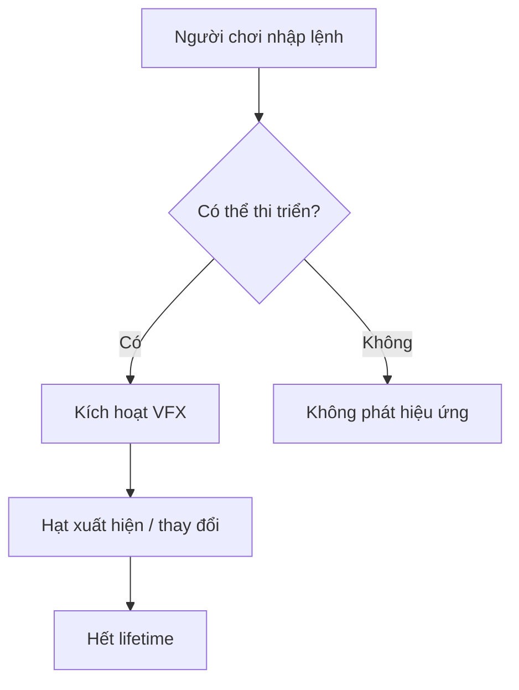

# Bài 07 — Challenge: Add some magic to your scene

> **Nguồn:** [Unity Learn — Visual Effects](https://learn.unity.com/pathway/game-development/unit/visual-effects?version=6.3). Tài liệu học tập tự biên soạn, không phải bản dịch hay nội dung chính thức của Unity.

## 1. Mục tiêu học tập

- Hiểu vai trò của chủ đề **Challenge: Add some magic to your scene** trong phát triển trò chơi.
- Thực hành một scene nhỏ có kết quả quan sát được.
- Kiểm tra lỗi bằng Inspector, Console và Play mode.

## 2. Kiến thức cơ sở

- **Scene** là không gian chứa GameObject.
- **Component** cung cấp dữ liệu và hành vi cho GameObject.
- **Particle System** cho phép tạo hiệu ứng như bụi, lửa, khói và phép thuật.
- **Emission**, **Shape**, **Lifetime** và **Renderer** ảnh hưởng đến cách hạt được phát, chuyển động và hiển thị.

## 3. Chuyên đề thực hành — Đề bài thực hành phép thuật

**Mục tiêu sản phẩm:** nhấn một phím để phát hiệu ứng phép thuật tại vị trí nhân vật hoặc một điểm chọn trước.

**Tiêu chí đánh giá:**
- Có trạng thái trước và sau khi kích hoạt.
- Có ít nhất hai lớp hình ảnh khác nhau (ví dụ: ánh sáng bùng lên và tàn hạt bay).
- Hiệu ứng dừng đúng lúc, không tạo hạt vô hạn.
- Có ảnh/video chứng minh và ghi kết quả FPS.

**Mở rộng:** thử hai phiên bản với độ sáng, mật độ và thời lượng khác nhau; trình bày bản phù hợp với gameplay hơn.

## 4. Quy trình kiểm chứng

1. Xác định kết quả mong đợi trong Game view.
2. Tạo scene thử nghiệm, thay đổi từng tham số một.
3. Chạy Play mode, theo dõi Console và hiệu năng.
4. Chụp ảnh/video kết quả, giải thích một trường hợp lỗi và cách khắc phục.

## 5. Checklist hoàn thành

- [ ] Có scene hoặc project minh họa hoạt động.
- [ ] Giải thích được ít nhất ba khái niệm áp dụng.
- [ ] Có ảnh/video minh chứng.
- [ ] Có ghi chú lỗi và hướng kiểm tra.

*Lưu ý: Các thao tác và giao diện có thể khác giữa phiên bản Unity hoặc render pipeline.*
