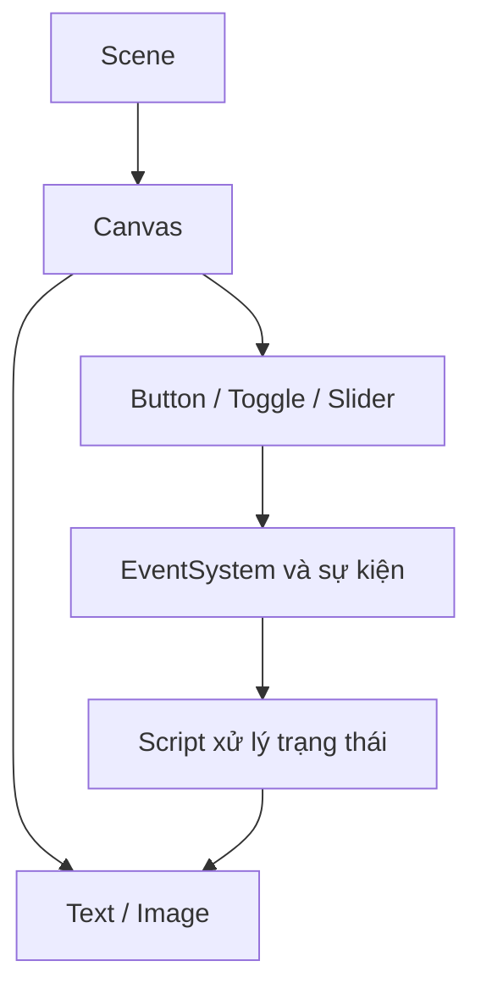

# Bài 01 — Giới thiệu Unit 7 — Giao diện người dùng

> **Unity Game Development · Unit 7 — User Interfaces · Unity 6.3**

> Tài liệu tiếng Việt biên tập và mở rộng từ bản tự biên soạn đã cung cấp; **không phải bản dịch chính thức** của Unity Learn. [Đối chiếu Unity Learn](https://learn.unity.com/pathway/game-development/unit/user-interfaces?version=6.3).

## Mục tiêu

Lập kế hoạch học UI: Canvas, sự kiện tương tác, bố cục và kiểm thử.

## Kiến thức và nguyên tắc

UI thông báo trạng thái và cho phép người chơi tương tác. Các thành phần chính gồm Canvas, RectTransform, EventSystem, Button, Toggle, Slider và TMP Text.

## Quy trình thực hành

1. Liệt kê những vị trí người chơi cần nhìn thông tin: menu, điểm số, trạng thái.
2. Vẽ nhanh sơ đồ giao diện gồm tiêu đề, nút bắt đầu, khu vực điểm.
3. Tạo Scene thử nghiệm, xác định một tương tác có thể kiểm chứng.
4. Đối chiếu checklist với các bài học còn lại trong Unit 7.

## Sơ đồ kiến trúc UI

## Ví dụ mã C#

Mục này tập trung vào thao tác Unity Editor. Khi cần xử lý tương tác, xem mã ở Bài 06, 07 hoặc 10.

## Bài tập vận dụng

- **Cơ bản:** Thực hiện các bước của bài “Giới thiệu Unit 7 — Giao diện người dùng” trong Scene riêng.
- **Nâng cao:** Thay đổi một thông số chính, dự đoán kết quả trước khi chạy.
- **Minh chứng:** Chụp Game view, ghi kết quả kỳ vọng và kết quả thực tế.

## Tiêu chí hoàn thành

- [ ] Phân biệt UI trong game với đối tượng của Scene.
- [ ] Có sơ đồ bố cục và kế hoạch kiểm thử.
- [ ] Có minh chứng chạy thử và giải thích được ít nhất một lỗi.

## Gỡ lỗi nhanh

| Hiện tượng | Nơi cần kiểm tra |
|---|---|
| Không thấy UI | Canvas, trạng thái active, màu/alpha, thứ tự lớp |
| Không thể bấm nút | EventSystem, Graphic Raycaster, Raycast Target, Button |
| Bố cục lệch khi resize | Anchor, Pivot, Canvas Scaler, Layout Group |
| Không cập nhật văn bản | Tham chiếu TMP_Text, dữ liệu, Console |

## Ghi chú về nguồn

Tệp nguồn là tài liệu tự biên soạn theo đề mục công khai và nhiều bài dùng phần thực hành chung. Bản này bổ sung hướng dẫn riêng cho từng chủ đề; đây là các ví dụ độc lập, không được coi là nội dung hoặc đáp án chính thức của Unity.

**Nguồn:** [Unity Learn — User interfaces](https://learn.unity.com/pathway/game-development/unit/user-interfaces?version=6.3).
