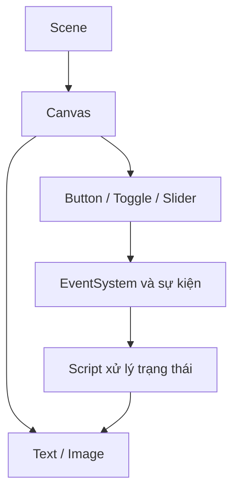

# Bài 02 — Bắt đầu với giao diện người dùng

> **Unity Game Development · Unit 7 — User Interfaces · Unity 6.3**

> Tài liệu tiếng Việt biên tập và mở rộng từ bản tự biên soạn đã cung cấp; **không phải bản dịch chính thức** của Unity Learn. [Đối chiếu Unity Learn](https://learn.unity.com/pathway/game-development/unit/user-interfaces?version=6.3).

## Mục tiêu

Tạo Canvas và các thành phần UI đầu tiên.

## Kiến thức và nguyên tắc

**Canvas** quản lý không gian hiển thị UI. **RectTransform** điều khiển vị trí và kích thước. **EventSystem** xử lý đầu vào tương tác.

## Quy trình thực hành

1. Mở Scene, tạo **GameObject > UI > Canvas**; kiểm tra EventSystem.
2. Thêm **UI > Text - TextMeshPro** và **UI > Button - TextMeshPro**.
3. Sắp xếp các đối tượng trong Hierarchy, đổi tên dễ hiểu.
4. Chạy Play Mode, quan sát các phần tử trong Game view.

## Sơ đồ kiến trúc UI

## Ví dụ mã C#

Mục này tập trung vào thao tác Unity Editor. Khi cần xử lý tương tác, xem mã ở Bài 06, 07 hoặc 10.

## Bài tập vận dụng

- **Cơ bản:** Thực hiện các bước của bài “Bắt đầu với giao diện người dùng” trong Scene riêng.
- **Nâng cao:** Thay đổi một thông số chính, dự đoán kết quả trước khi chạy.
- **Minh chứng:** Chụp Game view, ghi kết quả kỳ vọng và kết quả thực tế.

## Tiêu chí hoàn thành

- [ ] Canvas hiển thị Text và Button.
- [ ] EventSystem có mặt và Play Mode không báo lỗi UI.
- [ ] Có minh chứng chạy thử và giải thích được ít nhất một lỗi.

## Gỡ lỗi nhanh

| Hiện tượng | Nơi cần kiểm tra |
|---|---|
| Không thấy UI | Canvas, trạng thái active, màu/alpha, thứ tự lớp |
| Không thể bấm nút | EventSystem, Graphic Raycaster, Raycast Target, Button |
| Bố cục lệch khi resize | Anchor, Pivot, Canvas Scaler, Layout Group |
| Không cập nhật văn bản | Tham chiếu TMP_Text, dữ liệu, Console |

## Ghi chú về nguồn

Tệp nguồn là tài liệu tự biên soạn theo đề mục công khai và nhiều bài dùng phần thực hành chung. Bản này bổ sung hướng dẫn riêng cho từng chủ đề; đây là các ví dụ độc lập, không được coi là nội dung hoặc đáp án chính thức của Unity.

**Nguồn:** [Unity Learn — User interfaces](https://learn.unity.com/pathway/game-development/unit/user-interfaces?version=6.3).
