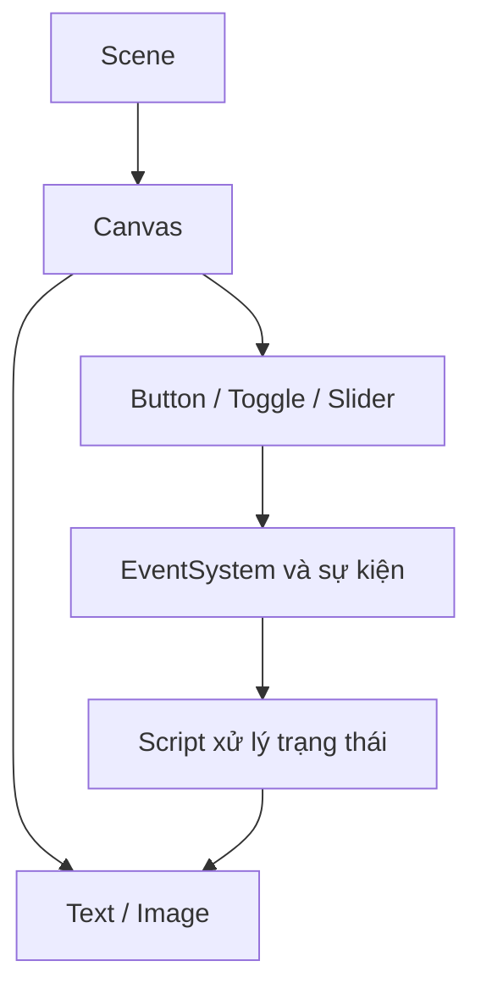

# Bài 04 — Quản lý kích thước màn hình và Anchor

> **Unity Game Development · Unit 7 — User Interfaces · Unity 6.3**

> Tài liệu tiếng Việt biên tập và mở rộng từ bản tự biên soạn đã cung cấp; **không phải bản dịch chính thức** của Unity Learn. [Đối chiếu Unity Learn](https://learn.unity.com/pathway/game-development/unit/user-interfaces?version=6.3).

## Mục tiêu

Giữ UI ổn định khi thay đổi độ phân giải.

## Kiến thức và nguyên tắc

**Anchors** xác định vị trí tương đối với phần tử cha; **Canvas Scaler** quy định cách thu phóng UI khi độ phân giải thay đổi.

## Quy trình thực hành

1. Chọn Canvas, chỉnh **Canvas Scaler > UI Scale Mode > Scale With Screen Size**.
2. Chọn Reference Resolution (ví dụ 1920 × 1080 cho giao diện ngang).
3. Đặt Anchor Presets: góc trên trái cho điểm, giữa cho menu.
4. Thử Game view 16:9, 4:3 và 9:16; điều chỉnh Match Width Or Height theo nhu cầu.

## Sơ đồ kiến trúc UI

## Ví dụ mã C#

Mục này tập trung vào thao tác Unity Editor. Khi cần xử lý tương tác, xem mã ở Bài 06, 07 hoặc 10.

## Bài tập vận dụng

- **Cơ bản:** Thực hiện các bước của bài “Quản lý kích thước màn hình và Anchor” trong Scene riêng.
- **Nâng cao:** Thay đổi một thông số chính, dự đoán kết quả trước khi chạy.
- **Minh chứng:** Chụp Game view, ghi kết quả kỳ vọng và kết quả thực tế.

## Tiêu chí hoàn thành

- [ ] HUD giữ đúng góc màn hình khi đổi kích thước.
- [ ] Menu vẫn nằm ở vị trí dự kiến.
- [ ] Có minh chứng chạy thử và giải thích được ít nhất một lỗi.

## Gỡ lỗi nhanh

| Hiện tượng | Nơi cần kiểm tra |
|---|---|
| Không thấy UI | Canvas, trạng thái active, màu/alpha, thứ tự lớp |
| Không thể bấm nút | EventSystem, Graphic Raycaster, Raycast Target, Button |
| Bố cục lệch khi resize | Anchor, Pivot, Canvas Scaler, Layout Group |
| Không cập nhật văn bản | Tham chiếu TMP_Text, dữ liệu, Console |

## Ghi chú về nguồn

Tệp nguồn là tài liệu tự biên soạn theo đề mục công khai và nhiều bài dùng phần thực hành chung. Bản này bổ sung hướng dẫn riêng cho từng chủ đề; đây là các ví dụ độc lập, không được coi là nội dung hoặc đáp án chính thức của Unity.

**Nguồn:** [Unity Learn — User interfaces](https://learn.unity.com/pathway/game-development/unit/user-interfaces?version=6.3).
