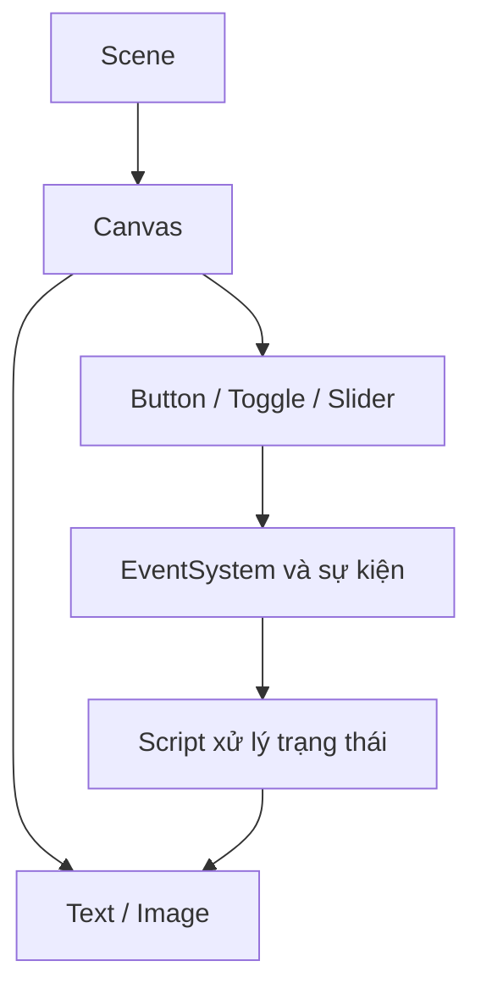

# Bài 05 — Tạo hình nền cho menu bằng Image

> **Unity Game Development · Unit 7 — User Interfaces · Unity 6.3**

> Tài liệu tiếng Việt biên tập và mở rộng từ bản tự biên soạn đã cung cấp; **không phải bản dịch chính thức** của Unity Learn. [Đối chiếu Unity Learn](https://learn.unity.com/pathway/game-development/unit/user-interfaces?version=6.3).

## Mục tiêu

Dùng UI Image, Sprite và thứ tự hiển thị.

## Kiến thức và nguyên tắc

**UI Image** hiển thị Sprite. Thứ tự các phần tử UI cùng Canvas quyết định lớp trước/sau; hình nền nên đứng phía sau các nút và nhãn.

## Quy trình thực hành

1. Nhập ảnh nền vào Assets và đổi Texture Type thành **Sprite (2D and UI)** nếu cần.
2. Tạo **UI > Image** bên trong Canvas, gán sprite vào Source Image.
3. Đặt Image nằm trước các phần tử menu trong Hierarchy để nó ở phía sau về thứ tự vẽ.
4. Đặt anchors kéo giãn để phủ vùng menu; kiểm tra Preserve Aspect hoặc cách crop phù hợp.

## Sơ đồ kiến trúc UI

## Ví dụ mã C#

Mục này tập trung vào thao tác Unity Editor. Khi cần xử lý tương tác, xem mã ở Bài 06, 07 hoặc 10.

## Bài tập vận dụng

- **Cơ bản:** Thực hiện các bước của bài “Tạo hình nền cho menu bằng Image” trong Scene riêng.
- **Nâng cao:** Thay đổi một thông số chính, dự đoán kết quả trước khi chạy.
- **Minh chứng:** Chụp Game view, ghi kết quả kỳ vọng và kết quả thực tế.

## Tiêu chí hoàn thành

- [ ] Hình nền không che nội dung menu.
- [ ] Ảnh hiển thị đúng tỷ lệ mong muốn.
- [ ] Có minh chứng chạy thử và giải thích được ít nhất một lỗi.

## Gỡ lỗi nhanh

| Hiện tượng | Nơi cần kiểm tra |
|---|---|
| Không thấy UI | Canvas, trạng thái active, màu/alpha, thứ tự lớp |
| Không thể bấm nút | EventSystem, Graphic Raycaster, Raycast Target, Button |
| Bố cục lệch khi resize | Anchor, Pivot, Canvas Scaler, Layout Group |
| Không cập nhật văn bản | Tham chiếu TMP_Text, dữ liệu, Console |

## Ghi chú về nguồn

Tệp nguồn là tài liệu tự biên soạn theo đề mục công khai và nhiều bài dùng phần thực hành chung. Bản này bổ sung hướng dẫn riêng cho từng chủ đề; đây là các ví dụ độc lập, không được coi là nội dung hoặc đáp án chính thức của Unity.

**Nguồn:** [Unity Learn — User interfaces](https://learn.unity.com/pathway/game-development/unit/user-interfaces?version=6.3).
