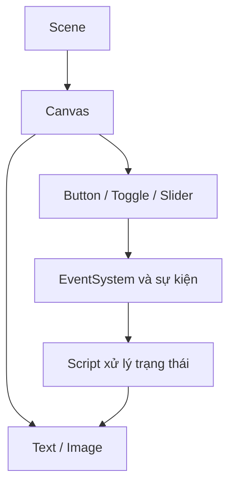

# Bài 06 — Thêm chức năng cơ bản cho Button

> **Unity Game Development · Unit 7 — User Interfaces · Unity 6.3**

> Tài liệu tiếng Việt biên tập và mở rộng từ bản tự biên soạn đã cung cấp; **không phải bản dịch chính thức** của Unity Learn. [Đối chiếu Unity Learn](https://learn.unity.com/pathway/game-development/unit/user-interfaces?version=6.3).

## Mục tiêu

Kết nối nút bấm với sự kiện On Click().

## Kiến thức và nguyên tắc

**Button.onClick** phát sự kiện khi kích hoạt. Bạn có thể gắn phương thức `public` từ một MonoBehaviour trong Inspector.

## Quy trình thực hành

1. Tạo Button trong Canvas và đặt tên `StartButton`.
2. Tạo GameObject `UIController`, gắn script chứa phương thức `public void StartGame()`.
3. Ở Button > **On Click()**, nhấn `+`, kéo `UIController` vào ô đối tượng và chọn phương thức.
4. Vào Play Mode, nhấn nút và xác minh phản hồi trong Console hoặc trạng thái Scene.

## Sơ đồ kiến trúc UI



## Ví dụ mã C#

```csharp
using UnityEngine;

public class UIController : MonoBehaviour
{
    public void StartGame()
    {
        Debug.Log("Người chơi đã nhấn Bắt đầu");
        // Thay bằng logic bắt đầu trò chơi của bạn.
    }
}
```

## Bài tập vận dụng

- **Cơ bản:** Thực hiện các bước của bài “Thêm chức năng cơ bản cho Button” trong Scene riêng.
- **Nâng cao:** Thay đổi một thông số chính, dự đoán kết quả trước khi chạy.
- **Minh chứng:** Chụp Game view, ghi kết quả kỳ vọng và kết quả thực tế.

## Tiêu chí hoàn thành

- [ ] Bấm nút gọi đúng phương thức.
- [ ] Không còn tham chiếu bị thiếu trong Inspector.
- [ ] Có minh chứng chạy thử và giải thích được ít nhất một lỗi.

## Gỡ lỗi nhanh

| Hiện tượng | Nơi cần kiểm tra |
|---|---|
| Không thấy UI | Canvas, trạng thái active, màu/alpha, thứ tự lớp |
| Không thể bấm nút | EventSystem, Graphic Raycaster, Raycast Target, Button |
| Bố cục lệch khi resize | Anchor, Pivot, Canvas Scaler, Layout Group |
| Không cập nhật văn bản | Tham chiếu TMP_Text, dữ liệu, Console |

## Ghi chú về nguồn

Tệp nguồn là tài liệu tự biên soạn theo đề mục công khai và nhiều bài dùng phần thực hành chung. Bản này bổ sung hướng dẫn riêng cho từng chủ đề; đây là các ví dụ độc lập, không được coi là nội dung hoặc đáp án chính thức của Unity.

**Nguồn:** [Unity Learn — User interfaces](https://learn.unity.com/pathway/game-development/unit/user-interfaces?version=6.3).
