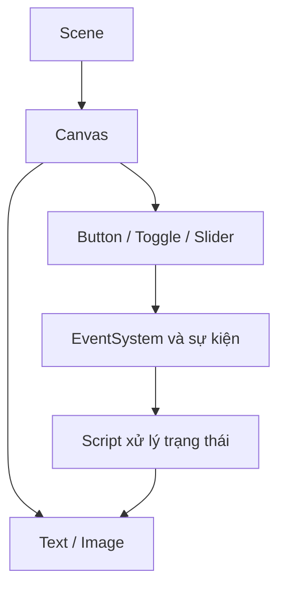

# Bài 07 — Thêm Toggle và Slider

> **Unity Game Development · Unit 7 — User Interfaces · Unity 6.3**

> Tài liệu tiếng Việt biên tập và mở rộng từ bản tự biên soạn đã cung cấp; **không phải bản dịch chính thức** của Unity Learn. [Đối chiếu Unity Learn](https://learn.unity.com/pathway/game-development/unit/user-interfaces?version=6.3).

## Mục tiêu

Tạo thiết lập bật/tắt và thanh giá trị.

## Kiến thức và nguyên tắc

**Toggle** xuất trạng thái `bool`; **Slider** xuất giá trị `float`. `On Value Changed` giúp thay đổi thiết lập khi người chơi thao tác.

## Quy trình thực hành

1. Tạo **UI > Toggle** cho tùy chọn âm thanh, đặt nhãn rõ nghĩa.
2. Tạo **UI > Slider**, cấu hình Min Value và Max Value.
3. Gắn On Value Changed của Toggle/Slider vào phương thức nhận `bool` hoặc `float`.
4. Thử kéo Slider, bật/tắt Toggle và đối chiếu phản hồi ở Game view.

## Sơ đồ kiến trúc UI



## Ví dụ mã C#

```csharp
using UnityEngine;

public class SettingsUI : MonoBehaviour
{
    public void SetSoundEnabled(bool enabled)
    {
        AudioListener.pause = !enabled;
    }

    public void SetVolume(float volume)
    {
        AudioListener.volume = Mathf.Clamp01(volume);
    }
}
```

> Ví dụ này minh họa hai sự kiện độc lập. Nếu dùng cả hai điều khiển cùng lúc, nên quản lý bật/tắt âm thanh và âm lượng ở một nơi để tránh trạng thái chồng chéo.

## Bài tập vận dụng

- **Cơ bản:** Thực hiện các bước của bài “Thêm Toggle và Slider” trong Scene riêng.
- **Nâng cao:** Thay đổi một thông số chính, dự đoán kết quả trước khi chạy.
- **Minh chứng:** Chụp Game view, ghi kết quả kỳ vọng và kết quả thực tế.

## Tiêu chí hoàn thành

- [ ] Toggle phản ánh đúng trạng thái bật/tắt.
- [ ] Slider chuyển giá trị đúng dải.
- [ ] Có minh chứng chạy thử và giải thích được ít nhất một lỗi.

## Gỡ lỗi nhanh

| Hiện tượng | Nơi cần kiểm tra |
|---|---|
| Không thấy UI | Canvas, trạng thái active, màu/alpha, thứ tự lớp |
| Không thể bấm nút | EventSystem, Graphic Raycaster, Raycast Target, Button |
| Bố cục lệch khi resize | Anchor, Pivot, Canvas Scaler, Layout Group |
| Không cập nhật văn bản | Tham chiếu TMP_Text, dữ liệu, Console |

## Ghi chú về nguồn

Tệp nguồn là tài liệu tự biên soạn theo đề mục công khai và nhiều bài dùng phần thực hành chung. Bản này bổ sung hướng dẫn riêng cho từng chủ đề; đây là các ví dụ độc lập, không được coi là nội dung hoặc đáp án chính thức của Unity.

**Nguồn:** [Unity Learn — User interfaces](https://learn.unity.com/pathway/game-development/unit/user-interfaces?version=6.3).
