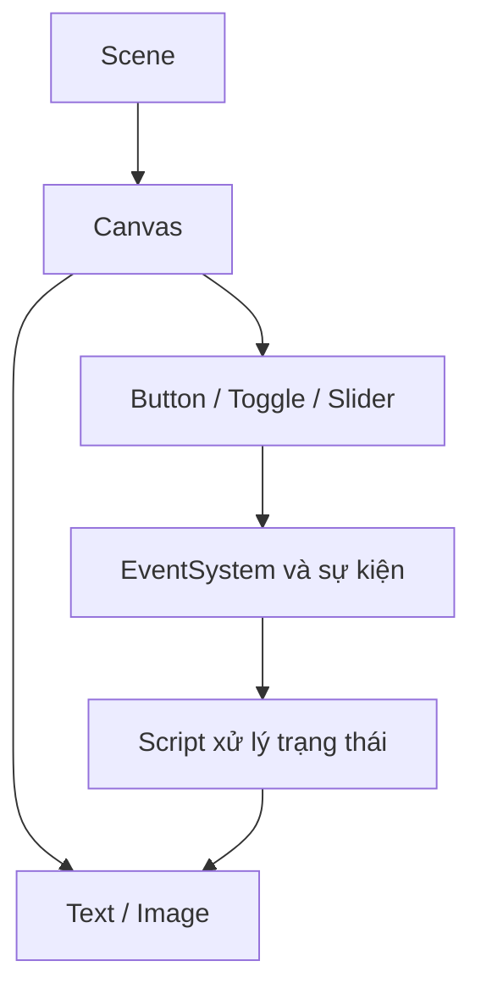

# Bài 10 — Tích hợp UI vào trò chơi

> **Unity Game Development · Unit 7 — User Interfaces · Unity 6.3**

> Tài liệu tiếng Việt biên tập và mở rộng từ bản tự biên soạn đã cung cấp; **không phải bản dịch chính thức** của Unity Learn. [Đối chiếu Unity Learn](https://learn.unity.com/pathway/game-development/unit/user-interfaces?version=6.3).

## Mục tiêu

Kết nối menu, điểm số và trạng thái game.

## Kiến thức và nguyên tắc

UI có thể chia thành các panel theo trạng thái trò chơi; chỉ cập nhật nhãn điểm khi dữ liệu thay đổi thay vì mỗi frame.

## Quy trình thực hành

1. Tạo `MainMenuPanel`, `HUDPanel`, `GameOverPanel` bên trong Canvas.
2. Chỉ bật panel thích hợp theo trạng thái menu, đang chơi hoặc game over.
3. Gắn Button Start/Restart với phương thức chuyển trạng thái.
4. Cho dữ liệu điểm thay đổi và chỉ cập nhật nhãn khi có thay đổi.

## Sơ đồ kiến trúc UI



## Ví dụ mã C#

```csharp
using TMPro;
using UnityEngine;

public class ScoreDisplay : MonoBehaviour
{
    [SerializeField] private TMP_Text scoreLabel;
    private int score;

    private void Start() => Refresh();

    public void AddPoint()
    {
        score++;
        Refresh();
    }

    private void Refresh()
    {
        if (scoreLabel != null)
            scoreLabel.text = $"Điểm: {score}";
    }
}
```

## Bài tập vận dụng

- **Cơ bản:** Thực hiện các bước của bài “Tích hợp UI vào trò chơi” trong Scene riêng.
- **Nâng cao:** Thay đổi một thông số chính, dự đoán kết quả trước khi chạy.
- **Minh chứng:** Chụp Game view, ghi kết quả kỳ vọng và kết quả thực tế.

## Tiêu chí hoàn thành

- [ ] Chuyển trạng thái menu/đang chơi/kết thúc rõ ràng.
- [ ] Số điểm hiển thị đúng khi dữ liệu thay đổi.
- [ ] Có minh chứng chạy thử và giải thích được ít nhất một lỗi.

## Gỡ lỗi nhanh

| Hiện tượng | Nơi cần kiểm tra |
|---|---|
| Không thấy UI | Canvas, trạng thái active, màu/alpha, thứ tự lớp |
| Không thể bấm nút | EventSystem, Graphic Raycaster, Raycast Target, Button |
| Bố cục lệch khi resize | Anchor, Pivot, Canvas Scaler, Layout Group |
| Không cập nhật văn bản | Tham chiếu TMP_Text, dữ liệu, Console |

## Ghi chú về nguồn

Tệp nguồn là tài liệu tự biên soạn theo đề mục công khai và nhiều bài dùng phần thực hành chung. Bản này bổ sung hướng dẫn riêng cho từng chủ đề; đây là các ví dụ độc lập, không được coi là nội dung hoặc đáp án chính thức của Unity.

**Nguồn:** [Unity Learn — User interfaces](https://learn.unity.com/pathway/game-development/unit/user-interfaces?version=6.3).
