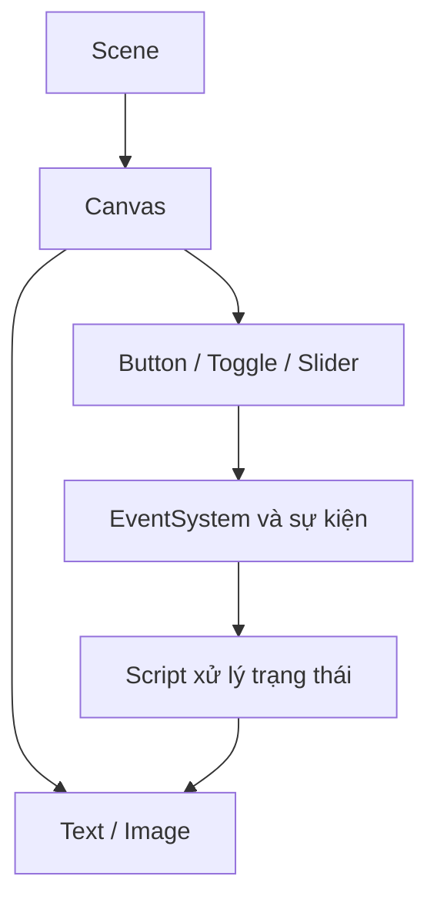

# Bài 08 — Thử thách: Tạo UI trong không gian 3D

> **Unity Game Development · Unit 7 — User Interfaces · Unity 6.3**

> Tài liệu tiếng Việt biên tập và mở rộng từ bản tự biên soạn đã cung cấp; **không phải bản dịch chính thức** của Unity Learn. [Đối chiếu Unity Learn](https://learn.unity.com/pathway/game-development/unit/user-interfaces?version=6.3).

## Mục tiêu

Đặt Canvas ở World Space và kiểm tra tương tác.

## Kiến thức và nguyên tắc

Canvas ở **World Space** tồn tại trong thế giới 3D, có vị trí, hướng và kích thước theo đơn vị Scene; cần kiểm tra Camera và raycast.

## Quy trình thực hành

1. Tạo Canvas, đặt **Render Mode = World Space**.
2. Chỉnh RectTransform và Scale của Canvas để phù hợp kích thước trong Scene.
3. Đặt Canvas gần một đối tượng 3D và hướng về Camera phù hợp.
4. Kiểm tra camera, EventSystem, raycaster và tương tác khi chơi.

## Sơ đồ kiến trúc UI

## Ví dụ mã C#

Mục này tập trung vào thao tác Unity Editor. Khi cần xử lý tương tác, xem mã ở Bài 06, 07 hoặc 10.

## Bài tập vận dụng

- **Cơ bản:** Thực hiện các bước của bài “Thử thách: Tạo UI trong không gian 3D” trong Scene riêng.
- **Nâng cao:** Thay đổi một thông số chính, dự đoán kết quả trước khi chạy.
- **Minh chứng:** Chụp Game view, ghi kết quả kỳ vọng và kết quả thực tế.

## Tiêu chí hoàn thành

- [ ] UI ở vị trí trong thế giới 3D.
- [ ] Người chơi quan sát và tương tác được với UI.
- [ ] Có minh chứng chạy thử và giải thích được ít nhất một lỗi.

## Gỡ lỗi nhanh

| Hiện tượng | Nơi cần kiểm tra |
|---|---|
| Không thấy UI | Canvas, trạng thái active, màu/alpha, thứ tự lớp |
| Không thể bấm nút | EventSystem, Graphic Raycaster, Raycast Target, Button |
| Bố cục lệch khi resize | Anchor, Pivot, Canvas Scaler, Layout Group |
| Không cập nhật văn bản | Tham chiếu TMP_Text, dữ liệu, Console |

## Ghi chú về nguồn

Tệp nguồn là tài liệu tự biên soạn theo đề mục công khai và nhiều bài dùng phần thực hành chung. Bản này bổ sung hướng dẫn riêng cho từng chủ đề; đây là các ví dụ độc lập, không được coi là nội dung hoặc đáp án chính thức của Unity.

**Nguồn:** [Unity Learn — User interfaces](https://learn.unity.com/pathway/game-development/unit/user-interfaces?version=6.3).
