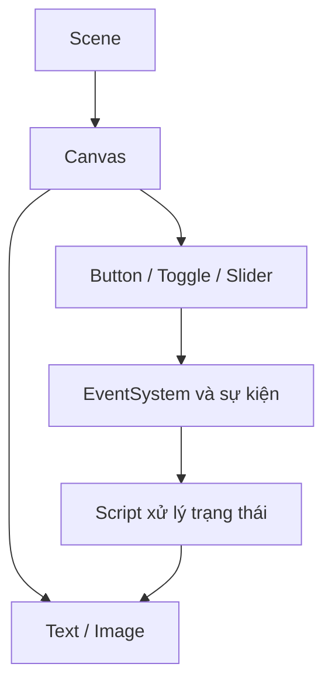

# Bài 11 — Ôn tập và tự đánh giá kiến thức UI

> **Unity Game Development · Unit 7 — User Interfaces · Unity 6.3**

> Tài liệu tiếng Việt biên tập và mở rộng từ bản tự biên soạn đã cung cấp; **không phải bản dịch chính thức** của Unity Learn. [Đối chiếu Unity Learn](https://learn.unity.com/pathway/game-development/unit/user-interfaces?version=6.3).

## Mục tiêu

Kiểm tra kiến thức thông qua câu hỏi và bài thực hành.

## Kiến thức và nguyên tắc

Các khái niệm cần nắm: Canvas, RectTransform, Canvas Scaler, Anchors, EventSystem, Image, Button, Toggle, Slider, TextMeshPro và sự kiện.

## Quy trình thực hành

1. Tự trả lời câu hỏi trước khi nhìn lại tài liệu.
2. Tạo Scene nhỏ có Text, Button, Toggle và Slider.
3. Đổi độ phân giải để kiểm tra anchors và Canvas Scaler.
4. Ghi lại một lỗi, cách kiểm tra trong Console/Inspector và cách khắc phục.

## Sơ đồ kiến trúc UI

## Ví dụ mã C#

Mục này tập trung vào thao tác Unity Editor. Khi cần xử lý tương tác, xem mã ở Bài 06, 07 hoặc 10.

## Bài tập vận dụng

- **Cơ bản:** Thực hiện các bước của bài “Ôn tập và tự đánh giá kiến thức UI” trong Scene riêng.
- **Nâng cao:** Thay đổi một thông số chính, dự đoán kết quả trước khi chạy.
- **Minh chứng:** Chụp Game view, ghi kết quả kỳ vọng và kết quả thực tế.

## Tiêu chí hoàn thành

- [ ] Giải thích được Canvas, RectTransform, Anchor và EventSystem.
- [ ] Tạo được tương tác hoàn chỉnh và nêu cách debug.
- [ ] Có minh chứng chạy thử và giải thích được ít nhất một lỗi.

## Gỡ lỗi nhanh

| Hiện tượng | Nơi cần kiểm tra |
|---|---|
| Không thấy UI | Canvas, trạng thái active, màu/alpha, thứ tự lớp |
| Không thể bấm nút | EventSystem, Graphic Raycaster, Raycast Target, Button |
| Bố cục lệch khi resize | Anchor, Pivot, Canvas Scaler, Layout Group |
| Không cập nhật văn bản | Tham chiếu TMP_Text, dữ liệu, Console |

## Ghi chú về nguồn

Tệp nguồn là tài liệu tự biên soạn theo đề mục công khai và nhiều bài dùng phần thực hành chung. Bản này bổ sung hướng dẫn riêng cho từng chủ đề; đây là các ví dụ độc lập, không được coi là nội dung hoặc đáp án chính thức của Unity.

**Nguồn:** [Unity Learn — User interfaces](https://learn.unity.com/pathway/game-development/unit/user-interfaces?version=6.3).
