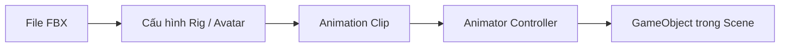

# Bài 06 — Nhập animation từ bên ngoài

> **Nguồn tham khảo:** [Unity Learn — Animation](https://learn.unity.com/pathway/game-development/unit/animation?version=6.3). Đây là tài liệu **tự biên soạn bằng tiếng Việt dựa trên chủ đề và file được cung cấp**, không phải bản dịch nguyên văn của Unity Learn.

## 1. Mục tiêu

Nhập model và clip có sẵn vào Unity.

**Kết quả cần đạt:** Model chạy được clip nhập, không lỗi Avatar hoặc rig.

## 2. Kiến thức cốt lõi

File FBX có thể chứa mesh, skeleton và animation clips. Tab Rig chọn Generic hoặc Humanoid; Avatar phù hợp giúp retarget. Tab Animation chỉnh clip và looping.

| Thuật ngữ | Ý nghĩa |
|---|---|
| Animation Clip | Tập hợp chuyển đổi thuộc tính theo thời gian |
| Keyframe | Mốc thời gian lưu giá trị của thuộc tính |
| Animator Controller | Điều phối trạng thái và chuyển tiếp animation |
| Animator Component | Thành phần phát animation trên GameObject |

## 3. Thực hành trong Unity Editor

Kéo FBX vào Assets, kiểm tra Model > Scale, Rig > Animation Type và Avatar, Animation > Clips; Apply; kéo model vào scene và gán clip qua Animator Controller.

**Quy trình kiểm tra:** mở Scene và Game view → xem Inspector/Animator → nhấn Play → quan sát khác biệt giữa kết quả mong đợi và kết quả thực tế.

## 4. Minh họa / ví dụ

## 5. Sự cố thường gặp

| Hiện tượng | Nguyên nhân cần kiểm tra |
|---|---|
| Animation không chạy | Animator chưa được gán Controller hoặc clip không có keyframe đúng thuộc tính |
| Chuyển state không thành công | Sai tên parameter, Conditions hoặc Has Exit Time |
| Model biến dạng bất thường | Rig/Avatar không tương thích hoặc import scale sai |
| Chuyển động bị giật | Keyframe, curve, timing hoặc script khác cùng điều khiển thuộc tính |

## 6. Checklist hoàn thành

- [ ] Hiểu khái niệm chính của bài học.
- [ ] Tạo hoặc chạy thử được ví dụ trong Unity.
- [ ] Ghi lại ảnh/video chứng minh kết quả.
- [ ] Nêu ít nhất một lỗi và cách kiểm tra.
- [ ] Đối chiếu tài nguyên và hướng dẫn chính thức tại Unity Learn.

> **Lưu ý:** Giao diện Editor và một số lựa chọn Import/Animation có thể khác nhau giữa các phiên bản Unity. Ví dụ dùng Unity 6.3 làm mốc tham khảo.
