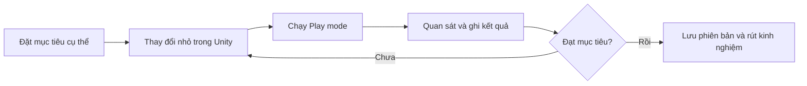

# Bài 01 — Introduction to Unit 11

> **Chủ đề:** Giới thiệu phương pháp cải tiến game. **Nguồn tham khảo:** [Unity Learn – Iterate on your game](https://learn.unity.com/pathway/game-development/unit/iterate-on-your-game?version=6.3). Nội dung này không phải toàn văn hoặc bản dịch chính thức.

## 1. Mục tiêu học tập

- Hiểu vấn đề cần giải quyết và mô tả kết quả mong đợi.
- Thực hành trong Unity Editor thông qua một ví dụ nhỏ.
- Chạy kiểm thử, xác định lỗi và ghi lại cải tiến.

## 2. Kiến thức nền tảng

Nên bắt đầu từ một mục tiêu cụ thể, thử với scene nhỏ, sử dụng các thành phần GameObject, Component, Inspector và Play mode để đánh giá kết quả. Chỉ thay đổi một yếu tố mỗi lần để dễ xác định ảnh hưởng.

## 3. Bài thực hành

1. Mở project và scene thử nghiệm trong Unity.
2. Chọn một nhiệm vụ liên quan đến **Giới thiệu phương pháp cải tiến game** và xác định tiêu chí đạt.
3. Thực hiện một thay đổi nhỏ, lưu scene, chạy Play mode và đọc Console.
4. Ghi lại kết quả trước/sau, các lỗi xuất hiện và cách khắc phục.

## 4. Ghi chép kiểm thử

| Mong đợi | Thực tế | Minh chứng | Điều chỉnh tiếp theo |
|---|---|---|---|
| Điền trước khi chạy | Điền sau kiểm thử | Ảnh/Console | Quyết định giữ hay sửa |

## 5. Checklist

- [ ] Hoàn thành một tình huống thực hành.
- [ ] Có kết quả quan sát và minh chứng.
- [ ] Giải thích được ít nhất một vấn đề.
- [ ] Đối chiếu lại nội dung chính thức trên Unity Learn.

---

## Sơ đồ: Quy trình học theo vòng lặp

**Ví dụ minh họa bổ sung:** Đặt mục tiêu “người chơi di chuyển được bằng phím A/D”, thử thay đổi một biến tốc độ và so sánh kết quả trước–sau. Đây là ví dụ tự biên soạn, không phải chỉ dẫn nguyên văn của Unity Learn.

---

*Ghi chú phiên bản:* Cần kiểm tra UI và tài liệu tương ứng với phiên bản Unity đang sử dụng.
