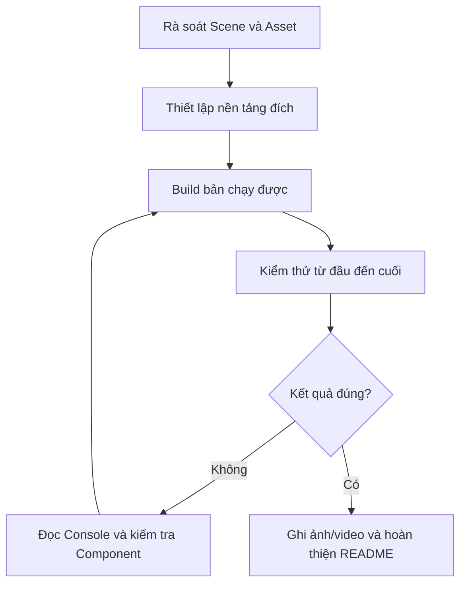
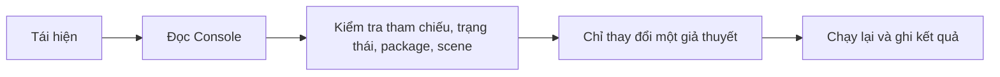

# Bài 01 — Chuẩn bị cho kỳ thi UCA Game Dev

> **Lộ trình:** Game Development · **Chủ đề:** Prepare for certification and publishing · **Unity:** 6.3

> **Phạm vi:** Hướng dẫn tiếng Việt tự biên soạn theo đề mục công khai, không phải bản dịch hay đề thi chính thức của Unity. [Xem chủ đề gốc trên Unity Learn](https://learn.unity.com/pathway/game-development/unit/prepare-for-certification-and-publishing?version=6.3).

## 1. Tổng quan

Bài học tập trung vào việc **chuẩn bị năng lực thực hành** và bằng chứng dự án trước khi tham gia đánh giá UCA Game Dev. Việc học cần gắn với thao tác quan sát được trong Unity Editor và kiểm chứng bằng một bản build chạy được. Tệp nguồn chỉ cung cấp hướng dẫn khái quát, **không liệt kê cấu trúc đề thi hay ngân hàng câu hỏi chính thức**.

## 2. Mục tiêu học tập

- Hiểu vai trò của việc hoàn thiện, xuất bản và trình bày dự án Unity.
- Tự thực hiện một thử nghiệm nhỏ và mô tả được kết quả.
- Nhận biết ít nhất một lỗi thường gặp và chứng minh cách tìm hoặc sửa lỗi.

## 3. Kiến thức trọng tâm

| Khái niệm | Ý nghĩa trong thực hành |
|---|---|
| **Scene** | Không gian chứa các GameObject để thiết kế và thử nghiệm |
| **GameObject** | Đối tượng trong scene, được mở rộng bằng Component |
| **Component** | Đơn vị mang dữ liệu, hành vi và các tham số trong Inspector |
| **Play Mode** | Chạy thử trong Editor để xác minh tương tác |
| **Build** | Phiên bản ứng dụng chạy trên nền tảng mục tiêu, cần kiểm thử riêng |

Cần phân biệt **chạy trong Editor** và **chạy bản build**: đường dẫn tài nguyên, input, cấu hình đồ họa hay giới hạn nền tảng có thể khác nhau. Khi chuẩn bị portfolio, hãy trình bày mục tiêu dự án, vai trò, cách triển khai, kết quả và bài học kinh nghiệm. Trước khi công bố, kiểm tra quyền sử dụng asset, âm thanh và quyền riêng tư.

## 4. Quy trình ôn tập và kiểm chứng

1. **Rà soát Scene và asset:** Kiểm tra tham chiếu, GameObject, Component và scene cần thiết.
2. **Thiết lập bản build:** Chọn nền tảng đích, cấu hình chất lượng và xuất bản chạy thử.
3. **Kiểm thử:** Chạy qua toàn bộ luồng chơi; chụp ảnh hoặc quay video từ ứng dụng, không chỉ từ Editor.
4. **Tài liệu hóa:** Viết `README.md` chứa cách chơi, cấu hình tối thiểu hoặc yêu cầu máy phù hợp, và danh sách lỗi còn biết.

**Mẫu nhật ký kiểm thử:**

| Trường | Nội dung cần ghi |
|---|---|
| Tình huống | Thao tác kiểm tra cụ thể |
| Kỳ vọng | Điều gì phải xảy ra |
| Thực tế | Điều gì thực sự xảy ra |
| Minh chứng | Ảnh, video hoặc Console |
| Kết luận | Nguyên nhân dự đoán và hành động tiếp theo |

## 5. Bài tập củng cố

- **Cơ bản:** Tự tạo hoặc lặp lại ví dụ rồi giải thích chức năng của GameObject và Component.
- **Vận dụng:** Đổi một tham số trong Inspector, dự đoán rồi kiểm chứng ảnh hưởng.
- **Mở rộng:** Tích hợp tương tác nhỏ vào một scene có thể build và chạy độc lập.

**Câu hỏi tự kiểm tra:** Vì sao Game view có thể khác kỳ vọng khi thay đổi Inspector? Cần quan sát GameObject, Component, trạng thái Play Mode và Console như thế nào?

## 6. Gỡ lỗi theo giả thuyết

Những lỗi cần đề phòng: quên đưa scene vào cấu hình build, tính năng chỉ hoạt động trong Editor hoặc dùng tài nguyên có giấy phép không phù hợp.

## 7. Checklist hoàn thành

- [ ] Hiểu vai trò của Scene, GameObject, Component và Play Mode.
- [ ] Chạy được một ví dụ Unity tự tạo.
- [ ] Build được phiên bản hoạt động trên nền tảng đã chọn.
- [ ] Ghi ít nhất một ảnh/video minh chứng.
- [ ] Giải thích một lỗi cùng phương pháp phát hiện.
- [ ] Đối chiếu với [bài học chính thức](https://learn.unity.com/pathway/game-development/unit/prepare-for-certification-and-publishing?version=6.3).

> **Lưu ý:** Giao diện, menu và package có thể thay đổi giữa các phiên bản Unity. Luôn đối chiếu hướng dẫn trong phiên bản Editor đang dùng.
