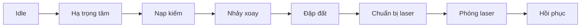

# Bài 01 — Thiết kế storyboard cho tuyệt kỹ dài

> Module: Tạo tuyệt kỹ nhiều giai đoạn với nhảy xoay, đập đất và laser  
> Mức độ: Trung cấp / nâng cao  
> Trích đoạn tham chiếu: T04 00:00–03:35 và 12:00–14:00

## Mục tiêu học tập

Sau bài này, bạn thực hành được quy trình **thiết kế storyboard cho tuyệt kỹ dài**, giải thích nguyên lý lựa chọn kỹ thuật và tự kiểm tra kết quả trong project.

## Trọng tâm
Bản chép lời thứ hai mô tả đòn tấn công nhiều bước: khom người, nạp năng lượng, nhảy, xoay, tiếp đất, trượt và chuẩn bị phóng laser. Vì animation dài, tác giả bắt đầu bằng 5–7 key pose thay vì tô từng frame từ đầu.

### Sơ đồ nhịp

### Quy trình
1. Viết mô tả mỗi pha bằng **hành động**, không bằng hiệu ứng: “hạ người”, “tung lên”, “cắm kiếm”.
2. Chọn tư thế cốt lõi cho từng pha, giữ sprite silhouette ở màu phẳng.
3. Đặt tên frame quan trọng trong bảng shot: `charge`, `spin`, `land`, `beam_fire`.
4. Chạy các key pose: người xem cần hiểu ý đồ ngay cả khi thiếu in-between.
5. Chỉ khi bố cục và nhịp hợp lý mới thêm frame kết nối và lớp VFX.

### Sai lầm cần tránh
Vẽ 20 frame chi tiết cho một pha chưa quyết định được đường chuyển động; khi thay đổi nhịp sẽ phải bỏ phần lớn công việc.

## Bài tập bắt buộc

1. Lập storyboard 8 ô cho tuyệt kỹ.
2. Mỗi ô ghi tên pose, hướng lực và frame đích.

## Tiêu chí hoàn thành

Mọi pha có mục đích rõ, người xem mô tả lại thứ tự hành động được.

## Tự kiểm tra

- Bước nào trong quy trình là điểm khó nhất, và bạn kiểm chứng nó bằng cách nào?
- Nếu bỏ một hiệu ứng, chuyển động chính còn dễ đọc không?
- Tham số hoặc thời điểm nào bạn sẽ điều chỉnh trước khi tối ưu hiệu năng?

## Liên hệ bài kế tiếp

Ghi lại một vấn đề quan sát được khi preview; mang nó vào bài tiếp theo để cải thiện dần thay vì làm mới từ đầu.

**Ghi chú nguồn:** Tài liệu biên soạn từ transcript, không phải bản chép lời nguyên văn. Các bài tập được thêm để người học thực hành.
