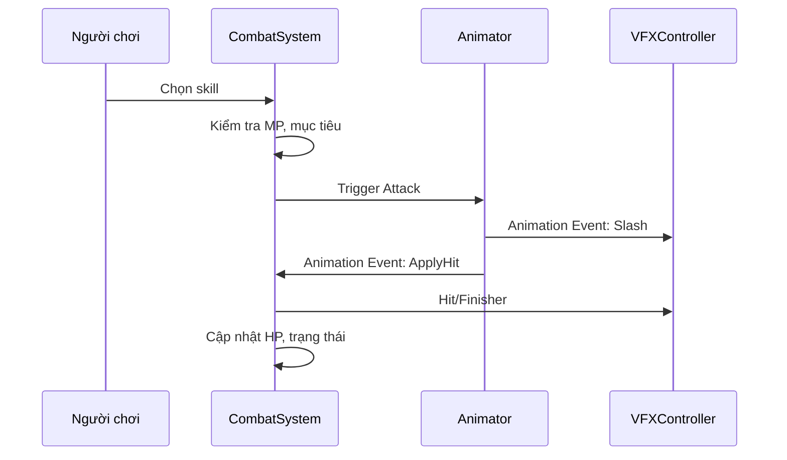

# Bài 01 — Thiết kế pipeline tung skill, trúng đòn và kết liễu

> Module: Đồ án ứng dụng: VFX tung chiêu, kết liễu, hiệu ứng tộc hệ trong game 2D  
> Mức độ: Trung cấp / nâng cao  
> Trích đoạn tham chiếu: Mở rộng từ T01–T07; không có mã C# trực tiếp trong bản chép lời

## Mục tiêu học tập

Sau bài này, bạn thực hành được quy trình **thiết kế pipeline tung skill, trúng đòn và kết liễu**, giải thích nguyên lý lựa chọn kỹ thuật và tự kiểm tra kết quả trong project.

## Mục tiêu
Biến asset học được ở các module trước thành hệ thống gameplay đúng sự kiện: nhân vật vung kiếm, ứng dụng tiêu hao MP, phát VFX, gây sát thương, rồi phản hồi hit/finisher. Đây là **bài mở rộng do biên soạn** để nối các kỹ thuật nguồn với game 2D.

### Sơ đồ sự kiện

### Nguyên tắc
- **Logic quyết định** liệu đòn đánh có hợp lệ; VFX chỉ phản ánh trạng thái đã xác nhận.
- Tách `Cast`, `Projectile`, `Impact`, `Kill`, `Synergy` thành các sự kiện khác nhau.
- Khi người chơi skip animation hoặc frame rate giảm, logic sát thương không được phụ thuộc số hạt còn tồn tại.
- Đưa điểm spawn về toạ độ mục tiêu; không spawn ở (0,0) trừ khi hiệu ứng thuộc world origin.

### Bài thực hành
Lập cue sheet có cột `Time/Frame`, `Owner`, `Event`, `VFX prefab`, `SFX`, `Gameplay effect`. Điền 3 skill: chém thường, laser và kết liễu.

## Bài tập bắt buộc

1. Tạo cue sheet ba skill có mốc gameplay riêng với FX.
2. Vẽ sơ đồ vai trò Animator, Combat và VFX.

## Tiêu chí hoàn thành

Đòn đánh luôn xử lý đúng một lần, kể cả khi animation chạy chậm.

## Tự kiểm tra

- Bước nào trong quy trình là điểm khó nhất, và bạn kiểm chứng nó bằng cách nào?
- Nếu bỏ một hiệu ứng, chuyển động chính còn dễ đọc không?
- Tham số hoặc thời điểm nào bạn sẽ điều chỉnh trước khi tối ưu hiệu năng?

## Liên hệ bài kế tiếp

Ghi lại một vấn đề quan sát được khi preview; mang nó vào bài tiếp theo để cải thiện dần thay vì làm mới từ đầu.

**Ghi chú nguồn:** Tài liệu biên soạn từ transcript, không phải bản chép lời nguyên văn. Các bài tập được thêm để người học thực hành.
