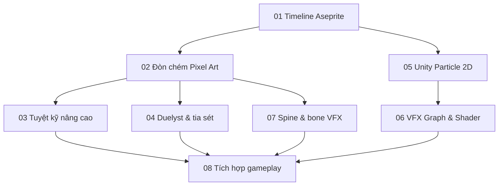

# KHÓA HỌC THỰC HÀNH PIXEL ART ANIMATION & 2D GAME VFX

> Biên soạn tiếng Việt từ **hai bản chép lời đưa trực tiếp** và **sáu tệp Markdown đính kèm** (trong đó có hai tệp nội dung trùng nhau). Bản chép lời có lỗi nhận dạng lời nói; thuật ngữ đã được chuẩn hóa theo ngữ cảnh. Các thao tác không thấy trong hình ảnh video được diễn đạt theo chức năng, **không tự khẳng định vị trí nút chính xác**.

## Đối tượng
Người bắt đầu xây dựng nhân vật/hiệu ứng 2D trong game bằng Aseprite (hoặc công cụ pixel tương đương), Unity, Blender và Spine.

## Kết quả sau khóa học
- Làm chủ Timeline, layer, cel, Onion Skin, animation tag và frame duration.
- Thiết kế đòn chém Pixel Art có anticipation, smear, follow-through, in-between và VFX.
- Dựng tuyệt kỹ dài: charge → spin → landing → laser → recovery.
- Thiết kế điện/sét với key pose, flash, lõi sáng, nhánh và fade.
- Tạo các hiệu ứng 2D bằng Unity Particle System với sprite, Burst, Collision, Size over Lifetime và Trails.
- Tạo vệt kiếm bằng Blender + Unity Visual Effect Graph + Shader Graph.
- Dùng Spine với image sequence, linked mesh, bone, glow và tái sử dụng atlas.
- Ghép VFX vào gameplay: tung skill, impact, finisher và cộng hưởng tộc/hệ.

## Sơ đồ học

## Cách học khuyến nghị
Mỗi bài gồm kiến thức, quy trình, bài tập, tiêu chí hoàn thành và nguồn thời gian. Học theo thứ tự 01 → 08 nếu mới làm; người đã có sprite animation có thể đi thẳng 05–07 rồi quay lại phần chiến đấu.

**Thời lượng đề xuất (do người biên soạn ước lượng):** 30–45 giờ thực hành, tùy kinh nghiệm. Không phải thời lượng của các video gốc.

## Nguồn
- **T01:** Clip hướng dẫn Pixel Art/Aseprite Timeline người dùng dán trong tin nhắn, `00:00–05:37`.
- **T02:** Clip Blackthornprod về Unity 2D sprite particles, `00:00–07:07`.
- **T03:** `Pasted markdown(20261103-155826).md`, thiết kế nhân vật/đòn kiếm, `00:00–18:52`.
- **T04:** `Pasted markdown (2)(20261103-155904).md`, tuyệt kỹ nhảy–đập–laser, `00:00–46:24`. Tệp `Pasted markdown (3)(8).md` trùng nguyên nội dung, không nhân đôi bài học.
- **T05:** `Pasted markdown (4)(5).md`, cách tạo đòn đánh nhân vật Duelyst và tia sét, `00:00–14:19`.
- **T06:** `Pasted markdown (5)(5).md`, Blender + Unity VFX Graph + Shader Graph vệt chém, `00:00–16:13`.
- **T07:** `Pasted markdown (6)(5).md`, Spine VFX animation, `00:00–36:05`.

**Phân biệt nội dung:** Module 01–07 chuyển thành bài học dựa trên nội dung video; Module 08 là đồ án và ví dụ lập trình mở rộng **do biên soạn**, được gắn nhãn để tránh nhầm với lời giảng gốc. Ví dụ tham số (fps, ms, số hạt) ghi “thử nghiệm” nếu không đến trực tiếp từ nguồn.
