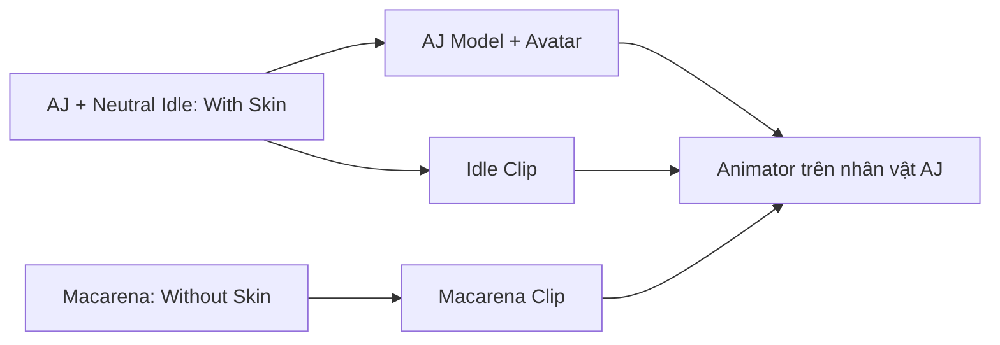

# Bài 02 — Làm quen Mixamo và chọn nhân vật 3D

## 1. Tóm tắt

**Adobe Mixamo** cung cấp nhân vật có rig và thư viện chuyển động dựng sẵn. Thay vì tự tạo skeleton và keyframe từ đầu, bạn có thể chọn nhân vật, xem trước animation, tải FBX và đưa vào Unity. Bài học dùng nhân vật **AJ** và hai animation `Neutral Idle`, `Macarena` làm ví dụ xuyên suốt.

## 2. Mục tiêu học tập

- Truy cập Mixamo và phân biệt mục nhân vật với mục animation.
- Chọn nhân vật và thử phát một animation trong giao diện xem trước.
- Phân biệt mục đích tải `With Skin` và `Without Skin`.
- Lập kế hoạch tải model một lần, sau đó dùng lại rig cho chuyển động bổ sung.

## 3. Vì sao cần cả nhân vật và animation?

Model là phần hình học và hình ảnh nhân vật; skeleton/rig là cấu trúc xương điều khiển chuyển động. Animation mô tả sự biến đổi của các xương theo thời gian. Khi rig phù hợp, cùng một nhân vật có thể phát nhiều animation mà không cần nhập một model mới cho mỗi chuyển động.

Trong khóa học này, `Neutral Idle` là hoạt ảnh mặc định khi nhân vật đứng yên. `Macarena` là hoạt ảnh được kích hoạt khi người dùng nhấn phím D. Chúng ta cần một model để hiển thị và hai clip để chuyển trạng thái.

## 4. Truy cập Mixamo

1. Mở [mixamo.com](https://www.mixamo.com/) và đăng nhập bằng tài khoản phù hợp.
2. Tìm danh mục nhân vật (`Characters`), chọn `AJ` nếu nhân vật này có sẵn.
3. Chuyển sang danh mục animation (`Animations`).
4. Tìm `Neutral Idle` và xem bản preview trên model đang chọn.
5. Quan sát tư thế ở đầu và cuối chuyển động để xác định clip có phù hợp để phát lặp hay không.

Tên gọi/vị trí các nút trên website có thể thay đổi. Hãy tập trung vào ba chức năng chính: **chọn nhân vật → chọn animation → tải FBX**.

## 5. Quy tắc tải asset

| Lượt tải | Chọn gì? | Mục đích |
| --- | --- | --- |
| Lần đầu | `FBX for Unity` + `With Skin` với `Neutral Idle` | Nhập model nhân vật cùng dữ liệu animation và rig |
| Lần kế tiếp | `FBX for Unity` + `Without Skin` với `Macarena` | Nhận clip nhảy để gắn vào nhân vật/Avatar đã có |

Nếu tải `With Skin` cho tất cả các clip, dự án có thể xuất hiện các bản model trùng lặp không cần thiết. Nếu tải `Without Skin` ngay từ đầu nhưng chưa có model/Avatar thích hợp, việc lắp ráp sẽ khó hơn.

## 6. Sơ đồ quan hệ model – animation

Model và Avatar là điểm chung, còn các clip là dữ liệu chuyển động riêng. Animator sẽ lựa chọn clip cần phát dựa trên trạng thái và tham số.

## 7. Thực hành ngắn

Hãy mở Mixamo, chọn một nhân vật có rig tương thích với animation. Tìm hai chuyển động: một động tác đứng yên và một chuyển động mang tính biểu diễn. Trước khi tải, tự trả lời: animation nào cần `With Skin`, animation nào chỉ cần `Without Skin`?

## 8. Lỗi thường gặp

- **Không thấy nhân vật AJ:** chọn nhân vật humanoid phù hợp khác và giữ nhất quán xuyên suốt bài.
- **Chuyển động không áp vào model như mong đợi:** xem lại nhân vật đang được chọn trong Mixamo.
- **Đã tải nhầm chế độ:** không bắt buộc xóa toàn bộ project; tải lại đúng bản FBX và quản lý file rõ ràng.

## 9. Câu hỏi ôn tập

**Câu 1.** Thành phần nào trực tiếp lưu chuyển động theo thời gian?

A. Texture  
B. Animation clip  
C. Material  
D. Scene

**Đáp án:** B. **Giải thích:** Animation clip chứa thông tin chuyển động, không phải dữ liệu tô bề mặt.

**Câu 2.** Khi tải nhân vật AJ lần đầu, nên chọn gì?

A. `Without Skin`  
B. Chỉ file ảnh PNG  
C. Chỉ Animator Controller  
D. `With Skin`

**Đáp án:** D. **Giải thích:** `With Skin` cung cấp model cùng skeleton cần thiết cho lần thiết lập đầu.

**Câu 3.** Vì sao tải Macarena bằng `Without Skin`?

A. Vì đã có model/Avatar và chỉ cần clip mới  
B. Vì Macarena không có chuyển động  
C. Để tắt animation  
D. Vì Unity không nhận `With Skin`

**Đáp án:** A. **Giải thích:** Mục tiêu là bổ sung chuyển động mà không nhân bản mô hình.

**Câu 4.** `Neutral Idle` phù hợp với trạng thái nào?

A. Hiển thị menu cài đặt  
B. Lưu texture  
C. Nhân vật đứng yên mặc định  
D. Import script

**Đáp án:** C. **Giải thích:** Idle biểu diễn trạng thái ít chuyển động khi không thực hiện hành động khác.

**Câu 5.** Nếu `AJ` không có trong danh mục, lựa chọn hợp lý nhất là gì?

A. Ngừng học Unity  
B. Chọn nhân vật humanoid khác và dùng nhất quán  
C. Bỏ qua model hoàn toàn  
D. Tải nhiều model không liên quan

**Đáp án:** B. **Giải thích:** Quy trình tập trung vào rig và animation, có thể áp dụng với một nhân vật tương thích khác.

## 10. Tổng kết

Mixamo tách lựa chọn model khỏi thư viện chuyển động. Dùng `With Skin` cho lần tải đầu và `Without Skin` cho clip bổ sung là nền tảng của quy trình nhập asset trong Unity.
