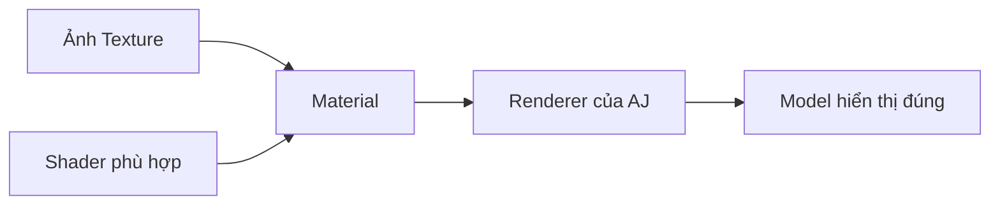

# Bài 05 — Khôi phục Material và Texture của nhân vật Mixamo

## 1. Tóm tắt

Sau khi nhập FBX, nhân vật đôi khi hiển thị màu trắng, xám hoặc thiếu chi tiết. Nguyên nhân có thể là texture/material chưa được liên kết đúng, shader không tương thích hoặc asset chưa được trích xuất vào Project. Bài này xử lý vấn đề từ giao diện import của Unity.

## 2. Mục tiêu học tập

- Phân biệt vai trò của `Texture`, `Material` và `Shader`.
- Tìm tab `Materials` của FBX và thao tác trích xuất asset khi có sẵn.
- Kiểm tra material đang gán lên renderer của nhân vật.
- Chẩn đoán trường hợp model không có màu hoặc chuyển sang màu bất thường.

## 3. Texture, Material và Shader

`Texture` là tệp hình ảnh lưu thông tin màu/chi tiết bề mặt. `Material` là tài nguyên lưu tham số hiển thị, chẳng hạn texture chính, màu và độ bóng. `Shader` quy định cách các tham số đó được dùng để vẽ vật thể. Vì vậy có file ảnh trong Project thôi chưa đủ: cần material phù hợp và renderer được gán đúng.

## 4. Trích xuất texture/material từ FBX

1. Trong `Project`, chọn **asset FBX nguồn** của `AJ`, không chọn instance trong `Hierarchy`.
2. Chọn tab `Materials` của FBX Import Settings.
3. Nếu có tùy chọn `Extract Textures`, chọn thư mục đích; ví dụ `Assets/Resources/Textures` hoặc một thư mục `Textures` chuyên cho nhân vật.
4. Nếu có tùy chọn `Extract Materials`, chọn thư mục `Assets/Materials`.
5. Khi Unity yêu cầu xác nhận thay đổi, thực hiện và kiểm tra kết quả sau import.
6. Chọn instance `AJ` trong `Hierarchy`, mở renderer tương ứng và kiểm tra danh sách material đã gán.

**Lưu ý:** Các tùy chọn extract và nhãn thông báo phụ thuộc vào cách FBX chứa tài nguyên và phiên bản Unity. Không phải FBX nào cũng nhúng sẵn texture có thể trích xuất. Khi không có nút extract hoặc không tìm thấy texture, cần kiểm tra asset đầu vào thay vì giả định Unity luôn có thể tự phục hồi ảnh.

## 5. Kiểm tra material sau khi trích xuất

Quan sát model trong Scene View với ánh sáng phù hợp. Nếu texture đã nằm trong Project nhưng model vẫn không hiện màu, chọn material và xem texture có nằm ở ô `Base Map`/`Albedo` không. Kiểm tra shader tương thích render pipeline hiện tại (ví dụ Built-in hoặc URP), vì material không tương thích có thể tạo màu bất thường.

Trong một số trường hợp, dùng nút sửa/cập nhật do Unity hiển thị có thể hỗ trợ, nhưng cần hiểu rõ thông báo trước khi bấm. Không coi một nút `Fix Now` là thao tác bắt buộc cho mọi project.

## 6. Bài thực hành

- Chọn FBX, xác định những material và texture đang dùng.
- Trích xuất chúng ra thư mục thích hợp nếu các nút có sẵn.
- Gán lại texture chính nếu renderer chưa đúng.
- Quan sát sự thay đổi giữa model không có texture và model được khôi phục.

## 7. Checklist debug nhanh

- [ ] Có ít nhất một material gán trên renderer của model.
- [ ] Material dùng shader phù hợp với render pipeline.
- [ ] Texture chính xuất hiện trong ô vật liệu cần thiết.
- [ ] Texture không bị mất đường dẫn hoặc import lỗi.
- [ ] Scene có ánh sáng đủ để nhận biết màu vật thể.

## 8. Câu hỏi ôn tập

**Câu 1.** Thành phần nào chứa tham số shader và tham chiếu đến texture?

A. Material  
B. Transform  
C. Trigger  
D. Avatar

**Đáp án:** A. **Giải thích:** Material là cấu hình hiển thị bề mặt, kết nối shader với texture và tham số vẽ.

**Câu 2.** Muốn tìm `Extract Materials` của FBX, nên chọn ở đâu?

A. Chọn Game View  
B. Chọn file `.cs`  
C. Chọn asset FBX trong Project  
D. Chọn nút Play

**Đáp án:** C. **Giải thích:** Import Settings là thuộc tính của file nguồn, không phải instance trong scene.

**Câu 3.** Texture đã có trong Project nhưng model còn màu trắng. Hướng xử lý nào phù hợp?

A. Chỉ đổi tên scene  
B. Kiểm tra material, ô texture và renderer  
C. Xóa Avatar  
D. Tạo Trigger mới

**Đáp án:** B. **Giải thích:** Texture cần được tham chiếu bởi material đang dùng để render model.

**Câu 4.** Vì sao không phải FBX nào cũng có `Extract Textures` khả dụng?

A. Vì Animator đang chạy  
B. Vì texture chỉ dùng cho 2D  
C. Vì không có Plane  
D. Vì file có thể không nhúng texture hoặc Unity không có dữ liệu để trích xuất

**Đáp án:** D. **Giải thích:** Chức năng trích xuất phụ thuộc nội dung asset và khả năng import.

**Câu 5.** Model có màu bất thường sau khi đổi render pipeline; nên kiểm tra gì đầu tiên?

A. Shader của material có tương thích hay không  
B. Phím D  
C. Tên Trigger  
D. Số lượng thư mục

**Đáp án:** A. **Giải thích:** Shader không tương thích có thể khiến material hiển thị sai dù texture vẫn còn.

## 9. Tổng kết

Model hiển thị đúng khi renderer sử dụng material phù hợp, và material được gắn đúng texture. Việc khôi phục asset đồ họa là bước riêng, độc lập với cấu hình animation.
