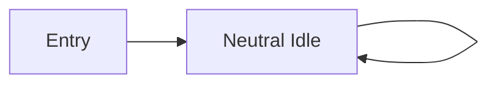

# Bài 06 — Cấu hình Rig, Avatar và animation Neutral Idle

## 1. Tóm tắt

FBX có model và chuyển động chưa chắc tự phát animation khi vào scene. Unity cần hiểu rig/Avatar của nhân vật, biết clip nào được phát và có một `Animator Controller` điều khiển. Bài này thiết lập `Neutral Idle` làm hoạt ảnh đứng yên lặp liên tục.

## 2. Mục tiêu học tập

- Giải thích vai trò của `Rig`, `Avatar`, animation clip và `Animator`.
- Chọn `Create From This Model` cho FBX nhân vật đầu tiên.
- Bật lặp cho `Neutral Idle` bằng các tùy chọn liên quan.
- Tạo `Animator Controller`, trạng thái `Neutral Idle` và gán clip đúng vị trí.
- Kiểm thử hoạt ảnh đứng yên trong Play Mode.

## 3. Vai trò của Rig và Avatar

`Rig` là cấu trúc xương của model. `Avatar` được Unity tạo để mô tả cách animation áp vào cấu trúc đó. Trong quy trình Mixamo, FBX tải `With Skin` là nguồn để Unity tạo Avatar của nhân vật chính.

Tùy FBX và loại nhân vật, hãy cấu hình `Animation Type` thích hợp trong tab `Rig`. Với nhân vật hình người tương thích, lựa chọn `Humanoid` thường là cách sử dụng hệ thống retargeting của Unity. Nếu model không phải humanoid, phải kiểm tra yêu cầu thực tế thay vì đặt máy móc.

## 4. Tạo Avatar từ model gốc

1. Trong `Project`, chọn FBX `AJ` đã tải bằng `With Skin`.
2. Mở `Inspector > Rig`.
3. Kiểm tra `Animation Type` tương thích với rig của nhân vật; với AJ trong bài thực hành, dùng `Humanoid` nếu import hợp lệ.
4. Trong `Avatar Definition`, chọn **`Create From This Model`**.
5. Nhấn `Apply`.
6. Nếu Unity cho phép xem cấu hình Avatar, kiểm tra rig đã ánh xạ xương hợp lệ.

Tại sao phải dùng `Create From This Model`? Vì đây là file chứa model và skeleton gốc; chúng ta cần Unity tạo Avatar tham chiếu cho các clip khác.

## 5. Thiết lập clip Neutral Idle phát lặp

Chọn FBX hoặc clip có `Neutral Idle`, mở tab `Animation` trong Import Settings. Bật `Loop Time` và, khi phù hợp, `Loop Pose`; sau đó nhấn `Apply`.

- `Loop Time`: tiếp tục lặp lại clip khi state đang hoạt động.
- `Loop Pose`: hỗ trợ điều chỉnh sự liên tục của tư thế tại ranh giới vòng lặp (mức hiệu quả phụ thuộc clip).

Animation dạng idle cần lặp; nếu không, nhân vật có thể dừng tại cuối clip và không cho cảm giác còn sống.

## 6. Tạo Animator Controller

1. Trong `Assets/Mixamo/Animators`, tạo `Animator Controller`, đặt tên `AJ.controller` hoặc `AJ1`.
2. Nhấp đúp để mở cửa sổ `Animator`.
3. Tạo một state mới, đặt tên `Neutral Idle`.
4. Chọn state, kéo clip `Neutral Idle` vào trường `Motion`.
5. Đặt `Neutral Idle` là **default state** (thường thể hiện bằng mũi tên Entry trỏ vào state).
6. Gán controller cho component `Animator` trên GameObject có liên quan đến nhân vật; chọn `Controller = AJ.controller`.

Cấu hình nơi đặt Animator cần nhất quán với nơi đặt script trong bài lập trình. Ví dụ dễ kiểm soát nhất: giữ `Animator` trên GameObject chứa model `AJ` và sau này gắn `PlayerController` vào chính `AJ`.

Mũi tên trở lại chính state chỉ minh họa hành vi lặp của clip; thực tế `Loop Time` đã đảm nhận việc phát lặp, **không cần tạo self-transition** cho Idle.

## 7. Kiểm tra trong Play Mode

Nhấn `Play` và quan sát. Nếu mọi thứ đúng, nhân vật sẽ phát animation đứng yên liên tục. Nếu không chuyển động, kiểm tra lần lượt: FBX đã có clip chưa, Avatar có hợp lệ không, state đã gán `Motion` chưa, `Animator` có `Controller` đúng chưa và component Animator có đang được bật không.

## 8. Lỗi thường gặp

| Triệu chứng | Nguyên nhân có thể | Cách khắc phục |
| --- | --- | --- |
| Animator state đúng nhưng model đứng yên | `Motion` chưa gán | Chọn state và gán clip |
| Animation chỉ chạy một lần | `Loop Time` chưa bật | Bật loop ở Import Settings |
| Nhân vật biến dạng | Avatar/rig ánh xạ không đúng | Kiểm tra `Rig`, loại animation và cấu hình Avatar |
| Không chạy animation khi Play | Animator thiếu controller | Gán `AJ.controller` ở component Animator |

## 9. Câu hỏi ôn tập

**Câu 1.** Khi nhập FBX `With Skin` lần đầu, Avatar Definition phù hợp là gì?

A. `Copy From Other Avatar`  
B. `Create From This Model`  
C. `No Avatar` cho mọi trường hợp  
D. Xóa Rig

**Đáp án:** B. **Giải thích:** Model đầu tiên là nguồn skeleton để Unity tạo Avatar của nhân vật.

**Câu 2.** Tùy chọn chính để `Neutral Idle` phát lặp là gì?

A. `Loop Time`  
B. `Has Exit Time`  
C. `Transition Duration`  
D. `Tiling`

**Đáp án:** A. **Giải thích:** Loop Time được cấu hình trên clip để lặp chuyển động.

**Câu 3.** State đang phát animation nào được xác định bởi trường nào?

A. `Tag`  
B. `Transform`  
C. `Motion`  
D. `Material`

**Đáp án:** C. **Giải thích:** `Motion` của state tham chiếu clip hoặc blend tree cần phát.

**Câu 4.** Để state nào chạy ngay khi vào Play Mode, cần chú ý gì?

A. Material dùng shader nào  
B. Có Texture trong Project  
C. Độ dài tên file  
D. Default state của Animator Controller

**Đáp án:** D. **Giải thích:** Entry dẫn vào state mặc định để bắt đầu phát animation.

**Câu 5.** Vì sao không cần tự tạo self-transition để lặp Idle?

A. `Loop Time` đã điều khiển phát lặp bên trong clip  
B. Unity không hỗ trợ animation  
C. Idle luôn có thời gian bằng 0  
D. Vì `PlayerController` sẽ xóa clip

**Đáp án:** A. **Giải thích:** Clip có thể tự lặp khi state được duy trì.

## 10. Tổng kết

Nhân vật đã có Avatar, Idle clip lặp và Animator Controller với trạng thái mặc định. Đây là nền tảng để bổ sung animation thứ hai mà không cần tải thêm model.
