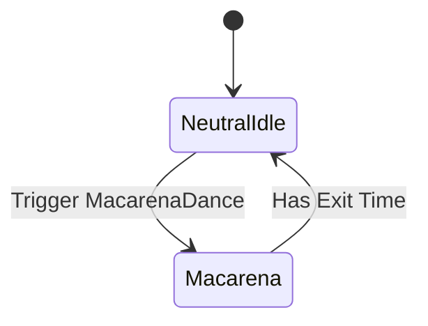

# Bài 08 — Animator State, Transition và Trigger

## 1. Tóm tắt

Có hai animation nhưng Unity chưa biết khi nào chuyển đổi giữa chúng. `Animator Controller` hoạt động như một máy trạng thái: một state mặc định `Neutral Idle`, một state `Macarena`, và các transition có điều kiện phù hợp.

## 2. Mục tiêu học tập

- Tạo hai animation state và gán clip cho từng state.
- Tạo transition hai chiều giữa Idle và Macarena.
- Tạo tham số `Trigger` và cấu hình transition theo sự kiện.
- Phân biệt `Has Exit Time` trên đường đi và đường trở về.
- Dự đoán hành vi khi trigger được kích hoạt trong runtime.

## 3. Thiết kế state machine



`Neutral Idle` là trạng thái bắt đầu. Khi nhận Trigger `MacarenaDance`, Animator chuyển sang `Macarena`. Sau khi điệu nhảy đi qua một chu kỳ, Animator trở lại Idle. Sơ đồ này có một đường theo sự kiện và một đường theo tiến trình thời gian của clip.

## 4. Tạo state và gán clip

Mở `AJ.controller` trong cửa sổ `Animator`.

1. Xác nhận `Neutral Idle` đã tồn tại, có `Motion` là clip Idle và được đặt làm default state.
2. Tạo state thứ hai tên `Macarena`.
3. Chọn state `Macarena`, gán `Motion` là clip Macarena từ `Assets/Mixamo/Animations`.
4. Tạo transition `Neutral Idle` → `Macarena`.
5. Tạo transition `Macarena` → `Neutral Idle`.

Đặt tên state dễ đọc, tách khỏi tên tham số. **State `Macarena` và Trigger `MacarenaDance` là hai thứ khác nhau.**

## 5. Tạo Trigger và cấu hình chuyển từ Idle sang Dance

Trong tab `Parameters` của cửa sổ Animator, thêm tham số mới với loại `Trigger`, tên **`MacarenaDance`**. Đây là tên chuẩn được sử dụng trong toàn bộ khóa học và mã C#.

Chọn transition `Neutral Idle` → `Macarena`:

- Trong `Conditions`, thêm điều kiện `MacarenaDance`.
- Tắt `Has Exit Time` để không cần đợi Idle đạt ngưỡng thời gian mới chuyển.
- Điều chỉnh `Transition Duration` nếu cần cho chuyển động đẹp mắt; thời gian blend quá dài có thể làm cảm giác phản hồi phím bị chậm.

Một Trigger là sự kiện kích hoạt transition. Đây không phải Boolean liên tục đại diện cho việc phím đang được giữ xuống.

## 6. Cấu hình transition từ Dance về Idle

Chọn transition `Macarena` → `Neutral Idle`:

- Bật `Has Exit Time`.
- Thiết lập Exit Time để trở về sau khoảng **một chu kỳ** (ví dụ giá trị normalized 1 khi thích hợp với clip).
- Không cần thêm điều kiện Trigger nếu muốn trở về tự động.
- Kiểm tra không còn điều kiện phụ nào vô tình chặn đường trở về.

`Exit Time` thường được biểu diễn dưới dạng thời gian chuẩn hóa theo độ dài clip. Với clip có loop, giá trị 1 tương ứng khoảng cuối vòng lặp đầu tiên. Nếu transition không diễn ra đúng như mong muốn, kiểm tra cả `Exit Time`, `Transition Duration`, thuộc tính `Fixed Duration` và điều kiện của transition.

## 7. Quy tắc nhất quán tên gọi

Các chuỗi phải khớp tuyệt đối:

```text
Animator > Parameters > Trigger: MacarenaDance
C# > SetTrigger("MacarenaDance")
```

Tránh dùng tên có khoảng trắng khác nhau (`Macarena Dance` so với `MacarenaDance`) hoặc viết sai hoa/thường. Bạn có thể chọn tên khác, nhưng phải đổi đồng bộ ở Animator và script.

## 8. Cách tự kiểm thử trước khi viết mã

Khi game đang Play, mở cửa sổ Animator để nhìn state đang sáng. Nếu giao diện cho phép kích hoạt thủ công Trigger trong Parameters, hãy thử một lần; kiểm tra trạng thái đi `Idle → Macarena → Idle`. Đây là cách tách lỗi máy trạng thái khỏi lỗi nhận phím ở C#.

## 9. Lỗi thường gặp

| Biểu hiện | Nguyên nhân khả dĩ | Cách xử lý |
| --- | --- | --- |
| Nhấn D nhưng không nhảy | Trigger chưa được gọi hoặc sai tên | So khớp tham số và kiểm tra script |
| Chỉ nhảy sau khi Idle kết thúc | `Has Exit Time` vẫn bật trên đường đi | Tắt exit-time cho `Idle → Macarena` |
| Không trở lại Idle | Transition quay về thiếu hoặc có điều kiện chặn | Kiểm tra đường về và `Has Exit Time` |
| Hai state phát sai clip | Sai `Motion` | Chọn từng state và kiểm tra clip |

## 10. Câu hỏi ôn tập

**Câu 1.** Muốn nhấn phím là chuyển sang Dance sớm nhất, nên cấu hình transition từ Idle như thế nào?

A. Không có Trigger và bật Exit Time  
B. Tắt mọi transition  
C. Có Trigger và tắt `Has Exit Time`  
D. Chỉ chỉnh Texture

**Đáp án:** C. **Giải thích:** Điều kiện Trigger cho phép phản hồi sự kiện mà không chờ Idle kết thúc.

**Câu 2.** Tại sao transition từ Dance về Idle thường bật `Has Exit Time`?

A. Để animation có thời gian hoàn thành một chu kỳ trước khi quay về  
B. Để tạo thêm model  
C. Để thay đổi Shader  
D. Để nạp ảnh bàn cờ

**Đáp án:** A. **Giải thích:** Exit Time gắn với tiến trình của clip đang phát.

**Câu 3.** `MacarenaDance` trong bài học là loại tham số nào?

A. Int  
B. Float  
C. Bool  
D. Trigger

**Đáp án:** D. **Giải thích:** Trigger được kích hoạt bởi một sự kiện rồi phục vụ điều kiện chuyển state.

**Câu 4.** State `Macarena` phát nội dung nào?

A. Mọi asset trong Project  
B. Clip được gán vào trường `Motion`  
C. Toàn bộ material của scene  
D. Nội dung Console

**Đáp án:** B. **Giải thích:** `Motion` quyết định hoạt ảnh mà state phát.

**Câu 5.** Nếu đặt tên Trigger trong Animator khác tên gọi trong `SetTrigger`, điều gì dễ xảy ra?

A. Unity tự dịch tên sang tiếng Việt  
B. Texture bị mất  
C. Script không kích hoạt được transition mong muốn  
D. Plane tự biến mất

**Đáp án:** C. **Giải thích:** Mã cần gọi đúng tên parameter được định nghĩa trong Controller.

## 11. Tổng kết

Một hệ thống animation nhỏ vẫn cần cấu hình state machine rõ ràng: trạng thái bắt đầu, đường chuyển có Trigger và đường tự quay về theo Exit Time. Khi sơ đồ này hoạt động, script chỉ còn nhiệm vụ gửi Trigger đúng lúc.
