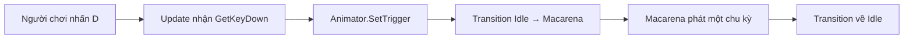

# Bài 09 — Dùng C# kích hoạt animation bằng phím D

## 1. Tóm tắt

Animator Controller xử lý quy tắc chuyển trạng thái; script C# chỉ cần phát tín hiệu khi người chơi thao tác. Bài này tạo `PlayerController.cs` để nhấn **D** kích hoạt Trigger `MacarenaDance`.

## 2. Mục tiêu học tập

- Tạo và gắn script C# kiểu `MonoBehaviour`.
- Sử dụng `GetComponent<Animator>()` để lấy component Animator.
- Dùng `Input.GetKeyDown(KeyCode.D)` để nhận một lần nhấn phím.
- Dùng `Animator.SetTrigger()` để chuyển sang animation nhảy.
- Phân tích các lỗi tham chiếu Animator sai vị trí hoặc tên Trigger không khớp.

## 3. Thiết kế điều khiển



`GetKeyDown` chỉ đúng trong frame phát hiện phím vừa được nhấn, phù hợp để kích hoạt hành động một lần. Trái lại, việc liên tục đặt Trigger trong khi giữ phím có thể tạo kết quả không mong muốn.

## 4. Tạo script PlayerController.cs

Trong `Assets/Scripts`, tạo một C# script tên `PlayerController`. Mở script và thay nội dung bằng:

```csharp
using UnityEngine;

public class PlayerController : MonoBehaviour
{
    private Animator animator;
    private const string DanceTrigger = "MacarenaDance";

    private void Start()
    {
        animator = GetComponent<Animator>();

        if (animator == null)
        {
            Debug.LogError("PlayerController cần Animator trên cùng GameObject.", this);
        }
    }

    private void Update()
    {
        if (animator != null && Input.GetKeyDown(KeyCode.D))
        {
            animator.SetTrigger(DanceTrigger);
        }
    }
}
```

### Giải thích từng phần

- `MonoBehaviour`: cho phép script được gắn vào một GameObject và dùng các callback của Unity.
- `Start()`: lấy `Animator` khi script bắt đầu hoạt động.
- `GetComponent<Animator>()`: tìm component Animator trên **cùng GameObject** chứa script.
- `Update()`: kiểm tra đầu vào trong các frame khi ứng dụng chạy.
- `Input.GetKeyDown(KeyCode.D)`: chỉ phản hồi ở thời điểm phím D vừa được nhấn.
- `SetTrigger(DanceTrigger)`: đặt Trigger đã khai báo trong Animator để transition được kích hoạt.

**Ghi chú về Input System:** Mẫu trên sử dụng API `Input` của hệ thống input cũ. Nếu dự án được cấu hình chỉ dùng **Input System Package** mới, cần bật chế độ đầu vào phù hợp hoặc viết lại theo Input Actions. Không kết luận script sai chỉ vì cấu hình Input Handling không tương thích.

## 5. Đặt script đúng GameObject

Điều kiện của `GetComponent<Animator>()` rất quan trọng. Nếu `Animator` nằm trên GameObject `AJ` thì gắn `PlayerController` lên `AJ`. Nếu bạn muốn script nằm trên `Player` nhưng Animator nằm ở `AJ` (child), thì `GetComponent<Animator>()` trên `Player` sẽ trả về `null`.

Trong trường hợp parent–child, có thể chủ động tham chiếu đến Animator con:

```csharp
private void Start()
{
    animator = GetComponentInChildren<Animator>();
}
```

Giải pháp khác là dùng trường `[SerializeField] Animator animator;` và kéo đúng Animator vào Inspector. Chọn **một** cách quản lý rõ ràng, không phụ thuộc vào may rủi vị trí component.

## 6. Kiểm thử từ đầu đến cuối

1. Gắn script lên GameObject đúng vị trí.
2. Kiểm tra component `Animator` đang tham chiếu đến `AJ.controller`.
3. Nhấn `Play`; nhân vật phát `Neutral Idle`.
4. Nhấp vào cửa sổ `Game` để bảo đảm nó nhận bàn phím, sau đó nhấn **D**.
5. Quan sát state `Macarena` sáng trong Animator và nhân vật thực hiện điệu nhảy.
6. Chờ hết một chu kỳ; Animator trở về `Neutral Idle`.

## 7. Lỗi thường gặp

| Lỗi | Khả năng cao | Kiểm tra |
| --- | --- | --- |
| Console báo thiếu Animator | Script không nằm cùng GameObject với Animator | Chuyển script hoặc dùng `GetComponentInChildren` |
| Nhấn D không phản hồi | Game View không có focus hoặc Input Handling không phù hợp | Click vào Game, kiểm tra Project Settings |
| Có gọi Trigger nhưng vẫn Idle | Parameter sai tên hoặc transition sai điều kiện | So sánh `MacarenaDance` trong code và Animator |
| Không quay lại Idle | Transition về chưa cấu hình | Kiểm tra `Has Exit Time` trên đường về |

## 8. Bài thực hành ngắn

Tạo script và chạy thử. Sau khi thành công, thử đổi phím kích hoạt từ `D` thành `F` trong mã, chạy lại để chứng minh input và state machine là hai phần độc lập. Đổi về D trước khi hoàn thành lab cuối khóa.

## 9. Câu hỏi ôn tập

**Câu 1.** API nào phù hợp để nhận sự kiện vừa nhấn phím D một lần?

A. `Input.GetKeyDown(KeyCode.D)`  
B. `Transform.Translate()`  
C. `Animator.Play()` trong mọi frame  
D. `Resources.Load()`

**Đáp án:** A. **Giải thích:** `GetKeyDown` báo sự kiện nhấn mới, đúng với hành động kích hoạt Trigger.

**Câu 2.** `GetComponent<Animator>()` tìm Animator ở đâu?

A. Trên mọi scene đang mở  
B. Trong thư mục Scripts  
C. Trên cùng GameObject chứa script  
D. Trong file ảnh bàn cờ

**Đáp án:** C. **Giải thích:** `GetComponent<T>` chỉ tìm component của GameObject hiện tại.

**Câu 3.** Nếu Animator nằm trên `AJ` (child) còn script trên `Player` (parent), cách xử lý có thể dùng là gì?

A. Xóa child AJ  
B. `GetComponentInChildren<Animator>()`  
C. Xóa script  
D. Đổi tên scene

**Đáp án:** B. **Giải thích:** Hàm này có thể tìm component trong cây GameObject con.

**Câu 4.** Lệnh nào gửi Trigger đúng tới Animator?

A. `transform.position = Vector3.zero`  
B. `GetComponent<Material>()`  
C. `GameObject.Find("MacarenaDance")`  
D. `animator.SetTrigger("MacarenaDance")`

**Đáp án:** D. **Giải thích:** `SetTrigger` tác động lên tham số Trigger của Animator Controller.

**Câu 5.** Mã dùng `Input.GetKeyDown` không chạy trong project chỉ bật Input System mới. Hướng xử lý đúng là gì?

A. Kiểm tra Active Input Handling hoặc chuyển sang Input Actions  
B. Xóa tất cả animation  
C. Thay texture bàn cờ  
D. Tắt Avatar

**Đáp án:** A. **Giải thích:** Cơ chế xử lý input phải tương thích với API đang dùng.

## 10. Tổng kết

`PlayerController` tập trung xử lý input và phát sự kiện; Animator tập trung phát animation. Mô hình phân chia trách nhiệm này sẽ giúp hệ thống dễ mở rộng khi phát triển gameplay phức tạp hơn.
