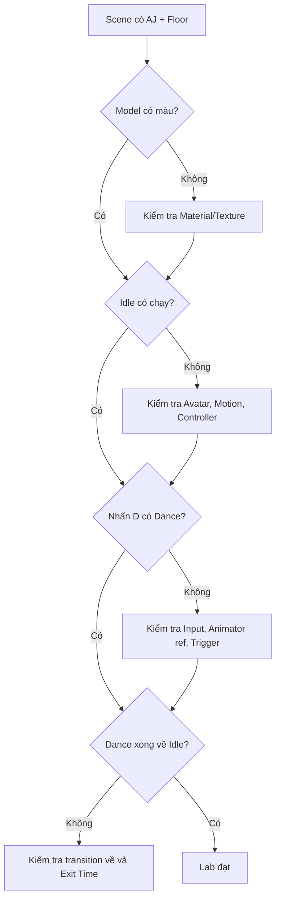

# Bài 10 — Lab: Hoàn thiện scene nhân vật có Idle và Dance

**Loại tài liệu:** Lab thực hành tích hợp.

## 1. Tổng quan

Mục tiêu là hoàn thành một scene Unity duy nhất có nhân vật Mixamo, sàn texture bàn cờ và hai animation chuyển đổi đúng theo thao tác bàn phím. Lab dùng lại toàn bộ kiến thức về asset, Avatar, Animator và script C#.

## 2. Mục tiêu

Kết thúc lab, bạn sẽ có thể:

- Tích hợp các asset FBX vào một scene hoạt động.
- Thiết lập `Idle → Macarena → Idle` theo đúng điều kiện.
- Kiểm thử ngoại hình, hành vi và Console.
- Tự xác định lớp phát sinh lỗi: asset, rig, controller hay input.

## 3. Chuẩn bị

- Dự án Unity 3D với thư mục `Mixamo`, `Resources/Textures`, `Materials`, `Scripts`.
- Một FBX `AJ` (hoặc nhân vật tương thích) tải `With Skin` cùng `Neutral Idle`.
- Một FBX `Macarena` tải `Without Skin`.
- Một ảnh bề mặt sàn và một material có thể gán texture.
- Script `PlayerController.cs` theo Bài 09.

## 4. Sơ đồ nghiệm thu

Các nút kiểm tra nên thực hiện tuần tự: chỉ sửa từng lớp vấn đề sau khi xác nhận lớp trước hoạt động. Điều này giúp tránh thay nhiều cài đặt cùng lúc rồi không biết thao tác nào giải quyết lỗi.

## 5. Các bước thực hiện

### 5.1. Thiết lập scene

1. Tạo `Plane` và gán material dùng ảnh sàn; chỉnh `Tiling X/Y = 5` nếu phù hợp.
2. Tạo `Player`, thêm model `AJ` làm child.
3. Chọn đúng model instance và bảo đảm không có camera con ngoài ý muốn cản trở kiểm thử.
4. Kiểm tra vị trí chân nhân vật so với mặt sàn.

**Checkpoint 1:** Nhân vật và sàn hiển thị trong Scene/Game View, không bị trùng model.

### 5.2. Hoàn thiện asset

1. Kiểm tra material/texture của FBX và trích xuất khi cần.
2. Với FBX có model, chọn `Create From This Model` trong `Rig`.
3. Với FBX chỉ có Macarena, chọn `Copy From Other Avatar` và trỏ tới Avatar của AJ.
4. Bật `Loop Time` cho Idle; kiểm tra Loop Pose khi cần.

**Checkpoint 2:** Model có bề mặt phù hợp, Avatar hợp lệ và cả hai clip có preview.

### 5.3. Tạo hệ thống Animator

1. Tạo controller và gán `Neutral Idle` làm default state.
2. Thêm `Macarena` state và clip tương ứng.
3. Tạo Trigger `MacarenaDance`.
4. Thiết lập `Idle → Macarena` có điều kiện Trigger và tắt Exit Time.
5. Thiết lập `Macarena → Idle` có Exit Time để tự trở về sau một chu kỳ.

**Checkpoint 3:** Có hai state và hai transition đúng chiều. Không có transition lạc hướng không chủ đích.

### 5.4. Gắn script và chạy thử

1. Gắn `PlayerController` ở đúng GameObject có `Animator`, hoặc điều chỉnh cách lấy tham chiếu đến Animator con.
2. Đối chiếu tên Trigger trong script với Animator.
3. Bấm `Play` và quan sát Idle.
4. Click Game View, nhấn **D**, quan sát Dance rồi trở lại Idle.
5. Mở Console xem còn lỗi liên quan hay không.

**Checkpoint 4:** Chuỗi hành vi lặp lại được trong nhiều lượt test.

## 6. Kịch bản kiểm thử

| Mã test | Thao tác | Kỳ vọng |
| --- | --- | --- |
| T01 | Bắt đầu Play Mode, không bấm phím | `Neutral Idle` phát lặp |
| T02 | Nhấn phím D một lần trong Idle | Chuyển sang `Macarena` |
| T03 | Không bấm phím khi Macarena chạy | Hoàn tất chu kỳ rồi quay lại Idle |
| T04 | Nhấn D lần nữa sau khi đã trở lại Idle | Hệ thống lại chuyển sang Dance |
| T05 | Quan sát model dưới ánh sáng scene | Texture/material hiển thị đúng |
| T06 | Mở Console trong và sau khi test | Không có lỗi Animator/Avatar/NullReference liên quan |

## 7. Gỡ lỗi có hệ thống

**Trường hợp A — Nhân vật không xuất hiện:** Kiểm tra `Hierarchy`, `Transform`, Mesh Renderer và camera. Nếu model có trong Hierarchy, chọn nó và dùng thao tác định vị Scene View đến đối tượng.

**Trường hợp B — Nhân vật nhìn như thiếu vật liệu:** Kiểm tra material slot, texture chính và shader tương thích; không sửa Animator vì Animator không quản lý màu sắc.

**Trường hợp C — Idle không chạy:** Kiểm tra Avatar, controller, default state và trường `Motion`. Nếu cần, tạm bỏ Macarena để chỉ kiểm thử Idle.

**Trường hợp D — Nhấn D không nhảy:** Bắt đầu từ việc Game View có focus hay chưa, sau đó kiểm tra cấu hình Input, tham chiếu Animator, chính tả `MacarenaDance` và conditions của transition.

**Trường hợp E — Nhảy rồi không về Idle:** Kiểm tra đường chuyển về đã tồn tại, `Has Exit Time` đã bật, Exit Time hợp lý và không có điều kiện chặn.

## 8. Deliverable

- Một project Unity với scene có thể chạy và đầy đủ asset tham chiếu.
- Screenshot `Hierarchy` cho thấy `Player` và `AJ`.
- Screenshot `Animator` cho thấy hai state và hai transition.
- File `PlayerController.cs` có thể biên dịch.
- Ghi chú ngắn nêu kết quả của 6 test case trong bảng trên.

## 9. Checklist hoàn thành

- [ ] Sàn và nhân vật hiển thị đúng vị trí.
- [ ] Không nhập thừa model khi thêm animation.
- [ ] FBX Macarena dùng Avatar đúng.
- [ ] `Neutral Idle` là default state và phát lặp.
- [ ] Phím D kích hoạt một lượt Dance.
- [ ] State Dance trở về Idle mà không cần bấm thêm.
- [ ] Console không có lỗi làm gián đoạn chức năng.

## 10. Câu hỏi ôn tập

**Câu 1.** Nếu model đứng yên từ lúc bắt đầu Play, nên ưu tiên kiểm tra nhóm nào?

A. `Tiling` của sàn  
B. Hệ thống `Avatar → Controller → Motion`  
C. Kích thước texture  
D. Tên thư mục Screenshots

**Đáp án:** B. **Giải thích:** Chuỗi Avatar/Controller/Motion quyết định clip có được phát trên model hay không.

**Câu 2.** Nếu Idle chạy được nhưng D không tạo Dance, bước đầu nào hợp lý?

A. Xóa FBX  
B. Tăng Scale của Floor  
C. Kiểm tra focus Game View, input, Trigger và transition  
D. Trích xuất texture sàn

**Đáp án:** C. **Giải thích:** Phát Idle thành công cho thấy cơ sở model và Animator đang hoạt động; lỗi nhiều khả năng ở điều khiển chuyển state.

**Câu 3.** Model thiếu texture thì nên sửa ở đâu?

A. Material và Renderer  
B. Trigger  
C. Exit Time  
D. Input Handling

**Đáp án:** A. **Giải thích:** Texture và vật liệu thuộc pipeline hiển thị, không thuộc máy trạng thái animation.

**Câu 4.** Dance chạy mãi không trở lại Idle; nguyên nhân nào đáng kiểm tra nhất?

A. Quên tạo Plane  
B. File ảnh sai định dạng  
C. Parent scale chưa bằng 5  
D. Thiếu hoặc sai transition `Macarena → Idle`

**Đáp án:** D. **Giải thích:** Cần một đường chuyển tự động phù hợp, thường dùng Has Exit Time.

**Câu 5.** Khi sửa lỗi, vì sao nên kiểm tra theo từng lớp?

A. Để tạo thêm càng nhiều file càng tốt  
B. Để xác định nguyên nhân có kiểm chứng, tránh sửa nhiều thứ cùng lúc  
C. Vì Unity không có Console  
D. Để bỏ qua script

**Đáp án:** B. **Giải thích:** Việc cô lập lỗi giúp biết chính xác bước nào đang không hoạt động.
