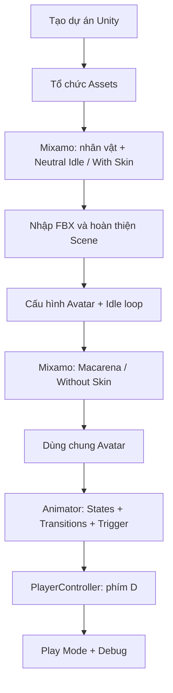

# Khóa học Unity 3D + Mixamo: Nhân vật và hệ thống Animation

> Lộ trình thực hành: từ một dự án Unity trống đến nhân vật 3D có hoạt ảnh đứng yên, nhảy và chuyển trạng thái bằng bàn phím.

## 1. Giới thiệu khóa học

Khóa học hướng dẫn cách sử dụng một nhân vật từ **Adobe Mixamo** trong **Unity 3D**. Sản phẩm cuối là một scene có sàn, nhân vật hiển thị đúng material và texture, phát `Neutral Idle` mặc định, chuyển sang điệu nhảy `Macarena` khi người chơi nhấn **D**, rồi quay về `Idle` sau khi điệu nhảy kết thúc.

Nội dung được tổ chức thành các bài độc lập, mỗi bài giải thích vấn đề, cách làm, lý do cấu hình và cách tự kiểm tra. Các bài thực hành dùng Unity Editor, FBX và C#.

**Đối tượng:** người mới học phát triển game 3D đã biết cách mở dự án Unity, sử dụng Project/Hierarchy/Inspector và tạo script C# cơ bản. Nếu chưa quen, hãy đọc phần thuật ngữ bên dưới trước khi bắt đầu.

**Phạm vi:** nhập mô hình, xây scene tối giản, xử lý texture/material, cấu hình Avatar/Animator, chuyển trạng thái bằng Trigger và viết `PlayerController`. Chưa xây dựng hệ thống di chuyển, chiến đấu hoặc camera góc nhìn thứ ba.

## 2. Sản phẩm đầu ra

- Một dự án Unity có thư mục asset tách biệt cho nhân vật, animation, texture, material và script.
- Một nhân vật Mixamo (ví dụ `AJ`) có model, Avatar và hai animation nhập từ FBX.
- `Animator Controller` chứa `Neutral Idle` và `Macarena`, có hai transition theo chiều đi–về.
- Script C# nhận phím **D** và gọi `Animator.SetTrigger(...)`.
- Một checklist kiểm thử scene ở Play Mode, bao gồm khắc phục lỗi thường gặp.

## 3. Lộ trình học

| Module | Chủ đề | Bài học |
| --- | --- | --- |
| 01 | Chuẩn bị dự án và nguồn asset | Tạo dự án/cấu trúc thư mục; khám phá Mixamo |
| 02 | Nhập nhân vật và dựng scene | FBX With Skin; sàn/Player; material và texture |
| 03 | Thiết lập animation | Avatar & Idle; animation Without Skin; Animator State Machine |
| 04 | Lập trình và hoàn thiện | C# điều khiển Trigger; lab tích hợp; tự đánh giá |

### Sơ đồ toàn bộ quy trình



Quy trình phân biệt hai việc: **tải model cùng animation lần đầu** và **tải animation bổ sung dùng lại Avatar có sẵn**. Đây là điểm quan trọng giúp tránh nhân bản mô hình và lỗi rig.

## 4. Danh mục tài liệu

### Module 01 — Chuẩn bị

1. [01. Tạo dự án và tổ chức Assets](01-chuan-bi-du-an/01-tao-project-va-cau-truc-assets.md)
2. [02. Làm quen Mixamo và chọn nhân vật](01-chuan-bi-du-an/02-mixamo-chon-nhan-vat-va-animation.md)

### Module 02 — Nhập asset và xây scene

1. [03. Tải và nhập FBX With Skin](02-nhap-asset-va-scene/01-import-fbx-with-skin.md)
2. [04. Dựng sàn và cấu trúc Player](02-nhap-asset-va-scene/02-dung-san-va-player.md)
3. [05. Khôi phục material và texture](02-nhap-asset-va-scene/03-material-texture.md)

### Module 03 — Hệ thống animation

1. [06. Avatar và animation Idle](03-he-thong-animation/01-rig-avatar-idle.md)
2. [07. Thêm animation Without Skin](03-he-thong-animation/02-animation-without-skin.md)
3. [08. Animator State, Transition và Trigger](03-he-thong-animation/03-animator-state-transition-trigger.md)

### Module 04 — Lập trình và kiểm thử

1. [09. Viết PlayerController bằng C#](04-lap-trinh-va-kiem-thu/01-player-controller-csharp.md)
2. [10. Lab tích hợp và khắc phục lỗi](04-lap-trinh-va-kiem-thu/02-lab-tich-hop-debug.md)
3. [11. Bài kiểm tra cuối khóa](04-lap-trinh-va-kiem-thu/03-danh-gia-cuoi-khoa.md)

## 5. Cấu trúc Assets đề xuất

```text
Assets/
├── Mixamo/
│   ├── Characters/
│   ├── Animations/
│   └── Animators/
├── Resources/
│   └── Textures/
├── Materials/
└── Scripts/
```

`Resources` là tên thư mục có ý nghĩa riêng trong Unity. Trong khóa học, nó chỉ dùng để lưu ảnh sàn theo quy trình thực hành; không cần gọi `Resources.Load` nếu asset đã được gán trực tiếp trong Inspector.

## 6. Thuật ngữ cơ bản

| Thuật ngữ | Ý nghĩa |
| --- | --- |
| `FBX` | Định dạng trao đổi dữ liệu 3D, có thể chứa model, xương và animation |
| `With Skin` | Tải animation kèm mô hình nhân vật đã gắn với skeleton |
| `Without Skin` | Tải chuyển động để dùng lại trên mô hình/Avatar hiện có |
| `Avatar` | Mô tả rig giúp Unity ánh xạ dữ liệu chuyển động sang nhân vật |
| `Animator Controller` | Bộ điều khiển các trạng thái và quy tắc chuyển animation |
| `State` | Một trạng thái như `Neutral Idle` hoặc `Macarena` |
| `Transition` | Đường chuyển từ state này sang state khác |
| `Trigger` | Tham số sự kiện được script đặt để kích hoạt transition |

## 7. Tiêu chí hoàn thành khóa học

- [ ] Scene chạy không xuất hiện lỗi liên quan đến Animator/Avatar trong Console.
- [ ] Model hiển thị texture và vật liệu đúng.
- [ ] Bắt đầu Play Mode: nhân vật phát `Neutral Idle` lặp.
- [ ] Nhấn **D**: nhân vật chuyển sang `Macarena`.
- [ ] Hết một lượt nhảy: nhân vật tự chuyển về `Neutral Idle`.
- [ ] Script và tên Trigger khớp tuyệt đối, kể cả chữ hoa/chữ thường.

## 8. Liên kết tham khảo

- [Adobe Mixamo](https://www.mixamo.com/)
- [Unity Manual](https://docs.unity3d.com/Manual/)

Giao diện và nhãn trong Unity có thể hơi khác giữa các phiên bản; hãy đối chiếu theo chức năng `Model`, `Rig`, `Animation`, `Materials`, `Animator` và `Inspector`.
