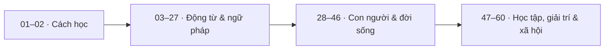

# 📚 Lộ trình từ vựng tiếng Anh — 60 Unit


> [!SUMMARY] Mỗi Unit là một bước tiến
> 60 Unit được chia thành **9 module** theo chủ đề, từ phương pháp ghi nhớ đến giao tiếp và đời sống. Dùng bảng này để mở bài học, đánh dấu hoàn thành và nhận ra phần nào cần ôn lại.

**09 module** &nbsp;·&nbsp; **60 Unit** &nbsp;·&nbsp; **60 liên kết bài học** &nbsp;·&nbsp; **0/60 Unit đã đánh dấu**

> [!NOTE] Trạng thái ban đầu
> Tất cả các ô đều để trống theo danh sách bạn cung cấp. Số liệu tiến độ ở phần tổng quan là **mốc khởi đầu**, không tự thay đổi khi đánh dấu trong Markdown thuần. Nếu website học tập có tính năng lưu tiến độ, hãy để website tính số bài đã hoàn thành từ trạng thái checkbox.

## 1. Mục tiêu học tập

- [ ] Có một quy trình nhất quán để học và ôn từ mới.
- [ ] Hoàn thành 60 bài theo 9 nhóm chủ đề.
- [ ] Tự làm bài tập đi kèm và hoàn thành 5 câu ôn tập cho mỗi bài.
- [ ] Chủ động nhận ra các từ, cụm từ và cấu trúc cần ôn thêm.

## 2. Cách sử dụng bảng theo dõi

1. **Mở bài học:** Chọn tiêu đề Unit để chuyển tới file Markdown tương ứng trong thư mục `modules/`.
2. **Học chủ động:** Ghi lại từ/cụm từ trọng tâm, tự đặt câu và thử nhớ lại mà không nhìn tài liệu.
3. **Luyện tập:** Hoàn thành bài tập gốc, sau đó làm đủ **5 câu ôn tập** của Unit.
4. **Đánh dấu:** Chỉ đổi `- [ ]` thành `- [x]` khi đã hoàn thành cả ba điều kiện: **học bài + bài tập gốc + 5 câu ôn tập**.
5. **Ôn lại:** Quay lại những Unit còn khó, không cần xóa dấu hoàn thành khi ôn tập.

> [!TIP] Học ít nhưng đều
> Bạn có thể chọn nhịp **1–2 Unit mỗi buổi** và dành vài phút cuối buổi để tự nhắc lại từ vựng. Đây là nhịp học gợi ý, không phải thời lượng bắt buộc của khóa học.

## 3. Bản đồ lộ trình

| Chặng | Module | Trọng tâm | Số Unit |
| :---: | --- | --- | ---: |
| **01** | [🧠 Học cách học từ vựng](#module-01) | Thiết lập cách ghi chép, ghi nhớ và sử dụng từ vựng chủ động. | **2** |
| **02** | [⚡ Động từ trong đời sống](#module-02) | Nhận diện và vận dụng các động từ phổ biến, động từ chuyển động và cụm động từ. | **12** |
| **03** | [🧩 Từ vựng và ngữ pháp](#module-03) | Tổ chức câu rõ nghĩa hơn qua từ nối, thời gian, vị trí, tính từ và cấu tạo từ. | **13** |
| **04** | [👥 Con người](#module-04) | Diễn đạt thông tin về gia đình, ngoại hình, trang phục, sức khỏe và cảm xúc. | **8** |
| **05** | [🌍 Thế giới xung quanh](#module-05) | Gọi tên và mô tả thế giới bên ngoài: địa lý, thời tiết, động vật, du lịch và biển báo. | **7** |
| **06** | [🏠 Không gian trong nhà](#module-06) | Nhận biết và sử dụng từ vựng về món ăn, đồ uống cùng các phòng trong nhà. | **4** |
| **07** | [🎓 Trường học và công việc](#module-07) | Sử dụng từ vựng liên quan đến nghề nghiệp, trường học và liên lạc. | **3** |
| **08** | [🎒 Giải trí, mua sắm và du lịch](#module-08) | Chuẩn bị vốn từ cho kỳ nghỉ, cửa hàng, khách sạn, nhà hàng, thể thao và giải trí. | **7** |
| **09** | [📰 Vấn đề xã hội](#module-09) | Nhận diện và trao đổi về tin tức, các sự cố thường ngày và vấn đề xã hội. | **4** |
| | **Tổng cộng** | **9 module** | **60** |



**Cách đọc sơ đồ:** Bắt đầu với phương pháp tự học, phát triển vốn từ và cấu trúc câu, rồi chuyển sang các tình huống đời sống và xã hội. Đây là cách nhóm các Unit để dễ hình dung hành trình, không phải các bài học mới.

## 4. Checklist 60 Unit

> **Quy ước:** `- [ ]` chưa hoàn thành · `- [x]` đã hoàn thành. Tiêu đề Unit là liên kết tương đối; giữ nguyên cấu trúc thư mục để link hoạt động.

<a id="module-01"></a>
### 4.1. 🧠 Module 01 — Học cách học từ vựng

**2 Unit · Unit 01–02**

> **Mục tiêu của module:** Thiết lập cách ghi chép, ghi nhớ và sử dụng từ vựng chủ động.

- [ ] **Unit 01** — [Nói về ngôn ngữ](modules/01-learner-training/01-talking-about-language.md)
- [ ] **Unit 02** — [Phương pháp học từ vựng](modules/01-learner-training/02-learning-vocabulary.md)

---

<a id="module-02"></a>
### 4.2. ⚡ Module 02 — Động từ trong đời sống

**12 Unit · Unit 03–14**

> **Mục tiêu của module:** Nhận diện và vận dụng các động từ phổ biến, động từ chuyển động và cụm động từ.

- [ ] **Unit 03** — [Động từ have và các cụm thông dụng](modules/02-everyday-verbs/03-have-had-had.md)
- [ ] **Unit 04** — [Di chuyển với go](modules/02-everyday-verbs/04-go-went-gone.md)
- [ ] **Unit 05** — [Do trong câu hỏi và công việc](modules/02-everyday-verbs/05-do-did-done.md)
- [ ] **Unit 06** — [Make và sự tạo ra](modules/02-everyday-verbs/06-make-made-made.md)
- [ ] **Unit 07** — [Come: đi đến phía người nói](modules/02-everyday-verbs/07-come-came-come.md)
- [ ] **Unit 08** — [Take: thời gian, phương tiện và mang theo](modules/02-everyday-verbs/08-take-took-taken.md)
- [ ] **Unit 09** — [Phân biệt bring và take](modules/02-everyday-verbs/09-bring-brought-brought.md)
- [ ] **Unit 10** — [Các cách dùng đa dạng của get](modules/02-everyday-verbs/10-get-got-got.md)
- [ ] **Unit 11** — [Cụm động từ](modules/02-everyday-verbs/11-phrasal-verbs.md)
- [ ] **Unit 12** — [Các hoạt động hằng ngày](modules/02-everyday-verbs/12-everyday-things.md)
- [ ] **Unit 13** — [Say, tell, ask và speak](modules/02-everyday-verbs/13-talking.md)
- [ ] **Unit 14** — [Động từ di chuyển và phương tiện](modules/02-everyday-verbs/14-moving.md)

> [!TIP] Điểm kiểm tra tiến độ
> **Cột mốc 01 · 14/60:** Đã đi qua phương pháp học và nhóm động từ thông dụng.

---

<a id="module-03"></a>
### 4.3. 🧩 Module 03 — Từ vựng và ngữ pháp

**13 Unit · Unit 15–27**

> **Mục tiêu của module:** Tổ chức câu rõ nghĩa hơn qua từ nối, thời gian, vị trí, tính từ và cấu tạo từ.

- [ ] **Unit 15** — [Từ nối và liên từ](modules/03-words-and-grammar/15-conjunctions-and-connecting-words.md)
- [ ] **Unit 16** — [Ngày, tháng và mùa](modules/03-words-and-grammar/16-time-words-1-days-months-and-seasons.md)
- [ ] **Unit 17** — [Mốc thời gian và tần suất](modules/03-words-and-grammar/17-time-words-2.md)
- [ ] **Unit 18** — [Vị trí và phương hướng](modules/03-words-and-grammar/18-places.md)
- [ ] **Unit 19** — [Cách thức thực hiện hành động](modules/03-words-and-grammar/19-manner.md)
- [ ] **Unit 20** — [Động từ bất quy tắc](modules/03-words-and-grammar/20-irregular-verbs.md)
- [ ] **Unit 21** — [Danh từ không đếm được](modules/03-words-and-grammar/21-common-uncountable-words.md)
- [ ] **Unit 22** — [Tính từ đánh giá sự vật](modules/03-words-and-grammar/22-common-adjectives-good-and-bad-things.md)
- [ ] **Unit 23** — [Tính từ miêu tả tính cách](modules/03-words-and-grammar/23-common-adjectives-people.md)
- [ ] **Unit 24** — [Từ thường đi với giới từ](modules/03-words-and-grammar/24-words-and-prepositions.md)
- [ ] **Unit 25** — [Tiền tố](modules/03-words-and-grammar/25-prefixes.md)
- [ ] **Unit 26** — [Hậu tố](modules/03-words-and-grammar/26-suffixes.md)
- [ ] **Unit 27** — [Những cặp từ dễ nhầm](modules/03-words-and-grammar/27-words-you-may-confuse.md)

> [!TIP] Điểm kiểm tra tiến độ
> **Cột mốc 02 · 27/60:** Đã học thêm từ vựng và ngữ pháp nền tảng.

---

<a id="module-04"></a>
### 4.4. 👥 Module 04 — Con người

**8 Unit · Unit 28–35**

> **Mục tiêu của module:** Diễn đạt thông tin về gia đình, ngoại hình, trang phục, sức khỏe và cảm xúc.

- [ ] **Unit 28** — [Sinh, kết hôn và qua đời](modules/04-people/28-birth-marriage-and-death.md)
- [ ] **Unit 29** — [Gia đình và họ hàng](modules/04-people/29-the-family.md)
- [ ] **Unit 30** — [Các bộ phận cơ thể](modules/04-people/30-parts-of-the-body.md)
- [ ] **Unit 31** — [Trang phục](modules/04-people/31-clothes.md)
- [ ] **Unit 32** — [Miêu tả ngoại hình](modules/04-people/32-describing-people.md)
- [ ] **Unit 33** — [Sức khỏe và bệnh tật](modules/04-people/33-health-and-illness.md)
- [ ] **Unit 34** — [Cảm xúc](modules/04-people/34-feelings.md)
- [ ] **Unit 35** — [Chào hỏi và các câu giao tiếp](modules/04-people/35-greetings-and-other-useful-phrases.md)

---

<a id="module-05"></a>
### 4.5. 🌍 Module 05 — Thế giới xung quanh

**7 Unit · Unit 36–42**

> **Mục tiêu của module:** Gọi tên và mô tả thế giới bên ngoài: địa lý, thời tiết, động vật, du lịch và biển báo.

- [ ] **Unit 36** — [Quốc gia, ngôn ngữ và quốc tịch](modules/05-the-world/36-countries-languages-and-people.md)
- [ ] **Unit 37** — [Thời tiết](modules/05-the-world/37-weather.md)
- [ ] **Unit 38** — [Các địa điểm trong thành phố](modules/05-the-world/38-in-the-town.md)
- [ ] **Unit 39** — [Vùng nông thôn](modules/05-the-world/39-in-the-countryside.md)
- [ ] **Unit 40** — [Động vật và thú cưng](modules/05-the-world/40-animals-and-pets.md)
- [ ] **Unit 41** — [Đi lại và du lịch](modules/05-the-world/41-travelling.md)
- [ ] **Unit 42** — [Các biển báo và thông báo](modules/05-the-world/42-notices.md)

> [!TIP] Điểm kiểm tra tiến độ
> **Cột mốc 03 · 42/60:** Đã mở rộng vốn từ về con người và thế giới xung quanh.

---

<a id="module-06"></a>
### 4.6. 🏠 Module 06 — Không gian trong nhà

**4 Unit · Unit 43–46**

> **Mục tiêu của module:** Nhận biết và sử dụng từ vựng về món ăn, đồ uống cùng các phòng trong nhà.

- [ ] **Unit 43** — [Đồ ăn và thức uống](modules/06-at-home/43-food-and-drink.md)
- [ ] **Unit 44** — [Đồ dùng trong bếp](modules/06-at-home/44-in-the-kitchen.md)
- [ ] **Unit 45** — [Đồ dùng phòng ngủ và phòng tắm](modules/06-at-home/45-in-the-bedroom-and-bathroom.md)
- [ ] **Unit 46** — [Đồ dùng phòng khách](modules/06-at-home/46-in-the-living-room.md)

---

<a id="module-07"></a>
### 4.7. 🎓 Module 07 — Trường học và công việc

**3 Unit · Unit 47–49**

> **Mục tiêu của module:** Sử dụng từ vựng liên quan đến nghề nghiệp, trường học và liên lạc.

- [ ] **Unit 47** — [Nghề nghiệp và công việc](modules/07-school-and-workplace/47-jobs.md)
- [ ] **Unit 48** — [Ở trường học và đại học](modules/07-school-and-workplace/48-at-school-and-university.md)
- [ ] **Unit 49** — [Giao tiếp qua thư từ và công nghệ](modules/07-school-and-workplace/49-communications.md)

---

<a id="module-08"></a>
### 4.8. 🎒 Module 08 — Giải trí, mua sắm và du lịch

**7 Unit · Unit 50–56**

> **Mục tiêu của module:** Chuẩn bị vốn từ cho kỳ nghỉ, cửa hàng, khách sạn, nhà hàng, thể thao và giải trí.

- [ ] **Unit 50** — [Kỳ nghỉ](modules/08-leisure/50-holidays.md)
- [ ] **Unit 51** — [Cửa hàng và mua sắm](modules/08-leisure/51-shops-and-shopping.md)
- [ ] **Unit 52** — [Ở khách sạn](modules/08-leisure/52-in-a-hotel.md)
- [ ] **Unit 53** — [Đi ăn ngoài](modules/08-leisure/53-eating-out.md)
- [ ] **Unit 54** — [Thể thao](modules/08-leisure/54-sports.md)
- [ ] **Unit 55** — [Phim ảnh và điện ảnh](modules/08-leisure/55-cinema.md)
- [ ] **Unit 56** — [Giải trí tại nhà](modules/08-leisure/56-leisure-at-home.md)

---

<a id="module-09"></a>
### 4.9. 📰 Module 09 — Vấn đề xã hội

**4 Unit · Unit 57–60**

> **Mục tiêu của module:** Nhận diện và trao đổi về tin tức, các sự cố thường ngày và vấn đề xã hội.

- [ ] **Unit 57** — [Từ vựng về tội phạm](modules/09-social-issues/57-crime.md)
- [ ] **Unit 58** — [Truyền thông](modules/09-social-issues/58-the-media.md)
- [ ] **Unit 59** — [Những rắc rối thường ngày](modules/09-social-issues/59-everyday-problems.md)
- [ ] **Unit 60** — [Các vấn đề toàn cầu](modules/09-social-issues/60-global-problems.md)

> [!TIP] Điểm kiểm tra tiến độ
> **Cột mốc cuối · 60/60:** Hoàn thành cả 9 module; có thể chuyển sang ôn tập tổng hợp.

---

## 5. Cách tự kiểm tra sau mỗi Unit

Để việc đánh dấu phản ánh năng lực sử dụng từ vựng, sau khi học và làm bài tập, hãy thử trả lời 5 câu hỏi tự kiểm tra dưới đây **nếu bài học chưa có phần ôn tập riêng**:

1. Tôi vừa học những từ/cụm từ quan trọng nào? Nêu ít nhất 3 ví dụ.
2. Mỗi từ/cụm từ này có nghĩa gì và dùng trong ngữ cảnh nào?
3. Tôi có thể tự viết một câu tiếng Anh tự nhiên với từ/cụm từ đó không?
4. Có cặp từ, cách dùng hoặc lỗi thường gặp nào tôi cần phân biệt không?
5. Nếu đóng tài liệu lại, tôi còn nhớ được bao nhiêu từ và cách dùng?

> [!IMPORTANT] Tiêu chí hoàn thành
> 5 câu tự kiểm tra trên là **phương án bổ trợ**. Nếu file Unit đã có 5 câu ôn tập chính thức, hãy làm các câu hỏi đó để đáp ứng điều kiện hoàn thành ban đầu.

## 6. Nhật ký học tập cá nhân

| Mục theo dõi | Ghi chép |
| --- | --- |
| Ngày bắt đầu | `____ / ____ / ______` |
| Unit đang học | `Unit ____` |
| Unit cần ôn lại | `________________________` |
| Từ/cụm từ dễ nhầm | `________________________` |
| Mục tiêu buổi tiếp theo | `________________________` |

### Mẫu ghi chú ngắn cho một Unit

```text
Unit: ____     Ngày học: ____ / ____ / ______
3 từ/cụm từ mới: ___________________________
1 câu tự đặt: ______________________________
1 lỗi cần tránh: ___________________________
Bài tập gốc: [ ]   5 câu ôn tập: [ ]
```

## 7. Góc học tập và nguồn ảnh


Ảnh minh họa lấy từ **Unsplash**; ảnh trực tuyến cần kết nối Internet để hiển thị. Nguồn tham khảo: [góc học tập](https://unsplash.com/es/s/fotos/escritorio-de-estudio) và [sổ tay ghi chú](https://unsplash.com/fr/photos/un-bureau-avec-un-ordinateur-portable-un-bloc-notes-un-stylo-et-un-telephone-portable-_cgcOEWKSKM). Xem [giấy phép Unsplash](https://unsplash.com/license) trước khi tái sử dụng ảnh cho mục đích khác.

---

**Điểm bắt đầu:** [Unit 01 — Nói về ngôn ngữ](modules/01-learner-training/01-talking-about-language.md) · **Điểm kết thúc:** [Unit 60 — Các vấn đề toàn cầu](modules/09-social-issues/60-global-problems.md)

*Tiến độ có ý nghĩa nhất khi mỗi ô được đánh dấu sau khi bạn thực sự có thể sử dụng kiến thức vừa học.*
