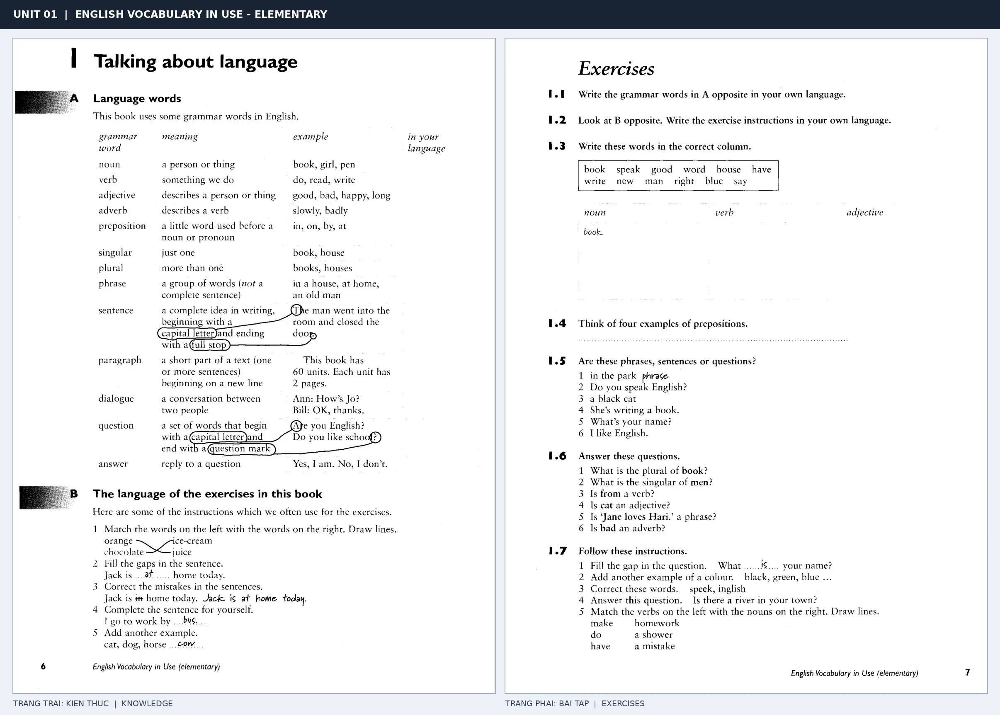
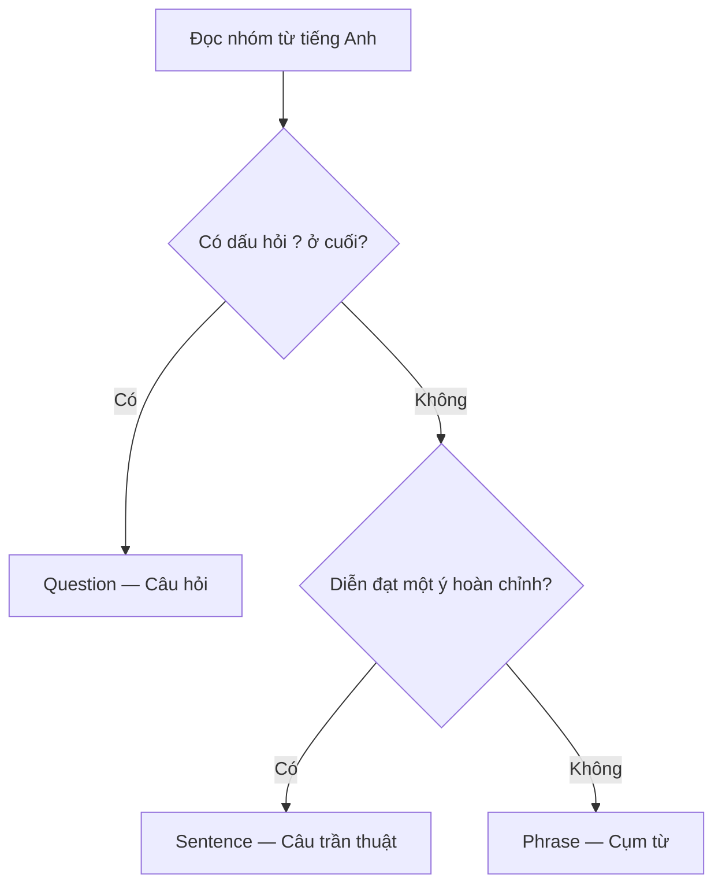

# Unit 01 — Talking about language: Nói về ngôn ngữ

> **Module 01:** Học cách học từ vựng  
> **Giáo trình:** *English Vocabulary in Use — Elementary*, Unit 1, trang in 6–7  
> **Trình độ:** A1–A2  
> **Trọng tâm:** Thuật ngữ ngữ pháp cơ bản, cách phân biệt cụm từ và câu, cách đọc yêu cầu bài tập.

*Trang trái: Language words và The language of the exercises in this book. Trang phải: Exercises 1.1–1.7. Phóng to ảnh khi cần đối chiếu cách trình bày trong sách.*

## 1. Tổng quan và mục tiêu học tập

Khi học tiếng Anh, bạn thường gặp các chỉ dẫn như **Write the plural**, **Correct the mistakes** hoặc **Match the words**. Muốn tự học hiệu quả, trước hết bạn phải hiểu những thuật ngữ và câu chỉ dẫn đó.

Sau khi hoàn thành bài này, bạn có thể:

- **Nhận diện và giải thích** năm loại từ cơ bản: *noun, verb, adjective, adverb* và *preposition*.
- **Phân biệt** *singular* với *plural*; *phrase*, *sentence*, *paragraph* và *dialogue*.
- **Nhận biết** câu hỏi (*question*) và câu trả lời (*answer*) qua ví dụ đơn giản.
- **Thực hiện đúng** năm dạng hướng dẫn thường gặp trong bài tập tiếng Anh.
- **Áp dụng** kiến thức để hoàn thành Exercises 1.1–1.7 và tự tạo ví dụ.

## 2. Language words — Các thuật ngữ về ngôn ngữ

### 2.1. Năm loại từ cơ bản

Mỗi từ có một vai trò trong câu. Hãy học **tên loại từ**, **chức năng** và **ví dụ** cùng lúc; không chỉ học bản dịch.

| Thuật ngữ | Nghĩa tiếng Việt | Chức năng trong bài | Ví dụ |
| --- | --- | --- | --- |
| **noun** | Danh từ | Gọi tên người hoặc vật | *book* (sách), *girl* (cô gái), *pen* (bút) |
| **verb** | Động từ | Diễn tả việc làm, hành động | *do* (làm), *read* (đọc), *write* (viết) |
| **adjective** | Tính từ | Miêu tả người hoặc vật | *good* (tốt), *bad* (xấu/tệ), *happy* (vui), *long* (dài) |
| **adverb** | Trạng từ | Bổ nghĩa cho động từ | *slowly* (một cách chậm rãi), *badly* (một cách tệ) |
| **preposition** | Giới từ | Từ ngắn thường đứng trước danh từ hoặc đại từ để tạo quan hệ với phần khác | *in* (trong), *on* (trên), *by* (bằng/bởi), *at* (ở/tại) |

**Cách nhận diện trong ngữ cảnh:**

- *She reads a book.* — Cô ấy đọc một cuốn sách. Ở đây, **reads** là *verb*; **book** là *noun*.
- *It is a good book.* — Đó là một cuốn sách hay. **good** là *adjective* vì miêu tả **book**.
- *She reads slowly.* — Cô ấy đọc chậm rãi. **slowly** là *adverb* vì miêu tả cách đọc.
- *The book is on the table.* — Cuốn sách ở trên bàn. **on** là *preposition*.

> **Dễ nhầm:** *good* là tính từ; *slowly* là trạng từ. Đừng cho rằng từ nào miêu tả cũng là *adjective*: cần xem nó miêu tả **danh từ** hay **động từ**.

### 2.2. Singular và plural — Số ít và số nhiều

| Thuật ngữ | Nghĩa | Ví dụ |
| --- | --- | --- |
| **singular** | Số ít: một người hoặc một vật | *book*, *house* |
| **plural** | Số nhiều: hơn một người hoặc một vật | *books*, *houses* |

Với những danh từ thông thường như *book* và *house*, có thể thêm **-s** để tạo số nhiều. Tuy nhiên, không phải danh từ nào cũng tuân theo cách này: **man → men** là một ví dụ số nhiều bất quy tắc xuất hiện trong bài tập.

- *one book* → *two books* (một cuốn sách → hai cuốn sách)
- *one house* → *three houses* (một ngôi nhà → ba ngôi nhà)
- *one man* → *two men* (một người đàn ông → hai người đàn ông)

### 2.3. Phrase, sentence và paragraph — Cụm từ, câu và đoạn văn

| Thuật ngữ | Nghĩa và dấu hiệu | Ví dụ |
| --- | --- | --- |
| **phrase** | Cụm từ: nhóm từ chưa diễn đạt thành một câu hoàn chỉnh | *in a house*, *at home*, *an old man* |
| **sentence** | Câu: diễn đạt một ý hoàn chỉnh; thông thường bắt đầu bằng chữ hoa và kết thúc bằng dấu câu | *The man went into the room and closed the door.* |
| **paragraph** | Đoạn văn: một hoặc nhiều câu trình bày thành một phần riêng, thường bắt đầu ở dòng mới | *This book has 60 units. Each unit has 2 pages.* |

Xét ba ví dụ:

1. **in the park** — *ở trong công viên*: là **phrase**, vì chưa nói rõ ai làm gì.
2. **I like English.** — *Tôi thích tiếng Anh.*: là **sentence**, vì có chủ thể và diễn đạt một ý hoàn chỉnh.
3. **This book has 60 units. Each unit has 2 pages.** — Hai câu đứng cùng nhau có thể tạo thành **paragraph** khi được trình bày thành một đoạn.

Một câu đơn giản thường có dạng:

**Subject (chủ ngữ) + Verb (động từ) + thông tin bổ sung**

Ví dụ: **She** *(subject)* **reads** *(verb)* **a book** *(thông tin bổ sung)*.

### 2.4. Dialogue, question và answer — Hội thoại, câu hỏi và câu trả lời

| Thuật ngữ | Nghĩa | Dấu hiệu hoặc ví dụ |
| --- | --- | --- |
| **dialogue** | Hội thoại giữa hai người | *Ann: How's Jo? — Bill: OK, thanks.* |
| **question** | Câu hỏi | *Are you English?* / *Do you like school?* |
| **answer** | Câu trả lời | *Yes, I am.* / *No, I don't.* |

**Ví dụ hội thoại:**

> **A:** Do you speak English? — Bạn có nói tiếng Anh không?  
> **B:** Yes, I do. — Có.

Trong bài này, hãy chú ý hai dấu hiệu: **question** thường kết thúc bằng dấu hỏi `?`, còn câu trần thuật trong các ví dụ kết thúc bằng dấu chấm `.`. Câu hỏi cũng là một dạng câu trong ngữ pháp nói chung, nhưng **Exercises 1.5** tách *question* và *sentence* thành hai nhóm để luyện nhận diện.

## 3. Phân biệt phrase, sentence và question

Đây là **mẹo xử lý các ví dụ trong Unit 01**, không phải quy tắc bao quát mọi kiểu câu tiếng Anh.

| Ví dụ | Phân loại | Giải thích |
| --- | --- | --- |
| *a black cat* | **Phrase** | Chỉ một con mèo đen; chưa tạo ý hoàn chỉnh. |
| *She's writing a book.* | **Sentence** | Nêu trọn vẹn việc cô ấy đang làm. |
| *What's your name?* | **Question** | Hỏi tên người nghe và kết thúc bằng `?`. |

## 4. The language of the exercises — Ngôn ngữ chỉ dẫn bài tập

Bạn sẽ thường gặp những câu lệnh sau. Điều quan trọng là hiểu **mình phải làm gì**, không chỉ dịch nghĩa từng từ.

| Câu chỉ dẫn tiếng Anh | Cách hiểu bằng tiếng Việt | Thao tác cần thực hiện |
| --- | --- | --- |
| **Match the words on the left with the words on the right. Draw lines.** | Nối các từ bên trái với các từ bên phải. Kẻ đường nối. | Tìm cặp từ phù hợp. |
| **Fill the gaps in the sentence.** | Điền vào chỗ trống trong câu. | Viết từ còn thiếu. |
| **Correct the mistakes in the sentences.** | Sửa các lỗi sai trong câu. | Tìm lỗi, sau đó viết cách đúng. |
| **Complete the sentence for yourself.** | Hoàn thành câu theo thông tin của bản thân. | Tự chọn câu trả lời đúng với mình. |
| **Add another example.** | Thêm một ví dụ khác. | Viết thêm một từ hoặc trường hợp cùng nhóm. |

**Ví dụ minh họa từng thao tác:**

1. **Match:** *orange* ↔ *juice*; *chocolate* ↔ *ice cream*. Bạn nối các từ tạo thành tổ hợp phù hợp.
2. **Fill:** *Jack is ___ home today.* → Điền **at**.
3. **Correct:** *Jack is in home today.* → **Jack is at home today.**
4. **Complete:** *I go to work by ___.* → Có thể viết **bus**, nếu đó là cách bạn đi làm.
5. **Add:** *cat, dog, horse, ...* → Có thể thêm **cow**.

Hai chỉ dẫn bổ sung cũng xuất hiện trong Exercises 1.7:

- **Answer this question.** — Trả lời câu hỏi này.
- **Write these words in the correct column.** — Viết các từ vào đúng cột.

> **Ghi nhớ:** *fill* = điền, *match* = nối/ghép, *correct* = sửa, *complete* = hoàn thành, *add* = thêm, *answer* = trả lời.

## 5. Luyện tập theo Exercises 1.1–1.7

Hãy tự làm trước khi xem lại bảng kiến thức phía trên. Các phần dưới đây giữ nguyên phạm vi kỹ năng của bài tập; những câu hỏi về địa phương hoặc bản thân có thể có nhiều đáp án đúng.

### 5.1. Exercise 1.1 — Dịch thuật ngữ ngữ pháp

**Yêu cầu:** Viết nghĩa tiếng Việt tương ứng cho 13 thuật ngữ.

| Thuật ngữ | Nghĩa tiếng Việt (tự điền) | Thuật ngữ | Nghĩa tiếng Việt (tự điền) |
| --- | --- | --- | --- |
| noun | … | verb | … |
| adjective | … | adverb | … |
| preposition | … | singular | … |
| plural | … | phrase | … |
| sentence | … | paragraph | … |
| dialogue | … | question | … |
| answer | … | | |

**Tự kiểm tra:** Bạn có thể nêu một ví dụ tiếng Anh cho từng loại từ trong năm loại đầu tiên không?

### 5.2. Exercise 1.2 — Hiểu chỉ dẫn bài tập

**Yêu cầu:** Diễn đạt năm chỉ dẫn ở mục 4 bằng tiếng Việt của riêng bạn. Với mỗi chỉ dẫn, viết thêm một câu ngắn mô tả hành động cần làm.

*Ví dụ về cách trả lời:* **Fill the gaps** → Điền từ phù hợp vào ô trống.

### 5.3. Exercise 1.3 — Phân loại noun, verb và adjective

**Yêu cầu:** Xếp 12 từ sau vào đúng cột.

**book · speak · good · word · house · have · write · new · man · right · blue · say**

| Noun — Danh từ | Verb — Động từ | Adjective — Tính từ |
| --- | --- | --- |
| book (mẫu) | … | … |
| … | … | … |
| … | … | … |
| … | … | … |

**Mẹo:** Hãy hỏi: Từ này dùng để **gọi tên**, **diễn tả việc làm** hay **miêu tả**? Trong bài tập này, mỗi từ được xếp theo vai trò phù hợp nhất với yêu cầu.

### 5.4. Exercise 1.4 — Tìm bốn giới từ

**Yêu cầu:** Viết **bốn ví dụ** về *prepositions*.

**Trả lời:** 1. ________ · 2. ________ · 3. ________ · 4. ________

Gợi ý: nhớ lại các cụm *at home*, *in a house* và *on the table*.

### 5.5. Exercise 1.5 — Phrase, sentence hay question?

**Yêu cầu:** Phân loại từng dòng là **phrase**, **sentence** hoặc **question**.

| STT | Tiếng Anh | Loại (tự điền) |
| --- | --- | --- |
| 1 | *in the park* | … |
| 2 | *Do you speak English?* | … |
| 3 | *a black cat* | … |
| 4 | *She's writing a book.* | … |
| 5 | *What's your name?* | … |
| 6 | *I like English.* | … |

**Tự kiểm tra:** Với mỗi *phrase*, thử thêm chủ ngữ và động từ để biến nó thành một câu hoàn chỉnh.

### 5.6. Exercise 1.6 — Trả lời câu hỏi về ngữ pháp

**Yêu cầu:** Viết câu trả lời ngắn bằng tiếng Anh.

1. What is the plural of **book**? → ____________________
2. What is the singular of **men**? → ____________________
3. Is **from** a verb? → ____________________
4. Is **cat** an adjective? → ____________________
5. Is **Jane loves Hari.** a phrase? → ____________________
6. Is **bad** an adverb? → ____________________

**Mẹo:** Với câu hỏi **Is ...?**, bạn có thể trả lời *Yes, it is.* hoặc *No, it isn't.*, rồi giải thích ngắn loại từ đúng.

### 5.7. Exercise 1.7 — Làm theo chỉ dẫn

**Yêu cầu:** Đọc kỹ từ chỉ hành động (*fill, add, correct, answer, match*) rồi thực hiện từng nhiệm vụ.

1. **Fill the gap:** *What ______ your name?*
2. **Add another example of a colour:** *black, green, blue, ______*
3. **Correct these words:** *speek, inglish* → ____________________
4. **Answer this question:** *Is there a river in your town?* → ____________________
5. **Match the verbs with the nouns:** Nối ba động từ **make / do / have** với ba cụm danh từ **homework / a shower / a mistake**.

**Lưu ý:** Câu 4 phụ thuộc vào nơi bạn sống. Bạn có thể viết câu trả lời ngắn, chẳng hạn *Yes, there is.* hoặc *No, there isn't.*, nếu đúng với thực tế.

## 6. Vận dụng: Tự tạo ví dụ

**Bài A — Nhận diện từ loại.** Đọc câu *The happy girl writes slowly.* và xác định:

- Từ nào là **noun**?
- Từ nào là **verb**?
- Từ nào là **adjective**?
- Từ nào là **adverb**?

**Bài B — Biến đổi câu.** Hãy viết ba dòng theo thứ tự:

1. Một **phrase** chỉ địa điểm, ví dụ *at school*.
2. Một **sentence** sử dụng cụm từ đó, ví dụ *I study at school.*
3. Một **question** liên quan, ví dụ *Do you study at school?*

**Bài C — Giải thích lại.** Dùng tiếng Việt của bạn để giải thích sự khác biệt giữa **noun** và **adjective**, rồi đưa ra mỗi loại hai ví dụ tiếng Anh.

## 7. Câu hỏi ôn tập — Trắc nghiệm (24 câu)

> [!TIP] Cách làm
> Chọn **một đáp án đúng nhất** trong bốn lựa chọn A–D. Hãy tự trả lời trước khi xem giải thích. Trên website có hỗ trợ quiz Markdown, đáp án có thể được ẩn tới lúc nộp bài.

**Phạm vi:** Từ loại (câu 1–2, 7–11), số ít/số nhiều (câu 3, 12–13), cụm từ–câu–hội thoại (câu 4, 6, 14–16), hướng dẫn bài tập và vận dụng (câu 5, 17–24).

### Câu 1

Trong câu *She reads a book.*, từ nào là **verb**?

A. **reads**  
B. **book**  
C. **She**  
D. **a**  

**Đáp án:** A. **Giải thích:** **reads** diễn tả hành động đọc, còn **book** là danh từ.

### Câu 2

Trong câu *He walks slowly.*, **slowly** thuộc loại từ nào?

A. Noun  
B. Adverb  
C. Preposition  
D. Adjective  

**Đáp án:** B. **Giải thích:** **slowly** bổ nghĩa cho động từ **walks**, cho biết cách thức đi bộ.

### Câu 3

Đâu là dạng **plural** của *house*?

A. house  
B. housing  
C. houses  
D. housed  

**Đáp án:** C. **Giải thích:** **houses** là số nhiều của **house**: thêm **-s**.

### Câu 4

Cụm *an old man* được phân loại là gì trong Unit 01?

A. Paragraph  
B. Question  
C. Dialogue  
D. Phrase  

**Đáp án:** D. **Giải thích:** **an old man** là cụm từ, không phải câu hoàn chỉnh hay đoạn hội thoại.

### Câu 5

Chỉ dẫn **Correct the mistakes in the sentences** yêu cầu làm gì?

A. Tìm và sửa lỗi sai trong câu  
B. Nối các cặp từ tương ứng  
C. Điền thêm một ví dụ màu sắc  
D. Viết lại nội dung thành hội thoại  

**Đáp án:** A. **Giải thích:** **correct** nghĩa là sửa; nhiệm vụ là phát hiện lỗi và viết câu đúng, không chỉ chỉ ra vị trí lỗi.

### Câu 6

Trong các lựa chọn sau, đâu là **question**?

A. *a black cat*  
B. *at home*  
C. *Do you like school?*  
D. *She likes English.*  

**Đáp án:** C. **Giải thích:** **Do you like school?** có cấu trúc hỏi và dấu hỏi; hai lựa chọn đầu là cụm từ, lựa chọn cuối là câu trần thuật.

### Câu 7

Trong *The happy girl writes slowly.*, từ nào là **noun**?

A. happy  
B. girl  
C. writes  
D. slowly  

**Đáp án:** B. **Giải thích:** **girl** gọi tên người nên là danh từ; ba từ còn lại lần lượt là tính từ, động từ và trạng từ.

### Câu 8

Trong *The happy girl writes slowly.*, từ nào là **adjective**?

A. writes  
B. slowly  
C. girl  
D. happy  

**Đáp án:** D. **Giải thích:** **happy** miêu tả **girl** nên là tính từ.

### Câu 9

Trong *The book is on the table.*, từ nào là **preposition** chỉ vị trí?

A. on  
B. book  
C. table  
D. is  

**Đáp án:** A. **Giải thích:** **on** nối vị trí của cuốn sách với chiếc bàn nên là giới từ trong câu.

### Câu 10

Từ nào được dùng như **noun** trong các ví dụ của bài?

A. write  
B. good  
C. house  
D. by  

**Đáp án:** C. **Giải thích:** **house** gọi tên một vật/địa điểm; **write** là động từ, **good** là tính từ và **by** là giới từ trong các ví dụ đã học.

### Câu 11

Trong cụm *a blue pen*, **blue** có chức năng gì?

A. Verb  
B. Adjective  
C. Noun  
D. Adverb  

**Đáp án:** B. **Giải thích:** **blue** miêu tả màu sắc của **pen**, vì vậy được dùng như tính từ.

### Câu 12

Đâu là dạng **singular** của *men*?

A. man  
B. mans  
C. mens  
D. men  

**Đáp án:** A. **Giải thích:** **man** là dạng số ít; **men** là số nhiều bất quy tắc.

### Câu 13

Cặp từ nào minh họa **số nhiều bất quy tắc** trong bài?

A. book → books  
B. house → houses  
C. pen → pens  
D. man → men  

**Đáp án:** D. **Giải thích:** **man → men** thay đổi dạng từ thay vì chỉ thêm **-s**.

### Câu 14

Khi hai câu *This book has 60 units. Each unit has 2 pages.* được trình bày cùng một phần riêng, phần đó có thể gọi là gì?

A. Phrase  
B. Preposition  
C. Paragraph  
D. Noun  

**Đáp án:** C. **Giải thích:** **paragraph** là đoạn văn, có thể gồm một hoặc nhiều câu trình bày thành một phần riêng.

### Câu 15

Đoạn nào thể hiện một **dialogue**?

A. *at home*  
B. *Ann: How’s Jo? — Bill: OK, thanks.*  
C. *The book is on the table.*  
D. *an old man*  

**Đáp án:** B. **Giải thích:** Hai lượt lời của **Ann** và **Bill** tạo thành một đoạn hội thoại.

### Câu 16

Câu trả lời nào phù hợp với *Do you like school?*?

A. Yes, I am.  
B. Yes, it is.  
C. Yes, I can.  
D. Yes, I do.  

**Đáp án:** D. **Giải thích:** Câu hỏi bắt đầu bằng **Do you…?** nên có thể trả lời **Yes, I do.**

### Câu 17

Trong bài tập, **Match the words** thường yêu cầu thao tác nào?

A. Ghép các từ thành cặp phù hợp  
B. Sửa lỗi chính tả của các từ  
C. Viết thêm một từ cùng chủ đề  
D. Trả lời một câu hỏi cá nhân  

**Đáp án:** A. **Giải thích:** **match** là nối hoặc ghép những mục có quan hệ tương ứng.

### Câu 18

Bạn gặp chỉ dẫn **Fill the gaps in the sentence.** Bạn cần làm gì?

A. Khoanh tròn động từ trong câu  
B. Viết một đoạn văn mới  
C. Điền từ còn thiếu vào chỗ trống  
D. Sắp xếp từ theo bảng chữ cái  

**Đáp án:** C. **Giải thích:** **fill the gaps** yêu cầu điền phần còn thiếu ở vị trí trống.

### Câu 19

Chỉ dẫn **Complete the sentence for yourself** có nghĩa chính xác nhất là gì?

A. Chép nguyên câu ví dụ  
B. Hoàn thành câu bằng thông tin của bản thân  
C. Sửa một câu có lỗi ngữ pháp  
D. Đổi câu thành số nhiều  

**Đáp án:** B. **Giải thích:** **for yourself** yêu cầu dùng thông tin đúng với bản thân; nhiều đáp án có thể chấp nhận nếu phù hợp.

### Câu 20

Với chỉ dẫn **Add another example**, cách làm phù hợp nhất là gì?

A. Nối các từ bằng đường kẻ  
B. Dịch toàn bộ câu sang tiếng Việt  
C. Chỉ gạch chân từ sai  
D. Viết thêm một ví dụ cùng nhóm  

**Đáp án:** D. **Giải thích:** **add another example** nghĩa là bổ sung một ví dụ mới phù hợp với nhóm đang xét.

### Câu 21

Chỉ dẫn **Write these words in the correct column** yêu cầu thao tác nào?

A. Phân loại từ vào đúng cột  
B. Viết một câu hỏi cho từng từ  
C. Đổi tất cả từ sang số ít  
D. Ghép các từ thành đoạn hội thoại  

**Đáp án:** A. **Giải thích:** Nhiệm vụ là xác định nhóm của từng từ và điền vào cột tương ứng.

### Câu 22

Cách sửa phù hợp cho *Jack is in home today.* là gì?

A. Jack is by home today.  
B. Jack is on home today.  
C. Jack is at home today.  
D. Jack is home at today.  

**Đáp án:** C. **Giải thích:** Cụm chỉ vị trí đúng trong ví dụ là **at home**, không phải **in home**.

### Câu 23

Trong bài ghép cụm từ ở Exercise 1.7, tổ hợp nào phù hợp?

A. make homework  
B. make a mistake  
C. do a shower  
D. have a mistake  

**Đáp án:** B. **Giải thích:** **make a mistake** là cụm đúng; trong bài, hai cụm còn lại là **do homework** và **have a shower**.

### Câu 24

Chọn từ điền đúng vào câu *What ____ your name?*

A. do  
B. are  
C. have  
D. is  

**Đáp án:** D. **Giải thích:** Câu hỏi tên được viết là **What is your name?**; chủ ngữ **your name** là số ít.

## 8. Câu hỏi ôn tập — Đúng/Sai (16 câu)

> [!NOTE] Đúng hay sai?
> Đọc **toàn bộ nhận định** và chọn A. Đúng hoặc B. Sai. Nếu chọn Sai, hãy tự sửa lại nhận định trước khi xem phần giải thích.

### Câu 25

**Nhận định:** Trong câu *She reads a book.*, từ *book* là một **verb**.

A. Đúng  
B. Sai

**Đáp án:** B. **Giải thích:** **book** gọi tên đồ vật nên là **noun**; **reads** mới là động từ.

### Câu 26

**Nhận định:** Trong câu *The happy girl writes slowly.*, *writes* là một **verb**.

A. Đúng  
B. Sai

**Đáp án:** A. **Giải thích:** **writes** diễn tả hành động viết của **the girl**.

### Câu 27

**Nhận định:** Trong câu *It is a good book.*, từ *good* là một **adverb**.

A. Đúng  
B. Sai

**Đáp án:** B. **Giải thích:** **good** bổ nghĩa cho danh từ **book**, vì vậy là **adjective** trong câu này.

### Câu 28

**Nhận định:** Trong danh sách giới từ của Unit 01, *in*, *on*, *by* và *at* đều là ví dụ về **preposition**.

A. Đúng  
B. Sai

**Đáp án:** A. **Giải thích:** Bốn từ này đều được liệt kê trong nhóm giới từ; chức năng cụ thể phụ thuộc ngữ cảnh.

### Câu 29

**Nhận định:** Trong ví dụ *one house → three houses*, từ *houses* mang nghĩa số ít.

A. Đúng  
B. Sai

**Đáp án:** B. **Giải thích:** **three houses** là ba ngôi nhà nên **houses** là danh từ số nhiều.

### Câu 30

**Nhận định:** Dạng số nhiều của *man* trong bài là *men*.

A. Đúng  
B. Sai

**Đáp án:** A. **Giải thích:** Đây là trường hợp số nhiều bất quy tắc **man → men**.

### Câu 31

**Nhận định:** Cụm *in the park* là một câu trần thuật hoàn chỉnh trong cách phân loại của Unit 01.

A. Đúng  
B. Sai

**Đáp án:** B. **Giải thích:** **in the park** chỉ một vị trí, chưa diễn đạt một ý hoàn chỉnh nên được xếp là **phrase**.

### Câu 32

**Nhận định:** Câu *I like English.* có chủ ngữ *I* và động từ *like*.

A. Đúng  
B. Sai

**Đáp án:** A. **Giải thích:** Trong câu này **I** là chủ ngữ, **like** là động từ; câu diễn đạt một ý hoàn chỉnh.

### Câu 33

**Nhận định:** Ví dụ *Ann: How’s Jo? — Bill: OK, thanks.* chỉ chứa một lời nói, không thể gọi là **dialogue**.

A. Đúng  
B. Sai

**Đáp án:** B. **Giải thích:** Ann hỏi và Bill trả lời, tạo thành một cuộc trao đổi giữa hai người.

### Câu 34

**Nhận định:** Câu *Do you speak English?* có thể được trả lời bằng *No, I don’t.*

A. Đúng  
B. Sai

**Đáp án:** A. **Giải thích:** Vì câu hỏi dùng **Do you…?**, câu trả lời phủ định phù hợp là **No, I don’t.**

### Câu 35

**Nhận định:** Trong các ví dụ của Unit 01, *What’s your name?* được xếp là **phrase**.

A. Đúng  
B. Sai

**Đáp án:** B. **Giải thích:** Đây là **question** vì hỏi tên người nghe và kết thúc bằng dấu hỏi.

### Câu 36

**Nhận định:** Trong Unit 01, chỉ dẫn **Answer this question** yêu cầu viết câu trả lời cho câu hỏi.

A. Đúng  
B. Sai

**Đáp án:** A. **Giải thích:** **answer** nghĩa là trả lời; người học cần phản hồi câu hỏi được đưa ra.

### Câu 37

**Nhận định:** Chỉ dẫn **Fill the gaps** có nghĩa là nối các từ ở hai cột bằng đường kẻ.

A. Đúng  
B. Sai

**Đáp án:** B. **Giải thích:** **fill the gaps** là điền vào chỗ trống; nối cặp tương ứng là **match**.

### Câu 38

**Nhận định:** Chỉ dẫn **Write these words in the correct column** yêu cầu xếp từ vào đúng cột.

A. Đúng  
B. Sai

**Đáp án:** A. **Giải thích:** Người học phải phân loại từ theo tiêu chí của các cột trước khi điền.

### Câu 39

**Nhận định:** Khi làm **Complete the sentence for yourself**, mọi người bắt buộc đưa ra cùng một câu trả lời.

A. Đúng  
B. Sai

**Đáp án:** B. **Giải thích:** Người học hoàn thành theo thông tin cá nhân, nên các đáp án phù hợp có thể khác nhau.

### Câu 40

**Nhận định:** Khi được yêu cầu **Add another example** vào nhóm *cat, dog, horse*, từ *cow* là một ví dụ phù hợp.

A. Đúng  
B. Sai

**Đáp án:** A. **Giải thích:** **cow** cũng là tên động vật, nên có thể thêm vào nhóm từ đã cho.

## 9. Tự chấm điểm và củng cố kiến thức

**Thang điểm:** 40 câu × 1 điểm/câu = **40 điểm**. Điểm phần trăm = số câu đúng ÷ 40 × 100%.

| Số câu đúng | Mức độ gợi ý | Bước tiếp theo |
| --- | --- | --- |
| **36–40** | Vững kiến thức | Tự đặt thêm 5 câu ví dụ tiếng Anh. |
| **30–35** | Khá tốt | Ôn những câu sai và giải thích lại bằng lời của bạn. |
| **20–29** | Cần củng cố | Đọc lại mục 2–4, sau đó làm lại các câu sai. |
| **0–19** | Nên ôn lại căn bản | Học từng bảng thuật ngữ và làm lại Exercises 1.1–1.7. |

**Theo dõi lỗi sai:**

- [ ] Tôi đã làm đủ **24 câu trắc nghiệm**.
- [ ] Tôi đã làm đủ **16 câu đúng/sai**.
- [ ] Tôi đã sửa các nhận định Sai bằng câu đúng.
- [ ] Tôi đã ghi lại ít nhất 3 điều dễ nhầm và tạo ví dụ riêng.

| Lần ôn | Ngày | Trắc nghiệm /24 | Đúng/Sai /16 | Tổng /40 | Điều cần ôn |
| --- | --- | ---: | ---: | ---: | --- |
| 1 | … | … | … | … | … |
| 2 | … | … | … | … | … |
| 3 | … | … | … | … | … |
## 10. Tổng kết và tự đánh giá

Bạn đã học hai nhóm kiến thức quan trọng: **thuật ngữ mô tả ngôn ngữ** và **những chỉ dẫn cần hiểu để tự làm bài tập**. Điểm cốt lõi là biết phân biệt chức năng của một từ, xác định một nhóm từ đã diễn đạt ý hoàn chỉnh hay chưa, và đọc đúng yêu cầu trước khi trả lời.

| Nhóm kiến thức | Từ khóa cần nhớ |
| --- | --- |
| Từ loại | noun · verb · adjective · adverb · preposition |
| Số lượng | singular · plural |
| Đơn vị ngôn ngữ | phrase · sentence · paragraph |
| Giao tiếp | dialogue · question · answer |
| Chỉ dẫn | match · fill · correct · complete · add |

**Checklist hoàn thành**

- [ ] Tôi giải thích được 13 thuật ngữ trong bảng từ vựng.
- [ ] Tôi phân loại được danh từ, động từ và tính từ trong Exercise 1.3.
- [ ] Tôi phân biệt được *phrase / sentence / question* trong Exercise 1.5.
- [ ] Tôi hoàn thành đủ Exercises 1.1–1.7.
- [ ] Tôi hoàn thành 24 câu trắc nghiệm và 16 câu đúng/sai, đồng thời giải thích được các câu sai.
- [ ] Tôi tự viết được ít nhất một cụm từ, một câu và một câu hỏi tiếng Anh.

---

[↑ Trở về mục lục khóa học](../../MUC_LUC.md)
