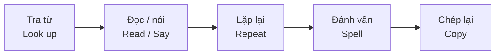

# Bài 04 – Học tập (Studying)

**Chủ đề:** Everyday Language – Ngôn ngữ hằng ngày  
**Trang sách:** 6–7 · **Trang PDF:** 16–17  
**Trọng tâm:** 26 hành động và chỉ dẫn trong lớp học, từ **A đến Z**.

## 1. Mục tiêu học tập

Hoàn thành bài này, người học có thể:

1. Nhận biết và giải thích bằng tiếng Việt **26 cụm động từ tiếng Anh** trong các hoạt động học tập.
2. Phân biệt những chỉ dẫn dễ nhầm: *say / spell / repeat*, *pass out / collect*, *check / correct*, *underline / cross out*.
3. Hiểu và thực hiện chỉ dẫn ngắn của giáo viên, chẳng hạn *Fill in the blank* hoặc *Circle the answer*.
4. Hỏi, trả lời và trao đổi với bạn học bằng câu đơn giản; tự kiểm tra và sửa lỗi trong bài làm.

## 2. Quan sát tranh bài học

*Ảnh ghép hai trang sách theo đúng thứ tự, gồm các tình huống A–Z. Phóng to ảnh để đối chiếu hành động và lời thoại.*

Hai trang được tổ chức thành năm nhóm tình huống. Hãy quan sát nhân vật đang **làm gì**, sau đó đọc thành tiếng cụm tiếng Anh tương ứng. Các cụm này cũng thường xuất hiện dưới dạng **câu mệnh lệnh** trong lớp: động từ được đặt ở đầu câu, không cần chủ ngữ.

## 3. Làm việc với từ điển – Dictionary work (A–F)

| Mã | Cụm từ / chỉ dẫn | Nghĩa tiếng Việt | Cách hiểu nhanh |
|:--:|---|---|---|
| **A** | **Look up a word.** | Tra một từ. | Tìm nghĩa hoặc thông tin về từ trong từ điển. |
| **B** | **Read the word.** | Đọc từ đó. | Nhìn từ và đọc theo yêu cầu. |
| **C** | **Say the word.** | Nói/đọc từ đó lên. | Phát âm từ để người khác nghe. |
| **D** | **Repeat the word.** | Lặp lại từ đó. | Nói lại từ đã nghe. |
| **E** | **Spell the word.** | Đánh vần từ đó. | Đọc lần lượt các chữ cái. |
| **F** | **Copy the word.** | Chép lại từ đó. | Viết lại từ đã cho. |

### 3.1. Phân biệt các hành động gần nghĩa

- **Look up** là *tra cứu*, không phải chỉ đơn thuần là *nhìn lên* khi đi cùng với *a word*.
- **Read** nhấn mạnh việc đọc chữ đã viết; **say** nhấn mạnh việc nói hoặc phát âm ra tiếng. Trong lớp, hai hành động có thể diễn ra cùng lúc.
- **Repeat** là nói lại điều vừa nghe; **spell** là nêu **từng chữ cái**, không phải đọc âm của cả từ.
- **Copy** là chép lại nội dung có sẵn; **write** là viết nói chung.

**Ví dụ với từ “share”:**

1. *Look up the word “share”.* — Tra từ “share”.
2. *Read the word.* — Đọc từ đó.
3. *Say “share”.* — Nói từ “share”.
4. *Repeat: “share”.* — Lặp lại: “share”.
5. *Spell it: S-H-A-R-E.* — Đánh vần: S-H-A-R-E.
6. *Copy the word in your notebook.* — Chép từ đó vào vở.

**Sơ đồ trình tự luyện từ:**

Sơ đồ thể hiện một cách tự học hữu ích: **hiểu từ → phát âm → ghi nhớ mặt chữ → viết lại**. Đây là trình tự gợi ý để luyện tập, không phải quy tắc bắt buộc trong mọi tình huống.

## 4. Làm việc với bạn – Work with a partner (G–J)

| Mã | Cụm từ / chỉ dẫn | Nghĩa tiếng Việt | Ví dụ ngắn |
|:--:|---|---|---|
| **G** | **Ask a question.** | Đặt câu hỏi. | *Can I share your book?* — Mình xem chung sách với bạn được không? |
| **H** | **Answer a question.** | Trả lời câu hỏi. | *Sure!* — Được chứ! |
| **I** | **Share a book.** | Dùng chung một quyển sách. | *We share a book.* — Chúng mình dùng chung sách. |
| **J** | **Help your partner.** | Giúp bạn cùng cặp. | *Help your partner with the exercise.* — Giúp bạn làm bài tập. |

**Partner** là người làm cùng bạn trong **một cặp**. Trong ngữ cảnh lớp học, *work with a partner* có nghĩa là **làm việc theo cặp**, còn *share* thường diễn tả việc **chia sẻ/dùng chung** một vật.

**Hội thoại mẫu:**

> **Student A:** Can I share your book?  
> **Student B:** Sure!  
> **Student A:** Thank you. Can you help me with this word?  
> **Student B:** Yes. Let's read it together.

*Dịch:* A hỏi có thể dùng chung sách và nhờ giúp với một từ; B đồng ý và đề nghị cùng đọc từ đó. Hai câu cuối là ví dụ luyện tập mở rộng.

## 5. Làm việc nhóm – Work in a group (K–N)

| Mã | Cụm từ / chỉ dẫn | Nghĩa tiếng Việt | Cách thực hiện |
|:--:|---|---|---|
| **K** | **Brainstorm a list.** | Động não để lập danh sách. | Mỗi người đề xuất ý tưởng/từ khóa. |
| **L** | **Discuss the list.** | Thảo luận danh sách. | Cùng xem xét, so sánh hoặc chọn các ý. |
| **M** | **Draw a picture.** | Vẽ một bức tranh/hình. | Biểu diễn ý tưởng bằng hình ảnh. |
| **N** | **Dictate a sentence.** | Đọc một câu cho người khác viết lại. | Một người đọc, người khác nghe và chép. |

### 5.1. Brainstorm khác discuss như thế nào?

**Brainstorm** tập trung vào việc đưa ra **nhiều ý tưởng**; chưa cần đánh giá kỹ từng ý. **Discuss** là **trao đổi, phân tích** về những ý tưởng đó. Vì vậy, trong hoạt động nhóm, hai bước thường được làm theo thứ tự *brainstorm → discuss*.

**Ví dụ hoạt động nhóm:**

1. *Brainstorm a list of things in the classroom.* — Cùng nghĩ ra danh sách đồ vật trong lớp.
2. *Discuss the list.* — Cùng thảo luận danh sách.
3. *Draw a picture.* — Vẽ một bức tranh.
4. *Dictate a sentence: “There are two windows.”* — Đọc cho bạn chép câu: “Có hai cửa sổ”.

**Lưu ý:** *dictate* không đồng nghĩa với *say*. Với *dictate*, mục tiêu là người nghe **ghi lại chính xác** lời được đọc.

## 6. Hoạt động cả lớp – Class work (O–Q)

| Mã | Cụm từ / chỉ dẫn | Nghĩa tiếng Việt | Ghi nhớ |
|:--:|---|---|---|
| **O** | **Pass out the papers.** | Phát giấy/bài cho mọi người. | Giấy đi **từ người phát đến học sinh**. |
| **P** | **Talk with each other.** | Nói chuyện/trao đổi với nhau. | Các thành viên cùng trao đổi. |
| **Q** | **Collect the papers.** | Thu giấy/bài làm. | Giấy đi **từ học sinh về người thu**. |

**Pass out** và **collect** biểu thị hai hướng ngược nhau. Trong lớp học, *papers* có thể là tờ giấy, phiếu bài tập hoặc bài làm tùy tình huống.

**Ví dụ:**

- *Please pass out the papers.* — Hãy phát các tờ giấy/bài tập.
- *Talk with each other about your answers.* — Trao đổi với nhau về câu trả lời.
- *Please collect the papers.* — Hãy thu các tờ giấy/bài làm.

## 7. Làm theo hướng dẫn – Follow directions (R–Z)

| Mã | Cụm từ / chỉ dẫn | Nghĩa tiếng Việt | Minh họa thực hành |
|:--:|---|---|---|
| **R** | **Fill in the blank.** | Điền vào chỗ trống. | *Write with a ____.* → *pencil* |
| **S** | **Circle the answer.** | Khoanh tròn đáp án. | Chọn và khoanh một phương án đúng. |
| **T** | **Mark the answer sheet.** | Đánh dấu trên phiếu trả lời. | Đánh dấu ô/phương án đã chọn. |
| **U** | **Cross out the word.** | Gạch bỏ từ. | Gạch ngang lên từ cần loại. |
| **V** | **Underline the word.** | Gạch chân từ. | Gạch một đường **dưới** từ. |
| **W** | **Put the words in order.** | Sắp xếp các từ theo đúng thứ tự. | *my / is / pencil / That* → *That is my pencil.* |
| **X** | **Match the items.** | Nối/ghép các mục tương ứng. | *sit → chair*, *write → pencil*, *read → book*. |
| **Y** | **Check your work.** | Kiểm tra lại bài làm. | Đọc lại, đối chiếu yêu cầu và đáp án. |
| **Z** | **Correct the mistake.** | Sửa lỗi sai. | Tìm chỗ sai và viết lại cho đúng. |

### 7.1. Những động từ dễ nhầm

| Cặp từ | Khác nhau như thế nào? |
|---|---|
| **Circle / Mark** | *Circle* yêu cầu **khoanh tròn**; *mark* là **đánh dấu** nói chung. |
| **Cross out / Underline** | *Cross out* = **gạch bỏ**, thường để loại; *underline* = **gạch chân**, thường để nhấn mạnh/chọn. |
| **Check / Correct** | *Check* = **kiểm tra xem có sai không**; *correct* = **sửa chỗ đã sai**. |
| **Match / Put in order** | *Match* = ghép hai mục tương ứng; *put in order* = sắp xếp thành trình tự đúng. |

### 7.2. Cách hiểu câu mệnh lệnh trong lớp

Trong những câu như *Copy the word.*, *Circle the answer.* và *Check your work.*, động từ ở dạng nguyên mẫu được đặt ngay đầu câu. Chủ ngữ **you** thường được lược bỏ.

**Mẫu:** **Động từ + đối tượng/bổ ngữ**.

- *Underline **the word**.* — Gạch chân **từ đó**.
- *Fill in **the blank**.* — Điền vào **chỗ trống**.
- *Put **the words** **in order**.* — Xếp **các từ** **theo thứ tự**.

Trong lời hướng dẫn lịch sự, có thể thêm **please**: *Please check your work.* — Vui lòng kiểm tra bài làm.

## 8. Luyện nói – Share your answers

Luyện trả lời sáu câu hỏi bằng **Yes, I do / No, I don't** hoặc **Yes, it is / No, it isn't**, rồi thêm một câu giải thích ngắn.

| Câu hỏi tiếng Anh | Nghĩa tiếng Việt | Trả lời mẫu |
|---|---|---|
| **1. Do you like to work in groups?** | Bạn có thích làm việc nhóm không? | *Yes, I do. I like sharing ideas.* |
| **2. Do you like to share books?** | Bạn có thích dùng chung sách không? | *Yes, I do. I can read with my friends.* |
| **3. Do you like to answer questions?** | Bạn có thích trả lời câu hỏi không? | *Yes, I do. It helps me learn.* |
| **4. Is it easy for you to talk with your classmates?** | Bạn có thấy dễ nói chuyện với bạn cùng lớp không? | *Yes, it is. My classmates are friendly.* |
| **5. Do you always check your work?** | Bạn có luôn kiểm tra lại bài làm không? | *No, I don't, but I should.* |
| **6. Do you cross out your mistakes or erase them?** | Bạn gạch bỏ lỗi sai hay tẩy xóa chúng? | *I usually erase them.* |

**Ghi nhớ mẫu câu:**

- *Do you like to + động từ...?* → *Do you like to work in groups?*
- *Is it easy for you to + động từ...?* → *Is it easy for you to talk with classmates?*
- *always / usually* là trạng từ tần suất, thường đặt trước động từ chính: *I usually check my work.*

Các câu trả lời mẫu là **gợi ý luyện nói**, không phải câu trả lời duy nhất.

## 9. Thực hành tổng hợp

### 9.1. Bài tập 1 – Ghép hành động với nghĩa

Ghép mỗi cụm tiếng Anh (1–6) với nghĩa (a–f).

| Cụm từ | Nghĩa |
|---|---|
| 1. Spell the word. | a. Thu bài làm. |
| 2. Pass out the papers. | b. Đánh vần từ đó. |
| 3. Correct the mistake. | c. Gạch chân từ đó. |
| 4. Underline the word. | d. Phát bài. |
| 5. Collect the papers. | e. Thảo luận danh sách. |
| 6. Discuss the list. | f. Sửa lỗi sai. |

### 9.2. Bài tập 2 – Chọn đúng chỉ dẫn

Điền một trong các từ/cụm sau vào chỗ trống: **repeat, circle, match, check, brainstorm**.

1. Listen and ______ the word.
2. ______ the correct answer: A, B, C, or D.
3. ______ the items: *sit – chair; read – book*.
4. Before handing in the paper, ______ your work.
5. Work in a group and ______ a list of classroom objects.

### 9.3. Bài tập 3 – Sắp xếp từ và sửa lỗi

1. Sắp xếp: *pencil / my / is / That*.
2. Sắp xếp: *work / your / Check*.
3. Sửa câu: *She write with a pencil.*
4. Sửa câu: *There is two windows.*

### 9.4. Bài tập 4 – Đóng vai trên lớp

Làm việc theo cặp: A đóng vai người đưa chỉ dẫn, B thực hiện. Sau đó đổi vai.

- A: *Look up the word “share”.* → B tra từ.
- A: *Spell the word.* → B đánh vần S-H-A-R-E.
- A: *Underline the word.* → B gạch chân từ đã viết.
- A: *Check your work.* → B kiểm tra lại.

**Tiêu chí tự đánh giá:** làm đúng ít nhất 3/4 chỉ dẫn, phát âm rõ và phân biệt được *underline* với *cross out*.

## 10. Câu hỏi ôn tập trắc nghiệm

### Câu 1

Giáo viên muốn học sinh đọc **từng chữ cái** trong từ *pencil*. Chỉ dẫn phù hợp nhất là gì?

A. Say the word.  
B. Copy the word.  
C. Spell the word.  
D. Look up the word.

**Đáp án: C.** *Spell* yêu cầu đánh vần từng chữ cái; *say* là phát âm cả từ.

### Câu 2

Sau khi phát phiếu bài tập, giáo viên yêu cầu thu lại. Cụm nào đúng?

A. Collect the papers.  
B. Pass out the papers.  
C. Share a book.  
D. Draw a picture.

**Đáp án: A.** *Collect* là thu về; *pass out* là phát ra.

### Câu 3

Bạn muốn học sinh **gạch bỏ** một từ không phù hợp. Nên nói gì?

A. Underline the word.  
B. Read the word.  
C. Circle the answer.  
D. Cross out the word.

**Đáp án: D.** *Cross out* là gạch bỏ; *underline* chỉ là gạch chân.

### Câu 4

Nhóm học sinh vừa nêu ra nhiều ý tưởng. Tiếp theo, cả nhóm cùng trao đổi và đánh giá các ý. Hoạt động này là gì?

A. Copy the word.  
B. Discuss the list.  
C. Dictate a sentence.  
D. Mark the answer sheet.

**Đáp án: B.** *Discuss* là thảo luận các ý đã có, khác với *brainstorm* là tạo ra ý tưởng.

### Câu 5

Một học sinh đã phát hiện câu sai và muốn viết lại cho đúng. Chỉ dẫn nào cụ thể nhất?

A. Ask a question.  
B. Check your work.  
C. Correct the mistake.  
D. Match the items.

**Đáp án: C.** *Correct* là thực hiện bước sửa lỗi; *check* chủ yếu là kiểm tra.

## 11. Đáp án bài tập và cách tự học

**Bài 1:** 1–b, 2–d, 3–f, 4–c, 5–a, 6–e.  
**Bài 2:** 1. repeat; 2. circle; 3. match; 4. check; 5. brainstorm.  
**Bài 3:** 1. *That is my pencil.*; 2. *Check your work.*; 3. *She writes with a pencil.*; 4. *There are two windows.*

Tự ôn theo ba lượt: (1) che cột nghĩa và nói lại 26 cụm từ; (2) nhìn từng tranh A–Z và tự đưa ra chỉ dẫn; (3) đóng vai giáo viên, nói ít nhất sáu câu mệnh lệnh khác nhau, rồi trả lời sáu câu hỏi ở mục 8.

**Tổng kết:** Trong chủ đề *Studying*, các động từ như *look up, repeat, spell, share, brainstorm, collect, underline, check,* và *correct* giúp bạn hiểu chính xác giáo viên muốn làm gì. Hãy học theo **tình huống và hành động**, không chỉ ghi nhớ nghĩa tiếng Việt của từng từ.

---

**Điều hướng:** [← Bài 03 – School](03_school.md) · [Bài 05 →](05_everyday-conversation.md)
