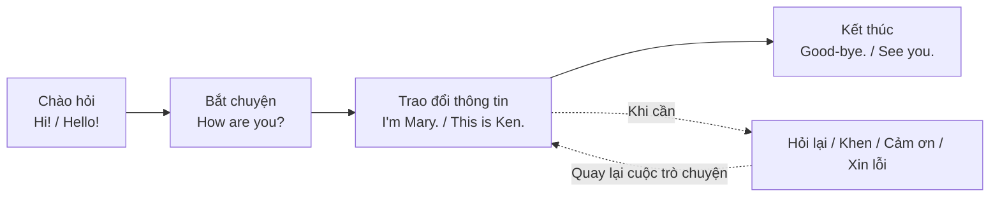

# Bài 05 – Đàm thoại hằng ngày (Everyday Conversation)

> **Chủ đề:** Ngôn ngữ hằng ngày (Everyday Language)  
> **Trình độ:** Cơ bản – giao tiếp trong những tình huống quen thuộc  
> **Tình huống trọng tâm:** Chào hỏi, bắt đầu và kết thúc cuộc trò chuyện, giới thiệu, xác nhận thông tin, khen ngợi, cảm ơn và xin lỗi.

## 1. Mục tiêu học tập

Sau khi hoàn thành bài học, người học có thể:

1. **Lựa chọn** câu chào phù hợp với thời điểm trong ngày và hoàn cảnh giao tiếp.
2. **Bắt đầu và kết thúc** một cuộc hội thoại ngắn bằng tiếng Anh.
3. **Tự giới thiệu**, giới thiệu người khác và **hỏi lại** khi chưa nghe rõ tên.
4. **Sử dụng** lời khen, lời cảm ơn và lời xin lỗi đúng ngữ cảnh.
5. **Thực hành** các đoạn hội thoại ngắn dựa trên chín tình huống minh họa.

## 2. Nhìn tranh và định hướng hội thoại

*Tranh minh họa bài học ở trang 8 của sách (trang 18 của tệp PDF).* 

Một cuộc trò chuyện đơn giản thường bắt đầu bằng **lời chào**, tiếp nối bằng **lời hỏi thăm hoặc giới thiệu**, rồi kết thúc bằng **lời tạm biệt**. Trong lúc trò chuyện, ta còn cần những cách nói lịch sự để xác nhận, khen ngợi, cảm ơn hoặc xin lỗi.

**Cách đọc sơ đồ:** Đi theo mũi tên liền để nắm trình tự cơ bản. Các mũi tên nét đứt thể hiện những hành động có thể xuất hiện bất cứ lúc nào trong phần trao đổi chính.

| Ký hiệu | Chức năng tiếng Anh | Ý nghĩa | Ví dụ nổi bật |
|---|---|---|---|
| A | Greet someone | Chào một người | **Hi!** – Chào! |
| B | Begin a conversation | Bắt đầu một cuộc trò chuyện | **How are you?** – Bạn khỏe không? |
| C | End the conversation | Kết thúc cuộc trò chuyện | **See you.** – Hẹn gặp lại. |
| D | Introduce yourself | Tự giới thiệu | **I'm Mary.** – Tôi là Mary. |
| E | Make sure you understand | Hỏi lại để chắc chắn mình hiểu đúng | **Did you say Bill?** – Bạn vừa nói Bill phải không? |
| F | Introduce your friend | Giới thiệu bạn của mình | **This is Ken.** – Đây là Ken. |
| G | Compliment your friend | Khen ngợi bạn | **That's a great sweater!** – Áo len đó đẹp quá! |
| H | Thank your friend | Cảm ơn bạn | **Thank you.** – Cảm ơn bạn. |
| I | Apologize | Xin lỗi | **Excuse me. / I'm sorry.** – Xin lỗi. |

## 3. Chào hỏi – Greet someone (A)

### 3.1. Câu chào cơ bản

| Tiếng Anh | Nghĩa tiếng Việt | Cách sử dụng |
|---|---|---|
| **Hi!** | Chào! | Thân mật; thường dùng với bạn bè, người quen. |
| **Hello!** | Xin chào! | Trung tính; thích hợp trong nhiều cuộc gặp. |
| **Good morning.** | Chào buổi sáng. | Khi gặp ai đó vào buổi sáng. |
| **Good afternoon.** | Chào buổi chiều. | Khi gặp ai đó vào buổi chiều. |
| **Good evening.** | Chào buổi tối. | Khi gặp ai đó vào buổi tối. |

**Ví dụ 1 – Hai người gặp nhau:**

- **A:** Hi! — Chào!
- **B:** Hello! — Xin chào!

**Ví dụ 2 – Gặp đồng nghiệp vào buổi sáng:**

- **A:** Good morning. — Chào buổi sáng.
- **B:** Good morning. — Chào buổi sáng.

### 3.2. Phân biệt Good evening và Good night

Đây là hai cách nói đều liên quan đến buổi tối nhưng **không dùng thay thế tùy ý**:

- **Good evening** là câu **chào khi gặp nhau** vào buổi tối.
- **Good night** thường là lời **chúc ngủ ngon** hoặc **chào tạm biệt khi kết thúc buổi tối**; không phải cách chào thông thường khi mới gặp.

**Ví dụ:**

- 19 giờ, bạn đến một buổi gặp mặt: **Good evening!** — Chào buổi tối!
- Trước khi đi ngủ: **Good night!** — Chúc ngủ ngon!

> **Mẹo nhớ:** *Evening* gắn với **gặp mặt**; *night* trong “Good night” thường gắn với **chia tay hoặc đi ngủ**.

## 4. Bắt đầu và kết thúc cuộc trò chuyện (B–C)

### 4.1. Hỏi thăm để bắt chuyện – Begin a conversation (B)

Sau câu chào, người nói có thể hỏi thăm tình hình hoặc sức khỏe để mở đầu cuộc trò chuyện.

| Câu hỏi | Nghĩa | Câu trả lời minh họa | Nghĩa |
|---|---|---|---|
| **How are you?** | Bạn khỏe không? | **Fine, thanks.** | Khỏe, cảm ơn. |
| **How are things?** | Mọi chuyện thế nào? | **Okay.** | Ổn. |

**Hội thoại mẫu 1:**

- **A:** How are you? — Bạn khỏe không?
- **B:** Fine, thanks. — Khỏe, cảm ơn.

**Hội thoại mẫu 2:**

- **A:** How are things? — Mọi chuyện thế nào?
- **B:** Okay. — Vẫn ổn.

**Lưu ý ngữ dụng:** “How are you?” thường hỏi thăm trực tiếp người đối diện; “How are things?” có thể hỏi tình hình nói chung, chẳng hạn công việc hoặc cuộc sống. Câu trả lời ngắn như “Fine, thanks” hay “Okay” rất phổ biến trong giao tiếp xã giao. Bạn cũng có thể hỏi lại **And you?** (Còn bạn?).

### 4.2. Tạm biệt – End the conversation (C)

| Tiếng Anh | Tiếng Việt | Sắc thái |
|---|---|---|
| **Bye.** | Tạm biệt. | Ngắn gọn, thường thân mật. |
| **Good-bye. / Goodbye.** | Tạm biệt. | Thông dụng, có thể dùng trang trọng hơn “Bye”. |
| **See you.** | Hẹn gặp lại. | Khi mong sẽ gặp lại người đó. |
| **Good night.** | Chúc ngủ ngon / Chào tạm biệt buổi tối. | Thích hợp khi ra về muộn hoặc trước giờ ngủ. |

**Hội thoại mẫu:**

- **A:** Good-bye. — Tạm biệt nhé.
- **B:** Bye. See you. — Tạm biệt. Hẹn gặp lại.

Khi kết thúc trò chuyện, nên chọn một lời tạm biệt rõ ràng thay vì dừng ngang cuộc hội thoại. Trong tình huống thân mật, “Bye” và “See you” có thể được dùng liền nhau.

## 5. Giới thiệu và xác nhận thông tin (D–F)

### 5.1. Tự giới thiệu – Introduce yourself (D)

Khi gặp người mới, bạn có thể dùng **I'm + tên** hoặc **My name is + tên**. “I'm” là dạng viết tắt của “I am”; “My name's” là dạng viết tắt của “My name is”.

**Hội thoại:**

- **Mary:** Hi, I'm Mary. — Chào, mình là Mary.
- **Bill:** My name's Bill. — Mình tên là Bill.

| Mẫu câu | Ví dụ | Nghĩa |
|---|---|---|
| **I'm + tên.** | I'm Mary. | Tôi là Mary. |
| **My name is + tên.** | My name is Bill. | Tên tôi là Bill. |
| **My name's + tên.** | My name's Bill. | Mình tên là Bill. |

**Áp dụng:** Hãy thay Mary hoặc Bill bằng tên của bạn, sau đó giới thiệu thành tiếng mà không đọc tài liệu.

### 5.2. Hỏi lại để chắc chắn – Make sure you understand (E)

Tên riêng đôi khi khó nghe rõ, đặc biệt ở lần gặp đầu tiên. Thay vì đoán, hãy hỏi lại lịch sự:

- **Mary:** Did you say Bill? — Bạn vừa nói “Bill” phải không?
- **Bill:** Yes, Bill. — Đúng rồi, Bill.

**Cấu trúc:** **Did you say + thông tin cần xác nhận?**

Ví dụ bổ sung:

- **Did you say Mary?** — Bạn vừa nói Mary phải không?
- **Did you say Ken?** — Bạn vừa nói Ken phải không?

Trong mẫu câu này, **Did you say ...?** dùng để kiểm tra xem mình nghe có đúng không, **không** phải câu hỏi về thói quen nói điều gì đó. Khi xác nhận, có thể đáp ngắn gọn “Yes, ...”.

### 5.3. Giới thiệu bạn bè – Introduce your friend (F)

Khi có ba người, một người có thể giới thiệu người bạn đi cùng bằng **This is + tên**.

- **Mary:** Bill, this is Ken. — Bill, đây là Ken.

Trong lời giới thiệu trên, **Bill** là người được Mary gọi và **Ken** là người mà Mary giới thiệu. Mẫu câu “This is ...” vừa đơn giản vừa tự nhiên khi giới thiệu một người đang có mặt.

**Hội thoại mở rộng để luyện tập:**

- **Mary:** Bill, this is Ken. — Bill, đây là Ken.
- **Bill:** Hi, Ken. Nice to meet you. — Chào Ken. Rất vui được gặp bạn.
- **Ken:** Nice to meet you, too. — Mình cũng rất vui được gặp bạn.

> **Mẫu thêm để thực hành:** “Nice to meet you” và “Nice to meet you, too” giúp cuộc giới thiệu lịch sự, tự nhiên hơn.

## 6. Khen ngợi, cảm ơn và xin lỗi (G–I)

### 6.1. Khen ngợi – Compliment your friend (G)

Một lời khen ngắn gọn có thể giúp cuộc trò chuyện thân thiện hơn.

- **A:** That's a great sweater! — Chiếc áo len đó đẹp quá!

**Cấu trúc:** **That's a great + danh từ!**

Ở đây:

- **That's** = **That is**: Đó là / Cái đó là.
- **great**: tuyệt, rất đẹp, rất tốt (tùy ngữ cảnh).
- **sweater**: áo len.

Có thể thay danh từ để khen những đồ vật khác: **That's a great bag!** (Chiếc túi đó đẹp quá!). Đây là ví dụ mở rộng từ cấu trúc đã học.

### 6.2. Cảm ơn – Thank your friend (H)

Khi nhận được lời khen hoặc sự giúp đỡ, ta có thể đáp:

- **B:** Thank you. — Cảm ơn bạn.
- **B:** Thanks. — Cảm ơn nhé.

**Hội thoại hoàn chỉnh:**

- **A:** That's a great sweater! — Áo len của bạn đẹp quá!
- **B:** Thank you. — Cảm ơn bạn.

**Lưu ý:** “Thanks” thường mang sắc thái thân mật hơn một chút; “Thank you” là cách nói lịch sự, phổ biến trong nhiều ngữ cảnh.

### 6.3. Xin lỗi – Apologize (I)

| Câu nói | Nghĩa thường gặp | Dùng khi |
|---|---|---|
| **Excuse me.** | Xin lỗi / Cho tôi xin phép. | Thu hút sự chú ý, xin phép đi qua, làm phiền nhẹ hoặc ngắt lời lịch sự. |
| **I'm sorry.** | Tôi xin lỗi. | Thừa nhận một lỗi, sự bất tiện hoặc bày tỏ sự tiếc nuối. |

**Tình huống 1 – Muốn đi qua:**

- **A:** Excuse me. — Xin phép cho tôi đi qua.
- **B:** Oh, sure. — Ồ, được chứ.

**Tình huống 2 – Vô tình va vào người khác:**

- **A:** Oh! Excuse me. — Ôi! Xin lỗi nhé.
- **B:** I'm sorry. — Tôi xin lỗi.

Hai cách nói **có thể cùng xuất hiện** trong tình huống va chạm nhẹ, nhưng sắc thái điển hình của chúng khác nhau. Không nên coi “Excuse me” và “I'm sorry” là hai câu luôn thay thế được cho nhau.

## 7. Ghép mẫu câu thành cuộc hội thoại tự nhiên

### 7.1. Làm quen một người mới

| Người nói | Tiếng Anh | Tiếng Việt |
|---|---|---|
| A | Hello! I'm Mary. | Xin chào! Mình là Mary. |
| B | Hi! My name's Bill. | Chào! Mình tên là Bill. |
| A | Did you say Bill? | Bạn vừa nói Bill phải không? |
| B | Yes, Bill. | Đúng rồi, Bill. |
| A | Nice to meet you, Bill. | Rất vui được gặp bạn, Bill. |
| B | Nice to meet you, too. | Mình cũng rất vui được gặp bạn. |

**Điểm cần nhớ:** Một cuộc làm quen không chỉ là đọc tên. Người nghe có thể hỏi lại để xác nhận, sau đó phản hồi thân thiện.

### 7.2. Gặp bạn và kết thúc cuộc trò chuyện

| Người nói | Tiếng Anh | Tiếng Việt |
|---|---|---|
| A | Good afternoon! | Chào buổi chiều! |
| B | Hello! | Xin chào! |
| A | How are things? | Mọi chuyện thế nào? |
| B | Okay, thanks. And you? | Vẫn ổn, cảm ơn. Còn bạn? |
| A | Fine, thanks. | Mình khỏe, cảm ơn. |
| B | Bye. See you! | Tạm biệt. Hẹn gặp lại! |

**Điểm cần nhớ:** Một lời hỏi thăm thường có câu trả lời ngắn, có thể đi kèm “And you?” để giữ nhịp trò chuyện.

### 7.3. Giới thiệu bạn, khen ngợi và cảm ơn

| Người nói | Tiếng Anh | Tiếng Việt |
|---|---|---|
| Sam | Hi, I'm Sam Jones, and this is my friend, Pat Green. | Chào, tôi là Sam Jones, còn đây là bạn tôi, Pat Green. |
| Tomas | Nice to meet you. I'm Tomas Garcia. | Rất vui được gặp các bạn. Tôi là Tomas Garcia. |
| Pat | That's a great sweater, Tomas. | Áo len của bạn đẹp quá, Tomas. |
| Tomas | Thanks, Pat. I like your shoes. | Cảm ơn, Pat. Tôi thích đôi giày của bạn. |

Trong cuộc hội thoại này, **this is my friend** giới thiệu người đi cùng, **That's a great ...** là lời khen, còn **Thanks** là lời cảm ơn. Câu “I like your shoes” cũng là một cách khen lịch sự.

## 8. Những điểm dễ nhầm

| Dễ nhầm | Cách dùng đúng | Giải thích |
|---|---|---|
| Dùng **Good night** để chào người mới gặp vào buổi tối | **Good evening!** | “Good night” thường dùng lúc chia tay hoặc trước khi đi ngủ. |
| Nói **My name Bill** | **My name is Bill.** | Cần có động từ “is”; có thể viết tắt thành “My name's Bill”. |
| Nói **I Mary** khi tự giới thiệu | **I'm Mary.** | “I'm” = “I am”. |
| Dùng **Did you say ...?** như câu hỏi thăm | **Did you say Bill?** khi chưa nghe rõ tên | Đây là câu hỏi xác nhận điều vừa nghe. |
| Nhầm **This is Ken** với **I'm Ken** | **This is Ken** (giới thiệu Ken); **I'm Ken** (Ken tự giới thiệu) | Chủ thể giới thiệu khác nhau. |
| Dùng **Excuse me** để xin lỗi cho mọi lỗi nghiêm trọng | Thường chọn **I'm sorry** khi nhận lỗi | Hai câu có thể chồng lấn trong lỗi nhỏ nhưng không đồng nghĩa hoàn toàn. |

## 9. Thực hành giao tiếp

### 9.1. Bài tập A – Điền câu nói phù hợp

Điền một trong các mẫu đã học vào mỗi chỗ trống.

1. Buổi sáng gặp giáo viên: “__________.”
2. Muốn hỏi thăm bạn: “__________?”
3. Bạn tên là Lan, hãy tự giới thiệu: “__________.”
4. Bạn vừa nghe tên “Ken” nhưng không chắc: “__________?”
5. Chuẩn bị ra về và muốn hẹn gặp lại: “__________.”
6. Vô tình làm phiền người khác và muốn xin phép: “__________.”

### 9.2. Bài tập B – Hoàn thành hội thoại

**Hội thoại 1:**

- A: Hello! I'm Anna.
- B: Hi! My ______ is Minh.
- A: Nice to ______ you.
- B: Nice to meet you, ______.

**Hội thoại 2:**

- A: That's a great sweater!
- B: ______ you.
- A: Bye!
- B: See ______!

### 9.3. Bài tập C – Đóng vai theo cặp

Thực hành ba tình huống với một người bạn:

1. **Gặp nhau buổi sáng:** Chào, hỏi thăm, trả lời và tạm biệt.
2. **Làm quen:** Một người giới thiệu tên, người còn lại hỏi lại tên để kiểm tra, sau đó đáp lời.
3. **Giới thiệu nhóm:** Một người giới thiệu bạn thứ ba; hai người mới gặp chào nhau; một người khen áo hoặc giày, người kia cảm ơn.

**Tiêu chí tự kiểm tra:** Phát âm đủ rõ để người nghe nhận ra câu nói, chọn mẫu câu đúng ngữ cảnh và không bỏ sót lời đáp của đối phương.

### 9.4. Gợi ý đáp án thực hành

**Bài A (một số câu trả lời phù hợp):**

1. Good morning.
2. How are you? / How are things?
3. I'm Lan. / My name is Lan.
4. Did you say Ken?
5. See you.
6. Excuse me.

**Bài B:**

- Hội thoại 1: **name – meet – too**.
- Hội thoại 2: **Thank – you**.

## 10. Câu hỏi ôn tập trắc nghiệm

### Câu 1

Bạn đến một buổi gặp mặt lúc 7 giờ tối. Câu nào phù hợp nhất để **bắt đầu chào** mọi người?

A. Good night.  
B. See you.  
C. Good evening.  
D. Good-bye.

**Đáp án: C.** **Giải thích:** “Good evening” dùng khi chào hỏi vào buổi tối; “Good night” thường dùng lúc chia tay hoặc trước khi ngủ.

### Câu 2

Khi một người tự giới thiệu “My name's Bill” nhưng bạn chưa nghe rõ, câu nào là cách hỏi lại phù hợp?

A. Did you say Bill?  
B. How are things?  
C. That's a great sweater!  
D. See you.

**Đáp án: A.** **Giải thích:** “Did you say ...?” giúp xác nhận thông tin vừa nghe.

### Câu 3

Bạn đang giới thiệu Ken với Bill. Câu nào chính xác?

A. I'm Bill.  
B. Good night, Ken.  
C. How are you, Ken?  
D. Bill, this is Ken.

**Đáp án: D.** **Giải thích:** “This is + tên” dùng để giới thiệu một người đang có mặt với người khác.

### Câu 4

Một người nói “That's a great sweater!” với bạn. Phản hồi tự nhiên nhất là gì?

A. Did you say sweater?  
B. Thank you.  
C. Good morning.  
D. Excuse me.

**Đáp án: B.** **Giải thích:** Khi nhận lời khen, “Thank you” hoặc “Thanks” là lời đáp lịch sự.

### Câu 5

Bạn muốn lịch sự xin phép đi qua chỗ có người đang đứng chắn. Câu nào phù hợp nhất?

A. Excuse me.  
B. I'm Ken.  
C. Fine, thanks.  
D. See you.

**Đáp án: A.** **Giải thích:** “Excuse me” có thể dùng để xin phép đi qua hoặc thu hút sự chú ý một cách lịch sự.

### Câu 6

Câu nào là một cách **bắt đầu hỏi thăm tình hình** thay vì kết thúc cuộc trò chuyện?

A. Bye.  
B. Good-bye.  
C. How are things?  
D. Good night.

**Đáp án: C.** **Giải thích:** “How are things?” hỏi thăm tình hình chung; ba đáp án còn lại thường gắn với kết thúc cuộc gặp.

## 11. Tổng kết và tự luyện

Có thể ghi nhớ toàn bài qua các cụm chức năng sau:

- **Chào hỏi:** Hi! / Hello! / Good morning. / Good afternoon. / Good evening.
- **Hỏi thăm:** How are you? / How are things? → Fine, thanks. / Okay.
- **Tạm biệt:** Bye. / Good-bye. / See you. / Good night.
- **Tự giới thiệu:** I'm Mary. / My name's Bill.
- **Xác nhận:** Did you say Bill? → Yes, Bill.
- **Giới thiệu người khác:** Bill, this is Ken.
- **Khen ngợi và cảm ơn:** That's a great sweater! → Thank you.
- **Xin lỗi:** Excuse me. / I'm sorry.

**Cách luyện nhanh:** Đọc lại tranh, che cột tiếng Việt và thử nói thành tiếng từng tình huống A–I. Sau đó tự đóng cả hai vai trong một hội thoại kéo dài khoảng 30–60 giây, gồm ít nhất một lời chào, một câu hỏi thăm, một câu giới thiệu và một lời tạm biệt.

---

**Điều hướng bài học:** [← Bài 04 – Studying](04_studying.md) · [Bài 06 – The Telephone →](06_the-telephone.md)
