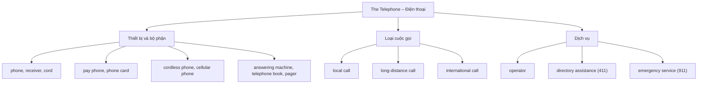
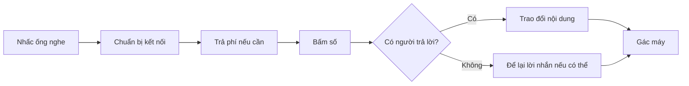

# Bài 06 – Điện thoại (The Telephone)

> **Chủ đề:** Ngôn ngữ hằng ngày (Everyday Language)  
> **Trình độ:** Từ vựng tiếng Anh giao tiếp cơ bản  
> **Trang tham khảo:** Trang 9 của sách (trang 19 của bản PDF).  
> **Trọng tâm:** Nhận diện thiết bị điện thoại, phân biệt các loại cuộc gọi, thực hiện một cuộc gọi và để lại lời nhắn.

## 1. Tổng quan và mục tiêu bài học

Điện thoại giúp mọi người liên lạc với nhau, dù ở gần hay cách xa hàng nghìn kilômét. Để giao tiếp bằng tiếng Anh trong chủ đề này, người học cần biết tên các bộ phận của điện thoại, loại cuộc gọi, dịch vụ liên lạc và những hành động cơ bản như nhấc ống nghe, quay số hoặc bấm số, để lại lời nhắn và gác máy.

Sau bài học, bạn có thể:

1. **Nhận diện và giải thích** 16 từ vựng được đánh số trong tranh.
2. **Phân biệt** `local call`, `long-distance call` và `international call`.
3. **Sử dụng** đúng 6 chỉ dẫn cơ bản khi gọi điện thoại công cộng.
4. **Thực hành** một đoạn hội thoại có mở đầu, trao đổi nội dung, để lại lời nhắn và kết thúc.
5. **Trả lời** 3 câu hỏi giao tiếp và hoàn thành bài kiểm tra từ vựng.

## 2. Quan sát tranh minh họa

Các số **1–16** chỉ đối tượng hoặc khái niệm tương ứng trong tranh. Các hình **A–F** minh họa những hành động khi sử dụng điện thoại công cộng. Hãy quan sát tranh trước, sau đó đối chiếu với bảng nghĩa bên dưới để tạo liên kết giữa **hình ảnh – từ tiếng Anh – nghĩa tiếng Việt**.

## 3. Từ vựng trọng tâm: 16 từ trong tranh

### 3.1. Bộ phận và loại cuộc gọi

| Số | Từ tiếng Anh | Nghĩa tiếng Việt | Giải thích và ví dụ |
|---:|---|---|---|
| **1** | **telephone / phone** | Điện thoại | `The phone is ringing.` – Điện thoại đang reo. |
| **2** | **receiver** | Ống nghe | Bộ phận cầm lên để nghe và nói trên điện thoại bàn truyền thống. `Pick up the receiver.` – Nhấc ống nghe lên. |
| **3** | **cord** | Dây điện thoại | Dây nối ống nghe với thân điện thoại. `The cord is too short.` – Dây điện thoại quá ngắn. |
| **4** | **local call** | Cuộc gọi nội hạt / gọi gần | Cuộc gọi trong phạm vi địa phương theo quy định của nhà mạng. `This is a local call.` – Đây là cuộc gọi nội hạt. |
| **5** | **long-distance call** | Cuộc gọi đường dài / gọi xa | Cuộc gọi đến một khu vực xa hơn, thường là trong cùng một quốc gia. `I made a long-distance call.` – Tôi đã gọi điện đường dài. |
| **6** | **international call** | Cuộc gọi quốc tế | Cuộc gọi đến một quốc gia khác. `She made an international call.` – Cô ấy đã gọi điện quốc tế. |

**Phân biệt dễ nhầm:**

- **Phone / telephone:** Có thể chỉ thiết bị hoặc dùng với nghĩa liên lạc qua điện thoại. `Phone` thông dụng hơn trong giao tiếp hằng ngày.
- **Receiver:** Chỉ ống nghe của điện thoại bàn, **không** dùng thay cho toàn bộ điện thoại.
- **Cord / cordless:** `Cord` là dây nối; `cordless` là *không có dây nối trực tiếp giữa ống nghe và đế máy*. Điện thoại không dây vẫn có thể có đế sạc.

### 3.2. Dịch vụ điện thoại

| Số | Từ tiếng Anh | Nghĩa tiếng Việt | Giải thích và ví dụ |
|---:|---|---|---|
| **7** | **operator** | Nhân viên tổng đài | Nhân viên hỗ trợ kết nối cuộc gọi hoặc cung cấp dịch vụ. `The operator connected the call.` – Nhân viên tổng đài đã kết nối cuộc gọi. |
| **8** | **directory assistance (411)** | Dịch vụ tra cứu số điện thoại | Trong hình, **411** là số tra cứu danh bạ trong ngữ cảnh Bắc Mỹ, không phải số dùng chung ở mọi nước. `Call directory assistance.` – Hãy gọi dịch vụ tra cứu danh bạ. |
| **9** | **emergency service (911)** | Dịch vụ khẩn cấp | **911** là số khẩn cấp của Mỹ và một số nơi khác; **không mặc định dùng ở Việt Nam**. `Call emergency services.` – Gọi dịch vụ khẩn cấp. |

**Lưu ý an toàn theo khu vực:** Ở Việt Nam, các số quen thuộc gồm **113** (công an), **114** (cứu hỏa và cứu nạn cứu hộ) và **115** (cấp cứu y tế). Số khẩn cấp và dịch vụ danh bạ thay đổi theo quốc gia; trong tình huống thực tế cần dùng số chính thức tại nơi đang ở.

### 3.3. Thiết bị và vật dụng liên quan

| Số | Từ tiếng Anh | Nghĩa tiếng Việt | Giải thích và ví dụ |
|---:|---|---|---|
| **10** | **phone card** | Thẻ điện thoại | Thẻ dùng để thanh toán một số dịch vụ điện thoại, phổ biến hơn trong hệ thống điện thoại công cộng trước đây. `I have a phone card.` – Tôi có một thẻ điện thoại. |
| **11** | **pay phone** | Điện thoại công cộng trả phí | Điện thoại dùng ở địa điểm công cộng và thường cần trả phí. `There is a pay phone here.` – Ở đây có điện thoại công cộng. |
| **12** | **cordless phone** | Điện thoại bàn không dây | Ống nghe liên lạc với đế mà không cần dây nối trực tiếp. `We have a cordless phone at home.` – Nhà tôi có điện thoại bàn không dây. |
| **13** | **cellular phone** | Điện thoại di động | Cũng thường gọi là `cell phone` (Mỹ), `mobile phone` (Anh). `My cell phone is in my bag.` – Điện thoại di động của tôi ở trong túi. |
| **14** | **answering machine** | Máy trả lời điện thoại tự động | Máy phát lời chào và ghi âm tin nhắn khi không có người nghe máy. `Leave a message on the answering machine.` – Hãy để lại lời nhắn trên máy trả lời tự động. |
| **15** | **telephone book** | Danh bạ điện thoại | Cuốn sách hoặc danh sách chứa tên và số điện thoại. `Look it up in the telephone book.` – Tra thông tin đó trong danh bạ điện thoại. |
| **16** | **pager** | Máy nhắn tin / máy báo số | Thiết bị nhận thông báo hoặc số gọi lại, phổ biến trước thời kỳ smartphone. `He received a message on his pager.` – Anh ấy nhận được thông báo trên máy nhắn tin. |

**Ghi nhớ ngữ cảnh:** Hình minh họa thể hiện nhiều thiết bị truyền thống như `pay phone`, `answering machine`, `telephone book` và `pager`. Các từ này vẫn hữu ích khi đọc, xem phim, nghe kể chuyện hoặc nói về lịch sử công nghệ. Trong đời sống hiện nay, `mobile phone`, `smartphone`, `contacts` và `voicemail` thường gặp hơn.

## 4. Phân loại từ vựng bằng sơ đồ

Sơ đồ chia 16 mục thành ba nhóm chính: **thiết bị và bộ phận**, **loại cuộc gọi** và **dịch vụ điện thoại**. Khi học, hãy nhớ từ theo nhóm thay vì đọc thuộc một danh sách rời rạc.

## 5. Sử dụng điện thoại công cộng (Using a Pay Phone)

Trong hình, quy trình gồm các hành động A–F. Để dễ hiểu, có thể sắp xếp theo trình tự thao tác: **A → C → D → B → E (nếu cần) → F**.

| Ký hiệu trong hình | Câu chỉ dẫn tiếng Anh | Nghĩa tiếng Việt | Tình huống |
|---|---|---|---|
| **A** | **Pick up the receiver.** | Nhấc ống nghe lên. | Bắt đầu cuộc gọi. |
| **B** | **Listen for the dial tone.** | Nghe tín hiệu mời quay số. | Xác nhận điện thoại đã sẵn sàng; vị trí bước này có thể thay đổi tùy loại máy. |
| **C** | **Deposit coins.** | Bỏ tiền xu vào máy. | Nạp tiền nếu máy yêu cầu. |
| **D** | **Dial the number.** | Bấm/quay số điện thoại. | Nhập số cần liên lạc. |
| **E** | **Leave a message.** | Để lại lời nhắn. | Khi người nhận không nghe máy và có hệ thống ghi lời nhắn. |
| **F** | **Hang up the receiver.** | Gác ống nghe / cúp máy. | Kết thúc cuộc gọi. |

**Lưu ý:** Trong một số loại điện thoại công cộng, máy yêu cầu nghe tín hiệu hoặc quay số trước khi bỏ tiền. Vì vậy thứ tự thao tác thực tế có thể khác nhau. Bảng trên giữ đúng **nhãn A–F** và ý nghĩa trong tranh; chuỗi thao tác là một **ví dụ học tập**, không phải quy trình bắt buộc cho mọi máy.

### 5.1. Các động từ cần ghi nhớ

- **pick up** – nhấc lên: `Pick up the receiver.`
- **listen for** – lắng nghe, chờ nghe thấy: `Listen for the dial tone.`
- **deposit** – bỏ/nộp vào: `Deposit coins.`
- **dial** – bấm hoặc quay số: `Dial the number.`
- **leave** – để lại: `Leave a message.`
- **hang up** – gác/cúp máy: `Don't hang up yet.` – Đừng cúp máy vội.

`Hang up` không có nghĩa là *treo* trong ngữ cảnh cuộc gọi; đây là cụm động từ chỉ việc **kết thúc cuộc gọi**.

### 5.2. Trình tự một cuộc gọi

Sơ đồ mô tả logic giao tiếp cơ bản: bắt đầu, kết nối, nói chuyện hoặc để lại lời nhắn, sau đó kết thúc. Với điện thoại di động hiện đại, bạn không cần bỏ tiền xu hay nhấc ống nghe.

## 6. Câu giao tiếp và hội thoại mẫu

### 6.1. Câu thông dụng khi gọi điện

| English | Tiếng Việt |
|---|---|
| **Hello. May I speak to Mai, please?** | Xin chào. Cho tôi gặp Mai được không ạ? |
| **Who's calling, please?** | Xin hỏi ai đang gọi vậy ạ? |
| **This is Nam speaking.** | Nam đang nghe đây. / Tôi là Nam. |
| **Just a moment, please.** | Vui lòng chờ một chút. |
| **I'm sorry. She's not available right now.** | Xin lỗi, hiện giờ cô ấy không nghe máy được. |
| **Can I leave a message?** | Tôi có thể để lại lời nhắn không? |
| **Could you ask her to call me back?** | Bạn có thể nhắn cô ấy gọi lại cho tôi không? |
| **Sorry, I have the wrong number.** | Xin lỗi, tôi gọi nhầm số rồi. |
| **Thanks for calling. Goodbye!** | Cảm ơn vì đã gọi. Tạm biệt! |

**Từ bổ sung:** `wrong number` – nhầm số điện thoại. Ví dụ: `You have the wrong number.` – Bạn gọi nhầm số rồi.

### 6.2. Hội thoại 1: Gọi cho bạn

**Nam:** Hello. May I speak to Lan, please?  
*Xin chào. Cho mình gặp Lan được không?*

**Lan:** This is Lan speaking.  
*Lan đang nghe đây.*

**Nam:** Hi, Lan. This is Nam. Are you free this afternoon?  
*Chào Lan. Mình là Nam. Chiều nay cậu rảnh không?*

**Lan:** Yes, I am. Let's meet at three.  
*Có. Hẹn gặp lúc ba giờ nhé.*

**Nam:** Great. See you later!  
*Tuyệt. Gặp lại sau nhé!*

**Lan:** Bye!  
*Tạm biệt!*

### 6.3. Hội thoại 2: Để lại lời nhắn

**Caller:** Hello. May I speak to Mr. Brown, please?  
*Xin chào. Cho tôi gặp ông Brown được không ạ?*

**Receptionist:** I'm sorry. He's not available right now.  
*Xin lỗi. Hiện giờ ông ấy không nghe máy được.*

**Caller:** Can I leave a message?  
*Tôi có thể để lại lời nhắn không?*

**Receptionist:** Of course.  
*Tất nhiên rồi.*

**Caller:** Please ask him to call me back.  
*Vui lòng nhắn ông ấy gọi lại cho tôi.*

**Receptionist:** Sure. Goodbye.  
*Được ạ. Tạm biệt.*

## 7. Điểm cần phân biệt và lỗi thường gặp

| Dễ nhầm | Cách dùng đúng |
|---|---|
| `phone` và `receiver` | `phone` là điện thoại, `receiver` là ống nghe của điện thoại bàn. |
| `cordless phone` và `cellular phone` | `cordless phone` là điện thoại bàn không dây; `cellular phone` là điện thoại di động dùng mạng di động. |
| `call` và `dial` | `call` nghĩa là gọi điện; `dial` là nhập/quay số để thực hiện cuộc gọi. |
| `answer the phone` và `answering machine` | `answer the phone` là nghe/trả lời điện thoại; `answering machine` là máy trả lời tự động. |
| `leave a message` và `hang up` | Một cụm là để lại lời nhắn; cụm còn lại là kết thúc cuộc gọi. |
| `911` và các số khẩn cấp khác | Mỗi quốc gia có hệ thống số khẩn cấp riêng. Không dùng số 911 theo thói quen khi ở Việt Nam. |

**Ví dụ sửa lỗi:**

- Sai: `I pick the receiver.` → Đúng: `I pick up the receiver.`
- Sai: `Please call to me.` → Tự nhiên hơn: `Please call me.`
- Sai: `I hung the phone.` → Đúng: `I hung up the phone.`

## 8. Thực hành ứng dụng

### Bài A – Nhìn hình, đoán từ

Che bảng từ vựng. Quan sát ảnh và viết tên tiếng Anh của các mục được đánh số **2, 5, 7, 11, 14, 16**. Sau đó kiểm tra đáp án ở mục 10.

### Bài B – Điền từ thích hợp

Chọn từ trong ngân hàng: **receiver – international call – phone card – operator – telephone book – pager**.

1. To make a call to another country, I make an __________.
2. In the old days, people looked up numbers in a __________.
3. Please pick up the __________.
4. This small device can receive short alerts. It is a __________.
5. The __________ can help connect your call.
6. I need a __________ to pay for this call.

### Bài C – Điền đúng động từ

Chọn trong các động từ: **dial – leave – hang up – deposit – pick up**.

1. __________ the receiver before making a call.
2. __________ some coins if the pay phone requires payment.
3. __________ the telephone number.
4. If no one answers, __________ a message.
5. __________ the receiver when the call ends.

### Bài D – Dịch câu sang tiếng Anh

1. Xin cho tôi gặp Lan được không?
2. Đây là một cuộc gọi quốc tế.
3. Xin lỗi, bạn gọi nhầm số rồi.
4. Bạn có thể để lại lời nhắn.
5. Đừng cúp máy vội.

### Bài E – Luyện nói theo cặp

**Tình huống 1:** Bạn gọi cho một người bạn để hẹn gặp. Hãy giới thiệu bản thân, hỏi người đó có rảnh không và kết thúc lịch sự.

**Tình huống 2:** Bạn gọi đến một văn phòng nhưng người cần gặp đang bận. Hãy đề nghị để lại lời nhắn và nhờ người đó gọi lại.

**Tình huống 3:** Bạn nhầm số điện thoại. Hãy xin lỗi bằng tiếng Anh và kết thúc cuộc gọi.

### Bài F – Câu hỏi thảo luận

Ba câu hỏi ở cuối trang sách có thể dùng để luyện nói:

1. **What kinds of calls do you make?** – Bạn thường thực hiện những loại cuộc gọi nào?  
   *Gợi ý:* `I usually make local calls and video calls to my friends.`
2. **How much does it cost to call your country?** – Gọi điện đến nước bạn tốn bao nhiêu tiền?  
   *Gợi ý:* `It depends on the provider and the country you call from.`  
   Không có một mức phí cố định cho mọi nhà mạng và quốc gia.
3. **Do you like to talk on the telephone?** – Bạn có thích nói chuyện qua điện thoại không?  
   *Gợi ý:* `Yes, I do. I like talking to my family.` hoặc `No, I prefer texting.`

## 9. Câu hỏi ôn tập trắc nghiệm

### Câu 1

Bạn muốn gọi điện cho người thân ở một quốc gia khác. Thuật ngữ phù hợp nhất là gì?

A. Local call  
B. Cordless phone  
C. International call  
D. Telephone book  

**Đáp án: C.** `International call` là cuộc gọi giữa các quốc gia; `local call` chỉ cuộc gọi trong khu vực nội hạt.

### Câu 2

Câu nào diễn tả đúng hành động *gác máy*?

A. Hang up the receiver.  
B. Deposit coins.  
C. Dial the number.  
D. Pick up the receiver.  

**Đáp án: A.** `Hang up` là kết thúc cuộc gọi hoặc gác ống nghe xuống.

### Câu 3

Thiết bị nào là điện thoại bàn có ống nghe kết nối không dây với đế?

A. Pager  
B. Phone card  
C. Telephone book  
D. Cordless phone  

**Đáp án: D.** `Cordless phone` có ống nghe không gắn với đế bằng dây trực tiếp.

### Câu 4

Khi gọi đến mà người cần gặp không nghe máy, bạn muốn để lại lời nhắn. Bạn nên nói gì?

A. Dial the cord.  
B. Can I leave a message?  
C. I am a telephone book.  
D. Deposit the receiver.  

**Đáp án: B.** `Can I leave a message?` là cách hỏi lịch sự để xin để lại lời nhắn.

### Câu 5

Phát biểu nào đúng về số 911 trong hình?

A. Đây là số khẩn cấp dùng thống nhất ở mọi quốc gia.  
B. Đây là số điện thoại công cộng phải trả tiền.  
C. Đây là số khẩn cấp được dùng ở Mỹ và một số nơi, không mặc định ở Việt Nam.  
D. Đây là số để gọi tra cứu danh bạ toàn cầu.  

**Đáp án: C.** Số liên hệ khẩn cấp thay đổi theo quốc gia; không nên suy từ một tranh minh họa rằng 911 dùng ở mọi nơi.

## 10. Đáp án gợi ý và tự kiểm tra

### 10.1. Đáp án bài thực hành

**Bài A:** 2. receiver; 5. long-distance call; 7. operator; 11. pay phone; 14. answering machine; 16. pager.

**Bài B:** 1. international call; 2. telephone book; 3. receiver; 4. pager; 5. operator; 6. phone card.

**Bài C:** 1. Pick up; 2. Deposit; 3. Dial; 4. leave; 5. Hang up.

**Bài D – một cách dịch tự nhiên:**

1. `May I speak to Lan, please?`
2. `This is an international call.`
3. `Sorry, you have the wrong number.`
4. `You can leave a message.`
5. `Don't hang up yet.`

### 10.2. Checklist hoàn thành

- [ ] Gọi tên chính xác 16 từ theo hình, không nhìn bảng nghĩa.
- [ ] Phân biệt 3 loại cuộc gọi theo phạm vi.
- [ ] Nêu và minh họa được 6 câu chỉ dẫn A–F.
- [ ] Thực hiện một hội thoại điện thoại ngắn khoảng 30–60 giây.
- [ ] Trả lời đúng ít nhất 4/5 câu trắc nghiệm.

## 11. Tổng kết và cách ôn tập

Bài học xoay quanh ba nhóm từ chính: **thiết bị điện thoại**, **loại cuộc gọi** và **dịch vụ hỗ trợ**. Khi thực hành, quan trọng nhất là biết sử dụng các cụm động từ: `pick up`, `dial`, `leave a message`, `hang up` và các câu lịch sự như `May I speak to ...?`.

**Lịch ôn gợi ý:** Học từ theo tranh ngay sau buổi học; hôm sau che nghĩa tiếng Việt rồi tự kiểm tra; một tuần sau tạo một đoạn hội thoại mới có ít nhất 5 từ trong bài.

---

**Điều hướng:** [← Bài 05: Everyday Conversation](05_everyday-conversation.md) · [Bài 07: Weather →](07_weather.md) · [Mục lục khóa học](README.md)
