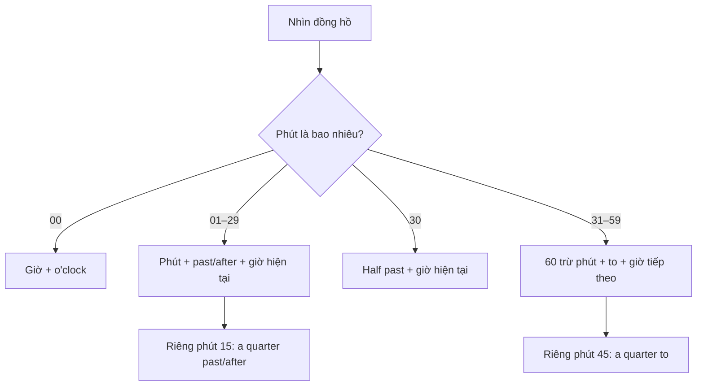
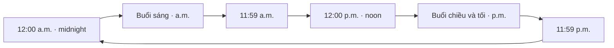

# Bài 12 – Thời gian (Time)

> **Đơn vị 1:** Ngôn ngữ hằng ngày (Everyday Language)  
> **Trang sách:** 16–17 · **Trang PDF:** 26–27  
> **Trọng tâm:** Đơn vị thời gian, cách đọc đồng hồ, A.M./P.M., thời điểm trong ngày, múi giờ và đúng giờ.

## 1. Tóm tắt bài học

Khi hẹn gặp bạn bè, hỏi giờ bắt đầu lớp học hay kể về lịch sinh hoạt, ta cần **đọc được thời gian** và **nói được lúc nào một việc diễn ra**. Bài học phân biệt các đơn vị thời gian, hai cách đọc giờ phổ biến trong tiếng Anh và những từ mô tả các thời điểm trong ngày. Cuối bài, bạn sẽ biết cách hỏi giờ, trả lời và nói mình đến sớm, đúng giờ hay muộn.

### 1.1. Mục tiêu học tập

Sau khi học, bạn có thể:

1. Phân biệt `second`, `minute`, `hour` và đọc giờ bằng tiếng Anh.
2. Diễn đạt các thời điểm từ **1:00 đến 1:55** theo hai cách (đọc số và dùng `past/after/to`).
3. Phân biệt chính xác **A.M.** và **P.M.**, nhất là 12 giờ trưa và 12 giờ đêm.
4. Dùng `morning`, `noon`, `evening`, `midnight`, `early`, `late`, `on time` trong câu.
5. Nhận biết tên các múi giờ trên bản đồ Bắc Mỹ và thực hành hội thoại về lịch hằng ngày.

## 2. Quan sát tranh và cách học

*Ảnh ghép trang 16–17, tương ứng trang PDF 26–27. Các số 1–33 bên cạnh hình khớp với bảng từ vựng trong bài này.*

Hãy quan sát đồng hồ ở trang trái, đọc giờ trước khi xem chú thích; tiếp đó nhìn các cảnh núi ở trang phải để đoán `morning`, `noon`, `afternoon`, `evening`, `night`, `midnight`. Sau cùng, nhận diện các múi giờ trong bản đồ.

## 3. Đơn vị thời gian và đồng hồ

### 3.1. Ba đơn vị cơ bản (số 1–3)

| Số trên tranh | English | Nghĩa tiếng Việt | Ghi nhớ |
|---:|---|---|---|
| 1 | **second** | giây | 60 seconds = 1 minute |
| 2 | **minute** | phút | 60 minutes = 1 hour |
| 3 | **hour** | giờ (đơn vị đo thời lượng) | 1 hour = 3,600 seconds |

**Ví dụ:**

- **Wait a second, please.** — Vui lòng chờ một giây/chút nhé.
- **The lesson starts in ten minutes.** — Bài học bắt đầu sau mười phút nữa.
- **I study English for one hour a day.** — Tôi học tiếng Anh một giờ mỗi ngày.

`Hour` chỉ khoảng thời gian dài bao lâu; `o'clock` dùng để chỉ **giờ đúng** trên đồng hồ. Vì vậy, “Tôi học hai giờ” là **I study for two hours**, còn “Bây giờ là hai giờ” là **It's two o'clock**.

### 3.2. Hai cách đọc thời gian

**Cách 1 — Đọc trực tiếp giờ và phút** (rất thông dụng):

- `1:00` → **one o'clock**.
- `1:05` → **one-oh-five** (đọc số 0 thành *oh*).
- `1:20` → **one-twenty**.
- `1:45` → **one-forty-five**.

**Cách 2 — Đọc theo vị trí phút so với giờ:**

- Từ phút **01 đến 30**: số phút + **past/after** + giờ hiện tại.
- Phút **30**: **half past** + giờ hiện tại.
- Từ phút **31 đến 59**: số phút **còn lại đến giờ tiếp theo** + **to** + giờ tiếp theo.
- Phút **15**: **a quarter past/after** + giờ hiện tại.
- Phút **45**: **a quarter to** + giờ tiếp theo.

**Cách hiểu:** Lúc `1:40`, đã qua 1 giờ 40 phút nhưng chỉ còn **20 phút đến 2 giờ**, nên có thể nói **twenty to two**. `Past` phổ biến trong tiếng Anh Anh; tranh sử dụng `after`, thường gặp trong tiếng Anh Mỹ. Hai cách đều có thể hiểu được.

### 3.3. Toàn bộ 12 mốc giờ trong tranh (số 4–15)

| Số | Đồng hồ | Cách đọc trực tiếp | Cách đọc theo phút | Nghĩa tiếng Việt |
|---:|---|---|---|---|
| 4 | **1:00** | one o'clock | — | một giờ |
| 5 | **1:05** | one-oh-five | five after one / five past one | một giờ năm phút |
| 6 | **1:10** | one-ten | ten after one / ten past one | một giờ mười phút |
| 7 | **1:15** | one-fifteen | a quarter after one / a quarter past one | một giờ mười lăm |
| 8 | **1:20** | one-twenty | twenty after one / twenty past one | một giờ hai mươi |
| 9 | **1:25** | one-twenty-five | twenty-five after one / twenty-five past one | một giờ hai mươi lăm |
| 10 | **1:30** | one-thirty | half past one | một giờ ba mươi |
| 11 | **1:35** | one-thirty-five | twenty-five to two | một giờ ba mươi lăm / hai giờ kém hai mươi lăm |
| 12 | **1:40** | one-forty | twenty to two | một giờ bốn mươi / hai giờ kém hai mươi |
| 13 | **1:45** | one-forty-five | a quarter to two | một giờ bốn mươi lăm / hai giờ kém mười lăm |
| 14 | **1:50** | one-fifty | ten to two | một giờ năm mươi / hai giờ kém mười |
| 15 | **1:55** | one-fifty-five | five to two | một giờ năm mươi lăm / hai giờ kém năm |

**Mẹo nhớ:** `quarter` là một phần tư giờ = **15 phút**; `half` là một nửa giờ = **30 phút**. Khi dùng `to`, hãy nhớ chuyển sang **giờ kế tiếp**, không giữ nguyên giờ hiện tại.

**Tự luyện:** Che cột cách đọc và thử phát âm 12 mốc thời gian theo thứ tự từ trên xuống, sau đó đảo ngược thứ tự để không chỉ học thuộc vị trí.

## 4. A.M., P.M. và các thời điểm trong ngày

### 4.1. Phân biệt A.M. và P.M.

Đồng hồ 12 giờ lặp lại hai lần trong một ngày. Ta thêm **a.m.** hoặc **p.m.** để phân biệt:

| Ký hiệu | Khoảng thời gian | Ví dụ |
|---|---|---|
| **A.M. / a.m.** | Từ **12:00 đêm** đến **11:59 sáng** | **6:30 a.m.** = 6 giờ 30 sáng |
| **P.M. / p.m.** | Từ **12:00 trưa** đến **11:59 tối/đêm** | **6:30 p.m.** = 6 giờ 30 chiều/tối |

**Đặc biệt dễ nhầm:**

- **12:00 a.m. = midnight = 0:00** (nửa đêm).
- **12:00 p.m. = noon = 12:00** (giữa trưa).
- Để tránh hiểu nhầm khi hẹn lịch, có thể nói **12 noon** hoặc **12 midnight** thay vì chỉ ghi 12 a.m./p.m.

### 4.2. Tên các thời điểm (số 16–21)

| Số | English | Tiếng Việt | Ví dụ |
|---:|---|---|---|
| 16 | **morning** | buổi sáng | **Good morning!** — Chào buổi sáng! |
| 17 | **noon** | buổi trưa / 12 giờ trưa | **Let's meet at noon.** — Gặp nhau lúc trưa nhé. |
| 18 | **afternoon** | buổi chiều | **I study in the afternoon.** — Tôi học vào buổi chiều. |
| 19 | **evening** | buổi tối (thường trước khi đi ngủ) | **I read in the evening.** — Tôi đọc sách vào buổi tối. |
| 20 | **night** | ban đêm / buổi đêm | **I sleep at night.** — Tôi ngủ vào ban đêm. |
| 21 | **midnight** | nửa đêm / 12 giờ đêm | **The clock strikes midnight.** — Đồng hồ điểm nửa đêm. |

**Giới từ thường đi cùng thời điểm:** `in the morning`, `in the afternoon`, `in the evening`, nhưng `at noon`, `at midnight`, `at night`.

`Evening` và `night` có thể trùng nhau về thời gian; `evening` thiên về khoảng tối khi còn sinh hoạt, còn `night` nhấn mạnh thời gian ban đêm. Không có một mốc chuyển giờ cố định tuyệt đối cho hai từ này.

## 5. Đến sớm, muộn và đúng giờ

| Số | Từ/cụm từ | Nghĩa | Ví dụ |
|---:|---|---|---|
| 22 | **early** | sớm | **I arrive early.** — Tôi đến sớm. |
| 23 | **late** | muộn, trễ | **He is late for class.** — Anh ấy đến lớp muộn. |
| — | **on time** | đúng giờ, không sớm cũng không muộn | **She's on time.** — Cô ấy đến đúng giờ. |

`Early`, `late`, `on time` thường nói về **thời điểm một người đến hoặc một việc xảy ra so với lịch dự kiến**.

**Ví dụ cùng một lịch hẹn lúc 8:00:**

- Đến **7:50** → **early** (đến sớm).
- Đến **8:00** → **on time** (đúng giờ).
- Đến **8:10** → **late** (đến muộn).

**Mẫu câu:** **Are you on time for class?** — Bạn có đến lớp đúng giờ không? / **Sorry I'm late.** — Xin lỗi, tôi đến muộn.

## 6. Múi giờ (Time Zones)

Khi hai nơi ở những vị trí địa lý khác nhau, **giờ trên đồng hồ có thể không giống nhau tại cùng một thời điểm**. Bản đồ trang 17 giới thiệu tên những vùng giờ tại Bắc Mỹ.

| Số | English | Nghĩa trong sách |
|---:|---|---|
| 24 | **Hawaii-Aleutian time** | giờ Hawaii–Aleutian |
| 25 | **Alaska time** | giờ Alaska |
| 26 | **Pacific time** | giờ Thái Bình Dương |
| 27 | **mountain time** | giờ miền núi |
| 28 | **central time** | giờ miền trung |
| 29 | **eastern time** | giờ miền đông |
| 30 | **Atlantic time** | giờ Đại Tây Dương |
| 31 | **Newfoundland time** | giờ Newfoundland |
| 32 | **standard time** | giờ tiêu chuẩn / giờ căn bản |
| 33 | **daylight saving time** | giờ mùa hè (điều chỉnh đồng hồ theo mùa) |

**Phân biệt hai khái niệm cuối:**

- **Standard time**: thời gian tiêu chuẩn của một vùng khi không áp dụng điều chỉnh giờ mùa hè.
- **Daylight saving time (DST)**: ở những khu vực có áp dụng, đồng hồ được chỉnh theo mùa để thay đổi thời điểm sinh hoạt so với ánh sáng ban ngày.

**Lưu ý khi xem tranh:** Khung chú thích `October–April` và `April–October` trong sách là phần minh họa lịch chuyển giờ của bản đồ, **không nên xem là quy tắc ngày áp dụng hiện nay cho mọi quốc gia hay vùng lãnh thổ**. Không phải khu vực nào cũng dùng DST; ngày chuyển đổi tùy nơi và thời kỳ.

**Hội thoại mẫu:**

- **A:** What time is it in New York? — Ở New York bây giờ là mấy giờ?
- **B:** New York is in the Eastern time zone. We need to check the time difference. — New York thuộc múi giờ miền Đông. Chúng ta cần kiểm tra chênh lệch giờ.

## 7. Mẫu câu hỏi và nói về thời gian

### 7.1. Hỏi bây giờ là mấy giờ

**A:** What time is it? — Bây giờ là mấy giờ?  
**B:** It's ten o'clock in the morning. — Bây giờ là 10 giờ sáng.

Có thể nói ngắn gọn **It's 10:00 a.m.** hoặc **It's ten a.m.**. Dạng `It's ...` rất thường gặp khi báo giờ.

### 7.2. Hỏi khi nào một hoạt động diễn ra

**A:** What time do you wake up on weekdays? — Bạn thức dậy lúc mấy giờ vào ngày thường?  
**B:** At six thirty a.m. — Lúc 6 giờ 30 sáng.

**A:** What time do you wake up on weekends? — Bạn thức dậy lúc mấy giờ vào cuối tuần?  
**B:** At nine thirty a.m. — Lúc 9 giờ 30 sáng.

**A:** When do you study English? — Bạn học tiếng Anh khi nào?  
**B:** I study in the evening. — Tôi học vào buổi tối.

**Ghi nhớ:** Dùng `at` với **giờ cụ thể** (`at 7:15`, `at noon`), dùng `on` với **ngày** (`on weekdays`, `on weekends`), dùng `in` với **buổi** (`in the morning`).

### 7.3. Hỏi về khoảng thời gian

**A:** How many hours a day do you study English? — Mỗi ngày bạn học tiếng Anh bao nhiêu giờ?  
**B:** I study English for two hours a day. — Tôi học tiếng Anh hai giờ mỗi ngày.

**A:** You're meeting friends at 1:00. How long will you wait if they are late? — Bạn hẹn bạn bè lúc 1 giờ. Nếu họ đến muộn, bạn sẽ đợi bao lâu?  
**B:** I'll wait for fifteen minutes. — Tôi sẽ đợi 15 phút.

`What time...?` hỏi **thời điểm**; `How long...?` hỏi **khoảng thời gian**. Dùng `for` để diễn đạt một khoảng kéo dài: `for ten minutes`, `for an hour`.

### 7.4. Nói về việc đến lớp đúng giờ

**A:** Do you come to class on time, early, or late? — Bạn đến lớp đúng giờ, sớm hay muộn?  
**B:** I usually come to class on time. — Tôi thường đến lớp đúng giờ.

**A:** When do you watch television, study, or do housework? — Bạn xem tivi, học bài hoặc làm việc nhà khi nào?  
**B:** I do housework in the morning and study at night. — Tôi làm việc nhà vào buổi sáng và học vào buổi tối/đêm.

## 8. Những lỗi dễ mắc

| Lỗi thường gặp | Cách đúng | Vì sao? |
|---|---|---|
| `one o'clock five` | **one-oh-five** hoặc **five past one** | `o'clock` chỉ dùng khi phút bằng 00. |
| `twenty to one` để chỉ 1:40 | **twenty to two** | `to` hướng đến giờ tiếp theo. |
| `12:00 a.m.` = trưa | **12:00 a.m. = midnight** | 12 giờ trưa là **12:00 p.m.** |
| `in night` | **at night** | Giới từ thông dụng đi cùng `night` là `at`. |
| `I study at two hours` | **I study for two hours** | Thời lượng dùng `for`, còn mốc giờ dùng `at`. |
| `I'm in time for class` khi muốn nói đến đúng giờ | **I'm on time for class** | `on time` nhấn mạnh đúng lịch; `in time` thường nhấn mạnh kịp trước khi quá muộn. |

## 9. Thực hành và tự kiểm tra

### 9.1. Bài tập A — Đọc đồng hồ

Viết **hai cách đọc tiếng Anh** (trực tiếp và theo phút) cho mỗi mốc:

1. `1:05`
2. `1:15`
3. `1:30`
4. `1:40`
5. `1:55`

### 9.2. Bài tập B — Điền từ

Điền `morning`, `midnight`, `late`, `on time`, `noon` vào chỗ trống (mỗi từ dùng một lần):

1. It's 12:00 p.m. It's ______.
2. It's 12:00 a.m. It's ______.
3. I wake up at 6:30 a.m., in the ______.
4. The class starts at 8:00. I arrive at 8:00. I'm ______.
5. The bus leaves at 7:30. I arrive at 7:40. I'm ______.

### 9.3. Bài tập C — Dịch câu

1. Bây giờ là một giờ kém mười lăm.
2. Tôi thường thức dậy lúc 6 giờ 30 sáng vào ngày thường.
3. Cô ấy đến lớp đúng giờ.
4. Tôi học tiếng Anh hai giờ mỗi ngày.
5. Chúng ta hãy gặp nhau lúc 12 giờ trưa.

### 9.4. Bài tập D — Luyện nói

Hãy trả lời thành tiếng bằng **câu hoàn chỉnh**:

1. What time is it?
2. What time do you wake up on weekdays?
3. What time do you wake up on weekends?
4. How many hours a day do you study English?
5. When do you watch television, study, or do housework?
6. Do you come to class on time, early, or late?

**Tiêu chí tự đánh giá:** Phát âm đúng giờ và phút, dùng đúng `a.m./p.m.`, dùng được `at/in/on/for` phù hợp và trả lời bằng câu đầy đủ.

### 9.5. Đáp án gợi ý

**Bài A:**

1. **one-oh-five** / **five after one**.
2. **one-fifteen** / **a quarter after one**.
3. **one-thirty** / **half past one**.
4. **one-forty** / **twenty to two**.
5. **one-fifty-five** / **five to two**.

**Bài B:** 1. **noon**; 2. **midnight**; 3. **morning**; 4. **on time**; 5. **late**.

**Bài C:**

1. **It's a quarter to one.** (12:45.)
2. **I usually wake up at six thirty a.m. on weekdays.**
3. **She comes to class on time.**
4. **I study English for two hours a day.**
5. **Let's meet at noon.**

*Bài D không có đáp án cố định vì phụ thuộc lịch sinh hoạt và thời gian trả lời của người học.*

## 10. Câu hỏi ôn tập trắc nghiệm

### Câu 1

Cách đọc nào đúng cho **1:45**?

A. A quarter after one  
B. Half past one  
C. A quarter to two  
D. Fifteen to one

**Đáp án: C.** Còn 15 phút nữa đến 2 giờ, nên nói `a quarter to two`.

### Câu 2

Lúc **12:00 a.m.** là thời điểm nào?

A. Noon  
B. Midnight  
C. Afternoon  
D. Evening

**Đáp án: B.** `12:00 a.m.` là nửa đêm, khác với `12:00 p.m.` là buổi trưa.

### Câu 3

Một cuộc hẹn bắt đầu 9:00; bạn đến đúng 9:00. Cách mô tả phù hợp nhất là:

A. On time  
B. Late  
C. Early  
D. At night

**Đáp án: A.** Đến đúng thời điểm theo lịch là `on time`.

### Câu 4

Câu nào nói đúng **“Tôi học tiếng Anh trong hai giờ”**?

A. I study English at two hours.  
B. I study English on two hours.  
C. I study English in two hours.  
D. I study English for two hours.

**Đáp án: D.** `For` đi với thời lượng hoạt động; `at` dùng cho thời điểm cụ thể.

### Câu 5

Nếu chỉ còn 20 phút nữa là 2:00, giờ hiện tại được đọc như thế nào?

A. Twenty past two  
B. Twenty to two  
C. Twenty to one  
D. Two twenty

**Đáp án: B.** `Twenty to two` chỉ 1:40, tức còn 20 phút đến 2 giờ.

### Câu 6

Cặp nào sử dụng đúng giới từ chỉ thời gian?

A. At the morning / in midnight  
B. On the morning / in noon  
C. In the morning / at midnight  
D. In the night / on noon

**Đáp án: C.** Ta nói `in the morning` và `at midnight`.

## 11. Tổng kết và ôn tập định kỳ

Có ba ý quan trọng nhất: **(1)** đọc số giờ–phút trực tiếp hoặc dùng `past/after/to`; **(2)** phân biệt `a.m.` và `p.m.` với điểm đặc biệt `noon/midnight`; **(3)** dùng đúng các trạng từ chỉ thời điểm `early`, `late`, `on time`.

- **Ngay sau bài học:** Che bảng, tự đọc đủ 12 mốc giờ và phát âm các từ số 16–23.
- **Ngày hôm sau:** Tự viết lại 5 câu nói về lịch sinh hoạt cá nhân mà không xem đáp án.
- **Sau một tuần:** Tập hội thoại 1 phút: hỏi giờ, hẹn gặp, nói thời lượng học và việc đến đúng giờ.

---

**Điều hướng:** [← Bài 11 – Số và đo lường](11_numbers-and-measurements.md) · [Bài 13 – Lịch →](13_the-calendar.md) · [Danh sách bài học](README.md)
