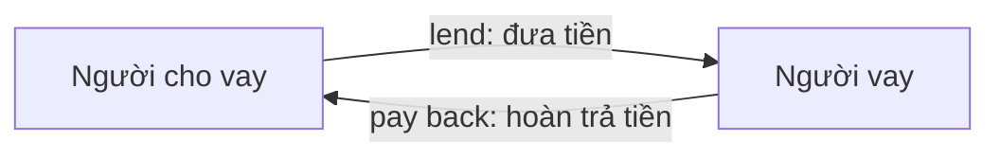

# Bài 14 – Tiền (Money)

> **Chủ đề:** Tiền xu, tiền giấy, cách trả tiền và những cách nói thông dụng về tiền ở Hoa Kỳ.  
> **Mục tiêu:** Nhận diện 17 hình minh họa, đọc các mệnh giá USD, lựa chọn cách thanh toán trong tình huống đơn giản và phân biệt *borrow – lend – pay back*.  
> **Tài liệu minh họa:** Trang 20 của *Oxford Picture Dictionary – Anh–Việt* (trang 30 của bản PDF).

## 1. Khởi động: Money là gì?

Trong giao tiếp hằng ngày, **money** (tiền) dùng để mua hàng, thanh toán dịch vụ, vay mượn hoặc hoàn trả một khoản tiền. Khi nói về đồng đô la Mỹ (US dollar, viết tắt **USD**), có hai đơn vị rất thường gặp:

- **dollar ($):** đô la.
- **cent (¢):** xu; **100 cents = 1 dollar**.

Ví dụ, `$1.25` có thể đọc là **one dollar and twenty-five cents** hoặc **a dollar twenty-five** (cách nói thường dùng khi mua sắm).

> **Ghi nhớ:** *money* là danh từ không đếm được: nói *some money*, *much money*, không nói *a money*. Tuy nhiên, **dollar, cent, coin, bill** là các danh từ đếm được.

## 2. Tranh minh họa: 17 từ vựng trên một trang

**Cách sử dụng tranh:** Theo dõi các số từ **1 đến 17**. Các số **1–6** là tiền xu, **7–12** là tiền giấy và **13–17** là những cách trả tiền. Trước khi đọc các bảng dưới đây, hãy thử gọi tên những vật có thể nhận ra.

## 3. Tiền xu – Coins (hình 1–6)

**Coin** là một đồng tiền kim loại. Mỗi loại tiền xu Mỹ có tên thường dùng riêng, vì vậy khi nói chuyện người ta hay gọi *a nickel* hoặc *a quarter* thay vì chỉ đọc giá trị.

| Số hình | English | Giá trị | Tiếng Việt | Ví dụ |
|---:|---|---:|---|---|
| 1 | **a penny / one cent** | **$0.01 = 1¢** | một xu | *I found a penny.* – Tôi nhặt được một đồng một xu. |
| 2 | **a nickel / five cents** | **$0.05 = 5¢** | năm xu | *This is a nickel.* – Đây là đồng năm xu. |
| 3 | **a dime / ten cents** | **$0.10 = 10¢** | mười xu | *I have two dimes.* – Tôi có hai đồng mười xu. |
| 4 | **a quarter / twenty-five cents** | **$0.25 = 25¢** | hai mươi lăm xu | *Four quarters make a dollar.* – Bốn đồng 25 xu bằng một đô la. |
| 5 | **a half dollar / fifty cents** | **$0.50 = 50¢** | nửa đô la, năm mươi xu | *A half dollar is worth fifty cents.* – Đồng nửa đô la có giá trị 50 xu. |
| 6 | **a silver dollar / one dollar** | **$1.00 = 100¢** | đồng một đô la bạc (tên gọi trong tranh) | *This is a one-dollar coin.* – Đây là một đồng xu một đô la. |

### 3.1. Tự quy đổi giá trị

Giá trị của tiền xu **không phụ thuộc vào kích thước hình vẽ** mà phụ thuộc vào mệnh giá. Hãy ghi nhớ những phép quy đổi sau:

| Số lượng tiền xu | Tổng tiền |
|---|---|
| 5 pennies | 5¢ = $0.05 |
| 2 nickels | 10¢ = $0.10 |
| 2 dimes | 20¢ = $0.20 |
| 4 quarters | 100¢ = $1.00 |
| 1 half dollar + 2 quarters | 100¢ = $1.00 |

**Ví dụ:** Bạn có một *quarter* và hai *dimes*. Tổng tiền là **25¢ + 10¢ + 10¢ = 45¢**, đọc là **forty-five cents**.

> **Lưu ý sử dụng:** Tên *silver dollar* trong hình là cách gọi đồng xu một đô la; không nên suy ra mọi đồng xu 1 USD đang lưu hành đều làm bằng bạc. Hình minh họa cũng thể hiện một số mẫu thiết kế tiền Mỹ, không nhất thiết là các mẫu mới nhất.

## 4. Tiền giấy – Bills (hình 7–12)

Trong tiếng Anh Mỹ, **bill** là tờ tiền giấy. Từ **banknote** hoặc **note** cũng có thể dùng để chỉ tiền giấy, đặc biệt trong tiếng Anh Anh. Khi nói đến một tờ tiền cụ thể, ta dùng **a + mệnh giá + dollar bill**.

| Số hình | English | Mệnh giá | Tiếng Việt |
|---:|---|---:|---|
| 7 | **a dollar / a one-dollar bill** | **$1.00** | một đô la |
| 8 | **five dollars / a five-dollar bill** | **$5.00** | năm đô la |
| 9 | **ten dollars / a ten-dollar bill** | **$10.00** | mười đô la |
| 10 | **twenty dollars / a twenty-dollar bill** | **$20.00** | hai mươi đô la |
| 11 | **fifty dollars / a fifty-dollar bill** | **$50.00** | năm mươi đô la |
| 12 | **one hundred dollars / a hundred-dollar bill** | **$100.00** | một trăm đô la |

**Cách nói tự nhiên với tiền giấy:**

- **a one / a dollar bill:** tờ 1 đô la.
- **a five:** tờ 5 đô la.
- **a ten:** tờ 10 đô la.
- **a twenty:** tờ 20 đô la.
- **a fifty:** tờ 50 đô la.
- **a hundred:** tờ 100 đô la.

Ví dụ:

> **A:** Do you have a twenty?  
> **B:** No, I only have two tens.  
> **Dịch:** A: Bạn có tờ 20 đô không? B: Không, tôi chỉ có hai tờ 10 đô.

### 4.1. Điểm ngữ pháp: dollars hay dollar?

- **one dollar** (một đô la), **five dollars** (năm đô la): *dollars* là danh từ chỉ tiền, số nhiều khi lượng lớn hơn một.
- **a five-dollar bill** (một tờ 5 đô la): *five-dollar* là tính từ ghép đứng trước *bill*, nên **dollar không thêm -s**.

Đúng: *I have twenty dollars.* / *I have a twenty-dollar bill.*  
Sai: *I have a twenty-dollars bill.*

## 5. Các hình thức thanh toán – Ways to pay (hình 13–17)

Không phải lúc nào trả tiền cũng là đưa tiền xu hoặc tiền giấy. Người mua có thể dùng thẻ hay chứng từ thanh toán. Năm thuật ngữ dưới đây tương ứng với những hình đánh số trong tranh:

| Số hình | English | Tiếng Việt | Cách hiểu và sử dụng |
|---:|---|---|---|
| 13 | **cash** | tiền mặt | Tiền xu và tiền giấy được sử dụng trực tiếp khi thanh toán. |
| 14 | **personal check** (Anh–Anh: *personal cheque*) | chi phiếu cá nhân | Chứng từ do cá nhân viết để yêu cầu ngân hàng thanh toán một khoản tiền. |
| 15 | **credit card** | thẻ tín dụng | Thẻ dùng để thanh toán bằng hạn mức tín dụng; khoản đã chi cần được hoàn trả theo điều khoản của tổ chức phát hành. |
| 16 | **money order** | phiếu trả tiền / ngân phiếu | Chứng từ thanh toán với số tiền được xác định trước, thường được mua hoặc trả tiền trước khi phát hành. |
| 17 | **traveler’s check** (Anh–Anh: *traveller’s cheque*) | chi phiếu du lịch | Chứng từ dùng trong du lịch, hiện ít phổ biến hơn trước do có nhiều cách thanh toán khác. |

### 5.1. Phân biệt cash, check và card

| Tình huống | Cách nói thường dùng |
|---|---|
| Bạn đưa tiền giấy hoặc tiền xu tại quầy | **pay in cash / pay with cash** |
| Bạn dùng thẻ tín dụng | **pay by credit card / pay with a credit card** |
| Bạn viết chi phiếu cá nhân | **pay by check / pay with a check** |

**Hội thoại mẫu:**

> **Cashier:** How would you like to pay?  
> **Customer:** By credit card, please.  
> **Cashier:** Sure.  
> **Dịch:** Thu ngân: Bạn muốn thanh toán bằng cách nào? Khách hàng: Bằng thẻ tín dụng ạ. Thu ngân: Vâng.

Trong giao tiếp thực tế, **cash** là tiền mặt; **credit card** không phải là tiền mặt. *Personal checks, money orders* và *traveler’s checks* là các loại chứng từ, không phải những mệnh giá của đồng USD.

## 6. Từ vựng mở rộng: borrow, lend, pay back

Ba động từ này rất dễ nhầm vì đều liên quan đến cùng một khoản tiền nhưng khác **hướng chuyển tiền**.

| Từ | Ý nghĩa | Cấu trúc thông dụng | Ví dụ |
|---|---|---|---|
| **borrow** | vay, mượn: **nhận** tiền của người khác và sẽ trả sau | **borrow money from someone** | *I borrowed ten dollars from Mai.* – Tôi vay Mai 10 đô la. |
| **lend** | cho vay, cho mượn: **đưa** tiền cho người khác và sẽ nhận lại sau | **lend money to someone** | *Mai lent me ten dollars.* – Mai cho tôi vay 10 đô la. |
| **pay back** | trả lại tiền đã vay | **pay someone back / pay back money** | *I paid Mai back yesterday.* – Hôm qua tôi đã trả lại tiền cho Mai. |

### 6.1. Mối quan hệ giữa ba hành động

Sơ đồ thể hiện quá trình chuyển tiền và hoàn trả: người **cho** dùng *lend*, người **nhận** dùng *borrow from*, sau đó người vay **pay back**. Dù cả *lend* và *borrow* mô tả cùng lần giao tiền, hai từ diễn đạt góc nhìn của hai người khác nhau.

**Cặp câu cùng nghĩa về sự kiện:**

- *Can I borrow five dollars from you?* – Tôi có thể vay bạn 5 đô không?
- *Can you lend me five dollars?* – Bạn có thể cho tôi vay 5 đô không?

Cần tránh nhầm **borrow me $5** với **lend me $5**: cách nói đúng để yêu cầu ai đó cho mình vay là **lend me $5**.

## 7. Cách đọc và nói số tiền bằng tiếng Anh

### 7.1. Cents, dollars và ký hiệu

| Cách viết | Cách đọc | Nghĩa |
|---|---|---|
| **1¢** | one cent | một xu |
| **5¢** | five cents | năm xu |
| **25¢** | twenty-five cents | hai mươi lăm xu |
| **$1.00** | one dollar / a dollar | một đô la |
| **$1.50** | one dollar and fifty cents / a dollar fifty | một đô rưỡi |
| **$5.25** | five dollars and twenty-five cents / five twenty-five | năm đô hai mươi lăm xu |
| **$20.00** | twenty dollars | hai mươi đô la |
| **$100.00** | one hundred dollars | một trăm đô la |

Với số tiền **$6.75**, người bán có thể nói *six dollars and seventy-five cents*; cách rút gọn trong văn nói là *six seventy-five*. Ngữ cảnh mua bán giúp người nghe hiểu đây là giá tiền.

### 7.2. Mẫu câu hỏi giá và trả tiền

| English | Tiếng Việt |
|---|---|
| **How much is it?** | Cái này bao nhiêu tiền? |
| **It’s ten dollars.** | Nó có giá 10 đô la. |
| **Do you have change for a twenty?** | Bạn có tiền lẻ đổi tờ 20 đô không? |
| **Can I pay in cash?** | Tôi có thể trả bằng tiền mặt không? |
| **Do you accept credit cards?** | Bạn có nhận thẻ tín dụng không? |
| **Here’s twenty dollars.** | Đây là 20 đô la. |
| **Keep the change.** | Bạn cứ giữ tiền thừa. |
| **How much do I owe you?** | Tôi nợ bạn bao nhiêu tiền? |

> **Phân biệt thêm:** Trong câu *Do you have change for a twenty?*, **change** có nghĩa là **tiền lẻ để đổi**; trong *Keep the change*, **change** có nghĩa là **tiền thối/tiền trả lại**.

## 8. Tình huống thực hành

### 8.1. Thanh toán tại cửa hàng

> **Clerk:** That’s eight dollars and fifty cents.  
> **Customer:** Can I pay in cash?  
> **Clerk:** Of course.  
> **Customer:** Here’s a ten-dollar bill.  
> **Clerk:** Here’s your change: one dollar and fifty cents.  
> **Customer:** Thank you!

**Dịch:**

- Nhân viên: Tổng cộng 8 đô la 50 xu.
- Khách: Tôi trả bằng tiền mặt được không?
- Nhân viên: Tất nhiên rồi.
- Khách: Đây là tờ 10 đô la.
- Nhân viên: Tiền thối của bạn là 1 đô la 50 xu.
- Khách: Cảm ơn!

**Giải thích:** Số tiền cần trả là `$8.50`, khách đưa `$10.00`, vậy tiền thối là **$1.50**.

### 8.2. Hỏi vay một khoản nhỏ

> **A:** Could you lend me five dollars?  
> **B:** Sure. When can you pay me back?  
> **A:** Tomorrow. Thanks!

**Dịch:** A: Bạn có thể cho mình vay 5 đô không? B: Được. Khi nào bạn trả lại? A: Ngày mai. Cảm ơn nhé!

Trong hội thoại, **Could you…?** là cách đề nghị lịch sự hơn **Can you…?**. Động từ **lend** mô tả hành động của người cho vay và **pay back** nói về hoàn trả.

## 9. Những lỗi dễ nhầm

| Cách dùng chưa đúng | Cách dùng đúng | Vì sao? |
|---|---|---|
| *two dollar* (nói số tiền) | **two dollars** | Số tiền nhiều hơn 1 đô dùng *dollars*. |
| *a five-dollars bill* | **a five-dollar bill** | *five-dollar* là tính từ ghép. |
| *I borrowed you money.* (ý muốn nói “tôi cho bạn vay tiền”) | **I lent you money.** | *Lend* = cho vay; *borrow* = vay từ ai. |
| *Can you borrow me ten dollars?* | **Can you lend me ten dollars?** | Người được đề nghị là người cho vay. |
| *I pay with cash yesterday.* | **I paid in cash yesterday.** | *Yesterday* yêu cầu thì quá khứ, *pay → paid*. |
| *This is five money.* | **This is five dollars.** | *Money* không đếm được, cần tên đơn vị. |

## 10. Bài tập củng cố

### Bài A – Nhận diện qua hình

Không nhìn bảng từ vựng, hãy gọi tên tiếng Anh của các số **2, 4, 8, 11, 13, 15 và 17** trên tranh. Sau đó giải thích điểm khác nhau giữa **a coin**, **a bill** và **cash**.

### Bài B – Tính tổng tiền

1. Two quarters + one dime = bao nhiêu cents?
2. One nickel + three pennies = bao nhiêu cents?
3. Two five-dollar bills + one twenty-dollar bill = bao nhiêu dollars?
4. One half dollar + one quarter = bao nhiêu dollars?
5. Bạn trả bằng tờ `$20` cho món hàng giá `$13.25`: nhận lại bao nhiêu tiền thừa?

### Bài C – Điền từ

Dùng **cash, quarter, lend, borrow, credit card** để điền vào chỗ trống (có thể biến đổi dạng từ nếu cần).

1. A ______ is worth twenty-five cents.
2. Can you ______ me ten dollars until tomorrow?
3. I want to ______ money from my sister.
4. I prefer to pay in ______.
5. She paid with a ______.

### Bài D – Luyện nói

Đóng vai người bán và khách hàng. Hãy xây dựng một hội thoại ngắn có đủ: **hỏi giá**, **nói số tiền**, **chọn phương thức thanh toán** và **cảm ơn**. Dùng ít nhất **5 từ** của bài.

## 11. Câu hỏi ôn tập trắc nghiệm

### Câu 1

Bạn có **three quarters**. Tổng số tiền là bao nhiêu?

A. 30¢  
B. 50¢  
C. 75¢  
D. $3.00

**Đáp án: C.** Mỗi *quarter* là 25¢, ba đồng bằng 75¢.

### Câu 2

Câu nào diễn đạt đúng ý “Tôi có một tờ 20 đô la”?

A. **I have a twenty-dollar bill.**  
B. I have a twenty-dollars bill.  
C. I have a twenty cents bill.  
D. I have twenty money.

**Đáp án: A.** *Twenty-dollar* là tính từ ghép trước danh từ *bill*; không thêm **-s** vào *dollar* trong cấu trúc này.

### Câu 3

Bạn muốn hỏi bạn mình “Bạn cho tôi vay 5 đô được không?”. Câu phù hợp là:

A. Can you pay me back five dollars?  
B. Can you borrow me five dollars?  
C. Did I lend you five dollars?  
D. **Could you lend me five dollars?**

**Đáp án: D.** Người nghe là người cho vay, nên dùng *lend*.

### Câu 4

Một khách hàng nói “**I’ll pay in cash.**” Người đó sẽ dùng gì?

A. Chỉ thẻ tín dụng  
B. **Tiền mặt**  
C. Chỉ chi phiếu cá nhân  
D. Chỉ phiếu trả tiền

**Đáp án: B.** *Cash* bao gồm tiền xu và tiền giấy; không có nghĩa là thẻ hoặc chi phiếu.

### Câu 5

Bạn mua hàng giá **$6.25** và đưa một tờ **$10**. Bạn nhận lại bao nhiêu?

A. $2.75  
B. $4.25  
C. **$3.75**  
D. $3.25

**Đáp án: C.** Lấy `$10.00 − $6.25 = $3.75`, đọc là *three dollars and seventy-five cents*.

### Câu 6

Trong số những mục sau, mục nào là **chứng từ thanh toán** chứ không phải một tờ tiền giấy?

A. A ten-dollar bill  
B. A one-dollar bill  
C. A fifty-dollar bill  
D. **A money order**

**Đáp án: D.** *Money order* là phiếu trả tiền/ngân phiếu, còn các phương án còn lại đều là tiền giấy.

## 12. Đáp án bài tập và tự kiểm tra

**Bài A:** 2 *a nickel*; 4 *a quarter*; 8 *a five-dollar bill*; 11 *a fifty-dollar bill*; 13 *cash*; 15 *credit card*; 17 *traveler's check*. *Coin* là một đồng xu; *bill* là tờ tiền giấy; *cash* là tiền mặt, bao gồm cả hai loại.

**Bài B:** (1) **60¢**; (2) **8¢**; (3) **$30**; (4) **$0.75**; (5) **$6.75**.

**Bài C:** (1) **quarter**; (2) **lend**; (3) **borrow**; (4) **cash**; (5) **credit card**.

**Bài D:** Có nhiều đáp án đúng. Một mẫu ngắn: *How much is it? – It's five dollars. – Can I pay by credit card? – Yes. – Thank you.*

**Checklist sau bài học:**

- [ ] Nhận diện được **6 loại tiền xu** và giá trị tương ứng.
- [ ] Gọi tên được **6 mệnh giá tiền giấy** trong tranh.
- [ ] Phân biệt được **5 hình thức thanh toán**.
- [ ] Nói được các giá tiền như `$0.25`, `$1.50` và `$20.00`.
- [ ] Dùng đúng **borrow**, **lend** và **pay back** trong một hội thoại ngắn.

## 13. Tóm tắt ghi nhớ

| Nhóm | Từ khóa |
|---|---|
| Tiền xu | *penny, nickel, dime, quarter, half dollar, silver dollar* |
| Tiền giấy | *a one, a five, a ten, a twenty, a fifty, a hundred* |
| Hình thức thanh toán | *cash, personal check, credit card, money order, traveler's check* |
| Vay mượn | *borrow from, lend to, pay back* |
| Câu nói cần nhớ | *How much is it?*, *How would you like to pay?*, *Keep the change.* |

**Thông điệp chính:** Học tên từng đồng xu và tờ tiền là bước đầu. Quan trọng hơn, hãy kết hợp những từ đó vào câu hỏi giá, thanh toán và tình huống vay mượn thực tế.

---

**Điều hướng:** [← Bài 13 – The Calendar](13_the-calendar.md) · [Bài 15 – Shopping →](15_shopping.md)
