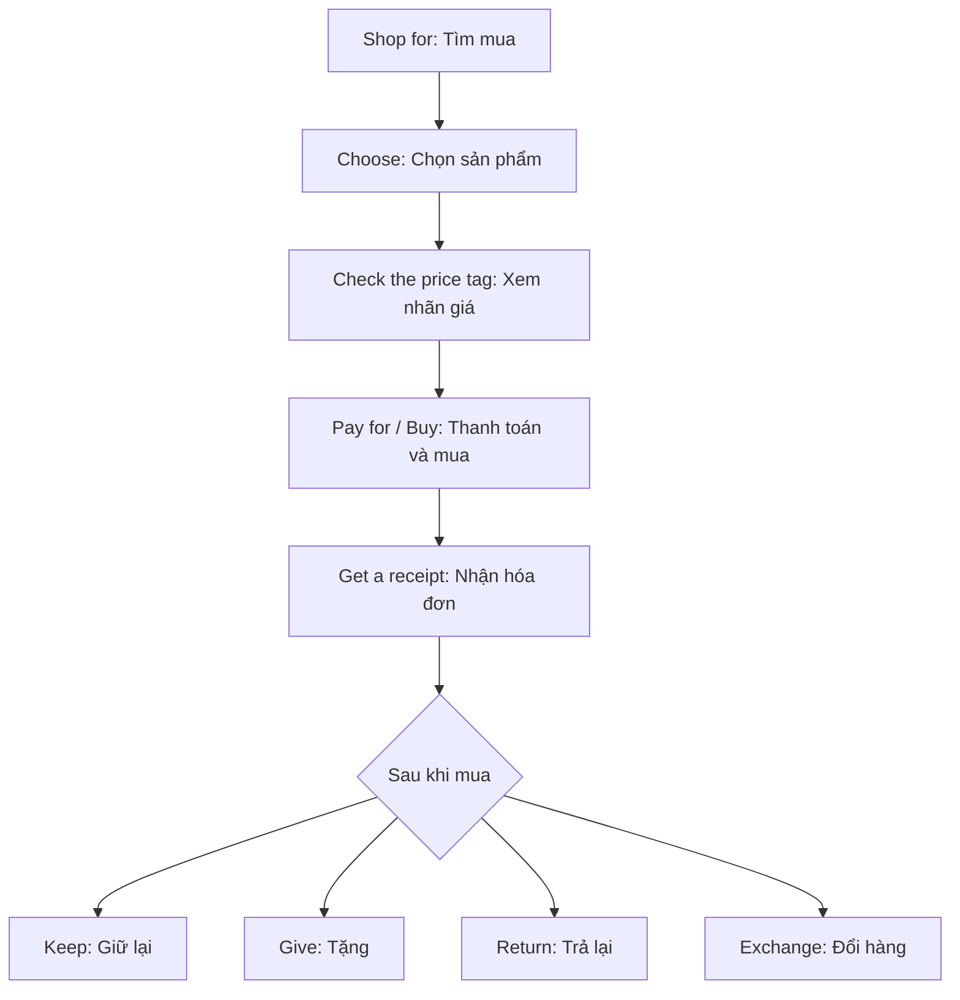

# Bài 15 – Mua sắm (Shopping)

> **Chủ đề:** Ngôn ngữ hằng ngày (Everyday Language)  
> **Trọng tâm:** Tìm mua hàng, giá niêm yết và giá giảm, thanh toán, hóa đơn, trả lại và đổi hàng.  
> **Tình huống chính:** Khách hàng chọn áo len (*sweaters*) trong cửa hàng.

## 1. Tóm tắt bài học

Đi mua sắm bằng tiếng Anh không chỉ cần biết tên món đồ. Bạn còn phải nói mình muốn tìm gì, hỏi giá, đọc nhãn giảm giá, thanh toán và xử lý khi cần đổi hoặc trả hàng. Trong bài này, một chiếc áo len có **giá thường $25.00** nhưng **giá giảm còn $9.99**. Khách hàng mua ba chiếc, thanh toán và nhận tiền thối. Đây là tình huống rất phù hợp để học các động từ mua sắm và từ trên hóa đơn.

Sau bài học, bạn có thể:

- Sử dụng đúng các động từ **shop for, sell, pay for / buy, give, keep, return, exchange**.
- Phân biệt **regular price**, **sale price**, **price tag**, **receipt**, **total** và **change**.
- Đọc các con số trên nhãn giá và hóa đơn đơn giản.
- Thực hiện hội thoại ngắn khi hỏi mua, thanh toán, đổi hoặc trả hàng.

## 2. Quan sát tranh: Một chuyến mua sắm

*Tranh minh họa bài Shopping, trang 21. Các ký hiệu A–G đánh dấu hành động; các số 1–9 đánh dấu thông tin giá cả, hóa đơn và thanh toán.*

Bảy tình huống A–G có thể hiểu theo trình tự từ tìm hàng đến xử lý món đồ sau khi mua:

| Ký hiệu | Cụm từ | Nghĩa | Cách hiểu trong tình huống |
|:---:|---|---|---|
| **A** | **shop for** | đi tìm mua | Người khách đang tìm mua áo len. |
| **B** | **sell** | bán | Nhân viên giới thiệu những chiếc áo len đang bán. |
| **C** | **pay for / buy** | trả tiền cho / mua | Khách đưa tiền để trả cho hàng đã chọn. |
| **D** | **give** | cho, tặng | Người mua tặng áo len cho người khác. |
| **E** | **keep** | giữ lại | Người nhận quyết định giữ chiếc áo. |
| **F** | **return** | trả lại | Một chiếc áo được đem lại cửa hàng để trả. |
| **G** | **exchange** | đổi lại | Khách đổi món đồ sang món khác. |

### 2.1. Mẫu câu xuất hiện trong tranh

> **I'm looking for some sweaters.**  
> Tôi đang tìm mua vài chiếc áo len.

> **These sweaters are only $9.99.**  
> Những chiếc áo len này chỉ có giá 9 đô la 99 xu.

**I'm looking for ...** là cách mở đầu lịch sự, tự nhiên khi cần nhân viên giúp tìm hàng. Từ **only** nhấn mạnh rằng mức giá có vẻ thấp hoặc hấp dẫn.

### 2.2. Phân biệt các hành động dễ nhầm

- **shop for something**: tìm kiếm hoặc lựa chọn món đồ để mua; chưa chắc đã mua.
- **buy something**: mua một món đồ; tập trung vào việc sở hữu món đồ sau giao dịch.
- **pay for something**: trả tiền cho món đồ hoặc dịch vụ; tập trung vào việc thanh toán.
- **sell something**: bán món đồ; là hành động của cửa hàng hoặc người bán.
- **keep something**: giữ món đồ lại, không trả hoặc đổi.
- **return something**: trả món đồ về cửa hàng; tùy chính sách có thể được hoàn tiền hoặc hình thức xử lý khác.
- **exchange something**: đổi món đồ lấy món khác, chẳng hạn đổi cỡ hoặc màu.

Ví dụ:

- *I'm shopping for a blue sweater.* — Tôi đang tìm mua một chiếc áo len màu xanh.
- *The store sells sweaters.* — Cửa hàng bán áo len.
- *I bought three sweaters.* — Tôi đã mua ba chiếc áo len.
- *I paid for them at the register.* — Tôi đã trả tiền cho chúng tại quầy thanh toán.
- *I'll keep the green one.* — Tôi sẽ giữ chiếc màu xanh lá.
- *I'd like to return this sweater.* — Tôi muốn trả lại chiếc áo len này.
- *Can I exchange it for a different size?* — Tôi có thể đổi nó sang cỡ khác không?

> **Lưu ý ngữ pháp:** Nói **buy a sweater** (mua một chiếc áo), **pay for a sweater** (trả tiền cho một chiếc áo), và **shop for a sweater** (tìm mua một chiếc áo). Không nói *pay a sweater* khi muốn diễn đạt “trả tiền cho chiếc áo”.

## 3. Từ vựng về giá và thanh toán

Các số từ 1 đến 9 ở phần dưới của tranh chỉ các thuật ngữ bạn thường gặp trên nhãn sản phẩm, hóa đơn và quầy thu ngân.

| Số | English | Tiếng Việt | Giải thích / cách dùng |
|:---:|---|---|---|
| **1** | **price tag** | thẻ giá, nhãn giá | Nhãn gắn trên sản phẩm, cho biết giá của món đồ. |
| **2** | **regular price** | giá thường, giá niêm yết | Giá trước khi giảm; trong tranh là **$25.00**. |
| **3** | **sale price** | giá hạ, giá khuyến mãi | Giá khi đang giảm; trong tranh là **$9.99**. |
| **4** | **bar code** | mã vạch | Dãy vạch để máy quét nhận diện sản phẩm. |
| **5** | **receipt** | hóa đơn / biên nhận | Giấy xác nhận giao dịch sau khi thanh toán. |
| **6** | **price / cost** | giá cả / chi phí | Số tiền phải trả cho hàng hóa. |
| **7** | **sales tax** | thuế bán hàng | Thuế được cộng vào tiền hàng trong tình huống minh họa. |
| **8** | **total** | tổng cộng | Tổng tiền hàng và các khoản cộng thêm. |
| **9** | **change** | tiền thối, tiền trả lại | Khoản tiền người bán trả lại khi khách đưa nhiều hơn số phải trả. |

### 3.1. Price và cost có gì khác nhau?

**Price** thường là mức giá người bán đưa ra cho một món hàng. **Cost** thường là chi phí phải bỏ ra, hoặc được dùng để hỏi món hàng có giá bao nhiêu.

- *What's the price of this sweater?* — Giá chiếc áo len này là bao nhiêu?
- *How much does this sweater cost?* — Chiếc áo len này giá bao nhiêu?
- *It costs $9.99.* — Nó có giá 9 đô la 99 xu.

**How much is it?** cũng là mẫu câu hỏi giá rất phổ biến: “Món này bao nhiêu tiền?”.

### 3.2. Sale price không phải sales tax

Hai cụm này có từ giống nhau nhưng ý nghĩa rất khác:

- **sale price**: giá đã được giảm.
- **sales tax**: thuế bán hàng, có thể làm tổng tiền tăng lên.

Ví dụ, áo có giá giảm **$9.99** không có nghĩa đây chắc chắn là số tiền cuối cùng phải thanh toán khi có thuế.

## 4. Đọc nhãn giảm giá và hóa đơn

### 4.1. Nhãn giá

Trong tranh, nhãn áo len ghi:

| Thông tin | Số tiền |
|---|---:|
| **Regular price** – giá thường | **$25.00** |
| **Sale price** – giá hạ | **$9.99** |
| **Số tiền tiết kiệm trên một áo** | **$15.01** |

Chiếc áo giảm từ $25.00 còn $9.99; tức người mua tiết kiệm **$15.01 trên mỗi chiếc**, chưa xét thuế. Có thể nói:

- *The regular price is twenty-five dollars.* — Giá thường là 25 đô la.
- *The sale price is nine dollars and ninety-nine cents.* — Giá khuyến mãi là 9 đô la 99 xu.
- *This sweater is on sale.* — Chiếc áo len này đang được giảm giá.

### 4.2. Hóa đơn mua ba chiếc áo len

Hóa đơn minh họa ghi **3 sweaters @ $9.99**. Ký hiệu **@** trong dòng hóa đơn nghĩa là “mỗi chiếc có giá”.

| Mục hóa đơn | Cách đọc | Số tiền |
|---|---|---:|
| **3 sweaters @ $9.99** | Ba áo len, mỗi chiếc $9.99 | **$29.97** |
| **Tax @ 8.25%** | Thuế 8,25% | **$2.47** |
| **Total** | Tổng số phải thanh toán | **$32.44** |
| **Amount tendered** | Số tiền khách đưa | **$40.00** |
| **Change** | Tiền thối lại | **$7.56** |

Cách tính từng bước:

1. **Tiền hàng:** 3 × $9.99 = **$29.97**.
2. **Thuế:** $29.97 × 8.25% ≈ **$2.47** (làm tròn đến xu).
3. **Tổng tiền:** $29.97 + $2.47 = **$32.44**.
4. **Tiền thối:** $40.00 − $32.44 = **$7.56**.

Trong tình huống này, **$32.44** là *total*, còn **$7.56** là *change*. Đây là hai con số rất dễ nhầm khi nghe nhân viên thu ngân nói nhanh.

> **Chú ý:** Thuế suất **8.25%** chỉ thuộc ví dụ hóa đơn trong tranh; không phải thuế suất áp dụng cho mọi cửa hàng hay quốc gia.

### 4.3. Cách đọc tiền trong tiếng Anh

| Ký hiệu | Cách đọc thông dụng |
|---|---|
| **$9.99** | *nine dollars and ninety-nine cents* / *nine ninety-nine* |
| **$25.00** | *twenty-five dollars* |
| **$32.44** | *thirty-two dollars and forty-four cents* |
| **$40.00** | *forty dollars* |
| **$7.56** | *seven dollars and fifty-six cents* |

Khi nói số tiền có hai chữ số sau dấu thập phân, cách đọc rút gọn như *nine ninety-nine* rất phổ biến trong giao tiếp mua sắm ở Mỹ. Trong ngữ cảnh trang trọng, đọc đầy đủ *dollars* và *cents* rõ ràng hơn.

## 5. Hội thoại thực tế khi mua sắm

### 5.1. Hỏi mua áo len đang giảm giá

**Customer (Khách hàng):** Excuse me. I'm looking for some sweaters.  
*Xin lỗi, tôi đang tìm mua vài chiếc áo len.*

**Salesperson (Nhân viên):** These sweaters are on sale. They're only $9.99 each.  
*Những chiếc áo len này đang giảm giá. Mỗi chiếc chỉ có 9 đô la 99 xu.*

**Customer:** What's the regular price?  
*Giá thường là bao nhiêu?*

**Salesperson:** It's $25.00.  
*Giá thường là 25 đô la.*

**Customer:** Great. I'll take three.  
*Tốt quá. Tôi lấy ba chiếc.*

**Ghi nhớ:** *I'll take ...* là cách nói tự nhiên khi đã quyết định mua một hoặc vài món hàng.

### 5.2. Thanh toán và nhận tiền thối

**Cashier (Thu ngân):** Your total is $32.44.  
*Tổng cộng của bạn là 32 đô la 44 xu.*

**Customer:** Here's $40.00.  
*Đây là 40 đô la.*

**Cashier:** Thank you. Here's your change: $7.56. And here's your receipt.  
*Cảm ơn. Đây là 7 đô la 56 xu tiền thối, và đây là hóa đơn của bạn.*

**Customer:** Thank you!  
*Cảm ơn!*

### 5.3. Đổi hoặc trả lại một món hàng

**Customer:** I'd like to return this sweater.  
*Tôi muốn trả lại chiếc áo len này.*

**Salesperson:** Do you have the receipt?  
*Bạn có hóa đơn không?*

**Customer:** Yes. Could I exchange it for a different size instead?  
*Có. Thay vào đó tôi có thể đổi sang cỡ khác không?*

**Salesperson:** Let me check what sizes we have.  
*Để tôi kiểm tra xem chúng tôi còn những cỡ nào.*

Trong thực tế, việc **return** hoặc **exchange** có được chấp nhận hay không phụ thuộc vào chính sách cửa hàng và tình trạng sản phẩm. Đoạn hội thoại trên là ví dụ luyện nói, không phải cam kết rằng mọi cửa hàng đều nhận đổi trả.

## 6. Mẫu câu cần nhớ và lỗi thường gặp

| Mục đích | Mẫu câu tiếng Anh | Nghĩa tiếng Việt |
|---|---|---|
| Tìm một món đồ | **I'm looking for ...** | Tôi đang tìm ... |
| Hỏi giá | **How much is this?** | Cái này giá bao nhiêu? |
| Hỏi giá của nhiều món | **How much are these?** | Những cái này giá bao nhiêu? |
| Hỏi về giảm giá | **Is this on sale?** | Món này có đang giảm giá không? |
| Quyết định mua | **I'll take it / them.** | Tôi lấy món này / những món này. |
| Xin hóa đơn | **Can I have a receipt, please?** | Cho tôi xin hóa đơn được không? |
| Trả lại hàng | **I'd like to return this.** | Tôi muốn trả lại món này. |
| Đổi hàng | **Can I exchange this?** | Tôi có thể đổi món này không? |

Các lỗi nên tránh:

- **Sai:** *I want to pay this sweater.* → **Đúng:** *I want to pay for this sweater.*
- **Sai:** *These sweater are $9.99.* → **Đúng:** *These sweaters are $9.99.*
- **Dễ nhầm:** *return* là trả lại món đồ; *change* trên hóa đơn là tiền thối, không phải động từ đổi hàng.
- **Dễ nhầm:** *receipt* là giấy biên nhận khi mua; *bill* có thể là hóa đơn yêu cầu thanh toán hoặc sao kê, tùy ngữ cảnh.

### 6.1. Từ vựng bổ sung: Bill khi mua bằng thẻ tín dụng

Khi mua hàng bằng **credit card** (thẻ tín dụng), bạn có thể nhận được một **bill** hoặc **credit card statement** (sao kê/thông báo số tiền đến hạn) sau đó. Thông tin này liệt kê các khoản đã mua và số tiền phải trả cho đơn vị phát hành thẻ. Không nên đánh đồng giấy **receipt** tại quầy với bảng **credit card statement**.

## 7. Sơ đồ ghi nhớ quy trình mua sắm

Quy trình bắt đầu từ **shop for** rồi đến **pay for / buy**. Sau khi mua, người mua có thể **keep** hoặc **give** món đồ, hoặc liên hệ cửa hàng để **return / exchange** nếu có nhu cầu và đáp ứng chính sách cửa hàng. **Sell** mô tả hành động tương ứng ở phía người bán.

## 8. Bài tập thực hành

### 8.1. Điền động từ phù hợp

Điền một trong các cụm: **shop for, sell, pay for, give, keep, return, exchange**. Có thể phải chia động từ theo câu.

1. I'm going to __________ some sweaters this afternoon.
2. This store __________ clothes at low prices.
3. I need to __________ these items before I leave the store.
4. This sweater is too small. Can I __________ it for a larger one?
5. I'll __________ the blue sweater. It fits me perfectly.
6. She wants to __________ her friend a sweater as a present.
7. The sweater is damaged, so I'd like to __________ it.

### 8.2. Đọc hóa đơn

Dựa trên hóa đơn trong bài, trả lời bằng tiếng Anh:

1. How many sweaters did the customer buy?
2. How much did each sweater cost?
3. What was the total before sales tax?
4. How much was the sales tax?
5. How much change did the customer receive?

### 8.3. Tự thực hành nói

Trả lời ba câu hỏi sau, mỗi câu bằng ít nhất một câu tiếng Anh hoàn chỉnh:

1. **Name three things you pay for every month.** — Kể tên ba thứ bạn trả tiền mỗi tháng.
2. **Name one thing you will buy this week.** — Kể tên một thứ bạn sẽ mua trong tuần này.
3. **Where do you like to shop?** — Bạn thích mua sắm ở đâu?

Gợi ý mẫu trả lời:

- *Every month, I pay for food, electricity, and internet service.* — Mỗi tháng tôi trả tiền ăn, điện và internet.
- *I'll buy a new notebook this week.* — Tuần này tôi sẽ mua một cuốn sổ mới.
- *I like to shop at a local supermarket.* — Tôi thích mua sắm ở siêu thị gần nhà.

### 8.4. Đáp án bài điền từ và đọc hóa đơn

**Bài 8.1:** 1. shop for; 2. sells; 3. pay for; 4. exchange; 5. keep; 6. give; 7. return.

**Bài 8.2:**

1. *Three sweaters.*
2. *$9.99 each.*
3. *$29.97.*
4. *$2.47.*
5. *$7.56.*

## 9. Câu hỏi ôn tập trắc nghiệm

### Câu 1

Bạn đang đi quanh cửa hàng để **tìm mua** áo len, nhưng chưa quyết định mua. Cụm từ phù hợp nhất là gì?

A. *return sweaters*  
B. *shop for sweaters*  
C. *exchange sweaters*  
D. *pay for sweaters*

**Đáp án: B.** Vì *shop for* mô tả việc tìm và lựa chọn hàng, không khẳng định bạn đã mua.

### Câu 2

Giá thường là $25.00 và giá đang giảm là $9.99. Con số $9.99 gọi là gì?

A. *sales tax*  
B. *change*  
C. *regular price*  
D. *sale price*

**Đáp án: D.** *Sale price* là giá bán sau khi giảm, không phải thuế hay tiền thối.

### Câu 3

Một khách hàng đưa $40.00 để thanh toán hóa đơn $32.44. Nhân viên cần trả lại bao nhiêu?

A. $7.56  
B. $8.56  
C. $32.44  
D. $40.00

**Đáp án: A.** *Change* = $40.00 − $32.44 = **$7.56**.

### Câu 4

Bạn muốn đổi chiếc áo hiện tại sang cỡ lớn hơn. Câu nào phù hợp nhất?

A. *Can I sell this for a larger size?*  
B. *Can I keep this for a larger size?*  
C. *Can I exchange this for a larger size?*  
D. *Can I pay this for a larger size?*

**Đáp án: C.** *Exchange ... for ...* là cấu trúc dùng để đổi món đồ này lấy món đồ khác.

### Câu 5

Trong câu **I paid for the sweater**, vì sao dùng giới từ *for*?

A. Vì *paid* luôn phải đi cùng *for* trong mọi ngữ cảnh.  
B. Vì *for* chỉ giá khuyến mãi.  
C. Vì *for* biến câu thành thì quá khứ.  
D. Vì *pay for something* diễn tả việc trả tiền cho một món đồ hay dịch vụ.

**Đáp án: D.** *Pay for a sweater* là cấu trúc đúng để nói “trả tiền cho chiếc áo”; vẫn có những cách dùng *pay* khác như *pay the cashier*.

## 10. Tổng kết

Trong cửa hàng, người mua thường **shop for** (tìm mua) sản phẩm mà người bán **sell** (bán); sau đó họ **buy / pay for** (mua / trả tiền), nhận **receipt** (hóa đơn) và **change** (tiền thối) nếu có. Sau khi mua, có thể **keep** (giữ), **give** (tặng), **return** (trả lại) hoặc **exchange** (đổi) sản phẩm.

Điều cần ghi nhớ nhất là sự khác nhau giữa **regular price** và **sale price**, cùng cách đọc hóa đơn theo thứ tự **tiền hàng → sales tax → total → amount tendered → change**. Hãy thử nói một hội thoại mua sắm ngắn không nhìn tài liệu, rồi đọc lại hóa đơn mẫu để củng cố bài học.

---

**Điều hướng:** [← Bài 14 – Money](14_money.md) · Bài 15 – Shopping
