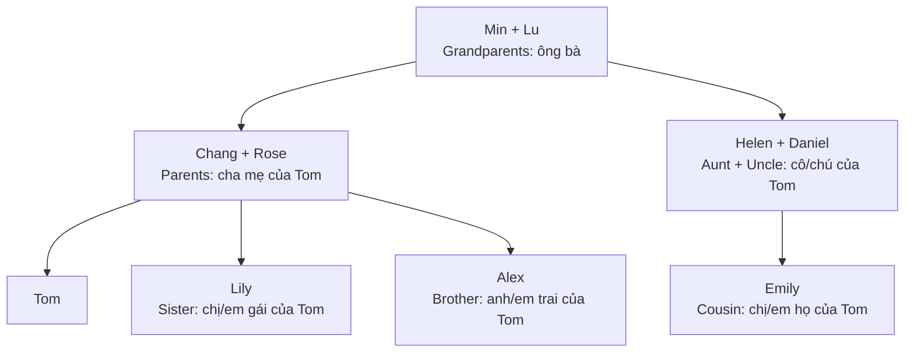
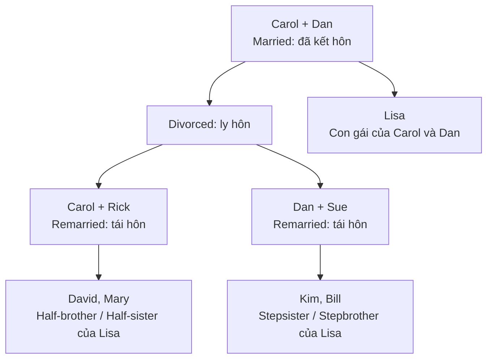

# Bài 03 – Gia đình (Family)

> **Chủ đề:** Con người (People) · **Trình độ gợi ý:** A1–A2  
> **Trang sách:** 24–25 · **Trang PDF:** 34–35  
> **Trọng tâm:** Quan hệ huyết thống, họ hàng bên vợ/chồng, hôn nhân và gia đình tái hôn.

## 1. Tổng quan và mục tiêu học tập

Khi giới thiệu gia đình bằng tiếng Anh, chỉ biết *father* (bố) và *mother* (mẹ) là chưa đủ. Ta còn cần gọi đúng vai trò của từng người **so với người đang được nhắc đến**. Một người có thể vừa là *father* (bố) của con mình, vừa là *son* (con trai) của cha mẹ mình, đồng thời là *uncle* (chú, bác hoặc cậu) của cháu.

Sau bài học, bạn có thể:

- Gọi tên và giải thích **33 mục từ/ngữ** được đánh số trong hai trang minh họa.
- Phân biệt các từ dễ nhầm: *niece/nephew*, *grandson/granddaughter*, *in-law*, *half-* và *step-*.
- Dùng câu đơn giản để giới thiệu người thân, hỏi quan hệ họ hàng và mô tả tình trạng hôn nhân.
- Đọc một sơ đồ gia đình và xác định mối quan hệ giữa hai người.

## 2. Tranh minh họa và cách đọc sơ đồ gia đình


[**Mở ảnh ghép hai trang ở Google Drive**](https://drive.google.com/file/d/1PHVMWeb4uam9eda6TVZNVEMJBJhBw56f/view?usp=drivesdk)

Trang bên trái thể hiện gia đình Tom Lee và Ana García; trang bên phải thể hiện những thay đổi trong gia đình Lisa Smith. **Các số từ 1 đến 33** ứng với bảng từ vựng ở mục 3.

### 2.1. Sơ đồ gia đình Tom Lee



Ta nhìn từ **Tom** để xác định tên gọi: Rose là *mother*, Chang là *father*, Lily là *sister*, Alex là *brother*, còn Emily là *cousin*. Với Min và Lu, Tom là *grandson* (cháu trai), còn Lily và Emily là *granddaughters* (các cháu gái).

> **Điểm mấu chốt:** Quan hệ họ hàng luôn gắn với một người làm mốc. Ví dụ Daniel là *uncle* của Tom, nhưng lại là *husband* của Helen và *son-in-law* (con rể) của Min và Lu.

### 2.2. Gia đình Ana García

```text
Berta + Mario (bố mẹ của Tito)
        │
       Tito ── Ana (vợ của Tito)
                │
            Sara, Felix
```

Berta và Mario là *mother-in-law* và *father-in-law* của Ana. Ana là *daughter-in-law* (con dâu) của họ. Tito là *husband* (chồng) của Ana; Sara là *daughter* (con gái), còn Felix là *son* (con trai). Marta và Carlos được minh họa với vai trò *sister-in-law* và *brother-in-law*.

### 2.3. Gia đình Lisa Smith: ly hôn và tái hôn



Rick là *stepfather* (cha dượng) của Lisa; Sue là *stepmother* (mẹ kế). Lisa và David/Mary có chung mẹ Carol, nên David và Mary là *half-brother* và *half-sister* của Lisa. Kim và Bill là con riêng trong gia đình ghép của Dan và Sue, nên là *stepsister* và *stepbrother* của Lisa. Các mũi tên ở đây minh họa **quan hệ gia đình**, không nhất thiết chỉ quan hệ cha/mẹ sinh học.

## 3. Từ vựng đầy đủ theo tranh

### 3.1. Gia đình và quan hệ huyết thống (số 1–9)

| Số | English | Nghĩa tiếng Việt | Ghi nhớ |
|---:|---|---|---|
| 1 | **grandparents** | ông bà | *grandparent* là ông hoặc bà; số nhiều là *grandparents*. |
| 2 | **grandmother** | bà | Min là bà. |
| 3 | **grandfather** | ông | Lu là ông. |
| 4 | **parents** | cha mẹ | Gồm *mother* và *father*. |
| 5 | **mother** | mẹ | Rose là mẹ của Tom. |
| 6 | **father** | bố, cha | Chang là bố của Tom. |
| 7 | **grandson** | cháu trai (của ông bà) | Tom là cháu trai của Min và Lu. |
| 8 | **sister** | chị gái, em gái | Lily là chị/em gái của Tom. |
| 9 | **brother** | anh trai, em trai | Alex là anh/em trai của Tom. |

**Ví dụ:** *Min and Lu are Tom's grandparents.* — Min và Lu là ông bà của Tom.

### 3.2. Cô, chú, anh em họ và họ hàng bên vợ/chồng (số 10–18)

| Số | English | Nghĩa tiếng Việt | Ghi nhớ |
|---:|---|---|---|
| 10 | **aunt** | cô, dì, bác gái… | Helen là *aunt* của Tom. |
| 11 | **uncle** | chú, cậu, bác trai… | Daniel là *uncle* của Tom. |
| 12 | **cousin** | anh/chị/em họ | Emily là *cousin* của Tom; không phân biệt nam/nữ. |
| 13 | **mother-in-law** | mẹ vợ hoặc mẹ chồng | Berta là mẹ chồng của Ana. |
| 14 | **father-in-law** | bố vợ hoặc bố chồng | Mario là bố chồng của Ana. |
| 15 | **sister-in-law** | chị/em dâu; chị/em gái bên vợ hoặc chồng | Marta được gọi là *sister-in-law*. |
| 16 | **brother-in-law** | anh/em rể; anh/em trai bên vợ hoặc chồng | Carlos được gọi là *brother-in-law*. |
| 17 | **niece** | cháu gái (con của anh/chị/em mình) | Alice là *niece*. |
| 18 | **nephew** | cháu trai (con của anh/chị/em mình) | Eddie là *nephew*. |

**Lưu ý khi dịch:** *aunt*, *uncle* và *cousin* không thể hiện đầy đủ tuổi tác, thứ bậc nội/ngoại như tiếng Việt. Khi cần nói chính xác, bổ sung ngữ cảnh: *my mother's brother* (anh/em trai của mẹ tôi).

### 3.3. Vợ chồng và con cái (số 19–22)

| Số | English | Nghĩa tiếng Việt | Ví dụ trong tranh |
|---:|---|---|---|
| 19 | **husband** | chồng | Tito is Ana's husband. |
| 20 | **wife** | vợ | Ana is Tito's wife. |
| 21 | **daughter** | con gái | Sara is Tito and Ana's daughter. |
| 22 | **son** | con trai | Felix is Tito and Ana's son. |

Các từ trong cùng nhóm thường tạo thành cặp: *husband ↔ wife*, *son ↔ daughter*, *brother ↔ sister*, *grandfather ↔ grandmother*.

### 3.4. Tình trạng hôn nhân (số 23–27)

| Số | English | Nghĩa tiếng Việt | Cách dùng |
|---:|---|---|---|
| 23 | **married** | đã kết hôn, có gia đình | *Carol and Dan are married.* |
| 24 | **divorced** | đã ly hôn | *Carol and Dan are divorced.* |
| 25 | **single mother** | mẹ đơn thân | *Carol is a single mother.* |
| 26 | **single father** | bố đơn thân | *Dan is a single father.* |
| 27 | **remarried** | đã tái hôn, kết hôn lần nữa | *Carol and Dan remarried.* |

*Married*, *divorced*, *remarried* mô tả những trạng thái hoặc sự kiện khác nhau. Không nên suy ra rằng mọi người sau khi ly hôn đều tái hôn.

### 3.5. Gia đình tái hôn: *step-* và *half-* (số 28–33)

| Số | English | Nghĩa tiếng Việt | Ví dụ trong tranh |
|---:|---|---|---|
| 28 | **stepfather** | cha dượng, bố dượng | Rick là cha dượng của Lisa. |
| 29 | **half brother** / **half-brother** | anh/em trai cùng cha khác mẹ hoặc cùng mẹ khác cha | David và Lisa có chung mẹ. |
| 30 | **half sister** / **half-sister** | chị/em gái cùng cha khác mẹ hoặc cùng mẹ khác cha | Mary và Lisa có chung mẹ. |
| 31 | **stepmother** | mẹ kế | Sue là mẹ kế của Lisa. |
| 32 | **stepsister** | chị/em gái kế | Kim là chị/em gái kế của Lisa. |
| 33 | **stepbrother** | anh/em trai kế | Bill là anh/em trai kế của Lisa. |

> *Half brother* và *half-brother* là hai cách trình bày thường gặp; tương tự với *half sister*. Khi viết, bạn có thể dùng dạng có dấu nối để dễ nhận diện.

### 3.6. Từ vựng mở rộng cần nhớ

| English | Tiếng Việt | Câu minh họa |
|---|---|---|
| **granddaughter** | cháu gái (của ông bà) | *Lily and Emily are Min and Lu's granddaughters.* |
| **son-in-law** | con rể | *Daniel is Min and Lu's son-in-law.* |
| **daughter-in-law** | con dâu | *Ana is Berta and Mario's daughter-in-law.* |
| **former wife** | vợ cũ | *Carol is Dan's former wife.* |
| **former husband** | chồng cũ | *Dan is Carol's former husband.* |
| **stepdaughter** | con gái riêng của vợ/chồng; con gái kế | *Lisa is Rick's stepdaughter.* |

**Cấu trúc từ:**

- **grand-**: chỉ quan hệ cách một thế hệ, như *grandmother*, *grandson*.
- **-in-law**: quan hệ họ hàng phát sinh qua hôn nhân, như *mother-in-law*.
- **step-**: quan hệ trong gia đình ghép do hôn nhân/tái hôn, không tự khẳng định cùng huyết thống.
- **half-**: anh/chị/em có chung **một** cha hoặc mẹ sinh học.

## 4. Phân biệt các nhóm từ dễ nhầm

### 4.1. *Grandson*, *nephew* và *son*

Giả sử bạn đang nói về một bé trai:

| Quan hệ của bé với người nói | Từ dùng |
|---|---|
| Bé là con trai của tôi | *my son* |
| Bé là cháu trai của tôi, con của con tôi | *my grandson* |
| Bé là cháu trai của tôi, con của anh/chị/em tôi | *my nephew* |

Tương tự, *daughter*, *granddaughter* và *niece* không thể dùng thay thế nhau.

### 4.2. *In-law* khác *step-* như thế nào?

- *Mother-in-law*: mẹ của vợ hoặc chồng mình.
- *Stepmother*: người kết hôn với cha mình nhưng không phải mẹ sinh học của mình.
- *Daughter-in-law*: vợ của con trai mình.
- *Stepdaughter*: con gái riêng của người mình kết hôn.

**Ví dụ:** Berta là *mother-in-law* của Ana vì Berta là mẹ của Tito, chồng Ana. Sue là *stepmother* của Lisa vì Sue kết hôn với Dan, cha của Lisa.

### 4.3. *Half-brother/sister* khác *stepbrother/sister*

| Tiêu chí | Half-brother / half-sister | Stepbrother / stepsister |
|---|---|---|
| Có chung cha hoặc mẹ sinh học? | **Có, một người** | **Không bắt buộc**; nghĩa thông thường là không chung cha mẹ sinh học. |
| Quan hệ được mô tả | Cùng huyết thống một phía | Quan hệ gia đình do cha/mẹ kết hôn với người khác |
| Trong câu chuyện Lisa | David và Mary | Kim và Bill |

**Mẹo nhớ:** *half* = chung **một nửa** quan hệ cha mẹ; *step* = quan hệ trong **gia đình ghép**. Không gọi David là *stepbrother* chỉ vì mẹ Lisa đã tái hôn: David được minh họa là em trai cùng mẹ khác cha của Lisa.

## 5. Mẫu câu giao tiếp về gia đình

### 5.1. Giới thiệu một người thân

**Mẫu:** `This is + tên/người thân.` hoặc `Tên + is + tính từ sở hữu + người thân.`

- *This is my sister, Lily.* — Đây là chị/em gái của tôi, Lily.
- *Rose is Tom's mother.* — Rose là mẹ của Tom.
- *Emily is Tom's cousin.* — Emily là chị/em họ của Tom.
- *Ana is Tito's wife.* — Ana là vợ của Tito.

**Sở hữu cách:** `Tom's father` = bố của Tom; `Min and Lu's grandson` = cháu trai của cả Min và Lu.

### 5.2. Hỏi quan hệ giữa hai người

**Mẫu:** `Who is + tên + to + tên?` hoặc `How are + hai người + related?`

- *Who is Daniel to Tom?* — Daniel là gì của Tom?  
  *He's Tom's uncle.* — Ông ấy là chú/cậu/bác của Tom.
- *How are Lily and Alex related?* — Lily và Alex có quan hệ gì?  
  *They're brother and sister.* — Họ là anh em ruột trong gia đình.
- *Is Emily Tom's sister?* — Emily là chị/em gái của Tom à?  
  *No, she's his cousin.* — Không, cô ấy là chị/em họ.

### 5.3. Nói về hôn nhân và tái hôn

- *Carol and Dan were married.* — Carol và Dan từng kết hôn.
- *They got divorced.* — Họ đã ly hôn.
- *Carol remarried.* — Carol đã tái hôn.
- *Rick is Lisa's stepfather.* — Rick là cha dượng của Lisa.
- *Sue is Dan's wife.* — Sue là vợ của Dan.

**Phân biệt cách nói:** `be married` mô tả tình trạng đã kết hôn; `get married` là hành động kết hôn; `get divorced` là việc ly hôn; `be divorced` là trạng thái đã ly hôn.

### 5.4. Hỏi và trả lời về chính gia đình mình

- *How many brothers and sisters do you have?* — Bạn có bao nhiêu anh chị em?  
  *I have one brother and two sisters.* — Tôi có một anh/em trai và hai chị/em gái.
- *What number son or daughter are you?* — Bạn là con thứ mấy trong nhà?  
  *I'm the second child.* — Tôi là con thứ hai.
- *Do you have any children?* — Bạn có con chưa/có con không?  
  *Yes, I have a daughter.* — Có, tôi có một con gái.  
  *No, I don't.* — Không, tôi không có.

> Trong giao tiếp tự nhiên, để hỏi thứ tự sinh, có thể nói: *Are you the oldest, middle, or youngest child?* — Bạn là con lớn, con giữa hay con út?

## 6. Đọc hiểu mẫu

**Đoạn 1 — Tom's family**

*Tom lives in a big family. Chang is his father, and Rose is his mother. He has a sister, Lily, and a brother, Alex. Min and Lu are his grandparents. Emily is his cousin.*

**Dịch:** Tom sống trong một gia đình đông người. Chang là bố và Rose là mẹ của Tom. Cậu có một chị/em gái tên Lily và một anh/em trai tên Alex. Min và Lu là ông bà của Tom. Emily là chị/em họ của cậu.

**Đoạn 2 — Lisa's family**

*Lisa's parents, Carol and Dan, got divorced. Carol married Rick, and Dan married Sue. Rick is Lisa's stepfather, and Sue is her stepmother. David and Mary are Lisa's half-brother and half-sister. Kim and Bill are her stepsister and stepbrother.*

**Dịch:** Cha mẹ Lisa là Carol và Dan đã ly hôn. Carol kết hôn với Rick, còn Dan kết hôn với Sue. Rick là cha dượng và Sue là mẹ kế của Lisa. David và Mary là em trai, em gái cùng mẹ khác cha của Lisa. Kim và Bill là chị/em gái kế và anh/em trai kế của cô bé.

## 7. Thực hành áp dụng

### 7.1. Điền từ tiếng Anh

Điền đúng **một** từ hoặc cụm từ vào mỗi chỗ trống.

1. Min is Tom's ______. (bà)
2. Lu is Tom's ______. (ông)
3. Emily is Tom's ______. (chị/em họ)
4. Ana is Tito's ______. (vợ)
5. Alice is a ______. (cháu gái, con của anh/chị/em mình)
6. Rick is Lisa's ______. (cha dượng)
7. Kim is Lisa's ______. (chị/em gái kế)
8. David is Lisa's ______. (anh/em trai cùng mẹ khác cha)

### 7.2. Chọn đúng mối quan hệ

Viết câu đầy đủ bằng tiếng Anh dựa trên gợi ý.

1. Rose / Tom → mẹ: `Rose is ...`
2. Daniel / Min and Lu → con rể: `Daniel is ...`
3. Berta / Ana → mẹ chồng: `Berta is ...`
4. Sue / Lisa → mẹ kế: `Sue is ...`
5. Felix / Tito and Ana → con trai: `Felix is ...`

### 7.3. Nói theo sơ đồ

Chọn một gia đình trong phần minh họa và nói từ **5–7 câu tiếng Anh**. Hãy giới thiệu ít nhất một quan hệ cha mẹ–con cái, một quan hệ họ hàng, và nếu chọn gia đình Lisa thì thêm một quan hệ *step-* hoặc *half-*.

**Khung gợi ý:** *This is ... / ... is ...'s ... / They have ... / ... is related to ... because ...*

<details>
<summary>Đáp án gợi ý cho bài 7.1 và 7.2</summary>

**Bài 7.1:** 1. grandmother; 2. grandfather; 3. cousin; 4. wife; 5. niece; 6. stepfather; 7. stepsister; 8. half-brother (hoặc half brother).

**Bài 7.2:**

1. Rose is Tom's mother.
2. Daniel is Min and Lu's son-in-law.
3. Berta is Ana's mother-in-law.
4. Sue is Lisa's stepmother.
5. Felix is Tito and Ana's son.

</details>

## 8. Câu hỏi ôn tập trắc nghiệm

### Câu 1

Tom là cháu trai của Min và Lu. Từ nào diễn tả đúng quan hệ của Tom với hai người này?

A. Nephew  
B. Son  
C. Grandson  
D. Brother

**Đáp án: C.** *Grandson* là cháu trai của ông bà; *nephew* là cháu trai của anh/chị/em mình.

### Câu 2

Emily là con của Helen và Daniel, còn Tom là con của Chang và Rose. Emily là gì của Tom?

A. Cousin  
B. Sister  
C. Niece  
D. Aunt

**Đáp án: A.** Emily là *cousin* (chị/em họ), không phải chị/em gái ruột của Tom.

### Câu 3

Berta là mẹ của Tito, chồng của Ana. Đối với Ana, Berta là ai?

A. Stepmother  
B. Grandmother  
C. Aunt  
D. Mother-in-law

**Đáp án: D.** Mẹ của chồng là *mother-in-law*, không phải *stepmother*.

### Câu 4

David và Lisa có chung mẹ nhưng khác cha. David là gì của Lisa?

A. Stepbrother  
B. Half-brother  
C. Cousin  
D. Nephew

**Đáp án: B.** Anh/em trai có chung một cha hoặc một mẹ được gọi là *half-brother*.

### Câu 5

Từ nào nói về con gái của anh/chị/em ruột của bạn?

A. Granddaughter  
B. Daughter  
C. Niece  
D. Cousin

**Đáp án: C.** *Niece* là cháu gái — con của anh/chị/em mình; *granddaughter* là cháu gái thuộc thế hệ cháu nội/ngoại.

### Câu 6

Chọn câu tiếng Anh đúng để nói “Carol và Dan đã ly hôn”.

A. Carol and Dan are divorced.  
B. Carol and Dan are cousin.  
C. Carol and Dan are grandson.  
D. Carol and Dan are parents-in-law.

**Đáp án: A.** *Be divorced* diễn tả tình trạng đã ly hôn; cũng có thể dùng *got divorced* để nhấn mạnh sự kiện ly hôn.

### Câu 7

Kim là con riêng thuộc gia đình của Sue và trở thành chị/em của Lisa sau khi Dan kết hôn với Sue. Từ đúng là gì?

A. Half-sister  
B. Granddaughter  
C. Daughter-in-law  
D. Stepsister

**Đáp án: D.** *Stepsister* chỉ chị/em gái kế qua quan hệ hôn nhân của cha mẹ, không hàm ý có chung cha/mẹ sinh học.

### Câu 8

Câu nào đúng để giới thiệu Tito là chồng của Ana?

A. Tito is Ana's nephew.  
B. Tito is Ana's husband.  
C. Tito is Ana's grandfather.  
D. Tito is Ana's stepfather.

**Đáp án: B.** *Husband* nghĩa là chồng; *wife* nghĩa là vợ.

## 9. Tổng kết và tự kiểm tra

Hãy ghi nhớ chủ đề **Family** theo bốn tầng quan hệ:

1. **Gia đình trực hệ:** *parents, mother, father, son, daughter, grandparents, grandson, granddaughter*.
2. **Anh chị em và họ hàng:** *brother, sister, aunt, uncle, cousin, niece, nephew*.
3. **Quan hệ qua hôn nhân:** *husband, wife, mother-in-law, father-in-law, brother-in-law, sister-in-law, son-in-law, daughter-in-law*.
4. **Gia đình sau ly hôn/tái hôn:** *divorced, remarried, stepfather, stepmother, stepsister, stepbrother, half-brother, half-sister*.

**Tự kiểm tra:** Không nhìn bảng, hãy (1) kể tên 10 người thân bằng tiếng Anh, (2) giải thích sự khác nhau giữa *nephew* và *grandson*, (3) giải thích sự khác nhau giữa *half-sister* và *stepsister*, rồi (4) nói 5 câu giới thiệu một gia đình theo sơ đồ.
