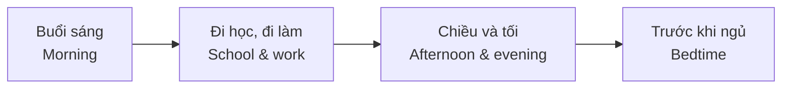

# Bài 04 – Sinh hoạt hằng ngày (Daily Routines)

> **Chủ đề:** People – Con người  
> **Trọng tâm:** Từ vựng về hoạt động thường ngày, nói về giờ giấc và **thì hiện tại đơn với ngôi thứ ba số ít**.  
> **Mục tiêu cuối bài:** Kể được lịch sinh hoạt của bản thân hoặc người thân bằng 6–8 câu tiếng Anh.

## 1. Mục tiêu học tập

Hoàn thành bài học, bạn có thể:

1. Nhận biết và sử dụng **25 hoạt động A–Y** gắn với lịch sinh hoạt từ sáng đến tối.
2. Đặt câu mô tả một việc làm thường ngày kèm giờ giấc: **at 6:00 a.m.**, **in the morning**.
3. Chia đúng động từ sau **he/she** trong thì hiện tại đơn, gồm các dạng đặc biệt **is, has**.
4. Phân biệt các cặp dễ nhầm: **wake up / get up**, **go to bed / go to sleep**, **go to work / leave work**.
5. Hỏi và trả lời về các công việc trong gia đình hoặc lịch sinh hoạt cá nhân.

## 2. Quan sát tranh và cấu trúc một ngày

[**Mở ảnh ghép hai trang sách trên Google Drive**](https://drive.google.com/file/d/1oWt_42rU_m9v0C7bbyNj8h4b_z88ANH1/view)

Tranh mô tả các thành viên gia đình thực hiện những công việc khác nhau trong một ngày. Mỗi **chữ cái A–Y** chỉ một hoạt động; các mốc giờ trên tranh cho biết thời gian của từng cảnh. Đây là lịch sinh hoạt **minh họa**, không phải quy định ai cũng phải làm việc vào các giờ đó.

Có thể ghi nhớ nội dung theo bốn chặng: **thức dậy và chuẩn bị → đi học/đi làm → sinh hoạt gia đình → nghỉ ngơi và ngủ**.

## 3. Từ vựng đầy đủ A–Y

### 3.1. Buổi sáng: Chuẩn bị cho ngày mới (A–I)

| Ký hiệu | English | Nghĩa tiếng Việt | Câu ví dụ |
|:--:|---|---|---|
| A | **wake up** | thức giấc, tỉnh dậy | I wake up at 6:00 a.m. |
| B | **get up** | thức dậy, ra khỏi giường | She gets up early. |
| C | **take a shower** | tắm vòi sen | He takes a shower in the morning. |
| D | **get dressed** | mặc quần áo | She gets dressed after her shower. |
| E | **eat breakfast** | ăn sáng | The children eat breakfast at 7:00 a.m. |
| F | **make lunch** | chuẩn bị bữa trưa | She makes lunch for her family. |
| G | **take the children to school** | đưa các con đến trường | She takes the children to school. |
| H | **take the bus to school** | đi xe buýt đến trường | He takes the bus to school. |
| I | **drive to work / go to work** | lái xe đi làm / đi làm | He drives to work at 8:00 a.m. |

**Lưu ý:** *make lunch* nói về việc **chuẩn bị/làm bữa trưa**; *eat lunch* hoặc *have lunch* mới là **ăn trưa**. *Take the bus* nhấn mạnh phương tiện; *go to school* chỉ việc đi đến trường, không nói rõ đi bằng gì.

### 3.2. Trong ngày: Học tập, làm việc và việc nhà (J–Q)

| Ký hiệu | English | Nghĩa tiếng Việt | Câu ví dụ |
|:--:|---|---|---|
| J | **be in school** | ở trường, đang học ở trường | He is in school at 10:00 a.m. |
| K | **work** | làm việc | He works during the day. |
| L | **go to the market** | đi chợ | She goes to the market. |
| M | **leave work** | rời nơi làm việc, tan làm | He leaves work at 5:00 p.m. |
| N | **clean the house** | dọn dẹp nhà cửa | She cleans the house. |
| O | **pick up the children** | đón các con | He picks up the children. |
| P | **cook dinner** | nấu bữa tối | She cooks dinner at 6:00 p.m. |
| Q | **come home / get home** | về nhà / đến nhà | He comes home in the evening. |

**Lưu ý:** *pick up the children* ở đây nghĩa là **đón các con** (chẳng hạn tại trường); không nên hiểu máy móc là “nhấc bọn trẻ lên”. *Leave work* là **rời chỗ làm**, khác với *go to work* (**đi đến chỗ làm**).

### 3.3. Buổi tối: Gia đình, giải trí và nghỉ ngơi (R–Y)

| Ký hiệu | English | Nghĩa tiếng Việt | Câu ví dụ |
|:--:|---|---|---|
| R | **have dinner** | ăn tối | The family has dinner at 6:30 p.m. |
| S | **watch TV** | xem tivi | She watches TV after dinner. |
| T | **do homework** | làm bài tập về nhà | The girl does her homework. |
| U | **relax** | thư giãn, nghỉ ngơi | He relaxes in the evening. |
| V | **read the paper** | đọc báo | She reads the paper. |
| W | **exercise** | tập thể dục | He exercises at 8:30 p.m. |
| X | **go to bed** | lên giường đi ngủ | They go to bed at 10:30 p.m. |
| Y | **go to sleep** | bắt đầu ngủ, thiếp đi | They go to sleep at 11:00 p.m. |

**Ghi nhớ:** Trong tiếng Anh, **have dinner** và **eat dinner** đều có thể diễn đạt “ăn tối”; sách sử dụng *have dinner*. *The paper* trong ngữ cảnh này là **báo**, không phải một tờ giấy bất kỳ.

## 4. Cách nói về thời gian

### 4.1. A.M. và P.M.

| Cách viết | Ý nghĩa | Ví dụ |
|---|---|---|
| **a.m.** | Từ nửa đêm đến trước 12 giờ trưa | 6:00 a.m. = 6 giờ sáng |
| **p.m.** | Từ 12 giờ trưa đến trước nửa đêm | 6:30 p.m. = 6 giờ 30 tối |
| **at + giờ** | Vào một thời điểm cụ thể | at 7:30 a.m. |
| **in the morning** | Vào buổi sáng | I study in the morning. |
| **in the afternoon** | Vào buổi chiều | She works in the afternoon. |
| **in the evening** | Vào buổi tối | We watch TV in the evening. |
| **at night** | Vào ban đêm | I read at night. |

Hai trường hợp cần nhớ: **12:00 a.m. = 0 giờ (nửa đêm)**; **12:00 p.m. = 12 giờ trưa**.

### 4.2. Ghép hoạt động với mốc thời gian

Trong tranh, những thời điểm tiêu biểu gồm:

| Giờ trên tranh | Hoạt động minh họa | Câu tiếng Anh gợi ý |
|---|---|---|
| **6:00 a.m.** | A–B: wake up, get up | She gets up at 6:00 a.m. |
| **6:30 a.m.** | C–D: take a shower, get dressed | He gets dressed at 6:30 a.m. |
| **7:00 a.m.** | E–F: eat breakfast, make lunch | They eat breakfast at 7:00 a.m. |
| **7:30 a.m.** | G: take the children to school | She takes the children to school at 7:30 a.m. |
| **8:00 a.m.** | H–I: take the bus, drive to work | He drives to work at 8:00 a.m. |
| **10:00 a.m.** | J–K: be in school, work | He is in school at 10:00 a.m. |
| **4:30 p.m.** | L: go to the market | She goes to the market at 4:30 p.m. |
| **5:00 p.m.** | M: leave work | He leaves work at 5:00 p.m. |
| **5:30 p.m.** | N–O: clean the house, pick up the children | She cleans the house at 5:30 p.m. |
| **6:00 p.m.** | P–Q: cook dinner, come home | She cooks dinner at 6:00 p.m. |
| **6:30 p.m.** | R: have dinner | They have dinner at 6:30 p.m. |
| **7:30 p.m.** | S–T: watch TV, do homework | She does her homework at 7:30 p.m. |
| **8:00 p.m.** | U–V: relax, read the paper | He relaxes at 8:00 p.m. |
| **8:30 p.m.** | W: exercise | He exercises at 8:30 p.m. |
| **10:30 p.m.** | X: go to bed | They go to bed at 10:30 p.m. |
| **11:00 p.m.** | Y: go to sleep | They go to sleep at 11:00 p.m. |

Không nhất thiết một người làm tất cả các hoạt động trên: bảng thể hiện **nhiều nhân vật và hoạt động khác nhau** trong gia đình.

## 5. Ngữ pháp: Thì hiện tại đơn và ngôi thứ ba số ít

Thì **hiện tại đơn (present simple)** thường dùng để diễn tả thói quen hoặc những việc lặp lại hằng ngày.

### 5.1. Câu khẳng định

| Chủ ngữ | Cấu trúc | Ví dụ |
|---|---|---|
| **I / you / we / they** | Chủ ngữ + động từ nguyên mẫu | I **wake up** at six. |
| **he / she / it** | Chủ ngữ + động từ thêm **-s / -es** | She **wakes up** at six. |

- **She takes a shower.** – Cô ấy tắm vòi sen.
- **He watches TV.** – Anh ấy xem tivi.
- **She goes to the market.** – Cô ấy đi chợ.
- **He leaves work at five.** – Anh ấy tan làm lúc 5 giờ.

### 5.2. Quy tắc thêm -s và -es

| Quy tắc | Động từ gốc | Dạng với he/she |
|---|---|---|
| Phần lớn động từ: thêm **-s** | wake, work, read, cook | wakes, works, reads, cooks |
| Kết thúc bằng **-ch, -sh, -ss, -x, -o**: thường thêm **-es** | watch, go, do | watches, goes, does |
| Phụ âm + **y**: đổi **y → ies** | study | studies |
| Nguyên âm + **y**: thêm **-s** | play | plays |

**Hai trường hợp đặc biệt được nhấn mạnh trong bài:**

- **be → is**: *He is in school at 10:00 a.m.* (không viết *He bes*).
- **have → has**: *She has dinner at 6:30 p.m.* (không viết *She haves*).

> **Dễ sai:** *He watch TV* ❌ → **He watches TV** ✅.  
> *She have dinner* ❌ → **She has dinner** ✅.  
> *He is go to work* ❌ → **He goes to work** ✅ khi nói về thói quen.

### 5.3. Câu phủ định và câu hỏi (mở rộng thực hành)

Để hỏi một người thường làm gì, dùng **do/does**; sau **does/doesn't**, động từ chính trở lại **nguyên mẫu**.

| Dạng câu | I/you/we/they | He/she |
|---|---|---|
| Khẳng định | I **work**. | She **works**. |
| Phủ định | I **don't work** on Sunday. | She **doesn't work** on Sunday. |
| Câu hỏi | **Do** you work? | **Does** she work? |
| Trả lời ngắn | Yes, I do. | Yes, she does. |

- **What time do you get up?** – Bạn thức dậy lúc mấy giờ?  
  **I get up at 6:30 a.m.** – Tôi dậy lúc 6 giờ 30 sáng.
- **What time does she go to work?** – Cô ấy đi làm lúc mấy giờ?  
  **She goes to work at 8:00 a.m.** – Cô ấy đi làm lúc 8 giờ sáng.
- **Does he watch TV?** – Anh ấy có xem tivi không?  
  **Yes, he does.** – Có.

## 6. Các cặp từ dễ nhầm

| Cặp từ | Phân biệt | Ví dụ |
|---|---|---|
| **wake up / get up** | *Wake up*: tỉnh giấc; *get up*: ra khỏi giường. | I wake up at six, but I get up at six fifteen. |
| **go to bed / go to sleep** | *Go to bed*: lên giường chuẩn bị ngủ; *go to sleep*: bắt đầu chìm vào giấc ngủ. | I go to bed at ten and go to sleep at ten thirty. |
| **go to work / leave work** | *Go to work*: đi làm; *leave work*: rời nơi làm việc. | He goes to work at eight and leaves work at five. |
| **make lunch / have lunch** | *Make*: chuẩn bị món ăn; *have*: ăn bữa đó. | She makes lunch, and the children have lunch. |
| **cook dinner / have dinner** | *Cook*: nấu; *have*: ăn. | Dad cooks dinner. We have dinner together. |
| **take … to school / pick up …** | *Take*: đưa đi; *pick up*: đón về. | She takes the children to school and picks them up later. |

**Mẹo học theo hành động:** tưởng tượng một người mở mắt (**wake up**), ngồi dậy và bước xuống giường (**get up**); buổi tối, người ấy lên giường (**go to bed**) rồi mới thiếp đi (**go to sleep**).

## 7. Giao tiếp về sinh hoạt hằng ngày

### 7.1. Kể về một ngày của bản thân

**English**

> I wake up at 6:30 in the morning. I get up and take a shower. I eat breakfast at 7:00. I go to school at 7:30. In the evening, I do my homework and relax. I go to bed at 10:30.

**Dịch nghĩa**

> Tôi thức giấc lúc 6 giờ 30 sáng. Tôi ra khỏi giường rồi tắm vòi sen. Tôi ăn sáng lúc 7 giờ. Tôi đến trường lúc 7 giờ 30. Buổi tối, tôi làm bài tập và thư giãn. Tôi lên giường lúc 10 giờ 30.

Đây là **đoạn mẫu** để luyện nói; thời gian và hoạt động có thể được thay đổi theo lịch thực tế của người học.

### 7.2. Hội thoại ngắn

**A:** What time do you wake up?  
**B:** I wake up at six o'clock.  
**A:** Do you eat breakfast at home?  
**B:** Yes, I do. I eat breakfast at seven.  
**A:** What do you do in the evening?  
**B:** I do my homework and watch TV.

**Dịch:**

**A:** Bạn thức giấc lúc mấy giờ?  
**B:** Tôi thức giấc lúc 6 giờ.  
**A:** Bạn ăn sáng ở nhà à?  
**B:** Đúng vậy. Tôi ăn sáng lúc 7 giờ.  
**A:** Bạn làm gì vào buổi tối?  
**B:** Tôi làm bài tập và xem tivi.

### 7.3. Ba câu hỏi thảo luận về gia đình

1. **Who makes dinner in your family?** – Ai nấu/chuẩn bị bữa tối trong gia đình bạn?
2. **Who goes to the market?** – Ai đi chợ?
3. **Who goes to work?** – Ai đi làm?

**Trả lời mẫu:** *My mother makes dinner. My father goes to the market. Both of my parents go to work.* (Mẹ tôi nấu bữa tối. Bố tôi đi chợ. Cả bố và mẹ tôi đều đi làm.)

## 8. Thực hành

### 8.1. Bài A – Ghép chữ cái với hoạt động

Không nhìn bảng từ vựng, tìm chữ cái trong tranh tương ứng với các hoạt động:

1. exercise → ___
2. pick up the children → ___
3. read the paper → ___
4. go to the market → ___
5. take a shower → ___
6. cook dinner → ___

### 8.2. Bài B – Chia động từ ở hiện tại đơn

Điền dạng đúng của động từ trong ngoặc.

1. She ______ (wake up) at six.
2. He ______ (watch) TV in the evening.
3. My mother ______ (make) lunch.
4. My father ______ (go) to work at eight.
5. She ______ (have) dinner with her family.
6. He ______ (be) in school at ten.
7. My sister ______ (do) her homework at seven thirty.
8. They ______ (read) the paper in the evening.

### 8.3. Bài C – Dịch sang tiếng Anh

1. Tôi thức dậy lúc 6 giờ sáng.
2. Cô ấy đưa các con đến trường.
3. Anh ấy rời chỗ làm lúc 5 giờ chiều.
4. Gia đình tôi ăn tối lúc 6 giờ 30.
5. Tôi lên giường lúc 10 giờ nhưng 11 giờ mới ngủ.

### 8.4. Bài D – Nói và viết

Hãy viết **6–8 câu** về lịch sinh hoạt thực tế của bạn. Bài cần có ít nhất:

- **4** cụm động từ trong bảng từ A–Y;
- **3** mốc thời gian;
- **1** câu về buổi tối;
- **1** câu nói về người thân bằng **he/she** (chia động từ phù hợp).

Sau đó tự nói lại bài trong khoảng **45–60 giây** mà không đọc nguyên văn.

<strong>Đáp án gợi ý – Bài A, B và C</strong>

**Bài A:** 1. W; 2. O; 3. V; 4. L; 5. C; 6. P.

**Bài B:** 1. wakes up; 2. watches; 3. makes; 4. goes; 5. has; 6. is; 7. does; 8. read.

**Bài C:**

1. I get up at 6:00 a.m.
2. She takes the children to school.
3. He leaves work at 5:00 p.m.
4. My family has dinner at 6:30 p.m.
5. I go to bed at ten, but I go to sleep at eleven.

*Lưu ý:* Một số câu có nhiều cách dịch tự nhiên. Ở câu 1, **wake up** cũng phù hợp nếu ý là **tỉnh giấc**; **get up** nhấn mạnh **rời giường**.

## 9. Câu hỏi ôn tập trắc nghiệm

### Câu 1

Bạn đã tỉnh giấc lúc 6 giờ nhưng đến 6 giờ 15 mới bước xuống giường. Cụm từ nào diễn đạt đúng việc xảy ra lúc 6 giờ 15?

A. **get up**  
B. wake up  
C. go to sleep  
D. go to bed

**Đáp án: A.** *Get up* là ra khỏi giường; *wake up* là tỉnh giấc.

### Câu 2

Điền động từ đúng: *She ______ TV after dinner.*

A. watch  
B. **watches**  
C. watching  
D. to watch

**Đáp án: B.** Chủ ngữ *she* cần dạng hiện tại đơn **watches**.

### Câu 3

Câu nào diễn đạt đúng “Anh ấy ăn tối lúc 6 giờ 30”?

A. He have dinner at 6:30 p.m.  
B. He haves dinner at 6:30 p.m.  
C. **He has dinner at 6:30 p.m.**  
D. He is have dinner at 6:30 p.m.

**Đáp án: C.** Với *he*, động từ *have* có dạng đặc biệt **has**.

### Câu 4

Bạn muốn hỏi “Cô ấy đi làm lúc mấy giờ?”. Câu nào đúng?

A. What time she goes to work?  
B. What time does she goes to work?  
C. What time do she go to work?  
D. **What time does she go to work?**

**Đáp án: D.** Dùng *does* với *she* và giữ động từ chính *go* ở dạng nguyên mẫu.

### Câu 5

Hoạt động nào diễn đạt việc **đón con về** sau giờ học?

A. **pick up the children**  
B. take the children to school  
C. be in school  
D. clean the house

**Đáp án: A.** *Pick up the children* nghĩa là đón các con; *take the children to school* là đưa con đến trường.

### Câu 6

Một người **lên giường lúc 10 giờ 30** nhưng **đến 11 giờ mới ngủ**. Câu nào đúng?

A. She goes to sleep at 10:30 and goes to bed at 11:00.  
B. **She goes to bed at 10:30 and goes to sleep at 11:00.**  
C. She gets up at 10:30 and wakes up at 11:00.  
D. She leaves work at 10:30 and gets home at 11:00.

**Đáp án: B.** *Go to bed* là lên giường; *go to sleep* là bắt đầu ngủ.

## 10. Tổng kết và tự kiểm tra

**Ba điều cần nhớ:**

1. Từ vựng về lịch sinh hoạt thường là **cụm động từ**: *take a shower, make lunch, have dinner, do homework*.
2. Khi nói giờ chính xác dùng **at**: *at 7:00 a.m.*; khi nói buổi trong ngày dùng *in the morning*, *in the evening*.
3. Trong thì hiện tại đơn, **he/she + động từ -s/-es**; hai dạng quan trọng là **is** và **has**.

**Checklist hoàn thành bài học:**

- [ ] Tôi nhận ra và giải thích được 25 hoạt động A–Y trong tranh.
- [ ] Tôi phân biệt được *wake up/get up* và *go to bed/go to sleep*.
- [ ] Tôi chia đúng động từ sau *he/she*.
- [ ] Tôi có thể hỏi và trả lời về lịch sinh hoạt bằng *What time…?*.
- [ ] Tôi có thể tự nói 6–8 câu về một ngày của mình.

**Ôn tập gợi ý:** Đọc lại các cụm động từ sau 1 ngày; sau 1 tuần hãy che cột tiếng Anh, nhìn nghĩa tiếng Việt rồi tự nói lại, sau đó kể lịch sinh hoạt không nhìn tài liệu.

---

**Thông tin bài:** *Oxford Picture Dictionary – Anh–Việt*, Unit 2: **People**, Lesson 4: **Daily Routines**; trang sách **26–27**, trang PDF **36–37**. Phần ví dụ, giải thích và câu hỏi ôn tập được biên soạn để luyện học dựa trên 25 hoạt động trong tranh.
