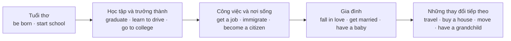

# Bài 05 – Các mốc trong cuộc sống (Life Events)

**Chủ đề:** People – Con người · **Trình độ gợi ý:** A1–A2

## 1. Mục tiêu học tập

Khi hoàn thành bài này, người học có thể:

- Nhận biết và sử dụng **18 cụm từ** mô tả các sự kiện quan trọng trong cuộc đời, từ *be born* đến *die*.
- Phân biệt các mốc về **học tập, công việc, gia đình và chuyển nơi sống**.
- Nhận diện **9 loại giấy tờ** thường liên quan đến thông tin cá nhân và các mốc cuộc đời.
- Chia động từ ở **thì quá khứ đơn (simple past)**, kể cả động từ có quy tắc và bất quy tắc.
- Hỏi, trả lời và viết một đoạn ngắn về các mốc cuộc sống bằng tiếng Anh.

## 2. Bức tranh tổng quan

Một người có thể trải qua nhiều mốc khác nhau: được sinh ra, đi học, trưởng thành, làm việc, lập gia đình, chuyển nhà hoặc nghỉ hưu. Những sự kiện này không nhất thiết xảy ra với tất cả mọi người và cũng không phải lúc nào cũng theo cùng một thứ tự.

Sơ đồ giúp **nhóm từ vựng theo ý nghĩa**, không phải mô hình bắt buộc về trình tự cuộc đời. Khi kể về một người cụ thể, dùng mốc thời gian và thì quá khứ đơn để làm rõ sự kiện đã xảy ra.

## 3. Từ vựng cốt lõi: 18 sự kiện A–R

Các chữ cái A–R tương ứng với hình minh họa. Cột năm tạo thành một dòng thời gian để luyện nói và viết câu ở thì quá khứ.

| Hình | Cụm từ tiếng Anh | Nghĩa tiếng Việt | Năm trong tranh |
|:--:|---|---|:--:|
| A | **be born** | được sinh ra, chào đời | 1925 |
| B | **start school** | bắt đầu đi học | 1930 |
| C | **immigrate** | nhập cư, chuyển đến sống ở một nước khác | 1940 |
| D | **graduate** | tốt nghiệp | 1942 |
| E | **learn to drive** | học lái xe | 1943 |
| F | **join the army** | gia nhập quân đội, đi lính | 1944 |
| G | **get a job** | tìm được / có một công việc | 1948 |
| H | **become a citizen** | trở thành công dân, nhập tịch | 1949 |
| I | **rent an apartment** | thuê một căn hộ | 1951 |
| J | **go to college** | học đại học hoặc cao đẳng | 1956 |
| K | **fall in love** | phải lòng, yêu nhau | 1957 |
| L | **get married** | kết hôn | 1958 |
| M | **have a baby** | sinh con, có em bé | 1960 |
| N | **travel** | đi du lịch, đi đây đó | 1967 |
| O | **buy a house** | mua nhà | 1971 |
| P | **move** | chuyển nhà, dọn nơi ở | 1971 |
| Q | **have a grandchild** | có cháu nội hoặc cháu ngoại | 1985 |
| R | **die** | qua đời | 1997 |

### 3.1. Nhóm học tập và công việc

- **start school** nhấn mạnh thời điểm bắt đầu đi học.  
  *She started school in 2012.* — Cô ấy bắt đầu đi học vào năm 2012.
- **graduate** là hoàn tất một chương trình học và tốt nghiệp; thường dùng **graduate from + trường**.  
  *He graduated from high school.* — Anh ấy tốt nghiệp trung học.
- **go to college** nghĩa là vào học hoặc theo học bậc cao đẳng/đại học, **không đồng nghĩa** với đã tốt nghiệp.  
  *She went to college in 2020.* — Cô ấy vào đại học năm 2020.
- **learn to drive** là học lái xe; **get a job** là tìm được việc làm.  
  *He learned to drive and got a job.* — Anh ấy học lái xe và tìm được việc làm.

### 3.2. Nhóm di cư và nơi ở

- **immigrate** là nhập cư vào một quốc gia để sinh sống.  
  *They immigrated to the United States.* — Họ nhập cư vào Hoa Kỳ.
- **become a citizen** nghĩa là trở thành công dân của một quốc gia.  
  *She became a citizen in 2015.* — Cô ấy trở thành công dân vào năm 2015.
- **rent an apartment** là thuê căn hộ; **buy a house** là mua nhà; **move** là chuyển nơi ở.  
  *They rented an apartment before they bought a house.* — Họ thuê căn hộ trước khi mua nhà.

**Phân biệt:** *immigrate* chỉ việc nhập cư vào một quốc gia; *move* chỉ việc chuyển chỗ ở nói chung, kể cả trong cùng một thành phố.

### 3.3. Nhóm gia đình và quan hệ

- **fall in love (with someone)**: phải lòng ai đó.  
  *He fell in love with her.* — Anh ấy đã phải lòng cô ấy.
- **get married (to someone)**: kết hôn với ai đó.  
  *They got married in 1958.* — Họ kết hôn năm 1958.
- **have a baby**: có em bé, sinh con.  
  *They had a baby in 1960.* — Họ có con năm 1960.
- **have a grandchild**: có cháu nội hoặc cháu ngoại.  
  *They had their first grandchild in 1985.* — Họ có cháu đầu tiên năm 1985.

**Phân biệt quan trọng:**

| Cụm từ | Ý nghĩa | Ví dụ |
|---|---|---|
| **be born** | Được sinh ra | *I was born in 2005.* |
| **have a baby** | Sinh con / có con, nhìn từ phía cha mẹ | *My sister had a baby.* |
| **get married** | Sự kiện kết hôn | *They got married last year.* |
| **be married** | Tình trạng đã kết hôn | *They are married.* |
| **fall in love** | Bắt đầu nảy sinh tình yêu | *They fell in love.* |

## 4. Giấy tờ và hồ sơ cá nhân

Những giấy tờ sau thường được sử dụng để chứng minh danh tính, tình trạng học tập, hôn nhân, quyền cư trú hoặc quốc tịch. Số 1–9 tương ứng với các hình giấy tờ ở nửa dưới trang 29.

| Số | Tên giấy tờ tiếng Anh | Nghĩa tiếng Việt | Tình huống liên quan |
|:--:|---|---|---|
| 1 | **birth certificate** | giấy khai sinh | *be born* |
| 2 | **diploma** | bằng tốt nghiệp | *graduate* |
| 3 | **Resident Alien card** | thẻ thường trú / thẻ xanh (tên gọi trên mẫu minh họa) | *immigrate* |
| 4 | **driver's license** | bằng lái xe | *learn to drive* |
| 5 | **Social Security card** | thẻ an sinh xã hội (Hoa Kỳ) | hồ sơ cá nhân, việc làm |
| 6 | **Certificate of Naturalization** | giấy chứng nhận nhập tịch | *become a citizen* |
| 7 | **college degree** | bằng cấp cao đẳng/đại học | *go to college*, *graduate* |
| 8 | **marriage license** | giấy phép kết hôn (tên gọi trong hệ thống của Hoa Kỳ) | *get married* |
| 9 | **passport** | hộ chiếu | *travel* |

**Cần lưu ý:** *diploma* và *college degree* đều nói đến chứng nhận học tập nhưng không phải cùng một loại giấy tờ trong mọi ngữ cảnh. *Marriage license* cũng không hoàn toàn tương đương với giấy chứng nhận kết hôn; cách gọi và thủ tục phụ thuộc từng quốc gia.

Ví dụ:

> **Do you have a passport?** — Bạn có hộ chiếu không?  
> **Yes, I do. I need it when I travel abroad.** — Có. Tôi cần hộ chiếu khi đi nước ngoài.

## 5. Ngữ pháp trọng tâm: Thì quá khứ đơn (Simple Past)

### 5.1. Khi nào dùng?

Thì quá khứ đơn diễn tả **một hành động hoặc sự kiện đã xảy ra và kết thúc trong quá khứ**. Chủ đề các mốc cuộc đời rất phù hợp với thì này, đặc biệt khi đi kèm một năm cụ thể.

- *He started school in 1930.* — Ông ấy bắt đầu đi học năm 1930.
- *He got married in 1958.* — Ông ấy kết hôn năm 1958.
- *He bought a house in 1971.* — Ông ấy mua nhà năm 1971.

### 5.2. Cách thành lập câu

| Dạng | Công thức | Ví dụ |
|---|---|---|
| Khẳng định (động từ thường) | **S + V2/V-ed** | *She graduated in 2018.* |
| Phủ định (động từ thường) | **S + didn't + V nguyên mẫu** | *She didn't move in 2018.* |
| Câu hỏi Yes/No | **Did + S + V nguyên mẫu?** | *Did she graduate in 2018?* |
| Câu hỏi về thời điểm | **When did + S + V nguyên mẫu?** | *When did she graduate?* |
| Động từ *be* | **S + was/were ...** | *He was a student.* |

**Chú ý:** Sau *did* hoặc *didn't*, động từ chính trở về dạng nguyên mẫu.

- Đúng: *When did he get married?*
- Sai: ~~When did he got married?~~

**Riêng với *be born***, dùng *was/were born* và không đặt *did* trước *born*:

- Đúng: *When were you born?* — Bạn sinh năm nào?
- Đúng: *I was born in 1968.* — Tôi sinh năm 1968.
- Sai: ~~When did you born?~~

### 5.3. Động từ có quy tắc (Regular verbs)

Thông thường, thêm **-ed** hoặc **-d** vào động từ nguyên mẫu.

| Quy tắc | Nguyên mẫu | Quá khứ đơn |
|---|---|---|
| Thêm **-ed** | start, learn, join, rent | started, learned, joined, rented |
| Động từ kết thúc bằng **-e**, thêm **-d** | immigrate, graduate, move, retire | immigrated, graduated, moved, retired |
| Động từ kết thúc bằng phụ âm + **y**, đổi **y → ied** | die | died |
| Một số cách viết khác nhau Anh–Mỹ | travel | traveled (Mỹ) / travelled (Anh) |

*Learned* là dạng thông dụng trong tiếng Anh Mỹ; *learnt* cũng được dùng, nhất là trong tiếng Anh Anh.

### 5.4. Động từ bất quy tắc (Irregular verbs)

Những động từ này cần ghi nhớ dạng quá khứ, không chỉ thêm *-ed*.

| Nguyên mẫu | Quá khứ đơn | Ví dụ |
|---|---|---|
| be | was / were | *I was born in 2005.* |
| get | got | *He got a job.* |
| become | became | *She became a citizen.* |
| go | went | *They went to college.* |
| fall | fell | *They fell in love.* |
| have | had | *They had a baby.* |
| buy | bought | *He bought a house.* |

**Mẹo học:** Ghi nhớ **cả cụm từ**, thay vì học động từ riêng lẻ: *get a job → got a job*, *fall in love → fell in love*, *buy a house → bought a house*.

### 5.5. Nói về năm và trình tự

| Cấu trúc | Công dụng | Ví dụ |
|---|---|---|
| **in + năm** | Xác định năm | *I was born in 2004.* |
| **when I was + tuổi** | Nói mốc theo độ tuổi | *I learned to drive when I was 18.* |
| **before + mệnh đề** | Trước một sự kiện | *She graduated before she got a job.* |
| **after + mệnh đề** | Sau một sự kiện | *They moved after they bought a house.* |
| **then / later** | Nối các sự kiện | *He graduated. Then he got a job.* |

## 6. Kể một câu chuyện cuộc đời

### 6.1. Đọc và phân tích một dòng thời gian

Dựa trên các mốc của nhân vật trong tranh, có thể viết:

> He was born in **1925** and started school in **1930**. He immigrated in **1940**, graduated in **1942**, and joined the army in **1944**. He got a job in **1948** and became a citizen in **1949**. Later, he went to college in **1956**. He fell in love in **1957** and got married in **1958**. He had a baby in **1960**, bought a house and moved in **1971**, and had a grandchild in **1985**. He died in **1997**.

**Diễn giải:** Ông sinh năm 1925, bắt đầu đi học năm 1930, nhập cư năm 1940, tốt nghiệp năm 1942 và gia nhập quân đội năm 1944. Sau đó ông có việc làm, trở thành công dân, học đại học, yêu và kết hôn. Ông có con, mua nhà, chuyển nhà, có cháu và qua đời năm 1997.

Đoạn kể dùng động từ quá khứ như *was, started, immigrated, joined, got, became, went, fell, had, bought, moved, died*. Các từ nối *and, later* giúp mạch kể tự nhiên, tránh lặp lại cấu trúc câu.

### 6.2. Hỏi và trả lời về bản thân

**Hội thoại mẫu:**

**A:** When were you born?  
**B:** I was born in 2005.

**A:** When did you start school?  
**B:** I started school in 2011.

**A:** Have you learned to drive?  
**B:** Yes, I have. I learned to drive last year.

Ở câu hỏi cuối, *Have you learned to drive?* hỏi về trải nghiệm đến hiện tại; *I learned to drive last year* dùng quá khứ đơn để nêu thời điểm cụ thể. Khi chỉ luyện thì quá khứ đơn, bạn cũng có thể hỏi: *When did you learn to drive?*

### 6.3. Một số từ vựng bổ sung

| Từ/cụm từ | Nghĩa | Ví dụ |
|---|---|---|
| **grow up** | lớn lên, trưởng thành | *I grew up in Hanoi.* |
| **widow** | người phụ nữ góa chồng | *She became a widow.* |
| **widower** | người đàn ông góa vợ | *He became a widower.* |
| **retire** | nghỉ hưu | *My grandfather retired at 65.* |

**Phân biệt:** *retire* là nghỉ làm do đến tuổi hoặc quyết định nghỉ hưu; *resign* là từ chức/nghỉ việc, không nhất thiết là nghỉ hưu.

## 7. Luyện tập thực hành

### 7.1. Bài A – Nhận diện sự kiện

Nhìn lại các hình A–R. Viết cụm từ tiếng Anh tương ứng với mô tả:

1. Hình F: gia nhập quân đội → __________
2. Hình H: trở thành công dân → __________
3. Hình K: phải lòng ai đó → __________
4. Hình P: chuyển nhà → __________
5. Hình Q: có cháu → __________

### 7.2. Bài B – Chia động từ ở quá khứ đơn

Điền dạng quá khứ đúng của động từ trong ngoặc:

1. She ______ (start) school in 2010.
2. They ______ (get) married in 2021.
3. He ______ (buy) a house last year.
4. My parents ______ (move) to Da Nang in 2015.
5. I ______ (go) to college in 2023.
6. My grandfather ______ (retire) in 2019.
7. They ______ (have) a baby in 2024.
8. She ______ (become) a citizen in 2018.

### 7.3. Bài C – Chọn giấy tờ thích hợp

Ghép tình huống với giấy tờ phù hợp:

| Tình huống | Giấy tờ |
|---|---|
| 1. Muốn chứng minh ngày sinh | A. passport |
| 2. Muốn lái xe hợp pháp | B. birth certificate |
| 3. Muốn đi du lịch nước ngoài | C. driver's license |
| 4. Muốn chứng minh đã nhập tịch | D. diploma |
| 5. Muốn chứng minh đã tốt nghiệp | E. Certificate of Naturalization |

### 7.4. Bài D – Viết và nói

Viết **5–7 câu** về các mốc của bản thân hoặc một nhân vật tưởng tượng. Dùng ít nhất **5 từ/cụm từ** trong bảng A–R và **3 động từ quá khứ đơn**.

Bạn có thể bắt đầu bằng:

> I was born in ...  
> I started school in ...  
> When I was ..., I ...  
> Later, I ...

Nếu kể về một người không có mốc kết hôn, sinh con hoặc nhập cư, bạn không cần ép những sự kiện đó vào câu chuyện.

**Đáp án bài A–C:**

- **A:** 1. join the army; 2. become a citizen; 3. fall in love; 4. move; 5. have a grandchild.
- **B:** 1. started; 2. got; 3. bought; 4. moved; 5. went; 6. retired; 7. had; 8. became.
- **C:** 1–B; 2–C; 3–A; 4–E; 5–D.

## 8. Câu hỏi ôn tập trắc nghiệm

### Câu 1

Câu nào diễn đạt đúng “Tôi sinh năm 2005”?

A. I born in 2005.  
B. I did born in 2005.  
C. I was born in 2005.  
D. I am born in 2005.

**Đáp án: C.** *Be born* dùng cấu trúc **was/were born** khi kể về sự ra đời trong quá khứ.

### Câu 2

Bạn muốn nói “Họ đã mua một căn nhà vào năm 1971”. Câu nào đúng?

A. They bought a house in 1971.  
B. They buyed a house in 1971.  
C. They have buy a house in 1971.  
D. They did bought a house in 1971.

**Đáp án: A.** Quá khứ của *buy* là **bought**; câu khẳng định không cần *did*.

### Câu 3

Cụm từ nào có nghĩa là “nhập cư vào một quốc gia”?

A. move  
B. travel  
C. retire  
D. immigrate

**Đáp án: D.** *Immigrate* diễn tả nhập cư để sinh sống; *move* rộng hơn và *travel* thường chỉ đi lại, du lịch.

### Câu 4

Muốn hỏi “Cô ấy tốt nghiệp khi nào?”, câu nào đúng?

A. When she graduated?  
B. When did she graduate?  
C. When did she graduated?  
D. When was she graduate?

**Đáp án: B.** Câu hỏi quá khứ đơn với động từ thường có cấu trúc **When did + S + V nguyên mẫu?**

### Câu 5

Loại giấy tờ nào thích hợp nhất để chứng minh đã nhập tịch?

A. Birth certificate  
B. Passport  
C. Certificate of Naturalization  
D. Driver's license

**Đáp án: C.** *Certificate of Naturalization* là giấy chứng nhận nhập tịch.

### Câu 6

Câu nào nói về **sự kiện kết hôn**, thay vì tình trạng đã kết hôn?

A. They got married in 2020.  
B. They are married.  
C. They have a marriage license.  
D. They are a married couple.

**Đáp án: A.** *Get married* chỉ sự kiện kết hôn; *be married* nhấn mạnh tình trạng hôn nhân.

### Câu 7

Chọn dạng quá khứ đơn đúng cho câu: “They ___ in love in 1957.”

A. fall  
B. falled  
C. fallen  
D. fell

**Đáp án: D.** *Fall* là động từ bất quy tắc, quá khứ đơn là **fell**.

### Câu 8

Động từ nào phù hợp với câu “My grandfather ___ at the age of 65” khi nói về nghỉ hưu?

A. moved  
B. retired  
C. immigrated  
D. graduated

**Đáp án: B.** *Retired* là dạng quá khứ của *retire*, nghĩa là nghỉ hưu.

## 9. Tổng kết và tự kiểm tra

Sau bài học, hãy tự kiểm tra những khả năng sau:

- [ ] Đọc hình và gọi tên được 18 sự kiện từ A đến R.
- [ ] Phân biệt được *be born / have a baby*, *get married / be married*, *immigrate / move*.
- [ ] Nhận diện được 9 giấy tờ và bối cảnh sử dụng cơ bản.
- [ ] Dùng đúng các động từ bất quy tắc: *was/were, got, became, went, fell, had, bought*.
- [ ] Đặt câu hỏi **When were you born?** và **When did you ...?** đúng cấu trúc.
- [ ] Viết được đoạn 5–7 câu giới thiệu các mốc cuộc sống ở thì quá khứ đơn.

**Cách ôn tập hiệu quả:** Lần đầu dùng bảng từ vựng để ghép hình; lần tiếp theo che nghĩa tiếng Việt và tự gọi tên; cuối cùng nhìn năm hoặc sự kiện để kể thành câu hoàn chỉnh. Học theo **cụm từ + ngữ cảnh + câu ví dụ** giúp nhớ và sử dụng tự nhiên hơn học từng từ riêng lẻ.
