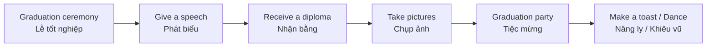

# Bài 07 – Lễ tốt nghiệp (A Graduation)

> **Chủ đề:** Lễ trao bằng tốt nghiệp và tiệc chúc mừng  
> **Trọng tâm:** 18 từ vựng về sự kiện, 10 hành động giao tiếp, cách dùng thì hiện tại tiếp diễn và luyện nói về trải nghiệm tham dự lễ tốt nghiệp.

## 1. Mục tiêu học tập

Sau bài học, người học có thể:

1. **Nhận diện và giải thích** 18 đối tượng, địa điểm hoặc vai trò thường gặp trong lễ tốt nghiệp và tiệc chúc mừng.
2. **Sử dụng** 10 động từ/cụm động từ để miêu tả hành động của những người trong tranh.
3. **Đặt câu** theo cấu trúc `am/is/are + V-ing` để nói về các hoạt động đang diễn ra.
4. **Hỏi và trả lời** những câu đơn giản về trải nghiệm đi dự lễ tốt nghiệp, nghe phát biểu hoặc tham dự tiệc.
5. **Miêu tả** một lễ tốt nghiệp bằng đoạn nói hoặc viết ngắn, có trình tự rõ ràng.

## 2. Bối cảnh: Từ buổi lễ đến bữa tiệc

Lễ tốt nghiệp (*a graduation*) là sự kiện đánh dấu việc hoàn thành một khóa học hoặc chương trình học. Trong một **graduation ceremony** (lễ trao bằng), người tốt nghiệp thường mặc **cap and gown** (mũ và áo tốt nghiệp), bước lên **stage** (sân khấu), nhận **diploma** (bằng tốt nghiệp) và nghe những bài phát biểu.

Sau buổi lễ, gia đình, bạn bè và người tốt nghiệp có thể tham gia **graduation party** (tiệc mừng tốt nghiệp). Mọi người chụp ảnh, chúc mừng, ôm nhau, ăn uống, nâng ly và khiêu vũ.

*Hình minh họa: trang sách 32–33 (trang PDF 42–43). Tranh bên trái mô tả buổi lễ; tranh bên phải mô tả bữa tiệc.*

### 2.1. Hai không gian chính

| The Ceremony – Buổi lễ | The Party – Bữa tiệc |
|---|---|
| Người tốt nghiệp bước lên sân khấu và nhận bằng. | Khách mời trò chuyện, ăn uống và chúc mừng. |
| Có bục phát biểu, diễn giả và khán giả. | Có tiệc buffet, người phục vụ, quà tặng và DJ. |
| Thường diễn ra trang trọng. | Thường có không khí thoải mái, vui vẻ. |

### 2.2. Sơ đồ diễn tiến thường gặp

Đây là **trình tự minh họa để ghi nhớ từ vựng**, không phải quy trình bắt buộc của mọi lễ tốt nghiệp. Một số sự kiện có thể sắp xếp phần phát biểu, trao bằng hoặc chụp ảnh theo thứ tự khác.

## 3. Từ vựng về buổi lễ – The Ceremony

Các số **1–11** tương ứng với nhãn trong bức tranh ở trang bên trái.

| Số | Từ vựng | Từ loại | Nghĩa tiếng Việt | Ví dụ tiếng Anh |
|---:|---|---|---|---|
| 1 | **graduating class** | cụm danh từ | khóa/lớp sinh viên tốt nghiệp | *The graduating class is on the stage.* |
| 2 | **gown** | danh từ | áo choàng/áo tốt nghiệp | *She is wearing a blue gown.* |
| 3 | **cap** | danh từ | mũ tốt nghiệp | *His cap is blue.* |
| 4 | **stage** | danh từ | sân khấu | *The graduates are on the stage.* |
| 5 | **podium** | danh từ | bục phát biểu | *The speaker is standing at the podium.* |
| 6 | **graduate** | danh từ | người tốt nghiệp | *The graduate is receiving her diploma.* |
| 7 | **diploma** | danh từ | bằng tốt nghiệp | *She is holding her diploma.* |
| 8 | **valedictorian** | danh từ | học sinh/sinh viên được chọn phát biểu đại diện cho khóa tốt nghiệp (thường có thành tích xuất sắc) | *The valedictorian is giving a speech.* |
| 9 | **guest speaker** | cụm danh từ | diễn giả/khách mời phát biểu | *The guest speaker is sitting on the stage.* |
| 10 | **audience** | danh từ tập hợp | khán giả, người tham dự đang theo dõi | *The audience is applauding.* |
| 11 | **photographer** | danh từ | nhiếp ảnh gia, người chụp ảnh | *The photographer is taking a picture.* |

### 3.1. Cách ghi nhớ theo nhóm

**Trang phục và vật phẩm:** `cap` – mũ; `gown` – áo choàng; `diploma` – bằng tốt nghiệp.

**Địa điểm và thiết bị:** `stage` – sân khấu; `podium` – bục phát biểu.

**Con người:** `graduate` – người tốt nghiệp; `graduating class` – cả khóa tốt nghiệp; `valedictorian` – người phát biểu đại diện khóa; `guest speaker` – khách mời diễn thuyết; `audience` – khán giả; `photographer` – người chụp ảnh.

### 3.2. Các cách kết hợp từ tự nhiên

| Cụm tiếng Anh | Nghĩa |
|---|---|
| **wear a cap and gown** | đội mũ và mặc áo tốt nghiệp |
| **graduate from university** | tốt nghiệp đại học |
| **receive/get a diploma** | nhận bằng tốt nghiệp |
| **walk across the stage** | bước ngang qua sân khấu |
| **stand at the podium** | đứng tại bục phát biểu |
| **give a graduation speech** | đọc bài phát biểu tốt nghiệp |
| **take a picture / take photos** | chụp một bức ảnh / chụp ảnh |
| **applaud the graduates** | vỗ tay chúc mừng người tốt nghiệp |

Ví dụ:

- *She is wearing a cap and gown.* — Cô ấy đang đội mũ và mặc áo tốt nghiệp.
- *The graduate is walking across the stage.* — Người tốt nghiệp đang bước qua sân khấu.
- *Everyone is applauding the graduates.* — Mọi người đang vỗ tay chúc mừng những người tốt nghiệp.

### 3.3. Phân biệt những từ dễ nhầm

**`graduate` và `graduating class`**

- **a graduate:** một người đã tốt nghiệp hoặc đang được nhắc tới trong lễ tốt nghiệp.
- **the graduating class:** cả nhóm người tốt nghiệp trong cùng một khóa.
- **to graduate:** động từ, nghĩa là tốt nghiệp.

Ví dụ: *She graduated last year.* — Cô ấy đã tốt nghiệp năm ngoái.

**`valedictorian` và `guest speaker`**

- **valedictorian:** người được chọn đại diện cho học sinh/sinh viên tốt nghiệp để phát biểu; trong một số hệ thống giáo dục, người này thường có kết quả học tập đứng đầu.
- **guest speaker:** khách mời được mời tới phát biểu; không nhất thiết là người trong khóa tốt nghiệp.

**`audience` và `guests`**

- **audience:** những người đang xem/nghe một bài phát biểu, buổi lễ hoặc màn trình diễn.
- **guests:** người được mời tham dự một sự kiện, như bữa tiệc.

## 4. Từ vựng về tiệc tốt nghiệp – The Party

Các số **12–18** tương ứng với nhãn trong bức tranh ở trang bên phải.

| Số | Từ vựng | Từ loại | Nghĩa tiếng Việt | Ví dụ tiếng Anh |
|---:|---|---|---|---|
| 12 | **caterer** | danh từ | người/đơn vị cung cấp đồ ăn, dịch vụ tiệc | *The caterer is serving food.* |
| 13 | **buffet** | danh từ | tiệc buffet, tiệc tự chọn | *There is a buffet at the party.* |
| 14 | **guests** | danh từ số nhiều | khách mời | *The guests are enjoying the party.* |
| 15 | **banner** | danh từ | biểu ngữ, băng-rôn | *The banner says “Congratulations, Graduates!”* |
| 16 | **dance floor** | cụm danh từ | sàn nhảy | *They are on the dance floor.* |
| 17 | **DJ (disc jockey)** | danh từ | người điều khiển/chọn và phát nhạc | *The DJ is playing music.* |
| 18 | **gifts** | danh từ số nhiều | những món quà | *The gifts are on the table.* |

### 4.1. Cụm từ thường gặp

| Cụm tiếng Anh | Nghĩa tiếng Việt |
|---|---|
| **a graduation party** | tiệc mừng tốt nghiệp |
| **invite guests** | mời khách |
| **serve food** | phục vụ đồ ăn |
| **have a buffet** | tổ chức/ăn tiệc buffet |
| **decorate with a banner** | trang trí bằng băng-rôn |
| **go onto the dance floor** | bước ra sàn nhảy |
| **play music** | mở/phát nhạc |
| **give someone a gift** | tặng ai đó một món quà |
| **Congratulations on your graduation!** | Chúc mừng bạn tốt nghiệp! |

Ví dụ:

- *The caterer is preparing food for the guests.* — Người cung cấp dịch vụ tiệc đang chuẩn bị thức ăn cho khách mời.
- *There are some gifts next to the dance floor.* — Có vài món quà cạnh sàn nhảy.
- *The DJ is playing music, and the guests are dancing.* — DJ đang phát nhạc và các vị khách đang khiêu vũ.

## 5. Mười hành động trong lễ tốt nghiệp

Các chữ **A–J** là những hành động được gắn với các hình nhỏ ở cuối hai trang.

| Nhãn | Động từ/cụm từ | Nghĩa tiếng Việt | Ví dụ |
|:---:|---|---|---|
| A | **graduate** | tốt nghiệp | *They are graduating.* |
| B | **applaud / clap** | vỗ tay | *They are clapping.* |
| C | **cry** | khóc | *She is crying.* |
| D | **take a picture** | chụp ảnh | *He is taking a picture.* |
| E | **give a speech** | đọc bài phát biểu | *She is giving a speech.* |
| F | **kiss** | hôn | *They are kissing.* |
| G | **hug** | ôm | *They are hugging.* |
| H | **laugh** | cười thành tiếng | *They are laughing.* |
| I | **make a toast** | nâng ly/chúc mừng | *He is making a toast.* |
| J | **dance** | khiêu vũ, nhảy múa | *They are dancing.* |

### 5.1. Phân biệt các hành động

**`applaud` và `clap`:** Đều có thể dịch là *vỗ tay*. `Clap` nhấn mạnh động tác đập hai bàn tay vào nhau; `applaud` thường có nghĩa vỗ tay để thể hiện sự tán thưởng hoặc chúc mừng.

**`laugh` và `smile`:** `Laugh` là *cười thành tiếng*; `smile` là *mỉm cười*. Ví dụ: *She is smiling, but her friend is laughing.*

**`hug` và `kiss`:** `Hug` là *ôm*; `kiss` là *hôn*. Cả hai thường dùng để thể hiện tình cảm, sự vui mừng hoặc chúc mừng.

**`make a toast`:** Là hành động nói lời chúc mừng và thường nâng ly. Không hiểu theo nghĩa *làm bánh mì nướng*; trong cụm này, `toast` là *lời chúc/nâng ly*.

**`take a picture` và `give a speech`:** Dùng `take` với ảnh và `give` với bài phát biểu; không hoán đổi hai động từ.

### 5.2. Các dạng `-ing` cần nhớ

| Động từ nguyên mẫu | Dạng `-ing` | Ghi chú |
|---|---|---|
| graduate | **graduating** | bỏ `e` cuối rồi thêm `-ing` |
| clap | **clapping** | gấp đôi `p` |
| cry | **crying** | giữ `y` |
| take | **taking** | bỏ `e` cuối |
| give | **giving** | bỏ `e` cuối |
| kiss | **kissing** | thêm `-ing` |
| hug | **hugging** | gấp đôi `g` |
| laugh | **laughing** | thêm `-ing` |
| make | **making** | bỏ `e` cuối |
| dance | **dancing** | bỏ `e` cuối |
| smile | **smiling** | bỏ `e` cuối |

## 6. Ngữ pháp ứng dụng: Hiện tại tiếp diễn

Khi quan sát tranh và miêu tả hành động **đang diễn ra**, sử dụng **Present Continuous – thì hiện tại tiếp diễn**.

### 6.1. Cấu trúc khẳng định

**Chủ ngữ + am/is/are + động từ thêm `-ing`**

| Chủ ngữ | Động từ `to be` | Ví dụ |
|---|---|---|
| I | am | *I am smiling.* – Tôi đang mỉm cười. |
| He / She / It | is | *She is giving a speech.* – Cô ấy đang phát biểu. |
| We / You / They | are | *They are hugging.* – Họ đang ôm nhau. |

Ví dụ miêu tả tranh:

1. *She is taking a picture.* — Cô ấy đang chụp ảnh.
2. *She is giving a speech.* — Cô ấy đang phát biểu.
3. *He is clapping.* — Anh ấy đang vỗ tay.
4. *He is making a toast.* — Anh ấy đang nâng ly chúc mừng.
5. *They are graduating.* — Họ đang tốt nghiệp.
6. *They are hugging and laughing.* — Họ đang ôm nhau và cười.

### 6.2. Câu phủ định và nghi vấn

- **Phủ định:** `S + am/is/are + not + V-ing`
  - *The guests are not dancing.* — Những vị khách không đang khiêu vũ.
- **Câu hỏi Yes/No:** `Am/Is/Are + S + V-ing?`
  - *Is she giving a speech?* — Cô ấy đang phát biểu à?
  - *Yes, she is.* — Đúng vậy.
- **Câu hỏi `What`:** `What + am/is/are + S + doing?`
  - *What is the photographer doing?* — Người chụp ảnh đang làm gì?
  - *He is taking a picture.* — Anh ấy đang chụp ảnh.

### 6.3. Chọn `is` hay `are`

Lựa chọn phụ thuộc vào chủ ngữ:

- *The graduate **is** smiling.* — Một người tốt nghiệp đang mỉm cười.
- *The graduates **are** smiling.* — Những người tốt nghiệp đang mỉm cười.
- *The guests **are** dancing.* — Những vị khách đang khiêu vũ.

**Lưu ý:** `The audience is applauding` là cách diễn đạt thông dụng khi xem `audience` như một tập thể. Trong tiếng Anh Anh, cũng có thể gặp `The audience are applauding` nếu nhấn mạnh từng thành viên.

### 6.4. Không nhầm với thì quá khứ đơn

Khi miêu tả hành động **trong tranh**, dùng hiện tại tiếp diễn. Khi kể về **một trải nghiệm đã xảy ra**, thường dùng quá khứ đơn.

| Đang diễn ra | Đã xảy ra |
|---|---|
| *She is giving a speech.* | *She gave a speech yesterday.* |
| *They are dancing.* | *They danced at the party.* |
| *He is taking a picture.* | *He took a picture at the ceremony.* |

## 7. Giao tiếp về lễ tốt nghiệp

### 7.1. Sáu câu hỏi hội thoại quan trọng

| Câu hỏi tiếng Anh | Nghĩa tiếng Việt | Gợi ý trả lời |
|---|---|---|
| **1. Did you ever go to a graduation? Whose?** | Bạn đã từng dự lễ tốt nghiệp chưa? Của ai? | *Yes. I went to my sister's graduation.* |
| **2. Did you ever give a speech? Where?** | Bạn đã từng phát biểu chưa? Ở đâu? | *Yes. I gave a speech at school.* |
| **3. Did you ever hear a great speaker? Where?** | Bạn đã từng nghe một diễn giả rất hay chưa? Ở đâu? | *Yes. I heard one at a graduation ceremony.* |
| **4. Did you ever go to a graduation party?** | Bạn đã từng dự tiệc tốt nghiệp chưa? | *No, I haven't.* |
| **5. What do you like to eat at parties?** | Bạn thích ăn gì ở các bữa tiệc? | *I like fruit and cake.* |
| **6. Do you like to dance at parties?** | Bạn có thích khiêu vũ ở các bữa tiệc không? | *Yes, I do.* |

Trong giao tiếp tự nhiên, có thể hỏi **Have you ever been to a graduation?** để hỏi về trải nghiệm từng tham dự. Câu hỏi với `Did you ever ...?` cũng xuất hiện trong ngữ cảnh hỏi về trải nghiệm quá khứ.

### 7.2. Mẫu câu gợi ý

**Hỏi về hành động trong tranh:**

- *What is she doing?* — Cô ấy đang làm gì?
- *She is receiving her diploma.* — Cô ấy đang nhận bằng.
- *What are they doing?* — Họ đang làm gì?
- *They are making a toast.* — Họ đang nâng ly.

**Hỏi về bữa tiệc:**

- *Who is at the party?* — Ai đang ở bữa tiệc?
- *There are many guests.* — Có nhiều khách mời.
- *Is there a buffet?* — Có tiệc buffet không?
- *Yes, there is.* — Có.
- *What does the banner say?* — Băng-rôn ghi gì?
- *It says “Congratulations, Graduates!”* — Nó ghi “Chúc mừng các bạn tốt nghiệp!”.

### 7.3. Đoạn hội thoại mẫu: At the Graduation Ceremony

**Lan:** *Is this your brother's graduation?*  
Đây là lễ tốt nghiệp của anh trai bạn à?

**Minh:** *Yes, it is. He is graduating today.*  
Đúng vậy. Hôm nay anh ấy tốt nghiệp.

**Lan:** *Look! He is walking across the stage.*  
Nhìn kìa! Anh ấy đang bước qua sân khấu.

**Minh:** *He is receiving his diploma.*  
Anh ấy đang nhận bằng.

**Lan:** *Everyone is clapping. Let's take a picture!*  
Mọi người đang vỗ tay. Chúng ta chụp một bức ảnh nhé!

**Minh:** *Great idea! We are going to a graduation party afterward.*  
Ý hay đấy! Sau đó chúng tôi sẽ tham dự một bữa tiệc tốt nghiệp.

### 7.4. Đoạn hội thoại mẫu: At the Graduation Party

**Anna:** *Congratulations on your graduation!*  
Chúc mừng bạn tốt nghiệp!

**Ben:** *Thank you! I'm very happy.*  
Cảm ơn! Mình rất vui.

**Anna:** *Are you enjoying the party?*  
Bạn có đang tận hưởng bữa tiệc không?

**Ben:** *Yes! The food is great, and the DJ is playing my favorite music.*  
Có chứ! Đồ ăn rất ngon và DJ đang mở nhạc mình thích.

**Anna:** *Let's make a toast to the graduating class!*  
Chúng ta hãy nâng ly chúc mừng cả khóa tốt nghiệp nhé!

**Ben:** *Cheers!*  
Chúc mừng!

## 8. Phương pháp miêu tả một bức tranh

Để nói hoặc viết về tranh, hãy thực hiện ba bước:

1. **Xác định sự kiện:** *This picture shows a graduation ceremony.*
2. **Kể các đối tượng nổi bật:** *I can see graduates, a guest speaker, and an audience.*
3. **Miêu tả hành động:** *A graduate is receiving a diploma. Some people are clapping. A photographer is taking pictures.*

**Đoạn văn mẫu 1 – The Ceremony**

*This is a graduation ceremony. The graduates are wearing caps and gowns. A guest speaker is on the stage. One graduate is receiving a diploma. The audience is clapping. A photographer is taking pictures. Everyone looks happy.*

**Dịch:** Đây là một lễ tốt nghiệp. Những người tốt nghiệp đang đội mũ và mặc áo tốt nghiệp. Một khách mời phát biểu đang ở trên sân khấu. Một người tốt nghiệp đang nhận bằng. Khán giả đang vỗ tay. Một nhiếp ảnh gia đang chụp ảnh. Mọi người trông rất vui.

**Đoạn văn mẫu 2 – The Party**

*This is a graduation party. There is a colorful banner and a buffet. The guests are eating and talking. Some people are hugging and laughing. The DJ is playing music. Two people are dancing. Everyone is celebrating.*

**Dịch:** Đây là tiệc mừng tốt nghiệp. Có một băng-rôn nhiều màu sắc và một bữa tiệc buffet. Những vị khách đang ăn uống và trò chuyện. Một số người đang ôm nhau và cười. DJ đang phát nhạc. Hai người đang khiêu vũ. Mọi người đang ăn mừng.

## 9. Những lỗi thường gặp

| Cách dùng chưa đúng | Cách dùng đúng | Vì sao? |
|---|---|---|
| *She giving a speech.* | **She is giving a speech.** | Hiện tại tiếp diễn cần `is`. |
| *They is dancing.* | **They are dancing.** | `They` đi với `are`. |
| *He is take a picture.* | **He is taking a picture.** | Sau `is` cần dạng `V-ing`. |
| *She is making a speech.* | **She is giving a speech.** | `Give a speech` là cách kết hợp từ thường dùng. |
| *He is doing a toast.* | **He is making a toast.** | Dùng cụm `make a toast`. |
| *They are claping.* | **They are clapping.** | `Clap` gấp đôi `p` khi thêm `-ing`. |
| *He is huging his friend.* | **He is hugging his friend.** | `Hug` gấp đôi `g`. |
| *I went to a graduate party.* | **I went to a graduation party.** | Tên loại tiệc là `graduation party`. |

## 10. Bài tập thực hành

### 10.1. Bài A – Ghép từ với nghĩa

Ghép từ ở cột trái với nghĩa đúng ở cột phải.

| Từ | Nghĩa cần ghép |
|---|---|
| 1. podium | A. người chụp ảnh |
| 2. photographer | B. băng-rôn |
| 3. banner | C. bục phát biểu |
| 4. diploma | D. khách mời |
| 5. guests | E. bằng tốt nghiệp |
| 6. dance floor | F. sàn nhảy |

### 10.2. Bài B – Hoàn thành câu

Điền dạng đúng của từ/cụm từ trong ngoặc.

1. The graduate is ______ her diploma. (`receive`)
2. The audience is ______. (`clap`)
3. The photographer is ______ a picture. (`take`)
4. They are ______ on the dance floor. (`dance`)
5. The valedictorian is ______ a speech. (`give`)
6. The guests are ______. (`laugh`)
7. He is ______ a toast. (`make`)
8. The friends are ______ each other. (`hug`)

### 10.3. Bài C – Chọn câu phù hợp

1. Có một người đang vỗ tay. Câu nào phù hợp nhất?
   - A. *He is clapping.*
   - B. *He are clapping.*
   - C. *He is clap.*
   - D. *He clapping.*

2. Một người đang đứng ở bục và phát biểu. Cụm từ nào mô tả đúng hành động?
   - A. *take a picture*
   - B. *give a speech*
   - C. *make a toast*
   - D. *dance*

3. Mọi người đứng lên và nâng ly chúc mừng. Họ đang làm gì?
   - A. *They are crying.*
   - B. *They are graduating.*
   - C. *They are making a toast.*
   - D. *They are taking pictures.*

### 10.4. Bài D – Miêu tả tranh

Quan sát lại bức tranh, viết **6 câu tiếng Anh**:

- 3 câu về **The Ceremony**.
- 3 câu về **The Party**.

Mỗi câu cần có ít nhất một từ vựng của bài và một động từ mô tả hành động. Cố gắng dùng cả `He is...`, `She is...` và `They are...`.

### 10.5. Bài E – Luyện nói theo cặp

**Người A:** Hỏi bạn đã từng tham dự lễ tốt nghiệp chưa, của ai, và có những hoạt động gì.

**Người B:** Trả lời bằng 3–5 câu, sau đó hỏi ngược lại người A về tiệc tốt nghiệp và món ăn yêu thích.

Đổi vai và thực hiện lại. Nếu chưa từng tham dự lễ tốt nghiệp, hãy dùng tranh để mô tả một lễ tốt nghiệp giả định.

### 10.6. Gợi ý đáp án cho bài tập

**Bài A:** 1–C, 2–A, 3–B, 4–E, 5–D, 6–F.

**Bài B:** 1. receiving; 2. clapping; 3. taking; 4. dancing; 5. giving; 6. laughing; 7. making; 8. hugging.

**Bài C:** 1–A, 2–B, 3–C.

**Bài D – E:** Có nhiều cách trả lời đúng. Kiểm tra chủ ngữ, dạng `am/is/are + V-ing` và sự phù hợp của từ vựng với tình huống.

## 11. Câu hỏi ôn tập trắc nghiệm

### Câu 1

Một sinh viên đang đứng trước bục và đọc bài diễn văn trong lễ tốt nghiệp. Hành động đó được gọi là gì?

A. *make a toast*  
B. *take a picture*  
C. *give a speech*  
D. *wear a gown*

**Đáp án: C.**  
**Giải thích:** `Give a speech` là phát biểu; `make a toast` là nâng ly chúc mừng trong bữa tiệc.

### Câu 2

Câu nào dùng đúng thì hiện tại tiếp diễn để miêu tả **nhiều vị khách đang khiêu vũ**?

A. *The guests is dancing.*  
B. *The guests are dancing.*  
C. *The guests are dance.*  
D. *The guests dancing.*

**Đáp án: B.**  
**Giải thích:** `Guests` là danh từ số nhiều, vì vậy dùng `are + dancing`.

### Câu 3

Bạn muốn nói về người **được mời đến sự kiện để phát biểu**, không nhất thiết thuộc khóa tốt nghiệp. Từ nào phù hợp nhất?

A. *guest speaker*  
B. *graduating class*  
C. *photographer*  
D. *caterer*

**Đáp án: A.**  
**Giải thích:** `Guest speaker` là diễn giả khách mời; `graduating class` là nhóm người tốt nghiệp.

### Câu 4

Chọn dạng `-ing` đúng của động từ `hug`.

A. *hugeing*  
B. *hugeingg*  
C. *huging*  
D. *hugging*

**Đáp án: D.**  
**Giải thích:** `Hug` gấp đôi phụ âm `g` khi thêm `-ing`, thành `hugging`.

### Câu 5

Trong tiệc tốt nghiệp, **caterer** có nhiệm vụ phù hợp nhất với mô tả nào?

A. Chụp ảnh cho khách.  
B. Phát biểu thay mặt cả khóa.  
C. Chuẩn bị hoặc phục vụ đồ ăn cho sự kiện.  
D. Trao bằng trên sân khấu.

**Đáp án: C.**  
**Giải thích:** `Caterer` là người hoặc đơn vị cung cấp dịch vụ ăn uống cho sự kiện.

### Câu 6

Bạn muốn diễn đạt **"Tôi đã từng dự lễ tốt nghiệp của chị gái"**. Câu nào phù hợp nhất?

A. *I go to my sister's graduation now.*  
B. *I went to my sister's graduation.*  
C. *I am going to my sister's graduation yesterday.*  
D. *I going to my sister's graduation.*

**Đáp án: B.**  
**Giải thích:** `Went` là quá khứ của `go`, phù hợp khi kể lại một sự kiện đã xảy ra.

### Câu 7

Khi một người đang cười thành tiếng thay vì chỉ mỉm cười, dùng từ nào?

A. *laugh*  
B. *smile*  
C. *applaud*  
D. *cry*

**Đáp án: A.**  
**Giải thích:** `Laugh` nhấn mạnh việc cười thành tiếng; `smile` là mỉm cười.

### Câu 8

Trong một bữa tiệc, mọi người nâng ly chúc mừng những người vừa tốt nghiệp. Câu nào đúng?

A. *They are giving a picture.*  
B. *They are doing a toast.*  
C. *They are taking a speech.*  
D. *They are making a toast.*

**Đáp án: D.**  
**Giải thích:** Cụm từ tự nhiên là `make a toast`, nghĩa là nâng ly nói lời chúc.

## 12. Tổng kết và tự kiểm tra

Hai tình huống trong bài có thể ghi nhớ theo nhóm từ:

| Tình huống | Danh từ trọng tâm | Hành động trọng tâm |
|---|---|---|
| **Ceremony** – Buổi lễ | graduate, cap, gown, stage, podium, diploma, valedictorian, guest speaker, audience, photographer | graduate, clap/applaud, give a speech, take a picture, cry |
| **Party** – Bữa tiệc | caterer, buffet, guests, banner, dance floor, DJ, gifts | hug, kiss, laugh, make a toast, dance |

**Checklist hoàn thành bài học:**

- [ ] Nhận diện được 18 nhãn từ vựng đánh số trong tranh.
- [ ] Nhớ được 10 hành động ký hiệu A–J.
- [ ] Viết đúng các dạng `clapping`, `hugging`, `taking`, `giving`, `making`.
- [ ] Đặt được ít nhất 5 câu hiện tại tiếp diễn với `is` hoặc `are`.
- [ ] Trả lời được 6 câu hỏi giao tiếp về lễ tốt nghiệp và bữa tiệc.
- [ ] Miêu tả được tranh bằng một đoạn nói hoặc viết 5–7 câu.

**Gợi ý ôn tập:** Học lần đầu bằng cách vừa nhìn tranh vừa nói từ mới; ôn lại sau một ngày bằng cách che nghĩa tiếng Việt; sau một tuần thử tự kể lại lễ tốt nghiệp bằng tiếng Anh mà không nhìn bảng từ vựng.

---

**Điều hướng:** [Bài trước – Feelings](06_feelings.md) · **Bài hiện tại – A Graduation**
