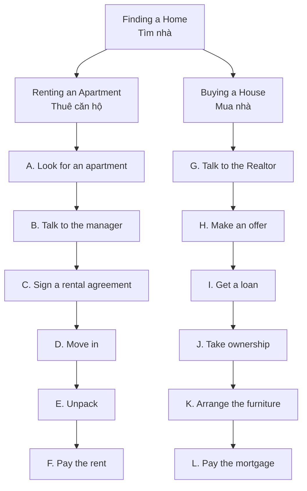

# Bài 02 – TÌM NHÀ (FINDING A HOME)

> **Chủ đề:** Nhà cửa (Housing) · **Trang sách:** 35  
> **Mục tiêu:** Học 12 hành động trong quá trình **thuê căn hộ** và **mua nhà**, hiểu các từ khóa về hợp đồng, tiền thuê và khoản vay, thực hành hỏi–đáp.  
> **Thời lượng đề xuất:** 20–30 phút.

## 1. Quan sát tranh gốc

*Các hình A–F mô tả **thuê căn hộ (renting an apartment)**; G–L mô tả **mua nhà (buying a house)**. Đọc theo thứ tự từ trái sang phải, từ trên xuống dưới.*

## 2. Sơ đồ tổng quan: Hai con đường tìm nhà

> **Ghi nhớ:** *rent* = thuê; *buy* = mua. Khi thuê, người ở **trả tiền thuê (rent)**; khi vay tiền để mua nhà, người mua **trả khoản vay thế chấp (mortgage)**.

## 3. Từ vựng theo tranh A–F: Thuê căn hộ

### Renting an apartment – Thuê căn hộ

| Hình | Cụm từ gốc | Nghĩa tiếng Việt | Câu ví dụ tiếng Anh | Dịch nghĩa |
|:---:|---|---|---|---|
| **A** | **look for a new apartment** | tìm căn hộ mới | I'm looking for a new apartment. | Tôi đang tìm một căn hộ mới. |
| **B** | **talk to the manager** | nói chuyện với người quản lý tòa nhà/căn hộ | I want to talk to the manager. | Tôi muốn nói chuyện với người quản lý. |
| **C** | **sign a rental agreement** | ký hợp đồng thuê nhà | Please sign the rental agreement. | Vui lòng ký hợp đồng thuê nhà. |
| **D** | **move in** | chuyển đến ở, dọn vào | We can move in on Monday. | Chúng tôi có thể dọn vào vào thứ Hai. |
| **E** | **unpack** | mở/tháo đồ ra khỏi thùng sau khi chuyển nhà | Let's unpack the boxes. | Chúng ta hãy mở các thùng đồ ra. |
| **F** | **pay the rent** | trả tiền thuê nhà | I pay the rent every month. | Tôi trả tiền thuê nhà hằng tháng. |

**Diễn giải tình huống trong tranh:**

- **A:** Người đi thuê xem quảng cáo để **tìm một căn hộ** phù hợp.
- **B:** Người thuê hỏi người quản lý về **utilities** (điện, nước, gas). Người quản lý đáp: **“Utilities are included.”** (Các chi phí tiện ích đã được tính trong tiền thuê.)
- **C:** Hai bên **ký hợp đồng thuê** ghi các điều khoản thuê.
- **D:** Người thuê **chuyển đồ đến căn hộ**.
- **E:** Sau khi dọn vào, người thuê **mở thùng và sắp xếp đồ đạc**.
- **F:** Người thuê **thanh toán tiền thuê nhà**.

### Những câu quan trọng khi đi thuê

| English | Tiếng Việt |
|---|---|
| How much is the rent? | Tiền thuê nhà là bao nhiêu? |
| Are utilities included? | Tiền điện, nước và gas có được bao gồm không? |
| When can I move in? | Khi nào tôi có thể dọn vào? |
| Utilities are included. | Các khoản phí tiện ích đã được bao gồm. |
| I'd like to look at the apartment. | Tôi muốn xem căn hộ. |
| Where do I sign the rental agreement? | Tôi ký hợp đồng thuê ở đâu? |

**Lưu ý cách dùng:**

- **look for + danh từ**: tìm kiếm thứ gì, ví dụ *look for an apartment*.
- **talk to + người**: nói chuyện với ai, ví dụ *talk to the manager*.
- **sign + văn bản**: ký một giấy tờ, ví dụ *sign a rental agreement*.
- **move in**: dọn **vào** nhà; **move out**: dọn **ra** (từ mở rộng, không phải từ in ở hình).
- **unpack**: mở đồ ra; trái nghĩa với **pack** (đóng gói).

## 4. Từ vựng theo tranh G–L: Mua nhà

### Buying a house – Mua nhà

| Hình | Cụm từ gốc | Nghĩa tiếng Việt | Câu ví dụ tiếng Anh | Dịch nghĩa |
|:---:|---|---|---|---|
| **G** | **talk to the Realtor** | nói chuyện với nhân viên môi giới bất động sản | We talked to a Realtor yesterday. | Hôm qua chúng tôi đã nói chuyện với một nhân viên môi giới. |
| **H** | **make an offer** | đưa ra mức giá đề nghị mua nhà | They made an offer on the house. | Họ đã đưa ra mức giá đề nghị mua căn nhà. |
| **I** | **get a loan** | vay được tiền/được cấp khoản vay | We need to get a loan from the bank. | Chúng tôi cần vay tiền ngân hàng. |
| **J** | **take ownership** | tiếp nhận quyền sở hữu, chính thức trở thành chủ sở hữu | They take ownership of the house. | Họ chính thức nhận quyền sở hữu căn nhà. |
| **K** | **arrange the furniture** | sắp xếp đồ nội thất | Let's arrange the furniture in the living room. | Chúng ta hãy sắp xếp nội thất trong phòng khách. |
| **L** | **pay the mortgage** | trả tiền vay thế chấp mua nhà | We pay the mortgage every month. | Chúng tôi trả khoản vay thế chấp mua nhà mỗi tháng. |

**Diễn giải tình huống trong tranh:**

- **G:** Người mua gặp **Realtor**, người hỗ trợ tìm và giao dịch nhà.
- **H:** Người mua **đề nghị một mức giá** với bên bán; *make an offer* **không nhất thiết** là giảm giá.
- **I:** Ngân hàng **phê duyệt khoản vay**; trong tranh có chữ **“APPROVED”**.
- **J:** Người mua **nhận chìa khóa**, tượng trưng cho việc nhận nhà và quyền sở hữu.
- **K:** Gia đình **kê và sắp xếp đồ nội thất** trong ngôi nhà.
- **L:** Người mua **thanh toán khoản vay thế chấp** cho ngân hàng theo kỳ hạn.

**Lưu ý:** *Realtor* trong hình là cách gọi người hành nghề môi giới bất động sản tại Mỹ; trong giao tiếp thông thường có thể dùng *real estate agent*. *Take ownership* nhấn mạnh quyền sở hữu, không đồng nghĩa đơn thuần với *move in* (dọn vào ở).

## 5. Từ vựng bổ sung ngay bên dưới trang sách

| Từ | Loại từ | Định nghĩa/ý nghĩa | Ví dụ |
|---|---|---|---|
| **lease** | noun | hợp đồng thuê trong một thời hạn xác định (*a rental agreement for a specific period of time*) | I signed a one-year lease. – Tôi đã ký hợp đồng thuê một năm. |
| **utilities** | plural noun | các dịch vụ tiện ích của nhà như gas, nước, điện (*gas, water, and electricity for the home*) | Are utilities included in the rent? – Điện, nước và gas có nằm trong tiền thuê không? |

### Phân biệt những từ dễ nhầm

| Từ/cặp từ | Phân biệt ngắn gọn |
|---|---|
| **rent** / **mortgage** | *Rent*: tiền thuê trả cho chủ nhà; *mortgage*: khoản vay thế chấp hoặc tiền trả khoản vay mua nhà. |
| **rental agreement** / **lease** | Đều chỉ thỏa thuận thuê; *lease* thường nêu rõ thời hạn thuê. |
| **manager** / **Realtor** | *Manager*: người quản lý tòa nhà/căn hộ; *Realtor*: người môi giới bất động sản. |
| **move in** / **take ownership** | *Move in*: bắt đầu ở tại nhà; *take ownership*: trở thành chủ sở hữu hợp pháp. |
| **make an offer** / **get a loan** | *Make an offer*: đưa ra đề nghị mua; *get a loan*: nhận khoản vay. |

### Mở rộng để giao tiếp (không phải danh sách từ gốc trong tranh)

| English | Tiếng Việt |
|---|---|
| security deposit | tiền đặt cọc bảo đảm khi thuê |
| landlord | chủ nhà cho thuê |
| tenant | người thuê nhà |
| monthly rent | tiền thuê hằng tháng |
| down payment | khoản trả trước khi mua nhà |
| interest rate | lãi suất |
| real estate agent | nhân viên môi giới bất động sản |

## 6. Ngữ pháp và cụm từ sử dụng ngay

### 6.1. Hỏi giá bằng *How much...?*

- **How much is the rent?** – Tiền thuê nhà là bao nhiêu?
- **How much is the house?** – Ngôi nhà giá bao nhiêu?
- **How much is the security deposit?** – Tiền đặt cọc là bao nhiêu?

### 6.2. Hỏi thông tin bằng *Are ... included?*

- **Are utilities included?** – Các phí tiện ích có được bao gồm không?
- **Is water included in the rent?** – Tiền nước có nằm trong tiền thuê không?

### 6.3. Hỏi thời điểm có thể chuyển nhà

- **When can I move in?** – Khi nào tôi có thể chuyển vào?
- **You can move in next week.** – Bạn có thể chuyển vào tuần sau.

### 6.4. Cụm động từ nên học nguyên khối

**look for**, **talk to**, **sign a rental agreement**, **move in**, **unpack**, **pay the rent**, **make an offer**, **get a loan**, **take ownership**, **arrange the furniture**, **pay the mortgage**.

## 7. Hội thoại mẫu Anh–Việt

### Hội thoại 1 – Nói chuyện với người quản lý căn hộ

**Tenant:** Hello. I'm looking for a new apartment.  
*Người thuê:* Xin chào. Tôi đang tìm một căn hộ mới.

**Manager:** Welcome! How can I help you?  
*Người quản lý:* Chào mừng bạn! Tôi có thể giúp gì?

**Tenant:** How much is the rent?  
*Người thuê:* Tiền thuê nhà là bao nhiêu?

**Manager:** It's $900 a month.  
*Người quản lý:* Là 900 đô la một tháng.

**Tenant:** Are utilities included?  
*Người thuê:* Điện, nước và gas có được bao gồm không?

**Manager:** Yes, utilities are included.  
*Người quản lý:* Có, các khoản phí tiện ích đã được bao gồm.

**Tenant:** Great! When can I move in?  
*Người thuê:* Tuyệt! Khi nào tôi có thể dọn vào?

**Manager:** You can move in next Monday.  
*Người quản lý:* Bạn có thể dọn vào thứ Hai tuần tới.

*Lưu ý: Mức giá và ngày trong hội thoại là ví dụ biên soạn để luyện nói, không phải thông tin đọc từ tranh.*

### Hội thoại 2 – Trao đổi về việc mua nhà

**Buyer:** We'd like to buy a house.  
*Người mua:* Chúng tôi muốn mua một căn nhà.

**Agent:** Would you like to make an offer?  
*Người môi giới:* Anh chị có muốn đưa ra mức giá đề nghị không?

**Buyer:** Yes, but we need to get a loan first.  
*Người mua:* Có, nhưng trước tiên chúng tôi cần vay tiền.

**Agent:** I understand. Once everything is complete, you can take ownership.  
*Người môi giới:* Tôi hiểu. Khi mọi thủ tục hoàn tất, anh chị có thể nhận quyền sở hữu.

## 8. Bài tập tự luyện

### Bài A – Ghép chữ cái trong tranh

Điền chữ cái **A–L** tương ứng với mỗi hoạt động:

1. ___ sign a rental agreement
2. ___ pay the mortgage
3. ___ look for a new apartment
4. ___ arrange the furniture
5. ___ unpack
6. ___ make an offer
7. ___ move in
8. ___ get a loan
9. ___ pay the rent
10. ___ take ownership
11. ___ talk to the manager
12. ___ talk to the Realtor

### Bài B – Chọn đáp án đúng

**1.** Which phrase means *dọn vào ở*?  
A. move in · B. unpack · C. pay the rent · D. get a loan

**2.** What does *utilities* mean?  
A. furniture · B. gas, water and electricity · C. house keys · D. rent payments

**3.** When buying a house, you can ___ with a real estate agent.  
A. unpack · B. pay the rent · C. make an offer · D. move out

**4.** Which phrase is most directly related to a home loan?  
A. pay the mortgage · B. sign a rental agreement · C. unpack · D. look for an apartment

**5.** Which person usually manages an apartment building?  
A. manager · B. tenant · C. buyer · D. banker

### Bài C – Điền từ thích hợp

Điền từ/cụm từ sau, có thể chia động từ nếu cần: **rent · loan · move in · utilities · furniture**.

1. How much is the __________ each month?
2. Are __________ included?
3. When can we __________?
4. We need a bank __________ to buy this house.
5. They want to arrange the __________ in the living room.

### Bài D – Luyện nói theo vai

**Tình huống 1:** Bạn muốn thuê một căn hộ. Hãy hỏi người quản lý về **giá thuê**, **phí điện/nước/gas**, và **ngày chuyển vào**.  
**Tình huống 2:** Bạn đang tìm mua một căn nhà. Hãy nói với người môi giới rằng bạn muốn **đề nghị giá mua**, cần **vay ngân hàng** và sẽ **sắp xếp nội thất** sau khi nhận nhà.

### Bài E – Viết câu theo tranh

Viết **6 câu tiếng Anh**: ba câu cho A–F, ba câu cho G–L. Dùng ít nhất năm cụm từ đã học. Ví dụ: *We are looking for a new apartment.*

<strong>Đáp án – mở sau khi tự làm</strong>

**Bài A:** 1–C; 2–L; 3–A; 4–K; 5–E; 6–H; 7–D; 8–I; 9–F; 10–J; 11–B; 12–G.

**Bài B:** 1–A; 2–B; 3–C; 4–A; 5–A.

**Bài C:** 1. rent; 2. utilities; 3. move in; 4. loan; 5. furniture.

**Bài E:** Đáp án mở; kiểm tra nghĩa, động từ và trật tự từ.

## 9. Tự kiểm tra và kế hoạch ôn tập

- [ ] Nhìn hình và gọi đúng 12 hành động A–L.
- [ ] Phân biệt *rent* và *mortgage*; *move in* và *take ownership*.
- [ ] Giải thích được *lease* và *utilities* bằng tiếng Việt.
- [ ] Nói được ba câu hỏi trong tranh: **How much is the rent?**, **Are utilities included?**, **When can I move in?**
- [ ] Đóng vai một cuộc hội thoại thuê nhà khoảng 45–60 giây.

**Ôn sau 1 ngày:** Che cột tiếng Việt và nhớ nghĩa 12 từ/cụm từ.  
**Ôn sau 3 ngày:** Tự kể lại trình tự thuê căn hộ và mua nhà bằng tiếng Anh.  
**Ôn sau 7 ngày:** Viết đoạn 80–100 từ về việc tìm căn nhà/căn hộ lý tưởng của bạn.

---

### Điều hướng

- [← Bài 01 – Places to Live](01_places-to-live.md)
- **Bài 02 – Finding a Home (trang hiện tại)**
- [Bài 03 – Apartments →](03_apartments.md)

*Phần A–L, các câu hỏi luyện nói và định nghĩa “lease”, “utilities” dựa trên trang sách gốc. Các ví dụ, hội thoại và bài tập do người biên soạn bổ sung để hỗ trợ luyện học.*
