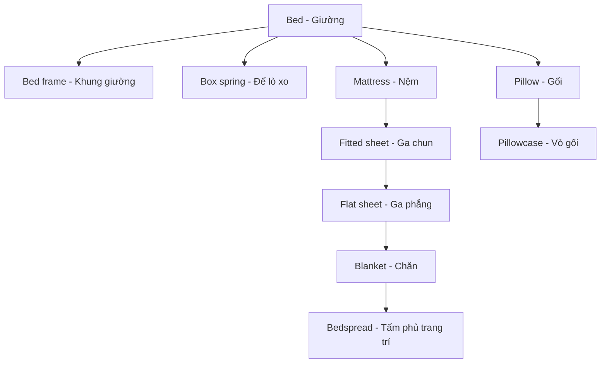

# Bài 10 – Phòng ngủ (A Bedroom)

> **Đơn vị 3: Nhà cửa (Housing)** · **Trang sách:** 44 · **Trang PDF:** 54  
> **Từ vựng:** 27 mục đánh số trong hình.

## 1. Mục tiêu học tập

Sau bài học, người học có thể gọi đúng tên tiếng Anh của **toàn bộ 27 vật dụng/chi tiết** theo số đánh dấu trên tranh, giải thích ý nghĩa tiếng Việt và dùng chúng để mô tả không gian, đặt câu hỏi, trả lời hoặc giao tiếp trong tình huống thực tế.

## 2. Quan sát tranh minh họa

**Cách dùng tranh:** Che phần bảng từ bên dưới, chọn một số bất kỳ trên ảnh, đọc tên tiếng Anh rồi nói nghĩa tiếng Việt. Tiếp theo đảo chiều: nhìn nghĩa tiếng Việt, chỉ đúng số trên tranh. **Số ở cột đầu tiên dưới đây khớp với số trên ảnh.**

## 3. Toàn bộ từ vựng theo số trong tranh

| Số trên tranh | English | Nghĩa tiếng Việt |
|---:|---|---|
| **1** | **mirror** | gương |
| **2** | **dresser / bureau** | tủ ngăn kéo phòng ngủ (có thể đặt gương phía trên) |
| **3** | **drawer** | ngăn kéo |
| **4** | **closet** | tủ/khoang treo quần áo |
| **5** | **curtains** | rèm cửa |
| **6** | **window shade** | rèm che cửa sổ, thường dạng cuốn |
| **7** | **photograph** | ảnh chụp |
| **8** | **bed** | giường |
| **9** | **pillow** | gối |
| **10** | **pillowcase** | vỏ gối |
| **11** | **bedspread** | khăn phủ/trải trang trí phủ giường |
| **12** | **blanket** | chăn, mền |
| **13** | **flat sheet** | ga trải giường dạng tấm phẳng |
| **14** | **fitted sheet** | ga chun ôm khít nệm |
| **15** | **headboard** | tấm đầu giường |
| **16** | **clock radio** | đồng hồ báo thức kết hợp radio |
| **17** | **lamp** | đèn bàn/đèn ngủ |
| **18** | **lampshade** | chụp đèn |
| **19** | **light switch** | công tắc đèn |
| **20** | **outlet** | ổ cắm điện |
| **21** | **night table** | bàn nhỏ đầu giường |
| **22** | **dust ruffle** | diềm vải che phần dưới chân giường |
| **23** | **rug** | thảm rời nhỏ |
| **24** | **floor** | sàn nhà |
| **25** | **mattress** | nệm, đệm |
| **26** | **box spring** | đế lò xo nâng đỡ nệm |
| **27** | **bed frame** | khung giường |

### 3.1. Ghi nhớ theo nhóm chức năng

| Nhóm | Số tương ứng trong tranh |
|---|---|
| Tủ, ngăn kéo và trang trí | 1–4, 7 |
| Cửa sổ và ánh sáng | 5–6, 16–20 |
| Giường và lớp chăn ga | 8–15, 22, 25–27 |
| Đồ nội thất và sàn | 21, 23–24 |

### 3.2. Luyện nhận diện bằng hình

Đọc lần lượt từ **số 1** đến **số 27** để đối chiếu từng nhãn, sau đó tự kiểm tra theo thứ tự ngẫu nhiên. Với những từ có dấu gạch chéo, cả hai cách gọi đều được học (ví dụ: `sofa/couch` hoặc `dresser/bureau`).

## 4. Kiến thức và mẫu câu sử dụng

### 4.1. Các lớp của một chiếc giường

Một chiếc giường có nhiều bộ phận mà tiếng Anh phân biệt khá rõ:

Sơ đồ mô tả mối quan hệ khái niệm, không phải thứ tự lớp trải bắt buộc trong mọi gia đình. `Box spring` là đế nâng đỡ nệm trong một số kiểu giường và có thể không được sử dụng. `Dust ruffle` là diềm vải che khoảng trống/phần đế dưới giường.

### 4.2. Phân biệt từ dễ nhầm

| Cặp từ | Phân biệt |
|---|---|
| **pillow – pillowcase** | `pillow` là chiếc gối; `pillowcase` là vỏ bọc gối. |
| **blanket – bedspread** | `blanket` dùng để đắp giữ ấm; `bedspread` thường là tấm phủ trang trí cho giường gọn đẹp. |
| **flat sheet – fitted sheet** | `flat sheet` là ga phẳng; `fitted sheet` có chun bo để bọc sát nệm. |
| **mattress – bed frame – box spring** | `mattress` là nệm; `bed frame` là khung; `box spring` là đế lò xo hỗ trợ nệm. |
| **dresser/bureau – closet – night table** | `dresser` là tủ ngăn kéo; `closet` là khoang/tủ treo áo quần; `night table` là bàn đầu giường. |
| **curtains – window shade** | `curtains` là rèm vải buông; `window shade` là tấm che cửa sổ, thường kiểu cuốn. |

### 4.3. Mô tả vị trí trong phòng ngủ

| Câu tiếng Anh | Nghĩa tiếng Việt |
|---|---|
| **I see a soft pillow and a beautiful bedspread.** | Tôi thấy một chiếc gối mềm và tấm phủ giường đẹp. |
| **The lamp is on the night table.** | Đèn đặt trên bàn đầu giường. |
| **There is a mirror above the dresser.** | Có một tấm gương phía trên tủ ngăn kéo. |
| **The rug is on the floor next to the bed.** | Tấm thảm nằm trên sàn, cạnh giường. |
| **The clock radio is beside the lamp.** | Đồng hồ radio nằm cạnh đèn. |
| **The pillowcase is on the pillow.** | Vỏ gối đang bọc chiếc gối. |

### 4.4. Hội thoại mẫu

**A:** What's your favorite thing in your bedroom?  
**B:** My bed. I have a soft pillow and a warm blanket.  
**A:** Do you have a clock in your bedroom?  
**B:** Yes. It's on the night table.

**Dịch:** A hỏi B thích đồ gì nhất trong phòng ngủ. B chọn giường, nhắc đến gối và chăn. Sau đó B nói đồng hồ đặt trên bàn đầu giường.

## 5. Bài tập thực hành

### Bài tập A – Quan sát và gọi tên

Xác định vị trí các số **4, 11, 14, 22, 26** trong tranh. Giải thích sự khác biệt giữa `flat sheet` và `fitted sheet`.

### Bài tập B – Điền danh từ chính xác

1. A ______ covers the pillow. (vỏ gối)
2. The ______ supports the mattress. (khung giường)
3. Please turn off the lamp with the ______. (công tắc đèn)

### Bài tập C – Viết đoạn miêu tả

Viết 5–7 câu về phòng ngủ của bạn, dùng ít nhất 8 từ trong bảng và các giới từ `on`, `above`, `next to`, `under` nếu phù hợp.

### Luyện nói theo tình huống

1. **What is your favorite thing in your bedroom?** — Món đồ yêu thích trong phòng ngủ của bạn là gì?
2. **Do you have a clock in your bedroom? Where is it?** — Bạn có đồng hồ không? Nó ở đâu?
3. **Do you have a mirror in your bedroom? Where is it?** — Có gương không? Gương ở đâu?

## 6. Câu hỏi ôn tập trắc nghiệm

### Câu 1

Bạn cần thay vỏ gối, không thay cả chiếc gối. Chọn từ đúng.

A. pillow  
B. pillowcase  
C. bedspread  
D. mattress  

**Đáp án: B.** `pillowcase` là vỏ gối; `pillow` là gối.

### Câu 2

Loại ga có chun bo khít quanh nệm gọi là gì?

A. flat sheet  
B. dust ruffle  
C. fitted sheet  
D. blanket  

**Đáp án: C.** `fitted sheet` được thiết kế ôm sát nệm.

### Câu 3

Đồ vật nào dùng để bật, tắt đèn gắn trong phòng?

A. light switch  
B. outlet  
C. lampshade  
D. photograph  

**Đáp án: A.** `light switch` là công tắc đèn; `outlet` là ổ cắm điện.

### Câu 4

Bạn muốn nói chiếc đèn ở trên bàn đầu giường. Chọn câu đúng.

A. The lamp is under the floor.  
B. The lamp is inside the pillow.  
C. The lamp is above the closet.  
D. The lamp is on the night table.  

**Đáp án: D.** `on the night table` diễn tả chiếc đèn đặt trên bề mặt bàn đầu giường.

### Câu 5

Bộ phận nào trực tiếp là tấm nệm để nằm?

A. box spring  
B. headboard  
C. mattress  
D. bed frame  

**Đáp án: C.** `mattress` là nệm, không phải đế lò xo hay khung giường.

## 7. Đáp án bài luyện tập và tổng kết

- **Bài điền từ/chọn từ:** pillowcase; bed frame; light switch.
- **Câu mẫu tham khảo:** `The pillowcase covers the pillow.` `The night table is next to the bed.`
- **Ôn tập chủ động:** Nhìn ảnh và gọi lần lượt tất cả 27 từ; đặt ít nhất 5 câu mới, dùng tối thiểu 8 từ khác nhau; tự nói một đoạn 30–60 giây về căn phòng.

---

**Điều hướng:** [← Bài trước](09_a-bathroom.md) · [Bài tiếp theo →](11_a-children-s-bedroom.md)
