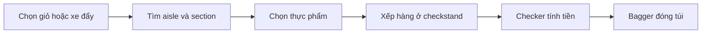

# Bài 05 – Chợ / Siêu thị (The Market)

**Oxford Picture Dictionary – Anh–Việt · Đơn vị 4: Thực phẩm và ăn uống**  
**Trang sách:** 54–55 · **Trang PDF:** 64–65

> **Tóm tắt:** Tìm đúng quầy hàng, nhận biết 55 vật và món ăn trong siêu thị, sử dụng những từ này khi đi mua sắm và thanh toán.

*Học với hình: tìm đúng số hoặc chữ cái bên cạnh vật/động tác, đọc tên tiếng Anh, che cột nghĩa rồi tự gọi tên bằng tiếng Việt.*

## 1. Mục tiêu học tập

Sau bài học, bạn có thể nhận diện và dịch **toàn bộ 55 mục đánh số**; phân biệt quầy hàng, thực phẩm và nhân viên; hỏi vị trí một món hàng; sử dụng mẫu câu giao tiếp cơ bản khi mua sắm.

## 2. Học cách quan sát siêu thị

Siêu thị gồm nhiều **sections** (khu vực) với các **aisles** (lối đi giữa dãy kệ). Bạn có thể dùng **shopping cart** (xe đẩy) hoặc **shopping basket** (giỏ). Khi chọn hàng xong, hãy tới **checkstand** (quầy thanh toán) và chờ trong **line** (hàng đợi). **Checker** tính tiền bằng **cash register**; **bagger** giúp cho đồ vào **paper bag** hoặc **plastic bag**.

## 3. Từ vựng theo số trên tranh

### 3.1. Các khu vực, vật dụng và người trong siêu thị (1–23)

| STT | English | Tiếng Việt |
|---|---|---|
| 1 | bottle return | khu/trạm trả vỏ chai |
| 2 | meat and poultry section | khu bán thịt và thịt gia cầm |
| 3 | shopping cart | xe đẩy mua hàng |
| 4 | canned goods | đồ hộp / thực phẩm đóng hộp |
| 5 | aisle | lối đi giữa các quầy hàng |
| 6 | baked goods | đồ nướng lò (bánh mì, bánh ngọt…) |
| 7 | shopping basket | giỏ mua hàng |
| 8 | manager | người quản lý |
| 9 | dairy section | khu bán sản phẩm từ sữa |
| 10 | pet food | thức ăn cho thú cưng |
| 11 | produce section | khu rau củ quả tươi |
| 12 | frozen foods | thực phẩm đông lạnh |
| 13 | baking products | nguyên liệu / sản phẩm phục vụ làm bánh |
| 14 | paper products | sản phẩm bằng giấy |
| 15 | beverages | đồ uống |
| 16 | snack foods | đồ ăn vặt |
| 17 | checkstand | quầy thanh toán |
| 18 | cash register | máy tính tiền |
| 19 | checker | nhân viên thu ngân / nhân viên thanh toán |
| 20 | line | hàng người xếp chờ |
| 21 | bagger | nhân viên đóng hàng vào túi |
| 22 | paper bag | túi giấy |
| 23 | plastic bag | túi nhựa / túi ni-lông |

**Lưu ý:** Trong tranh, **checker** chỉ nhân viên thanh toán, gần với từ **cashier** thường gặp trong giao tiếp hiện đại. **Produce** (trong *produce section*) là rau quả tươi, không phải động từ *produce* (sản xuất).

### 3.2. Thực phẩm, đồ uống và vật dụng (24–55)

| STT | English | Tiếng Việt |
|---|---|---|
| 24 | soup | súp |
| 25 | tuna | cá ngừ |
| 26 | beans | đậu / hạt đậu |
| 27 | spaghetti | mì Ý dạng sợi dài |
| 28 | rice | gạo; cơm (tùy ngữ cảnh) |
| 29 | bread | bánh mì |
| 30 | rolls | bánh mì tròn / ổ nhỏ |
| 31 | cookies | bánh quy |
| 32 | cake | bánh ngọt / bánh kem |
| 33 | yogurt | sữa chua |
| 34 | eggs | trứng |
| 35 | milk | sữa |
| 36 | butter | bơ (làm từ sữa) |
| 37 | sour cream | kem chua |
| 38 | cheese | phô mai |
| 39 | margarine | bơ thực vật |
| 40 | potato chips | khoai tây lát chiên giòn |
| 41 | candy bar | thanh kẹo |
| 42 | gum | kẹo cao su |
| 43 | frozen vegetables | rau củ đông lạnh |
| 44 | ice cream | kem |
| 45 | flour | bột mì / bột làm bánh |
| 46 | spices | gia vị |
| 47 | cake mix | bột trộn sẵn để làm bánh |
| 48 | sugar | đường |
| 49 | oil | dầu ăn |
| 50 | apple juice | nước ép táo |
| 51 | instant coffee | cà phê hòa tan |
| 52 | soda | nước ngọt có ga |
| 53 | bottled water | nước đóng chai |
| 54 | plastic wrap | màng bọc thực phẩm |
| 55 | aluminum foil | giấy bạc / lá nhôm bọc thực phẩm |

## 4. Nhóm từ theo tình huống mua sắm

| Nhóm | Từ quan trọng | Dùng khi nào? |
|---|---|---|
| Khu hàng tươi | meat and poultry section, produce section, dairy section | Tìm thịt, rau quả, sữa |
| Hàng bảo quản | canned goods, frozen foods | Tìm thực phẩm đóng hộp, đông lạnh |
| Đồ làm bánh | flour, sugar, cake mix, baking products | Mua nguyên liệu làm bánh |
| Đồ ăn nhẹ | potato chips, candy bar, gum, snack foods | Mua đồ ăn vặt |
| Thanh toán | line, checkstand, checker, cash register, bagger | Xếp hàng, trả tiền và đóng túi |

Có thể hình dung hành trình đi mua hàng bằng sơ đồ sau:

*Quy trình:* lấy giỏ → đến đúng khu vực → chọn món → chờ tới lượt → thanh toán → đóng gói.

## 5. Mẫu câu giao tiếp Anh–Việt

| English | Tiếng Việt |
|---|---|
| Excuse me, where is the dairy section? | Xin lỗi, khu bán sữa ở đâu? |
| It's in the next aisle. | Nó ở lối đi kế bên. |
| I need a shopping basket. | Tôi cần một giỏ mua hàng. |
| Do you have frozen vegetables? | Ở đây có rau củ đông lạnh không? |
| I'd like some bread and cheese. | Tôi muốn mua một ít bánh mì và phô mai. |
| Is this the line for checkout? | Đây có phải hàng chờ thanh toán không? |
| Could I have a paper bag, please? | Cho tôi xin một túi giấy được không? |

**Đoạn hội thoại ngắn**

**Customer:** Excuse me, where can I find apple juice?  
**Nhân viên:** It's in the beverages section, next to bottled water.  
**Customer:** Thank you. I'll also buy some cookies.  
**Nhân viên:** You're welcome!

*Dịch:* Khách hỏi nước ép táo ở đâu; nhân viên chỉ tới khu đồ uống, cạnh nước đóng chai; khách nói sẽ mua thêm bánh quy.

## 6. Luyện tập với tranh

**Bài A – Điền từ.** Không nhìn bảng: số 3 = ______; số 9 = ______; số 18 = ______; số 37 = ______; số 55 = ______.

**Bài B – Tình huống.** Viết câu hỏi tiếng Anh để tìm khu rau củ quả và hỏi xin một túi giấy. Sau đó viết một câu nói bạn muốn mua sữa chua và bánh mì.

**Bài C – Phân loại.** Xếp các từ *eggs, frozen foods, cash register, cake mix, bagger, soda* vào các nhóm: thực phẩm, khu bán hàng, dụng cụ thanh toán, nhân viên. Một số nhóm có thể chứa nhiều từ.

**Gợi ý kiểm tra:** A: shopping cart; dairy section; cash register; sour cream; aluminum foil. B: *Where is the produce section? Could I have a paper bag? I'd like some yogurt and bread.* C: thực phẩm (eggs, cake mix, soda), khu bán hàng (frozen foods), dụng cụ (cash register), nhân viên (bagger).

## 7. Câu hỏi ôn tập trắc nghiệm

### Câu 1

Bạn muốn tìm rau củ tươi. Nên hỏi khu nào?

A. Dairy section  
B. Produce section  
C. Paper products  
D. Baked goods  

**Đáp án: B.** Produce section là khu rau củ quả tươi.

### Câu 2

Một người đang giúp cho hàng đã mua vào túi. Người đó là ai?

A. Checker  
B. Manager  
C. Bagger  
D. Vendor  

**Đáp án: C.** Bagger là người đóng hàng vào túi; checker tính tiền.

### Câu 3

Khách vừa đặt hàng lên quầy để tính tiền. Tên quầy trong tranh là gì?

A. Checkstand  
B. Aisle  
C. Bottle return  
D. Shopping basket  

**Đáp án: A.** Checkstand là quầy thanh toán.

### Câu 4

Bạn cần màng bọc thực phẩm thay vì lá nhôm. Chọn mục nào?

A. Aluminum foil  
B. Paper bag  
C. Canned goods  
D. Plastic wrap  

**Đáp án: D.** Plastic wrap là màng bọc, aluminum foil là giấy bạc.

### Câu 5

Từ nào chỉ bơ thực vật, không phải bơ từ sữa?

A. Butter  
B. Margarine  
C. Sour cream  
D. Cheese  

**Đáp án: B.** Margarine là bơ thực vật, butter là bơ từ sữa.

## 8. Tổng kết

Nhớ theo **3 nhóm lớn**: (1) các **khu/quầy, người và dụng cụ** số 1–23; (2) **thực phẩm** số 24–53; (3) **vật liệu bao gói** số 54–55. Khi ôn, dùng thứ tự số trên tranh để tự kiểm đủ 55 mục.

**Điều hướng:** [Bài 04](04_deli-and-seafood.md) · [Bài 06](06_containers-and-packaged-foods.md)
