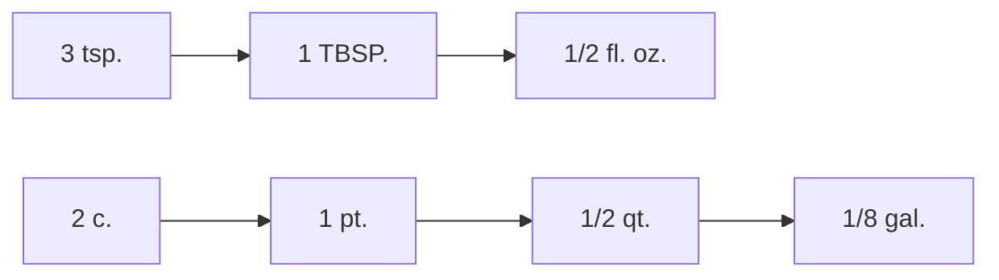

# Bài 07 – Trọng lượng và đo lường (Weights and Measures)

**Oxford Picture Dictionary – Anh–Việt · Đơn vị 4: Thực phẩm và ăn uống**  
**Trang sách:** 57 · **Trang PDF:** 67

> **Tóm tắt:** Trình bày đủ 12 ví dụ minh họa về đơn vị đo thể tích và khối lượng, các hoạt động đo – cân – đổi đơn vị, cùng bảng quy đổi theo sách.

*Học với hình: tìm đúng số hoặc chữ cái bên cạnh vật/động tác, đọc tên tiếng Anh, che cột nghĩa rồi tự gọi tên bằng tiếng Việt.*

## 1. Mục tiêu học tập

Phân biệt **measure / weigh / convert**, đọc đúng 12 ví dụ trong hình, nhận diện các viết tắt thông dụng khi nấu ăn và vận dụng quy đổi đơn vị thể tích hoặc khối lượng.

## 2. Ba thao tác quan trọng (A–C)

| Chữ | English | Tiếng Việt | Ý nghĩa |
|---|---|---|---|
| A | Measure the ingredients. | Đo lường nguyên liệu. | Dùng cốc hoặc thìa đong để lấy lượng cần thiết. |
| B | Weigh the food. | Cân thức ăn. | Dùng cân để đo khối lượng. |
| C | Convert the measurements. | Quy đổi đơn vị đo. | Chuyển cùng một lượng từ đơn vị này sang đơn vị khác. |

**Phân biệt:** *measure* là đo lường nói chung; *weigh* chuyên dùng để **cân khối lượng**; *convert* là đổi cách biểu diễn giá trị, không làm thay đổi lượng thực tế.

## 3. Từ vựng và đơn vị trong 12 hình

### 3.1. Đong chất lỏng – Liquid measures (1–5)

| STT | English | Tiếng Việt | Ký hiệu |
|---|---|---|---|
| 1 | a fluid ounce of water | một ao-xơ lỏng nước | 1 fl. oz. |
| 2 | a cup of oil | một cốc dầu ăn | 1 c. |
| 3 | a pint of yogurt | một pint sữa chua | 1 pt. |
| 4 | a quart of milk | một quart sữa | 1 qt. |
| 5 | a gallon of apple juice | một ga-lông nước ép táo | 1 gal. |

### 3.2. Đong nguyên liệu khô – Dry measures (6–10)

| STT | English | Tiếng Việt | Ký hiệu |
|---|---|---|---|
| 6 | a teaspoon of salt | một thìa cà phê muối | 1 tsp. |
| 7 | a tablespoon of sugar | một thìa canh đường | 1 TBSP. |
| 8 | a 1/4 cup of brown sugar | một phần tư cốc đường nâu | 1/4 c. |
| 9 | a 1/2 cup of raisins | nửa cốc nho khô | 1/2 c. |
| 10 | a cup of flour | một cốc bột mì | 1 c. |

### 3.3. Cân khối lượng – Weight (11–12)

| STT | English | Tiếng Việt | Ký hiệu |
|---|---|---|---|
| 11 | an ounce of cheese | một ao-xơ phô mai | 1 oz. |
| 12 | a pound of roast beef | một pao thịt bò nướng | 1 lb. |

**Từ bổ trợ xuất hiện trong ví dụ:** *ingredient* = nguyên liệu; *water* = nước; *oil* = dầu ăn; *yogurt* = sữa chua; *milk* = sữa; *apple juice* = nước ép táo; *salt* = muối; *sugar* = đường; *brown sugar* = đường nâu; *raisins* = nho khô; *flour* = bột mì; *cheese* = phô mai; *roast beef* = thịt bò nướng.

## 4. Bảng viết tắt và quy đổi từ bài học

### 4.1. Thể tích – Volume

| Ký hiệu | Tên đầy đủ | Giá trị theo bảng trong sách |
|---|---|---|
| fl. oz. | fluid ounce | 1 fl. oz. ≈ 30 mL |
| c. | cup | 1 c. ≈ 237 mL |
| pt. | pint | 1 pt. ≈ 0,47 L |
| qt. | quart | 1 qt. ≈ 0,95 L |
| gal. | gallon | 1 gal. ≈ 3,79 L |

### 4.2. Quan hệ giữa các đơn vị đong

| Quy đổi | Cách hiểu |
|---|---|
| 3 tsp. = 1 TBSP. | 3 thìa cà phê = 1 thìa canh |
| 2 TBSP. = 1 fl. oz. | 2 thìa canh = 1 ounce lỏng |
| 8 fl. oz. = 1 c. | 8 ounce lỏng = 1 cốc |
| 2 c. = 1 pt. | 2 cốc = 1 pint |
| 2 pt. = 1 qt. | 2 pint = 1 quart |
| 4 qt. = 1 gal. | 4 quart = 1 gallon |

### 4.3. Khối lượng – Weight

| Ký hiệu | Tên đầy đủ | Giá trị theo sách |
|---|---|---|
| oz. | ounce | 1 oz. ≈ 28,35 g |
| lb. | pound | 1 lb. ≈ 453,6 g |
| lb. | pound | 2,205 lb. ≈ 1 kg |
| oz. / lb. | ounce / pound | 16 oz. = 1 lb. |

> **Chú ý:** Đơn vị **fl. oz.** là *thể tích*, còn **oz.** là *khối lượng*. Dù cùng có chữ “ounce”, chúng không thể đổi trực tiếp cho nhau nếu không biết khối lượng riêng của chất. Các con số thể tích là quy ước hệ đo Mỹ và được làm tròn như bảng trong sách; không nên hiểu là chuẩn chung cho mọi quốc gia.

## 5. Đọc công thức và thực hành đổi đơn vị

Dạng câu quen thuộc: **Measure + quantity + of + ingredient.**

- *Measure a cup of flour.* — Đong một cốc bột mì.
- *Add two tablespoons of sugar.* — Thêm hai thìa canh đường.
- *Weigh a pound of roast beef.* — Cân một pao thịt bò nướng.
- *Convert two cups to one pint.* — Đổi hai cốc thành một pint.

**Ví dụ 1:** 6 tsp. đường = $6 / 3 = 2$ TBSP. đường.

**Ví dụ 2:** 4 c. sữa = $4 / 2 = 2$ pt. sữa.

**Ví dụ 3:** 2 lb. phô mai ≈ $2\times453{,}6=907{,}2$ g.

*Sơ đồ cho thấy cùng một lượng được biểu diễn bằng những đơn vị khác nhau; cần xác định đang đổi theo chuỗi đơn vị thìa, cốc hay hệ thống lớn hơn.*

## 6. Bài tập ứng dụng

**Bài A – Phân biệt:** Viết nghĩa và đơn vị cho các ký hiệu `tsp.`, `TBSP.`, `c.`, `fl. oz.`, `oz.`, `lb.`.

**Bài B – Tính:** (1) 9 tsp. = ? TBSP.; (2) 4 pt. = ? qt.; (3) 32 oz. = ? lb.; (4) 3 c. = ? mL (theo trị số sách).

**Bài C – Nói:** Dùng ít nhất 3 câu tiếng Anh để hướng dẫn đong đường nâu, cân phô mai và đổi cốc sang pint.

**Đáp án B:** 3 TBSP.; 2 qt.; 2 lb.; 711 mL. (*3 × 237 = 711*; đây là giá trị gần đúng.)

## 7. Câu hỏi ôn tập trắc nghiệm

### Câu 1

Khi cần biết khối lượng miếng thịt bằng cân, dùng động từ nào?

A. Convert  
B. Measure out  
C. Weigh  
D. Stir  

**Đáp án: C.** Weigh là thao tác dùng cân để đo khối lượng.

### Câu 2

Theo bảng quy đổi trong bài, 6 teaspoons bằng bao nhiêu tablespoons?

A. 1  
B. 2  
C. 3  
D. 6  

**Đáp án: B.** 3 tsp. = 1 TBSP., nên 6 tsp. = 2 TBSP.

### Câu 3

Cặp nào đều chỉ đơn vị thể tích?

A. Pound và ounce  
B. Gallon và quart  
C. Ounce và pound  
D. Gram và liter  

**Đáp án: B.** Gallon và quart đều đo thể tích; ounce/pound ở đây đo khối lượng.

### Câu 4

1 lb. tương đương bao nhiêu ounce khối lượng?

A. 8 oz.  
B. 12 oz.  
C. 32 oz.  
D. 16 oz.  

**Đáp án: D.** Sách ghi 1 lb. = 16 oz.

### Câu 5

Cách hiểu nào đúng về fl. oz. và oz.?

A. fl. oz. đo thể tích; oz. đo khối lượng  
B. Cả hai đều chỉ khối lượng  
C. Cả hai đều chỉ thể tích  
D. Hai ký hiệu luôn có giá trị số bằng nhau  

**Đáp án: A.** Chúng có đơn vị vật lý khác nhau, không thay thế trực tiếp.

## 8. Tổng kết

Khi đọc công thức nấu ăn, hãy nhận dạng trước **thể tích hay khối lượng**, sau đó chọn đúng hệ quy đổi. Hai khác biệt phải nhớ: **tsp. ≠ TBSP.** và **fl. oz. ≠ oz.**.

**Điều hướng:** [Bài 06](06_containers-and-packaged-foods.md) · [Bài 08](08_food-preparation.md)
