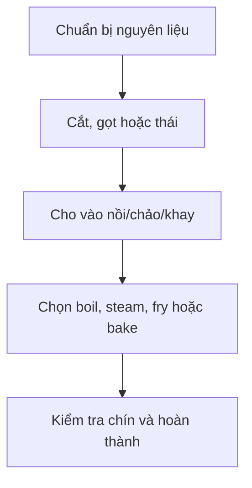

# Bài 08 – Chuẩn bị và nấu ăn (Food Preparation)

**Oxford Picture Dictionary – Anh–Việt · Đơn vị 4: Thực phẩm và ăn uống**  
**Trang sách:** 58 · **Trang PDF:** 68

> **Tóm tắt:** Học 18 bước nấu ba món trong ảnh (A–R), 5 phương pháp nấu gà (S–W), cách ra lệnh nấu ăn và mô tả quy trình bằng tiếng Anh.

*Học với hình: tìm đúng số hoặc chữ cái bên cạnh vật/động tác, đọc tên tiếng Anh, che cột nghĩa rồi tự gọi tên bằng tiếng Việt.*

## 1. Mục tiêu học tập

Sau bài này, bạn có thể diễn đạt đúng **toàn bộ các bước A–W**, kể lại cách làm trứng khuấy, rau củ đút lò và súp gà; phân biệt *boil, simmer, steam, fry, roast, broil, stir-fry*.

## 2. Các động từ cơ bản khi chuẩn bị món ăn

Trong công thức nấu ăn, người viết thường dùng **câu mệnh lệnh (imperative)**: bắt đầu trực tiếp bằng động từ nguyên mẫu, ví dụ *Break 3 eggs*, *Peel the carrots*, *Add the vegetables*. Chủ ngữ **you** thường được lược bỏ.

| Động từ | Tiếng Việt | Ghi nhớ |
|---|---|---|
| break | đập (trứng) | Làm vỡ vỏ trứng để lấy ruột. |
| beat | đánh | Dùng đũa hoặc dụng cụ đánh trứng để trộn đều. |
| grease | thoa/tráng dầu mỡ | Giúp thức ăn ít dính chảo. |
| pour | đổ/rót | Cho nguyên liệu lỏng vào vật chứa. |
| stir | khuấy/đảo | Di chuyển, trộn nguyên liệu trong chảo/nồi. |
| chop | băm/thái nhỏ | Chia rau củ thành các miếng nhỏ. |
| sauté | xào nhanh với ít dầu/mỡ | Thường dùng với hành, rau. |
| steam | hấp | Làm chín bằng hơi nước. |
| grate | bào/nạo | Thường bào phô mai bằng bàn nạo. |
| mix | trộn | Kết hợp nhiều nguyên liệu. |
| bake | nướng bằng lò | Dùng cho bánh hoặc món hầm đút lò. |
| cut up | chặt/cắt thành miếng | Dùng với thịt gà. |
| peel | gọt/bóc vỏ | Bỏ lớp vỏ ngoài. |
| slice | thái lát | Tạo các lát tương đối mỏng. |
| boil | luộc/đun sôi | Nấu trong nước sôi. |
| add | thêm/cho vào | Bổ sung nguyên liệu. |
| simmer | ninh/đun liu riu | Đun nhẹ, thấp hơn sôi mạnh. |

## 3. Ba công thức minh họa A–R

### 3.1. Scrambled eggs – Trứng khuấy (A–F)

| Bước | English | Tiếng Việt |
|---|---|---|
| A | Break 3 eggs. | Đập 3 quả trứng. |
| B | Beat well. | Đánh trứng cho đều. |
| C | Grease the pan. | Tráng/thoa dầu mỡ vào chảo. |
| D | Pour the eggs into the pan. | Đổ trứng vào chảo. |
| E | Stir. | Khuấy, đảo đều. |
| F | Cook until done. | Nấu cho đến khi chín. |

**Kể lại bằng tiếng Anh:** *First, break three eggs and beat them well. Then grease the pan and pour the eggs into it. Stir and cook until done.*

**Chú ý:** *Beat* là đánh trứng trước khi nấu; *stir* là khuấy/đảo trong lúc nấu. *Until done* nghĩa là cho đến khi thức ăn chín, không phải một khoảng thời gian cố định.

### 3.2. Vegetable casserole – Rau củ đút lò (G–L)

| Bước | English | Tiếng Việt |
|---|---|---|
| G | Chop the onions. | Băm/thái nhỏ hành tây. |
| H | Sauté the onions. | Xào hành tây. |
| I | Steam the broccoli. | Hấp bông cải xanh. |
| J | Grate the cheese. | Bào phô mai. |
| K | Mix the ingredients. | Trộn các nguyên liệu. |
| L | Bake at 350°F for 45 minutes. | Nướng trong lò ở 350°F trong 45 phút. |

**Kể lại bằng tiếng Anh:** *Chop and sauté the onions. Steam the broccoli. Grate the cheese, then mix the ingredients. Bake at 350°F for 45 minutes.*

**Nhiệt độ:** Bài sử dụng **350°F** (độ Fahrenheit), tương đương khoảng **177°C** theo phép đổi $C=(F-32)\times5/9$. Đây là cách diễn đạt lại nhiệt độ, không thay đổi thông số nấu của hình.

### 3.3. Chicken soup – Súp gà (M–R)

| Bước | English | Tiếng Việt |
|---|---|---|
| M | Cut up the chicken. | Chặt/cắt thịt gà thành miếng. |
| N | Peel the carrots. | Gọt vỏ cà rốt. |
| O | Slice the carrots. | Thái cà rốt thành lát. |
| P | Boil the chicken. | Luộc/đun sôi thịt gà. |
| Q | Add the vegetables. | Cho thêm rau củ vào. |
| R | Simmer for 1 hour. | Ninh liu riu trong 1 giờ. |

**Kể lại bằng tiếng Anh:** *Cut up the chicken. Peel and slice the carrots. Boil the chicken, add the vegetables, and simmer for one hour.*

**Phân biệt:** *Peel* là gọt vỏ, *slice* là thái lát; *boil* nhấn mạnh nước sôi, còn *simmer* là đun nhỏ lửa cho sôi liu riu.

## 4. Năm cách nấu gà (S–W)

| Chữ | English | Tiếng Việt |
|---|---|---|
| S | fry | chiên/rán |
| T | barbecue / grill | nướng trên vỉ/lửa trực tiếp |
| U | roast | quay/nướng (thường trong lò) |
| V | broil | nướng dưới nguồn nhiệt phía trên |
| W | stir-fry | xào nhanh, đảo liên tục |

| Phương pháp | Đặc điểm |
|---|---|
| **fry** | Rán/chiên với dầu hoặc chất béo trên chảo hoặc trong dầu. |
| **barbecue / grill** | Nướng trên vỉ với nhiệt trực tiếp, thường từ phía dưới. |
| **roast** | Quay/nướng trong lò, thường với miếng thịt lớn hoặc cả con gà. |
| **broil** | Nướng bằng nguồn nhiệt mạnh ở phía **trên** thực phẩm (theo nghĩa thông dụng ở Mỹ). |
| **stir-fry** | Xào với nhiệt khá cao, đảo liên tục, thường dùng miếng thực phẩm nhỏ. |

**Các ví dụ trong khung bài:** *I fry eggs.* (Tôi chiên trứng.) · *I bake potatoes.* (Tôi nướng khoai tây.)

## 5. Cách trình bày quy trình bằng tiếng Anh

Thực hành nối bước bằng **First** (đầu tiên), **Next / Then** (tiếp theo), **After that** (sau đó), **Finally** (cuối cùng). Động từ mệnh lệnh không thêm *-s*:

*Sơ đồ chỉ cách tổ chức lời nói thành một quy trình tổng quát; từng món ở mục 3 vẫn có thứ tự riêng A–F, G–L và M–R.*

**Ví dụ mở rộng:**

- *First, peel the carrots. Then slice them.* – Đầu tiên gọt vỏ cà rốt. Sau đó thái lát.
- *Add the vegetables and simmer for one hour.* – Thêm rau củ rồi ninh nhỏ lửa trong một giờ.
- *My favorite way to cook chicken is to grill it.* – Cách nấu gà tôi thích nhất là nướng vỉ.

## 6. Luyện tập nói và viết

**Bài A – Điền động từ:** (1) _____ the carrots (gọt vỏ); (2) _____ the cheese (bào); (3) _____ the ingredients (trộn); (4) _____ for 1 hour (ninh nhỏ lửa); (5) _____ the eggs into the pan (đổ vào chảo).

**Bài B – Nối bước:** Sắp xếp các hành động nấu súp: *add vegetables / peel carrots / simmer / cut up chicken / boil chicken / slice carrots* theo thứ tự M–R.

**Bài C – Trả lời câu hỏi thảo luận từ bài:** (1) *What are popular ways in your country to make rice, vegetables, and meat?* (Ở nước bạn có những cách phổ biến nào để nấu cơm, rau và thịt?) (2) *What is your favorite way to cook chicken?* (Bạn thích nấu gà theo cách nào nhất?)

**Gợi ý đáp án:** A: peel, grate, mix, simmer, pour. B: cut up chicken → peel carrots → slice carrots → boil chicken → add vegetables → simmer. C: có thể trả lời *We steam rice, stir-fry vegetables, and grill meat. I like roast chicken.*

## 7. Câu hỏi ôn tập trắc nghiệm

### Câu 1

Bạn muốn gọt vỏ cà rốt trước khi thái lát. Động từ nào đúng?

A. Slice  
B. Peel  
C. Grate  
D. Stir  

**Đáp án: B.** Peel là gọt vỏ; slice mới là thái lát.

### Câu 2

Ở bước J của món rau củ đút lò, bạn làm gì với phô mai?

A. Boil it  
B. Peel it  
C. Grate it  
D. Broil it  

**Đáp án: C.** Grate the cheese nghĩa là bào/nạo phô mai.

### Câu 3

Phương pháp nào dùng hơi nước làm chín bông cải xanh?

A. Steam  
B. Fry  
C. Roast  
D. Grill  

**Đáp án: A.** Steam nghĩa là hấp bằng hơi nước.

### Câu 4

Bạn cần đun nồi súp nhẹ trong một giờ, không sôi mạnh. Chọn cách diễn đạt nào?

A. Break for an hour  
B. Grate for an hour  
C. Beat for an hour  
D. Simmer for one hour  

**Đáp án: D.** Simmer là ninh, đun liu riu.

### Câu 5

Cách nấu nào thường có nguồn nhiệt mạnh từ phía trên ở tiếng Anh Mỹ?

A. Stir-fry  
B. Broil  
C. Sauté  
D. Boil  

**Đáp án: B.** Broil khác grill ở vị trí nguồn nhiệt; broil thường dùng nhiệt từ phía trên.

## 8. Tổng kết

Bạn đã học 3 quy trình **A–F / G–L / M–R** và 5 phương pháp **S–W**. Muốn ghi nhớ hiệu quả, hãy nhìn từng khung tranh, tự đọc lệnh nấu bằng tiếng Anh, sau đó kể lại toàn bộ một món với *First – Then – Finally*.

**Điều hướng:** [Bài 07](07_weights-and-measures.md) · [Bài 09](09_kitchen-utensils.md)
