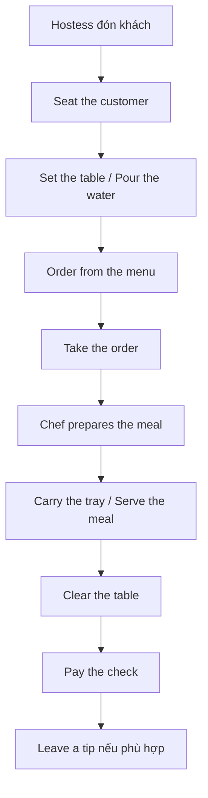

# Bài 12 – Nhà hàng (A Restaurant)

> **Chủ đề:** Thực phẩm và ăn uống (Food)  
> **Trang sách:** 62–63 · **Trang PDF:** 72–73  
> **Trọng tâm:** Nhận diện tất cả từ/cụm từ được đánh số trong tranh, sử dụng trong tình huống thực tế.

## 1. Mục tiêu học tập

- Nhận diện và giải thích đúng 29 mục từ vựng gắn số trong tranh.
- Chọn từ phù hợp để mô tả đồ vật, món ăn, vai trò hoặc thao tác trong bối cảnh thực tế.
- Sử dụng các cấu trúc hội thoại để tự nói và viết ít nhất 5 câu bằng tiếng Anh.

## 2. Tranh minh họa

**Cách học:** Nhìn số trên tranh, đoán từ tiếng Anh, sau đó đối chiếu bảng từ vựng bên dưới. Khi luyện lại, hãy che cột nghĩa tiếng Việt.

## 3. Từ vựng đầy đủ theo số trên tranh

| Số trên hình | Từ tiếng Anh | Nghĩa tiếng Việt |
|---:|---|---|
| 1 | **hostess** | nhân viên đón khách, hướng dẫn chỗ ngồi (nữ) |
| 2 | **dining room** | phòng ăn, khu vực dùng bữa |
| 3 | **menu** | thực đơn |
| 4 | **server / waiter** | nhân viên phục vụ / bồi bàn nam |
| 5 | **patron / diner** | khách ăn, thực khách |
| 6 | **server / waitress** | nhân viên phục vụ / bồi bàn nữ |
| 7 | **dessert tray** | khay tráng miệng |
| 8 | **bread basket** | giỏ đựng bánh mì |
| 9 | **busperson** | nhân viên thu dọn bàn |
| 10 | **kitchen** | nhà bếp |
| 11 | **chef** | đầu bếp chính |
| 12 | **dishroom** | khu rửa bát đĩa |
| 13 | **dishwasher** | nhân viên rửa bát đĩa (hoặc máy rửa bát tùy ngữ cảnh) |
| 14 | **place setting** | bộ đồ ăn đã bày cho một người tại bàn |
| 15 | **dinner plate** | đĩa ăn chính |
| 16 | **bread-and-butter plate** | đĩa đựng bánh mì và bơ |
| 17 | **salad plate** | đĩa salad |
| 18 | **soup bowl** | bát súp |
| 19 | **water glass** | ly nước |
| 20 | **wine glass** | ly rượu vang |
| 21 | **cup** | tách, cốc có quai |
| 22 | **saucer** | đĩa lót tách |
| 23 | **napkin** | khăn ăn |
| 24 | **salad fork** | nĩa ăn salad |
| 25 | **dinner fork** | nĩa ăn món chính |
| 26 | **steak knife** | dao cắt bít tết |
| 27 | **knife** | dao ăn |
| 28 | **teaspoon** | thìa cà phê, thìa nhỏ |
| 29 | **soup spoon** | thìa súp, muỗng canh |

## 4. Mười hành động trong quá trình phục vụ (A–J)

| Ký hiệu | Cụm từ tiếng Anh | Tiếng Việt | Câu ví dụ |
|---|---|---|---|
| A | **set the table** | sắp đặt bàn ăn | Please set the table. – Hãy bày bàn ăn. |
| B | **seat the customer** | xếp chỗ, dẫn khách vào bàn | Seat the customers near the window. – Sắp chỗ cho khách gần cửa sổ. |
| C | **pour the water** | rót nước | Please pour the water. – Rót nước giúp nhé. |
| D | **order from the menu** | gọi món từ thực đơn | We order from the menu. – Chúng tôi chọn món từ thực đơn. |
| E | **take the order** | nhận, ghi đơn gọi món | The server takes the order. – Nhân viên ghi món. |
| F | **serve the meal** | phục vụ, mang món ăn ra | It's time to serve the meal. – Đã đến lúc phục vụ món ăn. |
| G | **clear the table** | dọn đồ ăn, bát đĩa khỏi bàn | Please clear the table. – Hãy dọn bàn. |
| H | **carry the tray** | bưng, mang khay | The server carries the tray. – Nhân viên bưng khay. |
| I | **pay the check** | thanh toán hóa đơn | Can we pay the check? – Chúng tôi thanh toán được chưa? |
| J | **leave a tip** | để lại tiền boa | They leave a tip. – Họ để lại tiền boa. |

**Hai cụm từ mở rộng:**

- **eat out:** đi ăn ở ngoài, tại nhà hàng hoặc quán ăn. *We eat out on weekends.* – Chúng tôi đi ăn ngoài vào cuối tuần.
- **take out:** mua món ở nhà hàng rồi mang về ăn. *Let's order takeout.* – Mình gọi đồ mang về nhé. Trong sách dùng cụm động từ *take out*; khi làm danh từ/tính từ có thể gặp *takeout*.

## 5. Quy trình phục vụ trong nhà hàng

**Giải thích:** Nhân viên đón khách hướng dẫn vào bàn, nhân viên phục vụ tiếp nhận món, đầu bếp chế biến, món được mang ra, bàn được dọn và khách thanh toán. Sơ đồ là quy trình học giao tiếp mẫu; trong thực tế một số bước có thể diễn ra đồng thời hoặc thay đổi thứ tự. Tiền boa tùy quốc gia và quy định nhà hàng.

## 6. Bày bàn ăn và phân biệt các vật dụng

Một **place setting** là bộ dụng cụ dành cho **một người** khi dùng bữa. Tên dụng cụ thường kết hợp **mục đích + tên vật**.

| Cụm từ | Phân biệt / công dụng |
|---|---|
| **dinner plate** | đĩa chính, thường lớn hơn đĩa salad |
| **salad plate** | đĩa dành cho salad |
| **bread-and-butter plate** | đĩa nhỏ cho bánh mì và bơ |
| **soup bowl** | bát đựng súp |
| **cup / saucer** | tách có quai / đĩa lót tách |
| **water glass / wine glass** | ly uống nước / ly rượu vang |
| **salad fork / dinner fork** | nĩa salad / nĩa ăn món chính |
| **steak knife / knife** | dao cắt bít tết / dao ăn chung |
| **teaspoon / soup spoon** | thìa nhỏ / thìa súp |
| **napkin** | khăn ăn |

Các câu mô tả vị trí bàn ăn:

> **The glass is on the right.** – Ly ở phía bên phải.  
> **The fork goes on the left.** – Nĩa đặt phía bên trái.  
> **The napkin is next to the plate.** – Khăn ăn ở cạnh chiếc đĩa.

Mẫu ngôn ngữ: `on the left / on the right` = ở bên trái / bên phải; `next to` = bên cạnh; `goes on` = được đặt ở vị trí.

## 7. Vai trò nhân viên và hội thoại mẫu

- **Hostess:** đón khách, hướng dẫn chỗ ngồi.
- **Server, waiter, waitress:** phục vụ bàn và nhận món. *Server* là cách gọi trung tính về giới; *waiter/waitress* là các dạng chỉ giới tính trong tranh.
- **Chef:** đầu bếp; **busperson:** dọn bàn; **dishwasher:** rửa bát đĩa.
- **Patron / diner:** thực khách; **dining room:** khu vực khách ăn; **kitchen/dishroom:** khu chế biến/khu rửa bát.

**Hội thoại:**

> **Hostess:** Welcome! How many people are in your party?  
> **Customer:** Two, please.  
> **Server:** Here are your menus. Are you ready to order?  
> **Customer:** Yes. I'll have the steak, please.  
> **Server:** Certainly. Would you like some water?  
> **Customer:** Yes, please. Could we have the check after the meal?

**Câu dùng để hướng dẫn người khác:**

- **Please set the table.** – Hãy bày bàn ăn.
- **I'd like you to clear the table.** – Tôi muốn bạn dọn bàn.
- **It's time to serve the meal.** – Đến lúc phục vụ bữa ăn rồi.

## 8. Thực hành giao tiếp

1. Chỉ vào tranh, nhận diện **29 mục từ theo số** và **10 hoạt động A–J**.
2. Dùng 5 câu hoàn chỉnh để giới thiệu công việc của **hostess, server, chef, busperson, dishwasher**.
3. Mô tả cách bày bàn ăn trong nhà với các giới từ `on the left`, `on the right`, `next to`.
4. Trả lời: **Do you know anyone who works in a restaurant? What does he or she do?**
5. Trả lời: **In your opinion, which restaurant jobs are hard? Why?**
6. So sánh nghĩa của **eat out** và **take out** bằng một ví dụ cho mỗi cụm.

## 9. Câu hỏi ôn tập trắc nghiệm

### Câu 1

Khách vừa đến nhà hàng, ai thường chào và dẫn khách vào bàn?

A. hostess  
B. dishwasher  
C. chef  
D. busperson  

**Đáp án: A.** **Hostess** thường phụ trách đón khách và sắp xếp chỗ ngồi.

### Câu 2

Nhân viên vừa ghi các món khách chọn. Hoạt động đó là gì?

A. clear the table  
B. take the order  
C. leave a tip  
D. carry the tray  

**Đáp án: B.** **Take the order** là nhận và ghi yêu cầu gọi món.

### Câu 3

Dụng cụ nào là đĩa lót bên dưới tách trà/cà phê?

A. dinner plate  
B. soup bowl  
C. saucer  
D. salad fork  

**Đáp án: C.** **Saucer** là đĩa lót tách.

### Câu 4

Khách muốn trả tiền sau bữa ăn. Nên nói hoạt động nào?

A. seat the customer  
B. pour the water  
C. set the table  
D. pay the check  

**Đáp án: D.** **Pay the check** nghĩa là thanh toán hóa đơn.

### Câu 5

Nhân viên dọn các đĩa đã ăn xong khỏi bàn. Hoạt động là gì?

A. clear the table  
B. order from the menu  
C. serve the meal  
D. set the table  

**Đáp án: A.** **Clear the table** là thu dọn đồ trên bàn.

### Câu 6

Cụm nào chỉ mua thức ăn ở nhà hàng rồi mang về nhà?

A. eat out  
B. take out  
C. dine in  
D. leave a tip  

**Đáp án: B.** **Take out** có nghĩa là mua mang đi, khác với **eat out** là ăn tại hàng quán.

## 10. Tổng kết và tự đánh giá

- [ ] Tôi nhận diện được **29** từ/cụm từ được đánh số trong tranh.
- [ ] Tôi gọi tên được **10 hoạt động A–J** và giải thích quy trình phục vụ.
- [ ] Tôi diễn đạt được ít nhất **5 câu** có dùng từ mới.
- [ ] Tôi hoàn thành các câu hỏi trắc nghiệm và tự giải thích lý do chọn đáp án.

**Điều hướng:** [← Bài trước](11_a-coffee-shop-menu.md)
