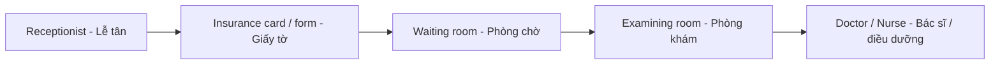

# Bài 08 – Phòng khám (Clinics)

## 1. Mục tiêu học tập

Nhận diện **24/24 từ vựng** ở hai bối cảnh *medical clinic* (phòng khám bệnh) và *dental clinic* (phòng nha); giải thích được vai trò của nhân viên, khu vực và thiết bị; luyện hội thoại đăng ký và khám bệnh.

## 2. Quan sát hình minh họa

Các nhãn số **1–15** liên quan đến **medical clinic** (y viện/phòng khám bệnh); các số **16–24** thuộc **dental clinic** (phòng nha).

## 3. Trọn bộ từ vựng: 1–24 (24/24)

### 3.1. Medical clinic – Y viện, phòng khám bệnh (1–15)

| Số | English | Tiếng Việt | Ghi chú |
|:---:|---|---|---|
| 1 | **waiting room** | phòng đợi / phòng chờ | Nơi bệnh nhân ngồi chờ. |
| 2 | **receptionist** | nhân viên tiếp đón / lễ tân | Người phụ trách quầy tiếp đón. |
| 3 | **patient** | bệnh nhân | Người đến khám hoặc điều trị. |
| 4 | **insurance card** | thẻ bảo hiểm | *insurance* = bảo hiểm. |
| 5 | **insurance form** | đơn / tờ khai bảo hiểm | Giấy tờ cần điền thông tin. |
| 6 | **doctor** | bác sĩ | Tên gọi chung cho bác sĩ. |
| 7 | **scale** | cân | Thiết bị đo cân nặng. |
| 8 | **stethoscope** | ống nghe | Thiết bị bác sĩ dùng khi thăm khám. |
| 9 | **examining room** | phòng khám bệnh | Cũng có thể gọi *examination room*. |
| 10 | **nurse** | y tá / điều dưỡng | Nhân viên chăm sóc người bệnh. |
| 11 | **eye chart** | bảng chữ kiểm tra thị lực | Bảng đọc chữ ở các kích thước khác nhau. |
| 12 | **blood pressure gauge** | dụng cụ / máy đo huyết áp | *blood pressure* = huyết áp. |
| 13 | **examination table** | bàn khám bệnh | Bàn/giường ngắn để thăm khám. |
| 14 | **syringe** | ống tiêm | *syringe* chỉ dụng cụ tiêm. |
| 15 | **thermometer** | nhiệt kế | Thiết bị đo nhiệt độ. |

### 3.2. Dental clinic – Phòng chữa răng (16–24)

| Số | English | Tiếng Việt | Ghi chú |
|:---:|---|---|---|
| 16 | **dental hygienist** | nhân viên vệ sinh răng miệng / nhân viên chùi răng | Làm công việc chăm sóc, vệ sinh răng theo phạm vi chuyên môn. |
| 17 | **tartar** | cao răng | Mảng bám đã cứng lại. |
| 18 | **dentist** | nha sĩ | Bác sĩ răng hàm mặt/nha khoa. |
| 19 | **dental assistant** | nhân viên trợ tá nha khoa | Hỗ trợ nha sĩ trong buổi khám. |
| 20 | **cavity** | lỗ sâu răng / răng bị sâu | *Fill a cavity* = trám lỗ sâu răng. |
| 21 | **drill** | khoan / dụng cụ khoan nha khoa | Vừa là danh từ vừa là động từ. |
| 22 | **filling** | miếng / chất trám răng | *Dental filling* = miếng trám răng. |
| 23 | **orthodontist** | bác sĩ chỉnh nha | Chuyên về điều chỉnh vị trí răng/hàm. |
| 24 | **braces** | niềng răng / mắc cài chỉnh nha | Danh từ thường ở dạng số nhiều. |

## 4. Hệ thống hóa theo chức năng

| Nhóm | Các từ nên học cùng nhau | Ý chính |
|---|---|---|
| **Tiếp đón** | receptionist, patient, insurance card, insurance form, waiting room | Đăng ký và chờ khám. |
| **Khám tổng quát** | doctor, nurse, examining room, scale, stethoscope, eye chart, blood pressure gauge, examination table, syringe, thermometer | Người và phương tiện phục vụ thăm khám. |
| **Khám nha khoa** | dental hygienist, dentist, dental assistant, orthodontist, tartar, cavity, drill, filling, braces | Người, vấn đề và dụng cụ điều trị răng. |

### 4.1. Các cặp thuật ngữ dễ nhầm

**Insurance card khác insurance form:** *Card* là thẻ; *form* là tờ khai/biểu mẫu cần điền.

**Dentist khác orthodontist:** *Dentist* là nha sĩ nói chung; *orthodontist* là bác sĩ chuyên chỉnh nha.

**Tartar khác cavity:** *Tartar* là cao răng; *cavity* là lỗ sâu răng. *Filling* là vật liệu/miếng trám để phục hồi phần răng bị sâu hoặc khuyết.

**Drill khác filling:** *Drill* là khoan hoặc dụng cụ khoan; *filling* là phần trám răng.

## 5. Sơ đồ giao tiếp khi đến phòng khám

Sơ đồ này mô tả **một tình huống hội thoại thường gặp** nhằm ghi nhớ từ vựng, không phải quy trình bắt buộc của mọi phòng khám.

## 6. Mẫu câu và hội thoại ứng dụng

| English | Tiếng Việt |
|---|---|
| **Please wait in the waiting room.** | Vui lòng đợi ở phòng chờ. |
| **Do you have your insurance card?** | Bạn có mang thẻ bảo hiểm không? |
| **Please fill out this insurance form.** | Vui lòng điền tờ khai bảo hiểm này. |
| **The nurse is in the examining room.** | Điều dưỡng đang ở phòng khám. |
| **The doctor is using a stethoscope.** | Bác sĩ đang dùng ống nghe. |
| **The nurse checked my blood pressure.** | Điều dưỡng đã đo huyết áp của tôi. |
| **The dentist found a cavity.** | Nha sĩ phát hiện một lỗ sâu răng. |
| **She has braces.** | Cô ấy đang niềng răng. |

**Hội thoại tại quầy tiếp đón**

**Receptionist:** Good morning. Are you here for an examination?  
**Patient:** Yes. Here is my insurance card.  
**Receptionist:** Thank you. Please fill out this insurance form.  
**Patient:** Where is the waiting room?  
**Receptionist:** It's on your left.

**Dịch:** — Chào buổi sáng. Bạn đến khám bệnh phải không? — Vâng. Đây là thẻ bảo hiểm của tôi. — Cảm ơn. Vui lòng điền tờ khai này. — Phòng chờ ở đâu? — Ở phía bên trái bạn.

**Hội thoại tại phòng nha**

**Patient:** I have a cavity.  
**Dentist:** We'll examine your tooth.  
**Patient:** Will I need a filling?  
**Dentist:** We'll discuss that after the examination.

**Dịch:** — Tôi có một lỗ sâu răng. — Chúng tôi sẽ khám răng của bạn. — Tôi có cần trám răng không? — Chúng ta sẽ trao đổi sau khi khám.

## 7. Bài tập thực hành

1. Nhìn tranh và gọi tên **15 mục** thuộc phòng khám bệnh, sau đó **9 mục** thuộc phòng nha.
2. Dịch sang tiếng Anh: “phòng chờ”, “tờ khai bảo hiểm”, “máy đo huyết áp”, “cao răng”, “mắc cài niềng răng”.
3. Đóng vai lễ tân và bệnh nhân, sử dụng ít nhất bốn từ: *receptionist, patient, insurance card, waiting room*.
4. Nói hai câu giải thích sự khác nhau giữa *dentist* và *orthodontist*.

## 8. Câu hỏi ôn tập trắc nghiệm

**Câu 1.** Người làm việc tại quầy tiếp đón là ai?  
A. Patient · B. Radiologist · C. Receptionist · D. Orthodontist  
**Đáp án: C.** *Receptionist* là nhân viên tiếp đón.

**Câu 2.** *Eye chart* dùng để làm gì?  
A. Kiểm tra thị lực · B. Đo cân nặng · C. Đo thân nhiệt · D. Đo huyết áp  
**Đáp án: A.** *Eye chart* là bảng kiểm tra mắt/thị lực.

**Câu 3.** Từ nào là “cao răng”?  
A. Braces · B. Tartar · C. Filling · D. Cavity  
**Đáp án: B.** *Tartar* nghĩa là cao răng; *cavity* là lỗ sâu răng.

**Câu 4.** Bác sĩ chuyên chỉnh nha là ai?  
A. Dentist · B. Dental assistant · C. Dental hygienist · D. Orthodontist  
**Đáp án: D.** *Orthodontist* là bác sĩ chỉnh nha.

**Câu 5.** Cần gọi “máy đo huyết áp”, chọn từ nào?  
A. Scale · B. Thermometer · C. Blood pressure gauge · D. Stethoscope  
**Đáp án: C.** *Blood pressure gauge* là dụng cụ đo huyết áp.

## 9. Tóm tắt và kiểm tra độ đầy đủ

Đã bao gồm **24/24 nhãn số 1–24** của trang 84: **15 mục medical clinic** và **9 mục dental clinic**. Không bỏ qua các từ nhỏ trong hình như *insurance form, eye chart, tartar, filling*.

**Điều hướng:** [← Bài 07](07_first-aid.md) · [Bài 09: Khám bệnh và khám răng →](09_medical-and-dental-exams.md) · [Mục lục](README.md)
