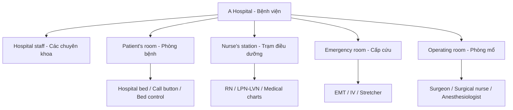

# Bài 10 – Bệnh viện (A Hospital)

## 1. Mục tiêu học tập

Nắm vững **35/35 từ/cụm từ đánh số** thuộc năm khu vực trong bệnh viện, ghi nhớ **4 từ vựng mở rộng**, phân biệt các chuyên khoa và vai trò nhân viên y tế, mô tả trang thiết bị của phòng bệnh, phòng cấp cứu và phòng mổ bằng tiếng Anh.

## 2. Quan sát hình minh họa

Bài này trải trên **hai trang sách 86 và 87** (PDF 96–97). Hãy phóng to hai nửa ảnh ghép để đối chiếu từng số **1–35**. Các nhóm được chia theo nhãn trong sách: *Hospital staff*, *Patient's room*, *Nurse's station*, *Emergency room* và *Operating room*.

## 3. Trọn bộ từ vựng đánh số: 1–35 (35/35)

### 3.1. Hospital staff – Nhân viên bệnh viện (1–8)

| Số | English | Tiếng Việt | Ghi chú |
|:---:|---|---|---|
| 1 | **obstetrician** | bác sĩ sản khoa | Chuyên về thai kỳ và sinh nở. |
| 2 | **internist** | bác sĩ nội tổng quát / nội khoa | *Internal medicine* = nội khoa. |
| 3 | **cardiologist** | bác sĩ chuyên khoa tim mạch | *Cardio-* liên quan đến tim. |
| 4 | **pediatrician** | bác sĩ nhi khoa | Khám, điều trị cho trẻ em. |
| 5 | **radiologist** | bác sĩ chuyên khoa chẩn đoán hình ảnh | Trong sách ghi “chuyên viên quang tuyến”. |
| 6 | **psychiatrist** | bác sĩ tâm thần | Là bác sĩ chuyên khoa tâm thần. |
| 7 | **ophthalmologist** | bác sĩ nhãn khoa | Chuyên khám và điều trị mắt. |
| 8 | **X-ray technician** | kỹ thuật viên X-quang / nhân viên chụp X-quang | Là nhân viên kỹ thuật, khác vai trò bác sĩ radiologist. |

### 3.2. Patient's room – Phòng bệnh nhân (9–17)

| Số | English | Tiếng Việt | Ghi chú |
|:---:|---|---|---|
| 9 | **bed table** | bàn bên giường bệnh / bàn đặt trên giường bệnh | Bàn dùng trong khu vực giường bệnh. |
| 10 | **call button** | nút bấm gọi / nút gọi nhân viên y tế | *Call* = gọi. |
| 11 | **hospital bed** | giường bệnh viện | Giường dành cho bệnh nhân. |
| 12 | **bed control** | bộ điều khiển giường | Điều chỉnh tư thế giường. |
| 13 | **bedpan** | bô / bô dẹt tại giường | Dụng cụ vệ sinh cho bệnh nhân khó di chuyển. |
| 14 | **medical waste disposal** | thùng / hệ thống thu gom rác thải y tế | *Disposal* = việc xử lý/thu gom loại bỏ. |
| 15 | **hospital gown** | áo bệnh nhân / áo choàng bệnh viện | Trang phục bệnh nhân mặc trong viện. |
| 16 | **lab technician** | kỹ thuật viên xét nghiệm | *Lab* viết tắt của *laboratory*. |
| 17 | **blood work / blood test** | xét nghiệm máu | Hai cách gọi được in cùng một mục trong sách. |

### 3.3. Nurse's station – Trạm y tá / quầy điều dưỡng (18–25)

| Số | English | Tiếng Việt | Ghi chú |
|:---:|---|---|---|
| 18 | **orderly** | nhân viên hộ lý / nhân viên hỗ trợ bệnh viện | Hỗ trợ vận chuyển và công việc chăm sóc theo phân công. |
| 19 | **volunteer** | tình nguyện viên | Nhân viên tình nguyện hỗ trợ bệnh viện. |
| 20 | **medical charts** | hồ sơ / biểu đồ bệnh án | Thông tin, bảng ghi về bệnh nhân. |
| 21 | **vital signs monitor** | máy theo dõi dấu hiệu sinh tồn | *Vital signs* = dấu hiệu sinh tồn. |
| 22 | **RN (registered nurse)** | điều dưỡng đã đăng ký/được cấp phép hành nghề | Giữ nguyên viết tắt **RN**. |
| 23 | **medication tray** | khay thuốc | *Medication* = thuốc dùng điều trị. |
| 24 | **LPN (licensed practical nurse) / LVN (licensed vocational nurse)** | điều dưỡng thực hành được cấp phép / điều dưỡng nghề được cấp phép | Hai tên gọi/viết tắt cùng mục theo hệ thống chức danh tại Mỹ. |
| 25 | **dietician** | chuyên viên dinh dưỡng / nhân viên tư vấn chế độ ăn | Sách dùng dạng viết **dietician**; còn gặp *dietitian*. |

### 3.4. Emergency room – Phòng cấp cứu (26–28)

| Số | English | Tiếng Việt | Ghi chú |
|:---:|---|---|---|
| 26 | **emergency medical technician (EMT)** | kỹ thuật viên / nhân viên cấp cứu y tế | *EMT* là viết tắt của cụm dài. |
| 27 | **IV (intravenous drip)** | truyền dịch tĩnh mạch / dây truyền tĩnh mạch | *Intravenous* = qua đường tĩnh mạch. |
| 28 | **stretcher / gurney** | băng ca / cáng bệnh nhân | Hai từ gần nghĩa trong ngữ cảnh chuyển bệnh nhân. |

### 3.5. Operating room – Phòng giải phẫu / phòng mổ (29–35)

| Số | English | Tiếng Việt | Ghi chú |
|:---:|---|---|---|
| 29 | **surgical nurse** | điều dưỡng phẫu thuật / y tá phòng mổ | *Surgical* = thuộc về phẫu thuật. |
| 30 | **surgeon** | bác sĩ phẫu thuật / bác sĩ giải phẫu | *Surgery* = phẫu thuật. |
| 31 | **surgical cap** | mũ đội phòng mổ | Trang phục phòng mổ. |
| 32 | **surgical gown** | áo choàng phẫu thuật | Áo chuyên dụng trong phẫu thuật. |
| 33 | **latex gloves** | găng tay latex / găng tay cao su | *Gloves* thường ở số nhiều. |
| 34 | **operating table** | bàn mổ / bàn giải phẫu | Nơi bệnh nhân được đặt khi phẫu thuật. |
| 35 | **anesthesiologist** | bác sĩ gây mê / chuyên viên gây mê | Bác sĩ chuyên khoa gây mê. |

### 3.6. More vocabulary – Từ bổ sung ở cuối trang 86 (4/4)

| Từ / cụm từ | Nghĩa và giải thích |
|---|---|
| **nurse practitioner** | điều dưỡng thực hành nâng cao được cấp phép khám và cung cấp một số dịch vụ y tế theo quy định (*a nurse licensed to give medical exams*). |
| **specialist** | bác sĩ chuyên khoa; bác sĩ chuyên điều trị các vấn đề y tế cụ thể (*a doctor who only treats specific medical problems*). |
| **gynecologist** | bác sĩ phụ khoa; chuyên khám và điều trị các vấn đề sức khỏe phụ nữ (*a specialist who examines and treats women*). |
| **nurse midwife** | điều dưỡng hộ sinh / nữ hộ sinh có trình độ điều dưỡng thực hành; chăm sóc thai phụ và đỡ đẻ (*a nurse practitioner who examines pregnant women and delivers babies*). |

## 4. Phân biệt vai trò và những thuật ngữ dễ nhầm

### 4.1. Nhân viên y tế theo chuyên môn

- **Obstetrician**: tập trung vào sản khoa; **gynecologist**: tập trung vào phụ khoa. Một bác sĩ có thể được đào tạo cả hai lĩnh vực (OB-GYN), nhưng hai từ vựng nhấn mạnh hai chuyên môn.
- **Internist**: bác sĩ nội khoa; **cardiologist**: bác sĩ chuyên về tim mạch; **pediatrician**: bác sĩ nhi khoa.
- **Radiologist**: bác sĩ chẩn đoán hình ảnh; **X-ray technician**: kỹ thuật viên vận hành thiết bị X-quang theo nhiệm vụ chuyên môn.
- **Psychiatrist**: bác sĩ tâm thần; **ophthalmologist**: bác sĩ nhãn khoa.
- **RN, LPN/LVN, nurse practitioner, nurse midwife**: các danh xưng điều dưỡng khác nhau theo đào tạo, chứng chỉ và phạm vi hành nghề; không đánh đồng hoặc dịch thành một chức danh duy nhất.

### 4.2. Vật dụng và quy trình

**Blood work / blood test** đều có thể chỉ xét nghiệm máu; trong khi **IV (intravenous drip)** chỉ đường truyền dịch tĩnh mạch. **Stretcher / gurney** chỉ cáng/băng ca dùng di chuyển bệnh nhân, khác với **hospital bed** là giường bệnh.

**Hospital gown** là áo của bệnh nhân; **surgical gown** là áo choàng của nhân viên khi thực hiện quy trình phẫu thuật. **Bed table** là bàn bên giường; **operating table** là bàn mổ.

## 5. Sơ đồ ghi nhớ theo khu vực bệnh viện

Sơ đồ dùng để **phân nhóm từ vựng**, không thể hiện tuyến điều trị bắt buộc hoặc cơ cấu nhân sự giống nhau ở mọi bệnh viện.

## 6. Mẫu câu tại bệnh viện

| English | Tiếng Việt |
|---|---|
| **Where is the nurse's station?** | Trạm y tá ở đâu? |
| **Please press the call button if you need help.** | Vui lòng bấm nút gọi nếu cần trợ giúp. |
| **The lab technician will take a blood sample.** | Kỹ thuật viên xét nghiệm sẽ lấy mẫu máu. |
| **The patient is wearing a hospital gown.** | Bệnh nhân đang mặc áo bệnh viện. |
| **They moved the patient on a stretcher.** | Họ di chuyển bệnh nhân trên băng ca. |
| **The surgeon is in the operating room.** | Bác sĩ phẫu thuật đang ở phòng mổ. |
| **The nurse is checking the vital signs monitor.** | Điều dưỡng đang kiểm tra máy theo dõi dấu hiệu sinh tồn. |
| **I'm looking for the cardiologist.** | Tôi đang tìm bác sĩ tim mạch. |

### Luyện nói: Practice asking for the hospital staff

Ba mẫu câu từ phần luyện tập của trang 87:

1. **Please get the nurse. I have a question for her.** — Hãy gọi giúp tôi điều dưỡng. Tôi có một câu hỏi dành cho cô ấy.
2. **Where's the anesthesiologist? I need to talk to her.** — Bác sĩ gây mê ở đâu? Tôi cần nói chuyện với cô ấy.
3. **I'm looking for the lab technician. Have you seen him?** — Tôi đang tìm kỹ thuật viên xét nghiệm. Bạn có thấy anh ấy không?

**Mẫu chung:** `I'm looking for + người cần tìm.` / `Where is + người hoặc phòng?` / `Have you seen + him/her?`

## 7. Câu hỏi luyện nói cuối trang 87

**Câu hỏi 1.** *Have you ever been to an emergency room? Who helped you?*  
(Bạn đã từng đến phòng cấp cứu chưa? Ai đã giúp bạn?)  
**Khung trả lời:** *Yes, I have. An emergency medical technician helped me.* — Có. Một nhân viên cấp cứu đã giúp tôi.

**Câu hỏi 2.** *Have you ever been in the hospital? How long did you stay?*  
(Bạn đã từng nằm viện chưa? Bạn ở đó bao lâu?)  
**Khung trả lời:** *No, I haven't.* hoặc *Yes, I stayed for two days.* — Chưa / Có, tôi ở hai ngày.

### Thực hành nhận diện

Nhìn hình và đọc thành tiếng tất cả các số theo năm nhóm: **1–8**, **9–17**, **18–25**, **26–28**, **29–35**. Sau đó che bảng nghĩa và giải thích bằng tiếng Việt các viết tắt **RN, LPN, LVN, EMT, IV**.

## 8. Câu hỏi ôn tập trắc nghiệm

**Câu 1.** Người khám và điều trị các vấn đề về tim mạch là ai?  
A. Cardiologist · B. Pediatrician · C. Ophthalmologist · D. Psychiatrist  
**Đáp án: A.** *Cardiologist* là bác sĩ tim mạch.

**Câu 2.** *Call button* trong phòng bệnh dùng để chỉ gì?  
A. Nút điều khiển giường · B. Nút gọi nhân viên hỗ trợ · C. Bàn ăn · D. Máy đo sinh hiệu  
**Đáp án: B.** *Call button* là nút bấm gọi.

**Câu 3.** Cặp nào cùng chỉ “băng ca/cáng bệnh nhân”?  
A. Bed control / bedpan · B. Medical charts / medication tray · C. Stretcher / gurney · D. IV / blood test  
**Đáp án: C.** *Stretcher* và *gurney* cùng xuất hiện tại mục 28.

**Câu 4.** *Anesthesiologist* là chức danh nào?  
A. Bác sĩ nhi khoa · B. Điều dưỡng phòng mổ · C. Kỹ thuật viên X-quang · D. Bác sĩ gây mê  
**Đáp án: D.** *Anesthesiologist* là bác sĩ chuyên về gây mê.

**Câu 5.** Thuật ngữ *nurse practitioner* có nghĩa gần nhất là gì?  
A. Điều dưỡng thực hành nâng cao · B. Hộ lý · C. Nhân viên ăn uống · D. Tình nguyện viên  
**Đáp án: A.** Đây là một chức danh điều dưỡng chuyên môn được cấp phép hành nghề theo quy định.

**Câu 6.** Từ nào thuộc mục *Nurse's station* của sách?  
A. Surgeon · B. Medication tray · C. Bedpan · D. X-ray technician  
**Đáp án: B.** *Medication tray* (số 23) nằm trong nhóm trạm y tá.

## 9. Tóm tắt và kiểm tra độ đầy đủ

Đã bao gồm **35/35 nhãn số 1–35**, **4/4 từ bổ sung trong More vocabulary**, **3 mẫu câu hỏi nhân viên bệnh viện** và **2 câu Share your answers**. Tất cả các cụm gạch chéo (*blood work / blood test*, *stretcher / gurney*, *LPN / LVN*) cùng các tên viết tắt đã được giữ đầy đủ.

**Điều hướng:** [← Bài 09](09_medical-and-dental-exams.md) · [Mục lục](README.md)
