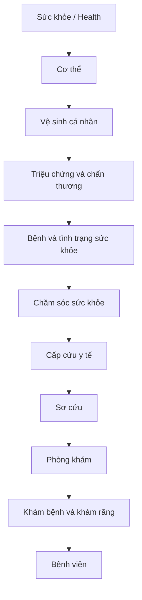

# Chủ đề 6: Sức khỏe (Health)

Bộ bài gồm **10 bài học** về cơ thể, vệ sinh cá nhân, triệu chứng, bệnh lý và chăm sóc y tế trong Oxford Picture Dictionary – Anh–Việt. Phạm vi trang sách **74–87**, tương ứng trang PDF **84–97**; mỗi bài có ảnh ghép và tài liệu Markdown đi kèm.

## Mục lục

| Bài | Chủ đề (VI / *EN*) | Trang sách | Từ vựng (số mục) | Tài liệu |
|:--:|---|:--:|---:|---|
| 01 | Cơ thể người / *The Body* | 74–75 | 64 + 5 | [Mở bài](01_the-body.md) |
| 02 | Vệ sinh cá nhân / *Personal Hygiene* | 76–77 | 40 + 16 + 2 More vocabulary | [Mở bài](02_personal-hygiene.md) |
| 03 | Triệu chứng và chấn thương / *Symptoms and Injuries* | 78 | 18 + 5 | [Mở bài](03_symptoms-and-injuries.md) |
| 04 | Bệnh và tình trạng sức khỏe / *Illnesses and Medical Conditions* | 79 | 16 + 4 More vocabulary | [Mở bài](04_illnesses-and-medical-conditions.md) |
| 05 | Chăm sóc sức khỏe / *Health Care* | 80–81 | 36 + 8 + 5 More vocabulary | [Mở bài](05_health-care.md) |
| 06 | Cấp cứu y tế / *Medical Emergencies* | 82 | 16 (A–P) | [Mở bài](06_medical-emergencies.md) |
| 07 | Sơ cứu / *First Aid* | 83 | 18 | [Mở bài](07_first-aid.md) |
| 08 | Phòng khám / *Clinics* | 84 | 24 | [Mở bài](08_clinics.md) |
| 09 | Khám bệnh và khám răng / *Medical and Dental Exams* | 85 | 13 (A–M) + 2 More vocabulary | [Mở bài](09_medical-and-dental-exams.md) |
| 10 | Bệnh viện / *A Hospital* | 86–87 | 35 + 4 More vocabulary | [Mở bài](10_a-hospital.md) |

**Tổng kiểm kê:** 208 + 106 = **314 nhãn theo tranh**; thêm 11 + 6 = **17 mục More vocabulary**, tổng cộng **331 mục**.

## Bản đồ chủ đề

## Cách học

1. Quan sát ảnh ghép và thử gọi tên các mục theo số hoặc chữ cái.
2. Đọc bảng từ vựng, che nghĩa tiếng Việt để tự kiểm tra.
3. Luyện nói bằng câu mẫu và hội thoại trong bài.
4. Hoàn thành bài tập, rồi đối chiếu đáp án và giải thích.
5. Ôn lại sau 1 ngày, 3 ngày và 7 ngày.

## Tệp và lưu ý

Giữ ảnh `.jpg` cùng thư mục với các file `.md` để ảnh hiển thị qua liên kết tương đối.

> Đây là tài liệu học tiếng Anh về y tế, không thay thế tư vấn chuyên môn.

[← Về trang chủ](../../README.md)