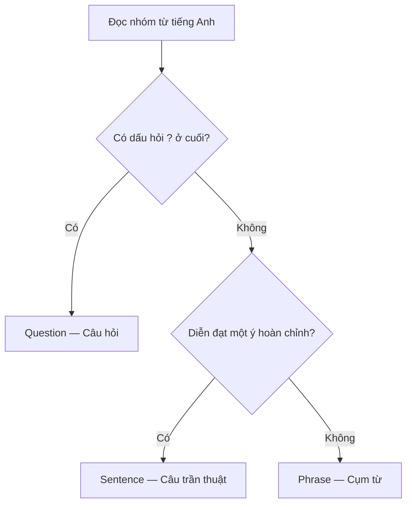

# Unit 01 — Talking about language: Nói về ngôn ngữ

> **Module 01:** Học cách học từ vựng  
> **Giáo trình:** *English Vocabulary in Use — Elementary*, Unit 1, trang in 6–7  
> **Trình độ:** A1–A2  
> **Trọng tâm:** Thuật ngữ ngữ pháp cơ bản, cách phân biệt cụm từ và câu, cách đọc yêu cầu bài tập.

*Trang trái: Language words và The language of the exercises in this book. Trang phải: Exercises 1.1–1.7. Phóng to ảnh khi cần đối chiếu cách trình bày trong sách.*

## 1. Tổng quan và mục tiêu học tập

Khi học tiếng Anh, bạn thường gặp các chỉ dẫn như **Write the plural**, **Correct the mistakes** hoặc **Match the words**. Muốn tự học hiệu quả, trước hết bạn phải hiểu những thuật ngữ và câu chỉ dẫn đó.

Sau khi hoàn thành bài này, bạn có thể:

- **Nhận diện và giải thích** năm loại từ cơ bản: *noun, verb, adjective, adverb* và *preposition*.
- **Phân biệt** *singular* với *plural*; *phrase*, *sentence*, *paragraph* và *dialogue*.
- **Nhận biết** câu hỏi (*question*) và câu trả lời (*answer*) qua ví dụ đơn giản.
- **Thực hiện đúng** năm dạng hướng dẫn thường gặp trong bài tập tiếng Anh.
- **Áp dụng** kiến thức để hoàn thành Exercises 1.1–1.7 và tự tạo ví dụ.

## 2. Language words — Các thuật ngữ về ngôn ngữ

### 2.1. Năm loại từ cơ bản

Mỗi từ có một vai trò trong câu. Hãy học **tên loại từ**, **chức năng** và **ví dụ** cùng lúc; không chỉ học bản dịch.

| Thuật ngữ | Nghĩa tiếng Việt | Chức năng trong bài | Ví dụ |
| --- | --- | --- | --- |
| **noun** | Danh từ | Gọi tên người hoặc vật | *book* (sách), *girl* (cô gái), *pen* (bút) |
| **verb** | Động từ | Diễn tả việc làm, hành động | *do* (làm), *read* (đọc), *write* (viết) |
| **adjective** | Tính từ | Miêu tả người hoặc vật | *good* (tốt), *bad* (xấu/tệ), *happy* (vui), *long* (dài) |
| **adverb** | Trạng từ | Bổ nghĩa cho động từ | *slowly* (một cách chậm rãi), *badly* (một cách tệ) |
| **preposition** | Giới từ | Từ ngắn thường đứng trước danh từ hoặc đại từ để tạo quan hệ với phần khác | *in* (trong), *on* (trên), *by* (bằng/bởi), *at* (ở/tại) |

**Cách nhận diện trong ngữ cảnh:**

- *She reads a book.* — Cô ấy đọc một cuốn sách. Ở đây, **reads** là *verb*; **book** là *noun*.
- *It is a good book.* — Đó là một cuốn sách hay. **good** là *adjective* vì miêu tả **book**.
- *She reads slowly.* — Cô ấy đọc chậm rãi. **slowly** là *adverb* vì miêu tả cách đọc.
- *The book is on the table.* — Cuốn sách ở trên bàn. **on** là *preposition*.

> **Dễ nhầm:** *good* là tính từ; *slowly* là trạng từ. Đừng cho rằng từ nào miêu tả cũng là *adjective*: cần xem nó miêu tả **danh từ** hay **động từ**.

### 2.2. Singular và plural — Số ít và số nhiều

| Thuật ngữ | Nghĩa | Ví dụ |
| --- | --- | --- |
| **singular** | Số ít: một người hoặc một vật | *book*, *house* |
| **plural** | Số nhiều: hơn một người hoặc một vật | *books*, *houses* |

Với những danh từ thông thường như *book* và *house*, có thể thêm **-s** để tạo số nhiều. Tuy nhiên, không phải danh từ nào cũng tuân theo cách này: **man → men** là một ví dụ số nhiều bất quy tắc xuất hiện trong bài tập.

- *one book* → *two books* (một cuốn sách → hai cuốn sách)
- *one house* → *three houses* (một ngôi nhà → ba ngôi nhà)
- *one man* → *two men* (một người đàn ông → hai người đàn ông)

### 2.3. Phrase, sentence và paragraph — Cụm từ, câu và đoạn văn

| Thuật ngữ | Nghĩa và dấu hiệu | Ví dụ |
| --- | --- | --- |
| **phrase** | Cụm từ: nhóm từ chưa diễn đạt thành một câu hoàn chỉnh | *in a house*, *at home*, *an old man* |
| **sentence** | Câu: diễn đạt một ý hoàn chỉnh; thông thường bắt đầu bằng chữ hoa và kết thúc bằng dấu câu | *The man went into the room and closed the door.* |
| **paragraph** | Đoạn văn: một hoặc nhiều câu trình bày thành một phần riêng, thường bắt đầu ở dòng mới | *This book has 60 units. Each unit has 2 pages.* |

Xét ba ví dụ:

1. **in the park** — *ở trong công viên*: là **phrase**, vì chưa nói rõ ai làm gì.
2. **I like English.** — *Tôi thích tiếng Anh.*: là **sentence**, vì có chủ thể và diễn đạt một ý hoàn chỉnh.
3. **This book has 60 units. Each unit has 2 pages.** — Hai câu đứng cùng nhau có thể tạo thành **paragraph** khi được trình bày thành một đoạn.

Một câu đơn giản thường có dạng:

**Subject (chủ ngữ) + Verb (động từ) + thông tin bổ sung**

Ví dụ: **She** *(subject)* **reads** *(verb)* **a book** *(thông tin bổ sung)*.

### 2.4. Dialogue, question và answer — Hội thoại, câu hỏi và câu trả lời

| Thuật ngữ | Nghĩa | Dấu hiệu hoặc ví dụ |
| --- | --- | --- |
| **dialogue** | Hội thoại giữa hai người | *Ann: How's Jo? — Bill: OK, thanks.* |
| **question** | Câu hỏi | *Are you English?* / *Do you like school?* |
| **answer** | Câu trả lời | *Yes, I am.* / *No, I don't.* |

**Ví dụ hội thoại:**

> **A:** Do you speak English? — Bạn có nói tiếng Anh không?  
> **B:** Yes, I do. — Có.

Trong bài này, hãy chú ý hai dấu hiệu: **question** thường kết thúc bằng dấu hỏi `?`, còn câu trần thuật trong các ví dụ kết thúc bằng dấu chấm `.`. Câu hỏi cũng là một dạng câu trong ngữ pháp nói chung, nhưng **Exercises 1.5** tách *question* và *sentence* thành hai nhóm để luyện nhận diện.

## 3. Phân biệt phrase, sentence và question

Đây là **mẹo xử lý các ví dụ trong Unit 01**, không phải quy tắc bao quát mọi kiểu câu tiếng Anh.

| Ví dụ | Phân loại | Giải thích |
| --- | --- | --- |
| *a black cat* | **Phrase** | Chỉ một con mèo đen; chưa tạo ý hoàn chỉnh. |
| *She's writing a book.* | **Sentence** | Nêu trọn vẹn việc cô ấy đang làm. |
| *What's your name?* | **Question** | Hỏi tên người nghe và kết thúc bằng `?`. |

## 4. The language of the exercises — Ngôn ngữ chỉ dẫn bài tập

Bạn sẽ thường gặp những câu lệnh sau. Điều quan trọng là hiểu **mình phải làm gì**, không chỉ dịch nghĩa từng từ.

| Câu chỉ dẫn tiếng Anh | Cách hiểu bằng tiếng Việt | Thao tác cần thực hiện |
| --- | --- | --- |
| **Match the words on the left with the words on the right. Draw lines.** | Nối các từ bên trái với các từ bên phải. Kẻ đường nối. | Tìm cặp từ phù hợp. |
| **Fill the gaps in the sentence.** | Điền vào chỗ trống trong câu. | Viết từ còn thiếu. |
| **Correct the mistakes in the sentences.** | Sửa các lỗi sai trong câu. | Tìm lỗi, sau đó viết cách đúng. |
| **Complete the sentence for yourself.** | Hoàn thành câu theo thông tin của bản thân. | Tự chọn câu trả lời đúng với mình. |
| **Add another example.** | Thêm một ví dụ khác. | Viết thêm một từ hoặc trường hợp cùng nhóm. |

**Ví dụ minh họa từng thao tác:**

1. **Match:** *orange* ↔ *juice*; *chocolate* ↔ *ice cream*. Bạn nối các từ tạo thành tổ hợp phù hợp.
2. **Fill:** *Jack is ___ home today.* → Điền **at**.
3. **Correct:** *Jack is in home today.* → **Jack is at home today.**
4. **Complete:** *I go to work by ___.* → Có thể viết **bus**, nếu đó là cách bạn đi làm.
5. **Add:** *cat, dog, horse, ...* → Có thể thêm **cow**.

Hai chỉ dẫn bổ sung cũng xuất hiện trong Exercises 1.7:

- **Answer this question.** — Trả lời câu hỏi này.
- **Write these words in the correct column.** — Viết các từ vào đúng cột.

> **Ghi nhớ:** *fill* = điền, *match* = nối/ghép, *correct* = sửa, *complete* = hoàn thành, *add* = thêm, *answer* = trả lời.

## 5. Luyện tập theo Exercises 1.1–1.7

Hãy tự làm trước khi xem lại bảng kiến thức phía trên. Các phần dưới đây giữ nguyên phạm vi kỹ năng của bài tập; những câu hỏi về địa phương hoặc bản thân có thể có nhiều đáp án đúng.

### 5.1. Exercise 1.1 — Dịch thuật ngữ ngữ pháp

**Yêu cầu:** Viết nghĩa tiếng Việt tương ứng cho 13 thuật ngữ.

| Thuật ngữ | Nghĩa tiếng Việt (tự điền) | Thuật ngữ | Nghĩa tiếng Việt (tự điền) |
| --- | --- | --- | --- |
| noun | … | verb | … |
| adjective | … | adverb | … |
| preposition | … | singular | … |
| plural | … | phrase | … |
| sentence | … | paragraph | … |
| dialogue | … | question | … |
| answer | … | | |

**Tự kiểm tra:** Bạn có thể nêu một ví dụ tiếng Anh cho từng loại từ trong năm loại đầu tiên không?

### 5.2. Exercise 1.2 — Hiểu chỉ dẫn bài tập

**Yêu cầu:** Diễn đạt năm chỉ dẫn ở mục 4 bằng tiếng Việt của riêng bạn. Với mỗi chỉ dẫn, viết thêm một câu ngắn mô tả hành động cần làm.

*Ví dụ về cách trả lời:* **Fill the gaps** → Điền từ phù hợp vào ô trống.

### 5.3. Exercise 1.3 — Phân loại noun, verb và adjective

**Yêu cầu:** Xếp 12 từ sau vào đúng cột.

**book · speak · good · word · house · have · write · new · man · right · blue · say**

| Noun — Danh từ | Verb — Động từ | Adjective — Tính từ |
| --- | --- | --- |
| book (mẫu) | … | … |
| … | … | … |
| … | … | … |
| … | … | … |

**Mẹo:** Hãy hỏi: Từ này dùng để **gọi tên**, **diễn tả việc làm** hay **miêu tả**? Trong bài tập này, mỗi từ được xếp theo vai trò phù hợp nhất với yêu cầu.

### 5.4. Exercise 1.4 — Tìm bốn giới từ

**Yêu cầu:** Viết **bốn ví dụ** về *prepositions*.

**Trả lời:** 1. ________ · 2. ________ · 3. ________ · 4. ________

Gợi ý: nhớ lại các cụm *at home*, *in a house* và *on the table*.

### 5.5. Exercise 1.5 — Phrase, sentence hay question?

**Yêu cầu:** Phân loại từng dòng là **phrase**, **sentence** hoặc **question**.

| STT | Tiếng Anh | Loại (tự điền) |
| --- | --- | --- |
| 1 | *in the park* | … |
| 2 | *Do you speak English?* | … |
| 3 | *a black cat* | … |
| 4 | *She's writing a book.* | … |
| 5 | *What's your name?* | … |
| 6 | *I like English.* | … |

**Tự kiểm tra:** Với mỗi *phrase*, thử thêm chủ ngữ và động từ để biến nó thành một câu hoàn chỉnh.

### 5.6. Exercise 1.6 — Trả lời câu hỏi về ngữ pháp

**Yêu cầu:** Viết câu trả lời ngắn bằng tiếng Anh.

1. What is the plural of **book**? → ____________________
2. What is the singular of **men**? → ____________________
3. Is **from** a verb? → ____________________
4. Is **cat** an adjective? → ____________________
5. Is **Jane loves Hari.** a phrase? → ____________________
6. Is **bad** an adverb? → ____________________

**Mẹo:** Với câu hỏi **Is ...?**, bạn có thể trả lời *Yes, it is.* hoặc *No, it isn't.*, rồi giải thích ngắn loại từ đúng.

### 5.7. Exercise 1.7 — Làm theo chỉ dẫn

**Yêu cầu:** Đọc kỹ từ chỉ hành động (*fill, add, correct, answer, match*) rồi thực hiện từng nhiệm vụ.

1. **Fill the gap:** *What ______ your name?*
2. **Add another example of a colour:** *black, green, blue, ______*
3. **Correct these words:** *speek, inglish* → ____________________
4. **Answer this question:** *Is there a river in your town?* → ____________________
5. **Match the verbs with the nouns:** Nối ba động từ **make / do / have** với ba cụm danh từ **homework / a shower / a mistake**.

**Lưu ý:** Câu 4 phụ thuộc vào nơi bạn sống. Bạn có thể viết câu trả lời ngắn, chẳng hạn *Yes, there is.* hoặc *No, there isn't.*, nếu đúng với thực tế.

## 6. Vận dụng: Tự tạo ví dụ

**Bài A — Nhận diện từ loại.** Đọc câu *The happy girl writes slowly.* và xác định:

- Từ nào là **noun**?
- Từ nào là **verb**?
- Từ nào là **adjective**?
- Từ nào là **adverb**?

**Bài B — Biến đổi câu.** Hãy viết ba dòng theo thứ tự:

1. Một **phrase** chỉ địa điểm, ví dụ *at school*.
2. Một **sentence** sử dụng cụm từ đó, ví dụ *I study at school.*
3. Một **question** liên quan, ví dụ *Do you study at school?*

**Bài C — Giải thích lại.** Dùng tiếng Việt của bạn để giải thích sự khác biệt giữa **noun** và **adjective**, rồi đưa ra mỗi loại hai ví dụ tiếng Anh.

## 7. Câu hỏi ôn tập trắc nghiệm

*Chọn một đáp án đúng nhất cho mỗi câu. Mỗi đáp án có phần giải thích để bạn tự kiểm tra.*

### Câu 1

Trong câu *She reads a book.*, từ nào là **verb**?

A. **reads**  
B. **book**  
C. **She**  
D. **a**

**Đáp án: A.** **reads** diễn tả hành động đọc nên là động từ; **book** là danh từ.

### Câu 2

Trong câu *He walks slowly.*, **slowly** thuộc loại từ nào?

A. Noun  
B. Adverb  
C. Preposition  
D. Adjective

**Đáp án: B.** **slowly** cho biết hành động đi bộ diễn ra như thế nào; nó bổ nghĩa cho động từ **walks**.

### Câu 3

Từ nào là **plural** của *house*?

A. house  
B. housing  
C. houses  
D. housed

**Đáp án: C.** Với danh từ *house*, thêm **-s** tạo số nhiều **houses**.

### Câu 4

*an old man* thuộc nhóm nào trong cách phân loại của Unit 01?

A. Paragraph  
B. Question  
C. Dialogue  
D. Phrase

**Đáp án: D.** Cụm này gọi tên một người nhưng chưa diễn đạt một ý thành câu hoàn chỉnh.

### Câu 5

Chỉ dẫn **Correct the mistakes in the sentences** yêu cầu điều gì?

A. Tìm và sửa lỗi sai trong câu.  
B. Nối các cặp từ.  
C. Điền một ví dụ về màu sắc.  
D. Viết một đoạn hội thoại.

**Đáp án: A.** **correct** có nghĩa là sửa; **mistakes** là lỗi sai.

### Câu 6

Trong các lựa chọn sau, đâu là **question**?

A. *a black cat*  
B. *at home*  
C. *Do you like school?*  
D. *She likes English.*

**Đáp án: C.** Đây là câu hỏi Yes/No, có cấu trúc hỏi và dấu hỏi cuối câu.

## 8. Tổng kết và tự đánh giá

Bạn đã học hai nhóm kiến thức quan trọng: **thuật ngữ mô tả ngôn ngữ** và **những chỉ dẫn cần hiểu để tự làm bài tập**. Điểm cốt lõi là biết phân biệt chức năng của một từ, xác định một nhóm từ đã diễn đạt ý hoàn chỉnh hay chưa, và đọc đúng yêu cầu trước khi trả lời.

| Nhóm kiến thức | Từ khóa cần nhớ |
| --- | --- |
| Từ loại | noun · verb · adjective · adverb · preposition |
| Số lượng | singular · plural |
| Đơn vị ngôn ngữ | phrase · sentence · paragraph |
| Giao tiếp | dialogue · question · answer |
| Chỉ dẫn | match · fill · correct · complete · add |

**Checklist hoàn thành**

- [ ] Tôi giải thích được 13 thuật ngữ trong bảng từ vựng.
- [ ] Tôi phân loại được danh từ, động từ và tính từ trong Exercise 1.3.
- [ ] Tôi phân biệt được *phrase / sentence / question* trong Exercise 1.5.
- [ ] Tôi hoàn thành đủ Exercises 1.1–1.7.
- [ ] Tôi trả lời được sáu câu trắc nghiệm và giải thích được vì sao chọn đáp án.
- [ ] Tôi tự viết được ít nhất một cụm từ, một câu và một câu hỏi tiếng Anh.

---

[↑ Trở về mục lục khóa học](../../MUC_LUC.md)
