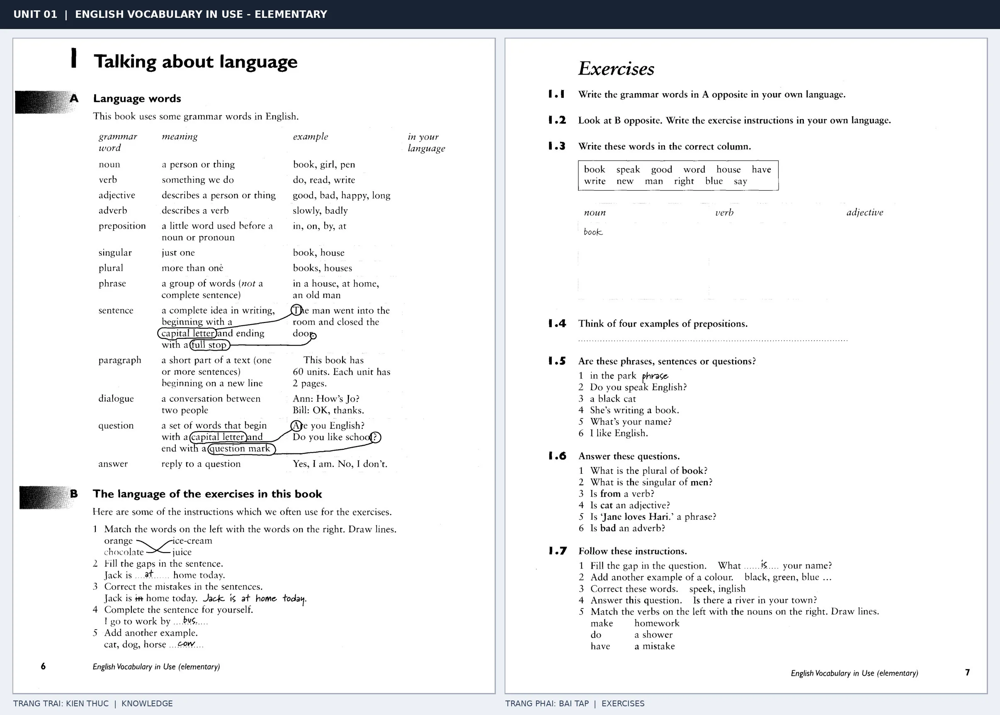

# Unit 01 — Talking about language: Nói về ngôn ngữ

*Trang trái cung cấp kiến thức và ví dụ; trang phải là phần Exercises của Unit tương ứng. Có thể phóng to ảnh để làm bài tập gốc.*

> **Module 01:** Học cách học từ vựng  
> **Phạm vi:** English Vocabulary in Use — Elementary, Unit 1; trang in 6–7 (PDF trang 9–10).  
> **Hình thức:** Tự học từ vựng A1–A2 · Giảng giải tiếng Việt · Luyện câu và bài tập.

## 1. Tóm tắt và mục tiêu

Nhận diện vai trò từ loại trước khi học từ mới: noun gọi tên sự vật, verb chỉ hành động, adjective miêu tả, còn adverb bổ nghĩa cho hành động. Phân biệt phrase chưa nhất thiết diễn đạt ý trọn vẹn và sentence thể hiện một ý hoàn chỉnh.

Sau bài này, bạn có thể:

- Giải thích nghĩa và cách sử dụng những từ, cụm từ cốt lõi của chủ đề **nói về ngôn ngữ**.
- Chọn đúng cách diễn đạt trong câu tiếng Anh đơn giản thay vì dịch máy móc từng từ.
- Tự đặt ít nhất ba câu thực tế và hoàn thành phần Exercises ở trang sách bên phải.

## 2. Kiến thức và từ vựng cốt lõi

Đọc kỹ từng mục. Với từ nhiều nghĩa, nghĩa ghi trong bảng được giới hạn ở cách dùng cần cho bài học này.

| Từ/cụm từ tiếng Anh | Nghĩa tiếng Việt |
| --- | --- |
| **noun** | danh từ |
| **verb** | động từ |
| **adjective** | tính từ |
| **adverb** | trạng từ |
| **preposition** | giới từ |
| **singular** | số ít |
| **plural** | số nhiều |
| **phrase** | cụm từ |
| **sentence** | câu |
| **paragraph** | đoạn văn |
| **dialogue** | hội thoại |
| **question** | câu hỏi |
| **answer** | câu trả lời |

### 2.1. Ghi nhớ theo nhóm và ngữ cảnh

**Nhóm từ thứ nhất:** noun (danh từ), verb (động từ), adjective (tính từ).

**Nhóm từ thứ hai:** singular (số ít), plural (số nhiều), phrase (cụm từ).

Hãy ghép từ với tình huống sử dụng thực tế. Khi gặp cụm từ có nhiều thành phần, ưu tiên ghi cả cụm kèm một câu ví dụ trong sổ từ vựng.

### 2.2. Mẫu câu song ngữ

**Ví dụ 1.** A noun can name a person or a thing.

→ Danh từ có thể gọi tên người hoặc vật.

**Ví dụ 2.** A sentence begins with a capital letter.

→ Một câu bắt đầu bằng chữ cái viết hoa.

Đọc từng câu thành tiếng, che phần dịch tiếng Việt và thử nói lại ý bằng lời của mình. Sau đó thay một chi tiết trong câu để tạo ví dụ mới.

## 3. Luyện tập ứng dụng

**Bài A — Nhớ từ trong ngữ cảnh.** Không nhìn bảng, hãy viết tiếng Anh tương ứng với các ý sau:

1. Danh từ: __________
2. Trạng từ: __________
3. Cụm từ: __________

**Bài B — Dịch và biến đổi câu.** Dịch hai câu dưới đây sang tiếng Anh trước khi nhìn mẫu câu ở trên:

1. Danh từ có thể gọi tên người hoặc vật.
2. Một câu bắt đầu bằng chữ cái viết hoa.

**Bài C — Viết cho bản thân.** Viết ba câu mới về cuộc sống của bạn, mỗi câu sử dụng một từ/cụm từ khác nhau trong bảng. Đọc lại để kiểm tra giới từ, cách chia động từ và trật tự từ.

**Bài D — Thực hành theo sách.** Quan sát phần **Exercises (trang phải)** trong ảnh ghép: giải bài tập trên giấy hoặc một file riêng, sau đó so sánh với các ví dụ ở trang trái. Những bài yêu cầu thông tin cá nhân không nhất thiết có một đáp án cố định.

## 4. Câu hỏi ôn tập trắc nghiệm

*Mỗi câu có một đáp án phù hợp nhất. Hãy tự trả lời trước khi đọc phần giải thích.*

### Câu 1

Bạn muốn diễn đạt **“động từ”** bằng tiếng Anh. Chọn cách nói phù hợp nhất.

A. verb

B. dialogue

C. plural

D. adjective

**Đáp án:** A. **Giải thích:** “verb” diễn đạt “động từ” trong chủ đề này.

### Câu 2

Cụm từ **“singular”** có nghĩa nào trong bài học?

A. số nhiều

B. câu hỏi

C. số ít

D. danh từ

**Đáp án:** C. **Giải thích:** “singular” được dùng với nghĩa “số ít”.

### Câu 3

Khi cần nói **“câu”**, chọn từ/cụm từ nào?

A. answer

B. question

C. sentence

D. noun

**Đáp án:** C. **Giải thích:** Cách dùng đúng trong bài là “sentence”.

### Câu 4

Chọn câu tiếng Anh diễn đạt đúng nhất: **“Danh từ có thể gọi tên người hoặc vật.”**

A. A noun can name a person or a thing.

B. It's sunny today.

C. We need a knife and a fork.

D. I keep new collocations in my notebook.

**Đáp án:** A. **Giải thích:** “A noun can name a person or a thing.” là câu tương ứng với tình huống đã nêu.

### Câu 5

Ý nghĩa phù hợp nhất của câu **“A sentence begins with a capital letter.”** là gì?

A. Bạn làm nghề gì? Tôi là kỹ sư.

B. Cô ấy nói tiếng Anh rất tốt.

C. Một câu bắt đầu bằng chữ cái viết hoa.

D. Ngân hàng gần bưu điện.

**Đáp án:** C. **Giải thích:** “A sentence begins with a capital letter.” có nghĩa là “Một câu bắt đầu bằng chữ cái viết hoa.”.

## 5. Tổng kết và kiểm tra hoàn thành

Bài **A sentence begins with a capital letter.** giúp bạn sử dụng vốn từ về **một câu bắt đầu bằng chữ cái viết hoa.** trong câu tiếng Anh thực tế. Giá trị quan trọng nhất không chỉ là biết nghĩa, mà là nhớ **cách kết hợp từ và ngữ cảnh sử dụng**.

- [ ] Tôi đã học bảng từ/cụm từ và đọc thành tiếng các ví dụ.
- [ ] Tôi đã hoàn thành ba phần luyện tập A, B, C.
- [ ] Tôi đã làm trang Exercises trong ảnh ghép và 5 câu trắc nghiệm.
- [ ] Tôi đã ghi các từ dễ nhầm vào sổ để ôn lại sau 1–3 ngày.

---

[Unit 02: Phương pháp học từ vựng →](02-learning-vocabulary.md)

[↑ Trở về mục lục khóa học](../../MUC_LUC.md)
