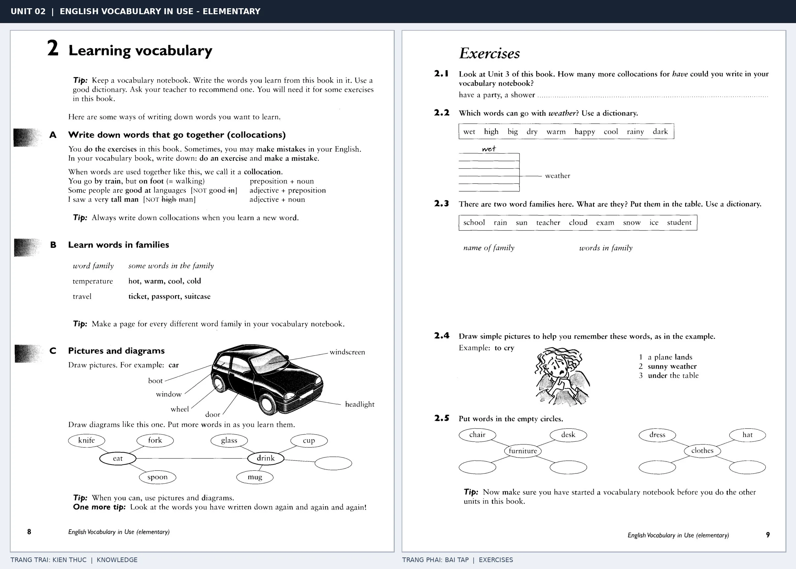
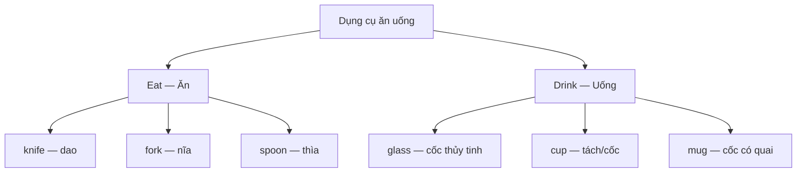

# Unit 02 — Learning vocabulary: Phương pháp học từ vựng

*Trang trái trình bày ba phương pháp ghi nhớ từ vựng; trang phải gồm Exercises 2.1–2.5. Hãy quan sát ảnh để tham khảo hình minh họa và sơ đồ trong sách.*

> **Module 01:** Học cách học từ vựng  
> **Giáo trình:** *English Vocabulary in Use — Elementary*, Unit 2; trang in 8–9 (PDF trang 11–12).  
> **Trình độ:** A1–A2  
> **Trọng tâm:** Collocations, nhóm từ theo chủ đề, tranh minh họa, sơ đồ và sổ từ vựng.

## 1. Tóm tắt và mục tiêu học tập

Biết nghĩa của một từ chưa đủ để sử dụng từ đó thành thạo. Người học còn cần biết **những từ nào thường đi cùng nhau**, **các từ có liên quan như thế nào**, và **nên ghi chép ra sao để dễ nhớ**. Thay vì học từng từ rời rạc, hãy học theo cụm, theo nhóm và kết hợp hình ảnh.

Sau bài học này, bạn có thể:

- **Nhận diện và giải thích** *collocation* (cụm từ thường đi cùng nhau), đồng thời sử dụng đúng các cụm từ thông dụng.
- **Phân loại** từ vựng vào các nhóm liên quan như *temperature*, *travel*, *school* và *weather*.
- **Vẽ và chú thích** tranh hoặc sơ đồ đơn giản để ghi nhớ từ mới.
- **Tạo một mục ghi chép** trong *vocabulary notebook* với cụm từ, nghĩa và câu ví dụ.
- **Hoàn thành** Exercises 2.1–2.5 và tự viết ít nhất ba câu tiếng Anh.

## 2. Từ vựng cốt lõi

| Từ hoặc cụm từ | Nghĩa tiếng Việt | Ví dụ tiếng Anh |
| --- | --- | --- |
| **vocabulary** | vốn từ vựng | I learn new vocabulary every day. |
| **vocabulary notebook** | sổ ghi từ vựng | I write new words in my vocabulary notebook. |
| **dictionary** | từ điển | I use a dictionary to check new words. |
| **collocation** | cách kết hợp những từ thường đi cùng nhau | *Make a mistake* is a collocation. |
| **word family** | nhóm từ có liên quan; trong bài này chủ yếu là theo chủ đề | *Hot, warm, cool, cold* form a group. |
| **do an exercise** | làm một bài tập | We do an exercise in class. |
| **make a mistake** | mắc lỗi | I sometimes make mistakes. |
| **have a shower** | tắm vòi sen | I have a shower in the morning. |
| **temperature** | nhiệt độ | The temperature is low today. |
| **ticket** | vé | I bought a train ticket. |
| **passport** | hộ chiếu | Don't forget your passport. |
| **suitcase** | va li | My suitcase is under the bed. |
| **picture** | bức tranh; hình ảnh | Draw a picture of a car. |
| **diagram** | sơ đồ | Draw a diagram to group the words. |
| **review** | ôn lại; xem lại | Review your new words regularly. |

Đừng chỉ ghi từ và nghĩa. Với mỗi từ, hãy thử tự trả lời: **Từ này thường xuất hiện cùng từ nào? Nó thuộc nhóm chủ đề nào? Mình có thể đặt câu gì với nó?**

## 3. Ba phương pháp học từ vựng

### 3.1. Học các từ thường đi cùng nhau — Collocations

**Collocation** là cách kết hợp từ được người bản ngữ sử dụng thường xuyên và tự nhiên. Nắm được cả cụm sẽ giúp bạn tránh dịch từng từ từ tiếng Việt sang tiếng Anh.

Ví dụ, khi nói **“mắc lỗi”**, tiếng Anh dùng *make a mistake*, không dùng *do a mistake*. Ngược lại, khi nói **“làm bài tập”**, ta thường dùng *do an exercise*.

| Kiểu kết hợp | Collocation đúng | Nghĩa tiếng Việt |
| --- | --- | --- |
| Động từ + danh từ | **do an exercise** | làm bài tập |
| Động từ + danh từ | **make a mistake** | mắc lỗi |
| Động từ + danh từ | **have a shower** | tắm vòi sen |
| Giới từ + danh từ | **by train** | bằng tàu hỏa |
| Giới từ + danh từ | **on foot** | đi bộ |
| Tính từ + giới từ | **good at languages** | giỏi ngôn ngữ |
| Tính từ + danh từ | **a very tall man** | một người đàn ông rất cao |

**Các lỗi cần tránh:**

| Dùng chưa đúng | Cách dùng tự nhiên | Giải thích |
| --- | --- | --- |
| ~~do a mistake~~ | **make a mistake** | *Make* thường đi với *mistake*. |
| ~~make an exercise~~ | **do an exercise** | *Do* thường đi với *exercise*. |
| ~~by foot~~ | **on foot** | Diễn đạt “đi bộ” bằng *on foot*. |
| ~~good in languages~~ | **good at languages** | Dùng *good at* để diễn tả giỏi một kỹ năng. |
| ~~a very high man~~ | **a very tall man** | Dùng *tall* để nói chiều cao của người. |

**Mẫu câu thực tế:**

1. *I do English exercises every evening.* → Tôi làm bài tập tiếng Anh mỗi tối.
2. *She is good at languages.* → Cô ấy giỏi ngôn ngữ.
3. *I go to school on foot.* → Tôi đi bộ đến trường.
4. *Everybody makes mistakes when learning.* → Ai cũng mắc lỗi khi học.

**Cách ghi nhớ:** Thay vì ghi riêng từ *mistake*, hãy ghi trọn cụm **make a mistake** kèm một câu của chính bạn. Khi đọc, viết và nói, hãy luyện cả cụm như một đơn vị ý nghĩa.

### 3.2. Nhóm các từ có liên quan — Word families

Khi các từ có chung một chủ đề, học chúng cùng nhau sẽ giúp trí nhớ tạo ra những mối liên hệ. Chẳng hạn, khi nghĩ đến *travel* (du lịch), bạn có thể liên tưởng ngay đến *ticket*, *passport* và *suitcase*.

| Nhóm chủ đề | Các từ liên quan | Nghĩa |
| --- | --- | --- |
| **Temperature** | hot, warm, cool, cold | nóng, ấm, mát, lạnh |
| **Travel** | ticket, passport, suitcase | vé, hộ chiếu, va li |
| **School** | school, teacher, student, exam | trường học, giáo viên, học sinh, kỳ thi |
| **Weather** | rain, sun, cloud, snow, ice | mưa, mặt trời/nắng, mây, tuyết, băng |

> **Lưu ý về thuật ngữ:** Trong bài này, *word family* được dùng để chỉ **nhóm từ có liên quan về ý nghĩa hoặc chủ đề**. Trong những bài ngôn ngữ khác, *word family* còn có thể chỉ các từ chung gốc, ví dụ *teach – teacher – teaching*. Hãy phân biệt hai cách hiểu theo ngữ cảnh.

**Thử áp dụng:** Tạo một trang trong sổ mang tên **Travel**. Viết *ticket, passport, suitcase*, rồi bổ sung các từ mới bạn gặp khi học về du lịch. Cách làm này giúp bạn dễ ôn lại theo từng chủ đề.

### 3.3. Dùng tranh và sơ đồ — Pictures and diagrams

Hình ảnh giúp kết nối từ vựng với đồ vật, hành động hoặc vị trí cụ thể. Đây là phương pháp hữu ích khi học từ chỉ **bộ phận đồ vật**, **đồ dùng**, **hành động** và **giới từ chỉ vị trí**.

**Ví dụ 1 — Ghi nhớ các bộ phận của ô tô (*car*)**

Hãy vẽ một chiếc ô tô và đánh dấu những bộ phận sau:

| Từ tiếng Anh | Nghĩa tiếng Việt |
| --- | --- |
| **boot** | cốp xe |
| **windscreen** | kính chắn gió phía trước |
| **window** | cửa kính |
| **wheel** | bánh xe |
| **door** | cửa xe |
| **headlight** | đèn pha |

*Boot* và *windscreen* là cách gọi thông dụng trong tiếng Anh-Anh. Tiếng Anh-Mỹ thường dùng *trunk* và *windshield*.

**Ví dụ 2 — Sơ đồ liên kết nhóm từ**

Sơ đồ này phân biệt các dụng cụ thường dùng khi **ăn** và đồ đựng đồ uống. Việc nối các từ theo công dụng giúp bạn nhớ từ dưới dạng một hệ thống, thay vì một danh sách không có liên hệ. Bạn có thể bổ sung từ mới vào từng nhánh khi học thêm.

## 4. Cách sử dụng sổ từ vựng hiệu quả

Một **vocabulary notebook** tốt không nhất thiết phải dài. Quan trọng là các ghi chép phải đủ thông tin để bạn có thể nhớ lại và sử dụng từ trong câu.

**Ví dụ về một mục ghi chép:**

| Mục | Nội dung mẫu |
| --- | --- |
| Từ/cụm từ | **make a mistake** |
| Nghĩa | mắc lỗi |
| Kiểu kết hợp | động từ + danh từ (*verb + noun*) |
| Câu ví dụ | *I made a mistake in my homework.* |
| Nhóm chủ đề | Learning / School |
| Gợi ý hình ảnh | một câu trả lời sai được sửa lại |

Quy trình học mỗi từ mới:

1. **Tìm từ:** Chọn từ hoặc cụm từ cần sử dụng trong thực tế.
2. **Tra cứu:** Dùng từ điển tốt để kiểm tra nghĩa và cách dùng.
3. **Ghi theo cụm hoặc nhóm:** Ghi lại *collocation* hoặc chủ đề liên quan.
4. **Tạo liên kết:** Viết một câu ví dụ, vẽ hình hoặc tạo sơ đồ.
5. **Ôn lại nhiều lần:** Che nghĩa, tự nhớ lại, sau đó dùng từ trong câu mới.

Ví dụ, thay vì chỉ chép *passport = hộ chiếu*, hãy viết: *I always check my passport before a trip.* (Tôi luôn kiểm tra hộ chiếu trước một chuyến đi.)

## 5. Luyện tập theo sách — Exercises 2.1–2.5

Hãy tự làm trước khi xem phần đáp án tham khảo ở Mục 7. Những bài yêu cầu viết thêm từ hoặc vẽ tranh có thể có nhiều phương án đúng.

### 5.1. Exercise 2.1 — Viết thêm collocations với *have*

Bắt đầu với hai cụm: **have a party** (tổ chức/tham gia một bữa tiệc) và **have a shower** (tắm vòi sen).

**Yêu cầu:** Viết ít nhất bốn cụm thông dụng khác với *have*, sau đó chọn hai cụm để đặt câu tiếng Anh.

- Cụm 1: ........................................................
- Cụm 2: ........................................................
- Cụm 3: ........................................................
- Cụm 4: ........................................................

*Câu ví dụ 1:* ........................................................................

*Câu ví dụ 2:* ........................................................................

### 5.2. Exercise 2.2 — Những từ nào đi với *weather*?

Chọn **năm từ** có thể kết hợp tự nhiên với *weather* (thời tiết) trong danh sách sau:

**wet · high · big · dry · warm · happy · cool · rainy · dark**

Viết năm cụm từ và giải thích nghĩa bằng tiếng Việt. Có thể tra từ điển để kiểm tra cách kết hợp.

### 5.3. Exercise 2.3 — Phân loại hai nhóm từ

Cho các từ:

**school · rain · sun · teacher · cloud · exam · snow · ice · student**

Hãy chia thành **hai nhóm chủ đề** và đặt tên tiếng Anh cho mỗi nhóm.

| Tên nhóm | Các từ trong nhóm |
| --- | --- |
| Nhóm 1: ................... | ................................................................ |
| Nhóm 2: ................... | ................................................................ |

### 5.4. Exercise 2.4 — Vẽ hình để ghi nhớ

Vẽ một hình đơn giản cho mỗi cụm sau:

1. **a plane lands** — một chiếc máy bay hạ cánh.
2. **sunny weather** — thời tiết có nắng.
3. **under the table** — ở dưới bàn.

Không cần vẽ đẹp. Mục tiêu là nhìn vào tranh có thể **nhớ lại cụm tiếng Anh** mà không phải đọc bản dịch.

### 5.5. Exercise 2.5 — Hoàn thành sơ đồ nhóm từ

Bổ sung **hai từ phù hợp** cho mỗi nhóm:

| Chủ đề | Từ đã cho | Hai từ cần bổ sung |
| --- | --- | --- |
| **Furniture** (đồ nội thất) | chair, desk | ..................., ................... |
| **Clothes** (quần áo, trang phục) | dress, hat | ..................., ................... |

**Vận dụng thêm:** Tự tạo một sơ đồ nhỏ cho chủ đề **School**, **Travel** hoặc **Food**, với ít nhất năm từ liên quan.

## 6. Câu hỏi ôn tập trắc nghiệm

*Mỗi câu có một đáp án phù hợp nhất. Hãy chọn trước khi xem đáp án ở Mục 7.*

### Câu 1

Bạn muốn nói **“Tôi mắc một lỗi trong bài tập”**. Câu nào dùng collocation đúng?

A. I did a mistake in my exercise.  
B. I made a mistake in my exercise.  
C. I made an exercise in my mistake.  
D. I had a mistake in my exercise.

### Câu 2

Các từ *ticket*, *passport* và *suitcase* nên được học cùng nhóm nào?

A. Weather  
B. Temperature  
C. Furniture  
D. Travel

### Câu 3

Khi học cụm *good at languages*, cách ghi chép nào hữu ích nhất?

A. Ghi **good at languages**, nghĩa và một câu ví dụ.  
B. Chỉ ghi từ **good**.  
C. Chỉ ghi bản dịch tiếng Việt mà không có từ tiếng Anh.  
D. Không cần ghi vì đã biết nghĩa từ **good**.

### Câu 4

Từ nào tạo thành một cụm tự nhiên trong bài học khi đứng trước *weather*?

A. happy  
B. big  
C. rainy  
D. high

### Câu 5

Bạn thường quên *windscreen*, *wheel* và *headlight*. Cách học nào phù hợp nhất?

A. Chỉ học từ **car** và bỏ qua các bộ phận.  
B. Vẽ chiếc ô tô rồi ghi nhãn từng bộ phận.  
C. Chép từng từ nhiều lần nhưng không tìm hiểu vị trí của nó.  
D. Không ôn lại vì các từ này khó nhớ.

## 7. Đáp án và giải thích

### 7.1. Đáp án tham khảo — Exercises 2.1–2.5

**Exercise 2.1 — Collocations với *have***

Có thể viết: **have breakfast** (ăn sáng), **have lunch** (ăn trưa), **have dinner** (ăn tối), **have a rest** (nghỉ ngơi), **have a drink** (uống gì đó), **have a good time** (có khoảng thời gian vui vẻ).

Ví dụ: *I have breakfast at seven o'clock.* → Tôi ăn sáng lúc bảy giờ. Các đáp án khác cũng có thể đúng nếu là cách kết hợp tự nhiên.

**Exercise 2.2 — Các cụm với *weather***

- **wet weather** — thời tiết ẩm ướt, có mưa.
- **dry weather** — thời tiết khô ráo.
- **warm weather** — thời tiết ấm áp.
- **cool weather** — thời tiết mát mẻ.
- **rainy weather** — thời tiết có mưa.

Những từ như *happy*, *big* và *high* không phải lựa chọn tự nhiên để mô tả *weather* trong bài này.

**Exercise 2.3 — Hai nhóm từ**

| Nhóm | Các từ |
| --- | --- |
| **School** | school, teacher, exam, student |
| **Weather** | rain, sun, cloud, snow, ice |

**Exercise 2.4 — Vẽ tranh**

Đáp án phụ thuộc vào tranh của người học. Kiểm tra xem tranh có thể hiện đúng ba ý: **máy bay hạ cánh**, **trời nắng** và **một vật nằm bên dưới bàn** hay không.

**Exercise 2.5 — Bổ sung từ theo nhóm**

Có thể bổ sung **table** (bàn) và **sofa** (ghế dài) cho *Furniture*; **shirt** (áo sơ mi) và **trousers** (quần dài) cho *Clothes*. Các từ khác thuộc đúng nhóm cũng được chấp nhận.

### 7.2. Đáp án trắc nghiệm

| Câu | Đáp án | Giải thích |
| --- | --- | --- |
| **1** | **B** | Cụm đúng là **make a mistake**, khi chia quá khứ dùng **made a mistake**. |
| **2** | **D** | Vé, hộ chiếu và va li đều liên quan tới **du lịch** (*travel*). |
| **3** | **A** | Ghi trọn cụm và câu ví dụ giúp nhớ **cách sử dụng**, không chỉ nhớ nghĩa. |
| **4** | **C** | **Rainy weather** là cách kết hợp tự nhiên giữa tính từ và danh từ. |
| **5** | **B** | Hình vẽ có nhãn nối tên tiếng Anh với **bộ phận cụ thể của ô tô**. |

## 8. Tổng kết và kiểm tra hoàn thành

Ba phương pháp học từ vựng quan trọng trong Unit 02 là:

- **Collocations:** Học các từ thường xuất hiện cùng nhau, chẳng hạn *do an exercise*, *make a mistake*, *on foot*.
- **Word families / topic groups:** Nhóm các từ có chung chủ đề, chẳng hạn *ticket – passport – suitcase* thuộc *travel*.
- **Pictures and diagrams:** Vẽ tranh, đặt nhãn và tạo sơ đồ để liên kết từ với hình ảnh hoặc công dụng.

Hãy lưu các từ mới vào **vocabulary notebook** và ôn lại thường xuyên. Mục tiêu cuối cùng không chỉ là thuộc nghĩa, mà còn là **tự dùng từ đúng trong một câu tiếng Anh**.

**Checklist tự đánh giá:**

- [ ] Tôi phân biệt được *collocation* và nhóm từ theo chủ đề.
- [ ] Tôi nhớ ít nhất năm collocations thông dụng trong bài.
- [ ] Tôi biết tạo một sơ đồ từ vựng và có thể bổ sung từ mới vào các nhánh.
- [ ] Tôi đã hoàn thành Exercises 2.1–2.5.
- [ ] Tôi đã tự làm năm câu trắc nghiệm và kiểm tra đáp án.
- [ ] Tôi đã ghi ít nhất ba câu ví dụ của bản thân vào sổ từ vựng.

---

[← Unit 01: Talking about language](01-talking-about-language.md) · [Unit 03: Have / had / had →](../02-everyday-verbs/03-have-had-had.md)

[↑ Trở về mục lục khóa học](../../MUC_LUC.md)
