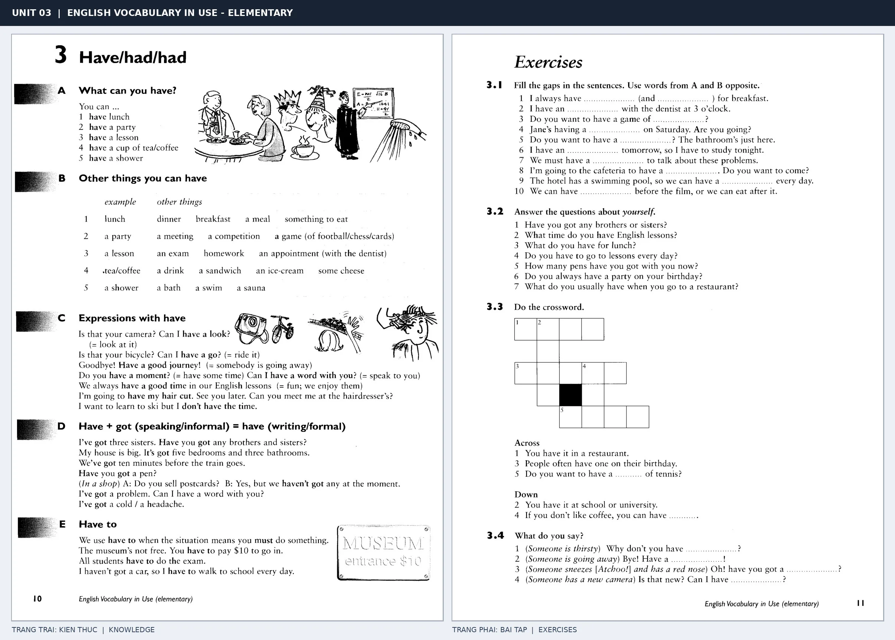

# Unit 03 — Have/had/had: Động từ have và các cụm thông dụng

*Trang trái cung cấp kiến thức và ví dụ; trang phải là phần Exercises của Unit tương ứng. Có thể phóng to ảnh để làm bài tập gốc.*

> **Module 02:** Động từ trong đời sống  
> **Phạm vi:** English Vocabulary in Use — Elementary, Unit 3; trang in 10–11 (PDF trang 13–14).  
> **Hình thức:** Tự học từ vựng A1–A2 · Giảng giải tiếng Việt · Luyện câu và bài tập.

## 1. Tóm tắt và mục tiêu

Have không chỉ có nghĩa sở hữu: trong have breakfast, have a shower, have a party, động từ tạo thành cụm hoạt động. Phân biệt have got mang nghĩa sở hữu với have to diễn đạt sự bắt buộc.

Sau bài này, bạn có thể:

- Giải thích nghĩa và cách sử dụng những từ, cụm từ cốt lõi của chủ đề **động từ have và các cụm thông dụng**.
- Chọn đúng cách diễn đạt trong câu tiếng Anh đơn giản thay vì dịch máy móc từng từ.
- Tự đặt ít nhất ba câu thực tế và hoàn thành phần Exercises ở trang sách bên phải.

## 2. Kiến thức và từ vựng cốt lõi

Đọc kỹ từng mục. Với từ nhiều nghĩa, nghĩa ghi trong bảng được giới hạn ở cách dùng cần cho bài học này.

| Từ/cụm từ tiếng Anh | Nghĩa tiếng Việt |
| --- | --- |
| **have breakfast** | ăn sáng |
| **have lunch** | ăn trưa |
| **have dinner** | ăn tối |
| **have a shower** | tắm vòi sen |
| **have a party** | tổ chức tiệc |
| **have a lesson** | có buổi học |
| **have a good time** | có khoảng thời gian vui vẻ |
| **have a look** | xem qua |
| **have a headache** | bị đau đầu |
| **have got** | có hoặc sở hữu |
| **have to** | phải |
| **had** | đã có hoặc đã dùng |

### 2.1. Ghi nhớ theo nhóm và ngữ cảnh

**Nhóm từ thứ nhất:** have breakfast (ăn sáng), have lunch (ăn trưa), have dinner (ăn tối).

**Nhóm từ thứ hai:** have a lesson (có buổi học), have a good time (có khoảng thời gian vui vẻ), have a look (xem qua).

Hãy ghép từ với tình huống sử dụng thực tế. Khi gặp cụm từ có nhiều thành phần, ưu tiên ghi cả cụm kèm một câu ví dụ trong sổ từ vựng.

### 2.2. Mẫu câu song ngữ

**Ví dụ 1.** We have lunch at twelve.

→ Chúng tôi ăn trưa lúc mười hai giờ.

**Ví dụ 2.** I have to go to class today.

→ Hôm nay tôi phải đến lớp.

Đọc từng câu thành tiếng, che phần dịch tiếng Việt và thử nói lại ý bằng lời của mình. Sau đó thay một chi tiết trong câu để tạo ví dụ mới.

## 3. Luyện tập ứng dụng

**Bài A — Nhớ từ trong ngữ cảnh.** Không nhìn bảng, hãy viết tiếng Anh tương ứng với các ý sau:

1. Ăn sáng: __________
2. Tắm vòi sen: __________
3. Xem qua: __________

**Bài B — Dịch và biến đổi câu.** Dịch hai câu dưới đây sang tiếng Anh trước khi nhìn mẫu câu ở trên:

1. Chúng tôi ăn trưa lúc mười hai giờ.
2. Hôm nay tôi phải đến lớp.

**Bài C — Viết cho bản thân.** Viết ba câu mới về cuộc sống của bạn, mỗi câu sử dụng một từ/cụm từ khác nhau trong bảng. Đọc lại để kiểm tra giới từ, cách chia động từ và trật tự từ.

**Bài D — Thực hành theo sách.** Quan sát phần **Exercises (trang phải)** trong ảnh ghép: giải bài tập trên giấy hoặc một file riêng, sau đó so sánh với các ví dụ ở trang trái. Những bài yêu cầu thông tin cá nhân không nhất thiết có một đáp án cố định.

## 4. Câu hỏi ôn tập trắc nghiệm

*Mỗi câu có một đáp án phù hợp nhất. Hãy tự trả lời trước khi đọc phần giải thích.*

### Câu 1

Bạn muốn diễn đạt **“ăn trưa”** bằng tiếng Anh. Chọn cách nói phù hợp nhất.

A. have breakfast

B. have a lesson

C. have got

D. have lunch

**Đáp án:** D. **Giải thích:** “have lunch” diễn đạt “ăn trưa” trong chủ đề này.

### Câu 2

Cụm từ **“have a lesson”** có nghĩa nào trong bài học?

A. xem qua

B. có buổi học

C. phải

D. bị đau đầu

**Đáp án:** B. **Giải thích:** “have a lesson” được dùng với nghĩa “có buổi học”.

### Câu 3

Khi cần nói **“bị đau đầu”**, chọn từ/cụm từ nào?

A. have to

B. have a look

C. have a headache

D. had

**Đáp án:** C. **Giải thích:** Cách dùng đúng trong bài là “have a headache”.

### Câu 4

Chọn câu tiếng Anh diễn đạt đúng nhất: **“Chúng tôi ăn trưa lúc mười hai giờ.”**

A. We have lunch at twelve.

B. Please bring your guitar to my house.

C. Please come in.

D. She watches TV every evening.

**Đáp án:** A. **Giải thích:** “We have lunch at twelve.” là câu tương ứng với tình huống đã nêu.

### Câu 5

Ý nghĩa phù hợp nhất của câu **“I have to go to class today.”** là gì?

A. Tôi mất ba mươi phút để đến trường.

B. Cô ấy nói tiếng Anh rất tốt.

C. Hôm nay tôi phải đến lớp.

D. Tin xấu khiến tôi buồn.

**Đáp án:** C. **Giải thích:** “I have to go to class today.” có nghĩa là “Hôm nay tôi phải đến lớp.”.

## 5. Tổng kết và kiểm tra hoàn thành

Bài **I have to go to class today.** giúp bạn sử dụng vốn từ về **hôm nay tôi phải đến lớp.** trong câu tiếng Anh thực tế. Giá trị quan trọng nhất không chỉ là biết nghĩa, mà là nhớ **cách kết hợp từ và ngữ cảnh sử dụng**.

- [ ] Tôi đã học bảng từ/cụm từ và đọc thành tiếng các ví dụ.
- [ ] Tôi đã hoàn thành ba phần luyện tập A, B, C.
- [ ] Tôi đã làm trang Exercises trong ảnh ghép và 5 câu trắc nghiệm.
- [ ] Tôi đã ghi các từ dễ nhầm vào sổ để ôn lại sau 1–3 ngày.

---

[← Unit 02: Phương pháp học từ vựng](../01-learner-training/02-learning-vocabulary.md) · [Unit 04: Di chuyển với go →](04-go-went-gone.md)

[↑ Trở về mục lục khóa học](../../MUC_LUC.md)
