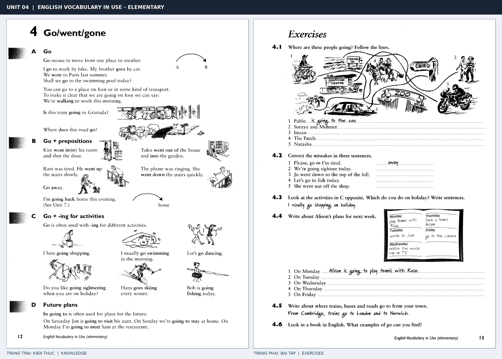

# Unit 04 — Go/went/gone: Di chuyển với go

*Trang trái cung cấp kiến thức và ví dụ; trang phải là phần Exercises của Unit tương ứng. Có thể phóng to ảnh để làm bài tập gốc.*

> **Module 02:** Động từ trong đời sống  
> **Phạm vi:** English Vocabulary in Use — Elementary, Unit 4; trang in 12–13 (PDF trang 15–16).  
> **Hình thức:** Tự học từ vựng A1–A2 · Giảng giải tiếng Việt · Luyện câu và bài tập.

## 1. Tóm tắt và mục tiêu

Go diễn đạt di chuyển hoặc tham gia hoạt động. Dùng go to + địa điểm nhưng go home không có to; dùng go + V-ing cho một số hoạt động giải trí như go swimming.

Sau bài này, bạn có thể:

- Giải thích nghĩa và cách sử dụng những từ, cụm từ cốt lõi của chủ đề **di chuyển với go**.
- Chọn đúng cách diễn đạt trong câu tiếng Anh đơn giản thay vì dịch máy móc từng từ.
- Tự đặt ít nhất ba câu thực tế và hoàn thành phần Exercises ở trang sách bên phải.

## 2. Kiến thức và từ vựng cốt lõi

Đọc kỹ từng mục. Với từ nhiều nghĩa, nghĩa ghi trong bảng được giới hạn ở cách dùng cần cho bài học này.

| Từ/cụm từ tiếng Anh | Nghĩa tiếng Việt |
| --- | --- |
| **go to work** | đi làm |
| **go home** | về nhà |
| **go away** | đi xa |
| **go out** | đi ra ngoài |
| **go in** | đi vào |
| **go shopping** | đi mua sắm |
| **go swimming** | đi bơi |
| **go skiing** | đi trượt tuyết |
| **go sightseeing** | đi tham quan |
| **go by bus** | đi bằng xe buýt |
| **go on foot** | đi bộ |
| **going to** | dự định sẽ |

### 2.1. Ghi nhớ theo nhóm và ngữ cảnh

**Nhóm từ thứ nhất:** go to work (đi làm), go home (về nhà), go away (đi xa).

**Nhóm từ thứ hai:** go shopping (đi mua sắm), go swimming (đi bơi), go skiing (đi trượt tuyết).

Hãy ghép từ với tình huống sử dụng thực tế. Khi gặp cụm từ có nhiều thành phần, ưu tiên ghi cả cụm kèm một câu ví dụ trong sổ từ vựng.

### 2.2. Mẫu câu song ngữ

**Ví dụ 1.** I go to work by bike.

→ Tôi đi làm bằng xe đạp.

**Ví dụ 2.** We are going to stay at home on Sunday.

→ Chủ nhật chúng tôi định ở nhà.

Đọc từng câu thành tiếng, che phần dịch tiếng Việt và thử nói lại ý bằng lời của mình. Sau đó thay một chi tiết trong câu để tạo ví dụ mới.

## 3. Luyện tập ứng dụng

**Bài A — Nhớ từ trong ngữ cảnh.** Không nhìn bảng, hãy viết tiếng Anh tương ứng với các ý sau:

1. Đi làm: __________
2. Đi ra ngoài: __________
3. Đi trượt tuyết: __________

**Bài B — Dịch và biến đổi câu.** Dịch hai câu dưới đây sang tiếng Anh trước khi nhìn mẫu câu ở trên:

1. Tôi đi làm bằng xe đạp.
2. Chủ nhật chúng tôi định ở nhà.

**Bài C — Viết cho bản thân.** Viết ba câu mới về cuộc sống của bạn, mỗi câu sử dụng một từ/cụm từ khác nhau trong bảng. Đọc lại để kiểm tra giới từ, cách chia động từ và trật tự từ.

**Bài D — Thực hành theo sách.** Quan sát phần **Exercises (trang phải)** trong ảnh ghép: giải bài tập trên giấy hoặc một file riêng, sau đó so sánh với các ví dụ ở trang trái. Những bài yêu cầu thông tin cá nhân không nhất thiết có một đáp án cố định.

## 4. Câu hỏi ôn tập trắc nghiệm

*Mỗi câu có một đáp án phù hợp nhất. Hãy tự trả lời trước khi đọc phần giải thích.*

### Câu 1

Bạn muốn diễn đạt **“về nhà”** bằng tiếng Anh. Chọn cách nói phù hợp nhất.

A. go away

B. go swimming

C. go home

D. go skiing

**Đáp án:** C. **Giải thích:** “go home” diễn đạt “về nhà” trong chủ đề này.

### Câu 2

Cụm từ **“go shopping”** có nghĩa nào trong bài học?

A. đi bộ

B. đi vào

C. đi mua sắm

D. đi trượt tuyết

**Đáp án:** C. **Giải thích:** “go shopping” được dùng với nghĩa “đi mua sắm”.

### Câu 3

Khi cần nói **“đi tham quan”**, chọn từ/cụm từ nào?

A. go away

B. go to work

C. go sightseeing

D. go skiing

**Đáp án:** C. **Giải thích:** Cách dùng đúng trong bài là “go sightseeing”.

### Câu 4

Chọn câu tiếng Anh diễn đạt đúng nhất: **“Tôi đi làm bằng xe đạp.”**

A. Do you like tennis?

B. The bad news made me sad.

C. I go to work by bike.

D. Please bring your guitar to my house.

**Đáp án:** C. **Giải thích:** “I go to work by bike.” là câu tương ứng với tình huống đã nêu.

### Câu 5

Ý nghĩa phù hợp nhất của câu **“We are going to stay at home on Sunday.”** là gì?

A. Bạn đi làm bằng cách nào?

B. Chủ nhật chúng tôi định ở nhà.

C. Tôi thường dậy lúc bảy giờ.

D. Máy bay cất cánh lúc giữa trưa.

**Đáp án:** B. **Giải thích:** “We are going to stay at home on Sunday.” có nghĩa là “Chủ nhật chúng tôi định ở nhà.”.

## 5. Tổng kết và kiểm tra hoàn thành

Bài **We are going to stay at home on Sunday.** giúp bạn sử dụng vốn từ về **chủ nhật chúng tôi định ở nhà.** trong câu tiếng Anh thực tế. Giá trị quan trọng nhất không chỉ là biết nghĩa, mà là nhớ **cách kết hợp từ và ngữ cảnh sử dụng**.

- [ ] Tôi đã học bảng từ/cụm từ và đọc thành tiếng các ví dụ.
- [ ] Tôi đã hoàn thành ba phần luyện tập A, B, C.
- [ ] Tôi đã làm trang Exercises trong ảnh ghép và 5 câu trắc nghiệm.
- [ ] Tôi đã ghi các từ dễ nhầm vào sổ để ôn lại sau 1–3 ngày.

---

[← Unit 03: Động từ have và các cụm thông dụng](03-have-had-had.md) · [Unit 05: Do trong câu hỏi và công việc →](05-do-did-done.md)

[↑ Trở về mục lục khóa học](../../MUC_LUC.md)
