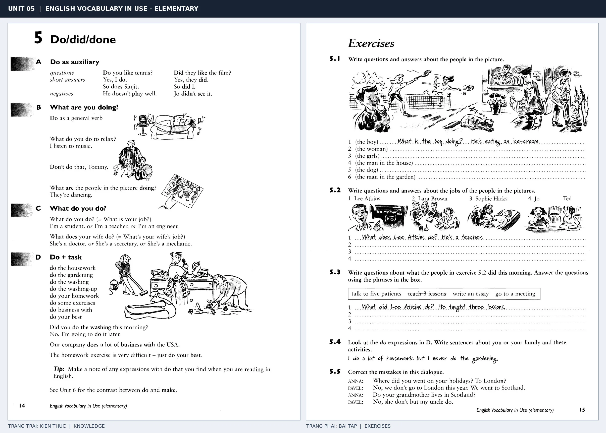

# Unit 05 — Do/did/done: Do trong câu hỏi và công việc

*Trang trái cung cấp kiến thức và ví dụ; trang phải là phần Exercises của Unit tương ứng. Có thể phóng to ảnh để làm bài tập gốc.*

> **Module 02:** Động từ trong đời sống  
> **Phạm vi:** English Vocabulary in Use — Elementary, Unit 5; trang in 14–15 (PDF trang 17–18).  
> **Hình thức:** Tự học từ vựng A1–A2 · Giảng giải tiếng Việt · Luyện câu và bài tập.

## 1. Tóm tắt và mục tiêu

Do có hai vai trò: trợ động từ tạo câu hỏi/phủ định, và động từ chính đi cùng tên công việc hoặc nhiệm vụ. Các cụm như do homework hay do the washing không thay bằng make.

Sau bài này, bạn có thể:

- Giải thích nghĩa và cách sử dụng những từ, cụm từ cốt lõi của chủ đề **do trong câu hỏi và công việc**.
- Chọn đúng cách diễn đạt trong câu tiếng Anh đơn giản thay vì dịch máy móc từng từ.
- Tự đặt ít nhất ba câu thực tế và hoàn thành phần Exercises ở trang sách bên phải.

## 2. Kiến thức và từ vựng cốt lõi

Đọc kỹ từng mục. Với từ nhiều nghĩa, nghĩa ghi trong bảng được giới hạn ở cách dùng cần cho bài học này.

| Từ/cụm từ tiếng Anh | Nghĩa tiếng Việt |
| --- | --- |
| **do homework** | làm bài tập về nhà |
| **do housework** | làm việc nhà |
| **do the washing** | giặt giũ |
| **do the washing-up** | rửa bát |
| **do exercises** | làm bài tập |
| **do business** | kinh doanh |
| **do your best** | cố gắng hết sức |
| **do the gardening** | làm vườn |
| **do a job** | làm công việc |
| **do as auxiliary** | do làm trợ động từ |
| **did** | đã làm |
| **done** | đã được làm |

### 2.1. Ghi nhớ theo nhóm và ngữ cảnh

**Nhóm từ thứ nhất:** do homework (làm bài tập về nhà), do housework (làm việc nhà), do the washing (giặt giũ).

**Nhóm từ thứ hai:** do business (kinh doanh), do your best (cố gắng hết sức), do the gardening (làm vườn).

Hãy ghép từ với tình huống sử dụng thực tế. Khi gặp cụm từ có nhiều thành phần, ưu tiên ghi cả cụm kèm một câu ví dụ trong sổ từ vựng.

### 2.2. Mẫu câu song ngữ

**Ví dụ 1.** Do you like tennis?

→ Bạn có thích quần vợt không?

**Ví dụ 2.** I do my homework every evening.

→ Tôi làm bài tập về nhà mỗi tối.

Đọc từng câu thành tiếng, che phần dịch tiếng Việt và thử nói lại ý bằng lời của mình. Sau đó thay một chi tiết trong câu để tạo ví dụ mới.

## 3. Luyện tập ứng dụng

**Bài A — Nhớ từ trong ngữ cảnh.** Không nhìn bảng, hãy viết tiếng Anh tương ứng với các ý sau:

1. Làm bài tập về nhà: __________
2. Rửa bát: __________
3. Làm vườn: __________

**Bài B — Dịch và biến đổi câu.** Dịch hai câu dưới đây sang tiếng Anh trước khi nhìn mẫu câu ở trên:

1. Bạn có thích quần vợt không?
2. Tôi làm bài tập về nhà mỗi tối.

**Bài C — Viết cho bản thân.** Viết ba câu mới về cuộc sống của bạn, mỗi câu sử dụng một từ/cụm từ khác nhau trong bảng. Đọc lại để kiểm tra giới từ, cách chia động từ và trật tự từ.

**Bài D — Thực hành theo sách.** Quan sát phần **Exercises (trang phải)** trong ảnh ghép: giải bài tập trên giấy hoặc một file riêng, sau đó so sánh với các ví dụ ở trang trái. Những bài yêu cầu thông tin cá nhân không nhất thiết có một đáp án cố định.

## 4. Câu hỏi ôn tập trắc nghiệm

*Mỗi câu có một đáp án phù hợp nhất. Hãy tự trả lời trước khi đọc phần giải thích.*

### Câu 1

Bạn muốn diễn đạt **“làm việc nhà”** bằng tiếng Anh. Chọn cách nói phù hợp nhất.

A. do housework

B. do the gardening

C. do homework

D. do the washing

**Đáp án:** A. **Giải thích:** “do housework” diễn đạt “làm việc nhà” trong chủ đề này.

### Câu 2

Cụm từ **“do business”** có nghĩa nào trong bài học?

A. do làm trợ động từ

B. đã làm

C. giặt giũ

D. kinh doanh

**Đáp án:** D. **Giải thích:** “do business” được dùng với nghĩa “kinh doanh”.

### Câu 3

Khi cần nói **“làm công việc”**, chọn từ/cụm từ nào?

A. do the washing

B. do the washing-up

C. do a job

D. do your best

**Đáp án:** C. **Giải thích:** Cách dùng đúng trong bài là “do a job”.

### Câu 4

Chọn câu tiếng Anh diễn đạt đúng nhất: **“Bạn có thích quần vợt không?”**

A. The train arrived on time.

B. I usually get up at seven.

C. Do you like tennis?

D. I have to go to class today.

**Đáp án:** C. **Giải thích:** “Do you like tennis?” là câu tương ứng với tình huống đã nêu.

### Câu 5

Ý nghĩa phù hợp nhất của câu **“I do my homework every evening.”** là gì?

A. Tôi làm bài tập về nhà mỗi tối.

B. Trời đang tối dần.

C. Cô ấy đã quay lại hôm qua.

D. Mang theo ô vì trời đang mưa.

**Đáp án:** A. **Giải thích:** “I do my homework every evening.” có nghĩa là “Tôi làm bài tập về nhà mỗi tối.”.

## 5. Tổng kết và kiểm tra hoàn thành

Bài **I do my homework every evening.** giúp bạn sử dụng vốn từ về **tôi làm bài tập về nhà mỗi tối.** trong câu tiếng Anh thực tế. Giá trị quan trọng nhất không chỉ là biết nghĩa, mà là nhớ **cách kết hợp từ và ngữ cảnh sử dụng**.

- [ ] Tôi đã học bảng từ/cụm từ và đọc thành tiếng các ví dụ.
- [ ] Tôi đã hoàn thành ba phần luyện tập A, B, C.
- [ ] Tôi đã làm trang Exercises trong ảnh ghép và 5 câu trắc nghiệm.
- [ ] Tôi đã ghi các từ dễ nhầm vào sổ để ôn lại sau 1–3 ngày.

---

[← Unit 04: Di chuyển với go](04-go-went-gone.md) · [Unit 06: Make và sự tạo ra →](06-make-made-made.md)

[↑ Trở về mục lục khóa học](../../MUC_LUC.md)
